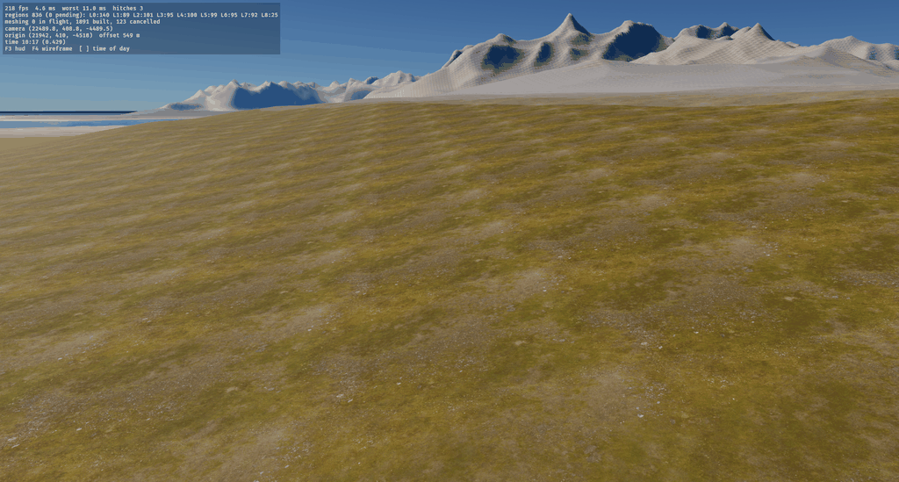
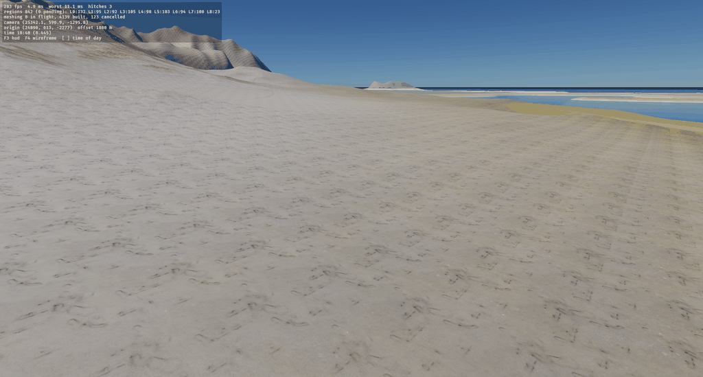
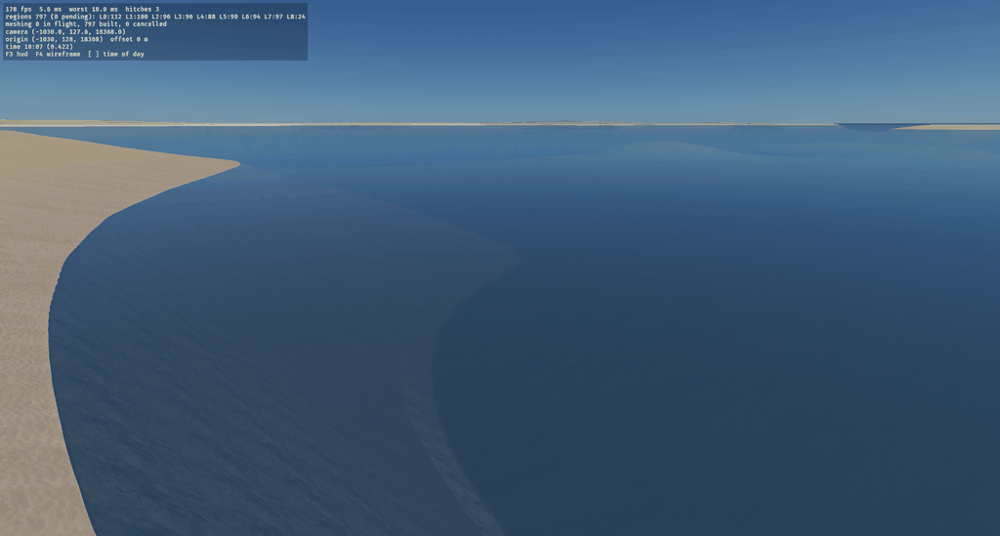

# Veyra

Veyra is a game, and `strata` the engine under it, on Bevy 0.19, for a
sci-fi MMO-like RPG, built as a workspace of layered crates with a thin
game on top. This repository holds the
vertical slice and the first served world: a window on a seeded,
procedural, seamless world tens of kilometres across, with distinct
biomes and a draw distance to the horizon; a character walking on a
physics ground with a third-person camera and a pause menu over it; and a
dedicated server that any number of those clients join, each seeing the
others walk. It sits on the boundaries the MMO needs later: the world is
a pure function of the seed, the simulation ticks on a fixed step, the
server owns it, and the client is a renderer over it that predicts its
own character.

## Play in the browser

**[Play Veyra](https://jedimemo.github.io/veyra/)** in a browser with WebGPU
(a current Chrome or Edge on a desktop). The page fetches about 120 MB before it
starts, then bakes the world's rivers for a minute or two on one thread; the
city streams in after that. Click the picture to take the mouse and Escape to
free it; F1 shows the controls. The household is
saved in the browser's own storage (`localStorage`), so it is there on the next
visit from the same browser. The page takes the game's options from its
address: `?fresh` starts a new household (the saved one is replaced on the
first change), `?at=city` starts on Port Serein's street, `?seed=7` another
world. `just web` builds the same page into `dist/` after `just content`; serve
it with any static server, for example `python3 -m http.server -d dist`.

*These three captures show seed 42's ground before ticket 0004 brought the
ranges near (2026-09-29); they have not been taken again.*







## The first world slice

Local play starts with a combat encounter beside Port Serein. Its road also
offers a route in from the wilderness. The city has dark stepped
towers from ashlar's city kit, a ring of Veyra outposts and habitats, and
forests, understory, rocks and cliffs on the way. Everything the world wears
is generated: materials, trees, rocks and the city are baked by the content
step into `generated/`, which the game and the server read.

```
just content                               bake everything into generated/ (a few minutes cold)
just run -- --at road                      start at the far end of the road
just run -- --at city                      start on the city's street
just run -- --route --frames 20000         walk the route: road, city, lobby, and back out
just run-server --at city                  a server that puts new players on the street
just run-client                            join it
```

`docs/WORLD_SLICE_PLAN.md` records how the slice was built, phase by phase,
with its measurements in `docs/perf/ledger.md`.

## Running it

The dev loop is a `justfile`; `just --list` shows every recipe. A release
build is the one to play (`cargo run --release -p game`); a dev build
renders at a fraction of the frame rate.

```
just run                      local blaster and melee combat beside the city
just run --no-combat           the original walking controller
just run -- --seed 7          another world
just run -- --spawn 50000,50000 --look 1.2
just run -- --flycam          the free camera instead of the character
just run -- --flight --flight-heading -2.2 --flight-secs 60
just run -- --auto-walk --frames 900 --screenshot walk-{frame}.png --shot-frames 300,900
just run -- --open-pause --frames 400 --screenshot pause.png
just run-headless             local simulation with no window
just worldmap -- --seed 42    biome, height, moisture, hydration, cover, fog, shade, geology and view maps of a seed to PNG
just ci                       fmt-check, clippy, tests, server-check
just web                      the browser build into dist/ (after just content)
```

### Weapon assembly

`just weapon-workbench` opens the standalone Rust assembly studio on Vigil's
dark military line. Fit 41 components across 12 procedural weapons, try 24 named
builds, compare against stock, change finishes, and inspect or explode the
assembly. Save/load uses RON; export produces OBJ geometry, PBR textures and
reusable Ashlar recipes and material graphs. See the
[workbench guide](tools/weapon-workbench/README.md) for controls, presets and
offscreen gallery generation.

### Rendering studies

Press **F6** for live presets, lighting, mist and lens controls. Exported
looks reload automatically on startup. With no saved look, Baseline is the
default; compare it against Clear Contrast, Sunlit Mist and Cinematic Woodland. The baseline switch holds your edits, Reset restores
the selected preset, and Export RON writes `render-look.ron` beside the
normal settings file. Export again to persist further edits. Explicit
`--render-look` or `--render-look-file` overrides the saved look; use
`--render-look baseline` to bypass it. An unreadable or invalid saved file
logs a warning and falls back to Baseline. Escape closes the panel; the
world keeps running.

```sh
cargo run --release -p game -- --study-scene woodland --render-look sunlit-mist --visual-time .32
cargo run --release -p game -- --render-look-file /path/to/render-look.ron
# Export a preset with explicit CLI overrides, without opening a window:
target/release/game --render-look cinematic-woodland --ev100 14.5 --export-render-look /tmp/look.ron
# Matched captures, logs, exact RON settings and timing summaries:
python3 tools/render-study.py --output /tmp/render-study --fullscreen --times .32
```

Study scenes (`woodland`, `grove`, `valley`, `coast`) require seed 42 and
standalone play. Mist stays at that site. `--visual-time` freezes only the
rendered sun; the HUD still reports simulation time. `--aa auto` follows
the look, while explicit `msaa4`, `taa` or `off` overrides it. SSAO is
inactive under MSAA. Fullscreen uses the primary monitor's native size;
the capture script checks it matches `--window` (default 2560x1440).

See the [visual comparisons and measured costs](docs/research/render-look-study.md)
for the current recommendation and known limitations.

### A server and its clients

```
just run-server                             the dedicated server on UDP 5000, seed 42
just run-server -- --port 5001 --seed 7
just run-client                             a client of 127.0.0.1:5000
just run-client -- --connect 10.0.0.2:5000 --seed 7
```

The server is `apps/server`: the simulation, the streamer and the physics
for every connected player, no window, no renderer. It logs a status line
every two seconds (tick, each client's player position, grounded flag,
round trip and interest size, regions and colliders loaded around them);
`--tick-log` adds a line per simulation tick and `--frames N` exits after
N frames for a smoke run. A client is the same `game` binary with
`--connect host:port`: the server spawns its player and it renders and
predicts it; `--seed` must match the server's (a mismatch is logged, and
the ground would not match). Start as many clients as you like; each
sees the others as a warmer-tinted capsule once they are within about
1.3 km. `--auto-walk` works on a connected client too. The debug HUD's
network line shows the role, the round trip, the players in sight and
the number of prediction corrections.

### Controls

Local combat (the default): `W A S D` move, `Space` jumps, `Shift` sprints,
and the mouse looks. Left mouse fires a blaster, right mouse aims, `R`
reloads, `E` cuts, `Q` performs a heavy strike, and left `Alt` or `Ctrl`
dodges. `F5` resets the encounter. Approach or damage a hostile to engage;
the passive target is available for practice. See the
[combat guide and measured timing curves](docs/design/combat/README.md).
Combat uses levelled Forge sound takes with spatial enemy cues and contact-timed footsteps; [provenance and loudness](docs/design/combat/ASSETS.md#sound-library-2026-10-01).

With `--no-combat` or `--connect`, walking retains the original controls:
`W A S D` move relative to the camera, `Space` jumps, `Shift` sprints,
right mouse orbits the camera, and scrolling changes its distance (2 to 20 m).
Below sea level the character swims at half speed, a metre under the
surface.

With `--flycam` or `--flight`: `W A S D` move, `Q`/`E` or `Ctrl`/`Space`
down and up, right mouse button to look, `Shift` for eight times the
speed, scroll to change the base speed.

Always: `Escape` opens the pause menu (Resume, Settings, Quit; the world
keeps running underneath, this is an MMO), `F3` toggles the debug
statistics (frame rate, worst frame, loaded regions by LOD, meshing
tasks, player and render origin, time of day, the network line), `F4`
toggles wireframe, `[` and `]` scrub the time of day. The settings
screen's values (field of view, HUD, mouse sensitivity) persist in
`~/.config/sci-fi-scrolls/settings.ron` (the platform's configuration
directory).

### Flags

`game`: `--seed`, `--headless`, `--connect host:port`, `--no-combat`,
`--combat-script`, `--combat-trace path.csv`, `--frames N`,
`--screenshot PATH` (`{frame}` in the name is replaced by the frame
number), `--shot-frames a,b,c`, `--spawn x,z`, `--look yaw`, `--flycam`,
`--flight`, `--flight-secs`, `--flight-heading`, `--auto-walk`,
`--open-pause`, `--time F` (0.25 sunrise, 0.5 noon), `--ev100`, `--haze`,
`--no-shadows`, `--fog F` (the valley fog's density, `0` for no fog pass
at all), `--weather fog,sea_fog` (pins the fog's weather, each 0 to 1,
default `1,0.5`), `--fog-steps N` (its raymarch steps, default 12),
`--no-foliage`, `--wind F`, `--aa msaa4|off|taa` (the valley fog needs
`taa` or `off`), `--assets DIR`, `--window WxH`.

`server`: `--seed`, `--port`, `--tick-log`, `--frames N`, `--assets DIR`.

Foliage keeps persistent 64 m cells as terrain changes LOD. Grass uses patches
and tufts with species-controlled blade shapes; far trees use baked views of
their procedural variants. F3 shows real frame-time percentiles. The foliage
log includes placement, collection, deferred entity application and upload costs.
See [foliage validation and budgets](docs/research/foliage-improvements.md).

## Layout

```
crates/strata-core        no Bevy: WorldPos (f64), RegionCoord, seeds, RNG, sim time
crates/strata-registry    no Bevy: biome, terrain material, flora, settlement and geology registries on slotted-registry
crates/strata-worldgen    no Bevy: continents, climate, biomes, geological provinces, relief; the WorldSource port
crates/strata-flora       no Bevy: vegetation placed per 64 m cell from the seed and the species registry
crates/strata-weather     no Bevy: where fog lies, basins baked per 8 km tile and sampled under a weather
crates/strata-sim         bevy_ecs/app/math/state/time/transform/tasks: fixed-tick sim, f64 positions, render origin, world loader
crates/strata-stream      no renderer: quadtree selection, wanted/loaded regions, budgets
crates/strata-physics     no renderer: avian3d stepped in the sim tick, a heightfield collider per region, the character controller
crates/strata-terrain     bevy_render: async heightfield meshing, LOD morph, splat material, the sea
crates/strata-atmosphere  bevy_render: sky, sun, shadows, day cycle bound to sim time, the valley fog pass
crates/strata-client      cameras, input, scripted flight, the player capsules, the slotted UI and HUD
crates/strata-net         the network port: NetRole, Replicated, NetStatus, Transport
crates/strata-net-replicon  no renderer: the bevy_replicon adapter, renet over UDP, interest by region, prediction
crates/strata             facade: StrataPlugins::{headless, client}, prelude, feature flags
apps/game                  the slice binary: a window, --headless, --connect
apps/server                the dedicated server: the headless facade served over UDP
apps/worldmap              the worldgen dev loop: a seed to PNG
tools/xtask                dev commands (shrinking screenshots for the docs)
assets/                    biomes/*.biome.ron, geology/*.geology.ron, flora/*.flora.ron, terrain/materials.ron, shaders/, themes/, fonts/
```

The rule that holds it together: an arrow never points from a lower crate
to a higher one. Crates below `strata-sim` have no Bevy at all;
`strata-sim`, `strata-stream`, `strata-physics` and
`strata-net-replicon` use `bevy_ecs`, `bevy_app` and `bevy_math` (plus
state, time, transforms and the task pool) and never a renderer; only the
crates above them see `bevy_render`. `just server-check` asserts that the
headless plugin group's dependency graph contains no render, window or UI
crate, that the server binary's does not either, and CI runs it.

Positions below the render layer are `f64` `WorldPos`; a `Transform` is
derived from one through the movable `RenderOrigin`, never the other way.

## Documents

`just building-references` generates a [headless reference gallery](docs/research/building-references/README.md)
of every building style in roughly three seconds after compilation.

[Buildings](docs/BUILDING_RECIPES.md) cover the game's own architecture and its
grounding fixture; the authoring system itself is
[ashlar](../../bevy-crates/ashlar), a standalone workspace. [Terrain integration](docs/research/building-grounding/README.md)
covers foundations, access ramps, collision and vegetation clearance.
[Corporate building mockups](docs/research/building-corporate/README.md) show a
second reusable kit, with tower, annex and courtyard variants.

[The setting](docs/SETTING.md) introduces Veyra, an inhabited frontier planet
still being terraformed, and the player's arrival in the Serein Basin. It defines
the world's atmosphere, institutions, and the first playable journey the engine
will build toward.

`docs/PLAN.md` is the architecture and the phase plan, with what each
phase measured. `docs/adr/` holds the decisions: crate layering and
authority, `f64` world coordinates with a render origin, the chunked
quadtree heightfield with async meshing, and replication through an
adapter with interest on the region grid and prediction corrected
against exact acks.
`CLAUDE.md` is the working guide for the repository's conventions.

Every texture the world wears is generated: `just content` bakes the
materials, the trees and their impostors into `generated/`. The UI theme and its two OFL fonts are copied from the
`bevy-slotted` workspace; `assets/README.md` says from where.

## Licence

The code is MIT or Apache-2.0, at your option (`LICENSE-MIT`,
`LICENSE-APACHE`). The two fonts keep the SIL Open Font License beside them in
`assets/fonts/`.
