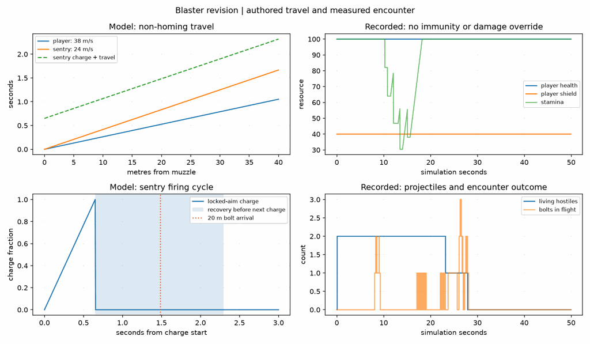
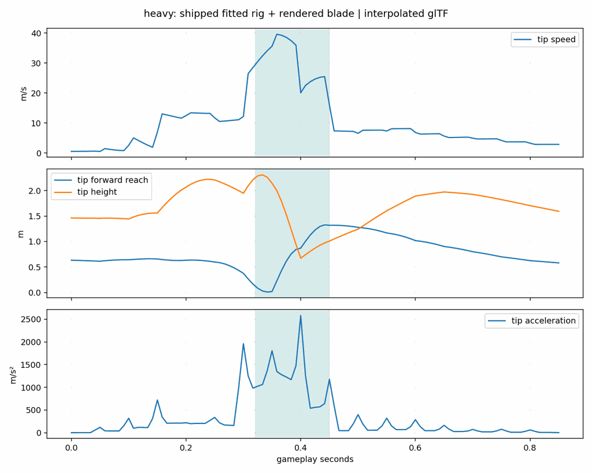
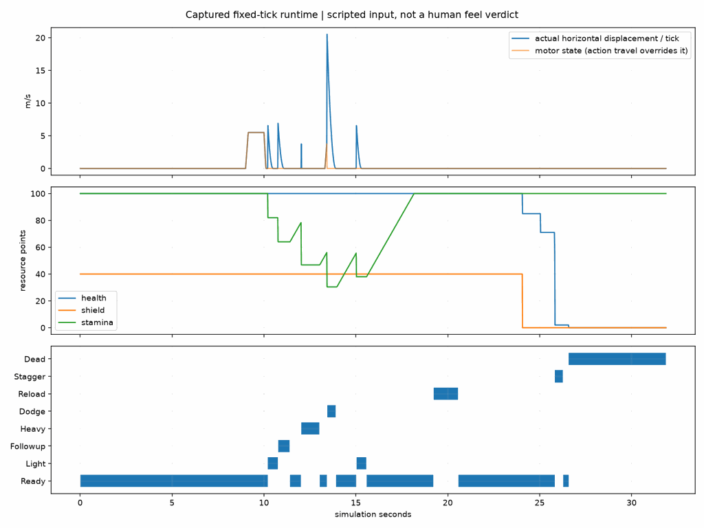

# Combat study results, 2026-10-01

A standalone playable slice now joins a responsive camera-relative motor,
mobile carbine fire, shield/health/stamina/posture rules, a two-attack blade
chain, a heavier strike, collision-constrained dodging, and two enemy roles.
The character is a new fitted Forge body with eight bundled animation clips.
The work preserves the project's simulation/physics/render boundaries and
does not change terrain generation or the replication protocol.

The user played the first pass and reported good movement, excessive enemy
tracking and damage, an inverted rifle, and a spawn too far from the city. The
blaster revision below responds to that feedback. Input-to-photon latency has
not been measured, and numerical curves cannot establish subjective feel.

## Weapons, muzzle and hit reactions, 2026-10-01 evening

**Bolts leave the barrel.** The sim fires from a fixed gameplay muzzle 0.45 m
in front of and 0.2 m right of the shoulder, which is not where the animated
rifle's barrel is. The view now carries a `Muzzle` marker at the tip of each
held weapon (rifle 0.57 m along its barrel, pistol 0.30 m), spawns the flash
there, and starts the bolt there: the difference between the barrel and the
gameplay muzzle is faded out quadratically over the first 6 m of flight, so
the bolt visibly leaves the gun and still arrives exactly where the sim's
path does. No sim, physics or protocol change; a bolt's authoritative path is
untouched.

**Hit reactions are a spring, not a flinch.** A hit kicks a damped spring on
the victim (stiffness 400, damping 20: about three cycles a second at half
critical damping) with a pitch impulse from the frontal component of the
incoming direction and a roll impulse from the lateral one; a shot kicks at
2.8 rad/s, a shield absorption at 1.6, a blade at 5.5. The spine chain
carries the offset by shares (Spine1 0.30, Spine2 0.35, Spine3 0.20, Neck
0.25, Head 0.35), so the body leans back from a frontal shot, rolls away
from a side hit, overshoots once and settles, and the head whips more than
the back under it. The aim pitch is distributed over the same chain instead
of hinging at Spine2. A unit test holds the lean-back peak between 0.05 and
0.3 rad, the overshoot, the settle inside two seconds, and the roll sign.

**Two weapons.** `Weapon::{Carbine, Pistol}` with a `WeaponSpec` each:

| Weapon | Interval | Bolt | Damage / posture | Magazine | Reload |
| --- | ---: | ---: | ---: | ---: | ---: |
| Carbine | 240 ms | 38 m/s | 24 / 18 | 24 | 1.35 s |
| Pistol | 150 ms | 46 m/s | 15 / 9 | 12 | 0.9 s |

Keys 1 and 2 request a draw; `Action::Swap` takes 0.45 s with no fire, the
request is held rather than buffered (it waits through a reload or a cut),
and each weapon keeps its own magazine across the swap. Physics takes damage
and posture from the attacker's weapon; the AI sentry keeps its own bolt
speed. The view hides the holstered weapon, shows the drawn one from the
swap's second part, dips the torso through the swap, and drops the left arm
from the fore-grip while the pistol is up. The pistol is a blocky primitive
sidearm in the rifle's frame until a prop is lifted. The scripted run draws
the pistol at 14.8 s (after its 14.2 s reload) and the carbine again at
17.2 s; `cargo test -p strata-sim` covers the magazines, the cadence and the
no-op draw. [Pistol burst and the bolt leaving it](weapons-v1.png).

**Feet on the ground.** The capsule stands on one point, so across a slope
one foot floated and the other sank. `strata-client`'s `combat_ik` casts a
ray under each animated foot (actors excluded), clamps the ground offset to
0.35 m, drops the pelvis to the lower foot, and solves each leg as two bones
in render space: the thigh turns toward the target, the knee keeps the
clip's bend plane, bone lengths hold, and the sole tilts onto the ground
normal up to 0.5 rad. It runs after the animation and the pose overlays from
the current frame's local transforms, so it never lags the body, and it
smooths the offsets with a 60 ms time constant so region seams do not pop
the feet. Airborne, dodging and dead bodies keep the clip. Unit tests hold
the reach, the knee side and the straight-leg limit;
[before and after across the slope](foot-ik-v1.png).

## Sound library completion

Forge library **0.1.2** ships **58 levelled takes for 24 events**, with the same
bytes under `assets/audio/combat/`. The five placeholder WAVs are removed.
`tools/combat_audio.py` reproduces the set from retained raw Forge renders and
their unmodified generator receipts, with silence trimming, measured gain,
peak limiting and 5 ms endpoint fades. All files are 48 kHz mono 16-bit PCM.
The [per-event loudness table and provenance](ASSETS.md#sound-library-2026-10-01)
include EBU R128 and Forge readings, rendering/licence facts and both silent
backend rejects. Every take is within 0.2 LU of its target; the highest true
peak is -2.41 dBTP. Forge reports no defects or warnings.

The single supplied `low_health` take is retained as requested. **An event
marked as a loop needs one take; every one-shot event needs at least two.**
The asset test enforces that rule, validates every WAV and decodes every sample
through Bevy. The derived second low-health variant has been removed from the
recipe, shipped assets and Forge library.

Player shots, blade actions, dodge, reload, footsteps, jump/landing, hurt and UI
feedback are non-spatial. Enemy shots, charge/windup, death and all impacts are
spatial relative to the camera and survive origin rebasing. One-shots select
random takes without immediate repeats, with per-event gain and small pitch
variation; master-volume changes also update active sounds. Sentry warnings
start with the 650 ms charge and stop at launch, interruption or death.
The low-health loop runs below 25% HP and stops on recovery, death or removal;
shield recharge sounds once when recovery starts or resumes after damage.
See [the cue map](ASSETS.md#playback-cues) for every trigger.

Footsteps cross the run clip's audited 0.15 s and 0.55 s contacts on its 0.8 s
loop, sharing the renderer's locomotion phase in both directions. Terrain
material selects the footstep; the fallback is stone inside city sites and
gravel outside. Scenery impacts currently carry no material and fall back to
stone. Metal impact and footstep takes are ready, but current cues and terrain
do not expose a metal surface.

`forge verify` passes 139 checks and the regenerated manifest matches.
`cargo fmt --all` and its final check pass; targeted client/game clippy with
warnings fatal and tests pass (25 game, 32 client unit and 5 client integration
tests). Other agents' settlement edits were left alone. The 600-frame headless combat
smoke test exits without warnings, including missing-asset or audio-decode
warnings. Headless mode does not install client audio, so actual WAV decoding
is covered by the separate device-free unit test. No new audio was generated,
no window was opened, and no sim, physics, protocol, body or clip files were
edited. Whole-workspace tests and `just ci` were not run, as requested.
Subjective listening, loop rhythm and in-game spatial balance remain for an
external session with audio output.

## Body closure validation

The body closure replacement is shipped in Forge library 0.1.1: seed 42 at
the 512 grid, 25,978 skinned glTF vertices, 24,509 triangles and 55 bones.
The external fit, first-sample hip gate and pre-export checks passed. CPU
`forge verify` passes all 23 checks; audit reproduces all nine clips, root
tracks and footsteps, verifies their poses and body conformance; the manifest
matches. Each of the nine clips binds 27 driven bones with no orphaned curves.
The runtime bundle keeps run/aim/fire/light/followup/heavy/dodge/death at motion
scale 1.0. Bundle and curve hashes match their receipts, clip durations match
the action specs, and all three regenerated peaks remain inside contact.

`cargo check -p game` and `cargo test -p strata-sim -p strata-physics` pass:
35 sim tests and 24 physics tests, including the regenerated blade paths,
same-tick chaining and cover checks. No workspace tests, `just ci`, game run,
generation, skinning or rendering were attempted in this CPU-only shipping
pass. The accepted raw-lift [views](body-v3-views.png) and
[close-ups](body-v3-closeups.png) were produced externally; in-game rear and
above-behind screenshots, animated deformation and weapon placement on the
new body remain for the external display session. Earlier runtime traces and
game captures below predate this replacement. See [ASSETS](ASSETS.md#body)
for candidate decisions, fit warnings and the unchanged licence restriction.

## Melee pacing revision

The user played and accepted HEAD, then asked for faster melee and clearer
energy fire. The simulation, clip retiming, bundle and collision paths now
agree on the following authored timings. Trims and contact source poses are
preserved; only the derived clips were baked. The Forge body, rig, references,
replication protocol and sounds were not edited by this revision.

| Attack | Before contact / total | After contact / total | Before peak | After evaluated peak (v3 body) |
| --- | --- | --- | --- | --- |
| Light thrust | 180–280 / 540 ms | 130–220 / 400 ms | 22.76 m/s at 208 ms | 24.33 m/s at 158 ms |
| Follow-up chop | 220–330 / 640 ms | 120–220 / 400 ms | 43.48 m/s at 233 ms | 49.13 m/s at 142 ms |
| Heavy chop | 420–550 / 1,000 ms | 320–450 / 850 ms | 39.75 m/s at 458 ms | 39.58 m/s at 358 ms |

A contact-buffered light now starts its follow-up on the final contact tick,
after physics consumes the entire outgoing sweep. Previously it waited for
the full 540 ms duration, and a press early in contact could expire from the
150 ms buffer. The new handover preserves damage identity and respects a
stagger, death, missing stamina and menu clearing. A 35 ms pose blend retains
the outgoing thrust instead of passing through the guard pose. Heavy recovery
still occupies 400 ms and its dodge cancel opens at 690 ms. Lights can dodge
at 310 ms.

Lunges changed from 0.65 / 0.80 / 1.00 m to 0.50 / 0.60 / 0.85 m. This avoids
turning shorter windups into excessive body acceleration; the blade supplies
the speed. The integrated cubic curve and capsule sweep remain unchanged.
Light hit-stop changed from 45 to 24 ms, heavy from 45 to 36 ms, with a
140 ms upper-body flinch and a contact flash on victims. These are local
presentation envelopes and do not delay authoritative contact or chaining.

Forge samples the derived clip at 20 Hz, so both light clips now use exactly
400 ms and heavy 850 ms. The light recovery includes the extra source:gameplay
knot `0.65:0.35`; without it, the compressed retraction briefly exceeded the
contact speed. All final evaluated speed peaks lie inside contact. The
recipe, bundle receipt, `melee.ron`, plots and measurements were regenerated.
The bundle receipt identifies the body actually used. The subsequent v3 body
replacement regenerated the curves against the seed-42 512-grid fit. The table
now reports that body's evaluated peaks: 24.33 / 49.13 / 39.58 m/s, previously
24.41 / 49.31 / 39.75 m/s. Peak times and contact windows are unchanged; none
moved outside contact. The existing runtime traces predate this body replacement.

The new scripted press at 5.38 s falls inside the thrust's contact window.
The 1,800-frame headless capture contains 1,795 fixed ticks: light transitions
directly to follow-up at 10.500 simulation seconds, with no Ready tick between
them. Both hostiles are defeated by the end; the player fires 27 times and
receives no hits. This is deterministic simulation evidence, not visual or
human feel validation. [Pacing trace](curves/pacing-runtime.csv),
[pacing plot](curves/pacing-runtime.png). Runtime analysis now names outputs
from the trace stem, preserving the initial study's `runtime.json/png`.

### Energy fire presentation

`strata-client` now draws a bright elongated emissive core with two crossed,
soft additive glow sheets. Cyan identifies player bolts; orange identifies
sentry bolts. World-space trail segments sample actual previous positions at
25 ms intervals and fade over 100 ms, continuing briefly after impact. Four
shadow-free travelling bolt lights at most illuminate a 2.5 m radius; adding
a fifth removes the oldest light while retaining its bolt geometry. Muzzle
flashes last three rendered frames, with at most two 3 m muzzle lights.

Impacts have a surface-oriented flash and six short-lived directional sparks.
The view queries the hit normal locally. Scenery is amber, flesh a smaller
warm flash, and shield absorption produces a larger blue flash, a translucent
victim-following shield tint and an expanding 240 ms ripple. All effects use
shared meshes and a fixed palette of fade materials; no per-frame material
allocations, new dependencies or simulation-side FX state are required.

### Validation and capture limit

The release build and the 1,800-frame headless encounter completed.
`cargo fmt --all`, `cargo clippy -p strata-sim -p strata-physics -p
strata-client -p game --all-targets -- -D warnings`, and the tests of those
four crates passed. The final suite has 114 passing tests: sim 35, physics 24,
client 30 and game 25, including integration tests. New coverage checks the
complete outgoing contact sweep and same-tick chain at 30/60/120 Hz, actual
collider hits across a chain, stamina/stagger rejection, both light budgets,
three-frame muzzle lights, world-space trail rebasing/expiry, and shield/flesh
reactions. Bundle and curve hashes match the measurement receipt and all three
clip durations match their action specs. Diff whitespace checks pass.
The full workspace tests and `just ci` were deliberately not run, as requested
while the concurrent body agent uses this machine.

The requested Xvfb captures failed before the first rendered frame. This
session rejects X socket binds with `Operation not permitted`, Xvfb reports
that it cannot establish listening sockets, and Bevy exits with
`XOpenDisplayFailed`. No GPU device is exposed in this execution environment
either. The offscreen fallback therefore cannot supply the requested hardware
verification. No energy-fire screenshots were produced to inspect or link as evidence.
Expected paths are `bolts-v2-550.png`, `bolts-v2-1600.png`,
`bolts-v2-night-550.png` and `bolts-v2-night-1600.png`; the repeatable commands
are in [README](README.md#energy-fire-capture).

| Same scripted rendering run | HEAD | Revision |
| --- | --- | --- |
| Measured rendering FPS | unavailable, display startup failed | unavailable, display startup failed |
| GPU / render work | no frames rendered | no frames rendered |

A performance-cost claim remains unverified. In addition, `--combat-script`
uses a manual 60 Hz clock: the game's ordinary FPS line would report a nominal
60 for both versions, not wall-clock throughput. A successful comparison must
also use log timestamps/wall duration and CPU/GPU work timings, on the same
body and rendering environment. The regression tests enforce light caps and
lifetime cleanup, but do not establish visual readability or GPU cost.

## Blaster revision

Local runs now start combat automatically, including `just run` and
`cargo run -p game`. `--no-combat` retains the original local controller;
connected play and diagnostic movement modes keep their existing behavior.
The player spawns at approximately (-671, 54, -248), about 370 m from the
city's centre and 47 m beyond its western building bounds. The previous open
field was about 1.4 km from the centre. Enemy staging waits for streamed
colliders and checks sight lines so a rise cannot hide an initial opponent.

The blaster revision retained the first pass movement, dodge and blade timing;
the melee pacing revision above supersedes the blade timings.
The rifle mount is rotated upright about its barrel axis. The blaster releases
one bolt every 240 ms, at 38 m/s and 24 damage; its pulse, sound and recoil
happen immediately, while impact and hit confirmation wait for contact.

The sentry captures aim before a visible 650 ms charge, launches a non-homing
24 m/s bolt for 12 damage, and recovers for 1.65 s before charging again. The
rusher moves at 3.1 m/s, deals 27.5 heavy damage and starts attacks no more
often than every 2.6 s. Each hostile has 85 health and a 20-point shield cap.
They wait for proximity or damage to a hostile; the passive target does not
start combat. F5 also clears outstanding projectiles.

`curves/blaster-runtime.csv` records this revision, including remaining
hostiles, enemy shots and bolts in flight. `tools/combat_projectiles.py`
compares the authored travel equations with recorded resources and encounter
outcome. Unlike the initial demonstration, the revised script fights the
hostiles after its moveset study with ordinary movement, aiming and reloads.
It receives no immunity or damage bonus.

The final capture contains 2,997 fixed ticks at a median 16.667 ms step. Both
hostiles were defeated at 27.916667 simulation seconds, following a 22-second
moveset demonstration. The player fired 27 bolts in total, including practice;
the sentry fired twice. Strafing avoided both incoming bolts, leaving 100
health and 40 shield. The script deliberately stopped firing for three seconds
during the live encounter to leave room for incoming attacks. This is a
repeatable successful tactic, not a difficulty estimate for a human player.

An ordinary `just run` launch, without either combat flag, also stayed alive
and idle for 22 seconds with both hostiles waiting. The city streaming census
reported 47 m from its edge. [Default start](default-run.png),
[blaster exchange](blaster-pose-1600.png), [cleared encounter](blaster-final-2700.png).

The final pose review also corrected the upper body's compensation for the
hip turn during strafing. For hip rotation H and strafe turn T, the spine now
receives H^-1 T^-1 H, keeping (T H)(H^-1 T^-1 H) S = H S. A unit test verifies
that this preserves torso orientation for a tilted hip basis.

## Accepted HEAD validation

`just ci` completed successfully, including workspace tests and the headless
server dependency audit. After the last staging and presentation changes, the
final game suite passed 25 tests, the client suite passed 21, workspace clippy
passed with warnings fatal, and formatting and diff whitespace checks passed.
The projectile regressions verify delayed arrival, a strafe escaping a fixed
trajectory, expiry, cover and thin-cover obstruction, and dodge immunity at
arrival. AI regressions verify the locked aim and safe idle spawn.

An earlier attempt hit a native crash in the terrain headless test; the full
rerun passed, with no terrain changes made here. The existing initial-pass
weather failure described below also no longer fails in the current suite.

Both the ordinary launch and scripted rendered encounter completed without
combat schedule panics or asset-load failures. The recorded manual-clock
encounter is not a rendering performance benchmark. Terrain streaming still
causes startup hitches in an ordinary development build.

## What the curves changed

| Attack | Authored contact window | Evaluated tip-speed peak | Peak time | Tip forward reach during contact |
| --- | --- | --- | --- | --- |
| Light thrust | 130–220 ms | 24.33 m/s | 158 ms | 0.88–1.56 m |
| Follow-up chop | 120–220 ms | 49.13 m/s | 142 ms | 0.03–1.33 m |
| Heavy chop | 320–450 ms | 39.58 m/s | 358 ms | 0.01–1.33 m |

These values evaluate the fitted shipped skeleton and the actual 0.78 m
blade, using glTF's translation interpolation and quaternion slerp. They are
sampled near 120 Hz for analysis and collision lookup. The source takes are
20 Hz; interpolation does not add captured detail. Forward reach is relative
to the body and excludes the motor's lunge. Reach is sampled inside the revised contact windows.

The first light take gave only 0.14–0.29 m forward blade-tip reach. Its
equipped hand stayed in guard while the other hand performed the main
strike. Replacing the take corrected both the visible action and collision
geometry. All three accepted speed peaks lie inside their contact windows.
Follow-up and heavy have high angular speed through contact; retain these
curves as an explicit tuning point for the first human session.

The source sword take's blade proxy peaked at 10.11 m/s at 1.0 s. Its mean
planted-foot drift was 0.0109 m/s in source space. The source run averaged
2.5584 m/s over the retained loop; animation phase follows motor speed divided
by that measured speed. The motor owns all horizontal travel. Source foot
drift is not a claim of in-game foot locking or terrain foot IK.

## Response and presentation

Jog targets 5.5 m/s, sprint 8.5 m/s, and aiming 65% of jog. Ground acceleration
is 38 m/s² and braking 52 m/s². At 60 Hz the motor reaches jog in nine ticks;
seven braking ticks bring it to rest. Air control uses 10 m/s². Jump input is
buffered for 120 ms, with 100 ms coyote time.

The dodge integrates a cubic ease-out displacement, rather than multiplying
an arbitrary frame impulse. Its unobstructed travel is 3.4 m over 480 ms;
invulnerability occupies 60–240 ms. The first fixed tick has the largest
displacement, so capsule sweeping is essential. Analytical tests hold the
total range at 30, 60 and 120 Hz. Real wall tests check that the same motion
cannot teleport through cover.

Contact queries use the exported blade path, four overlapping samples along
the blade, and eight subsegments per contact tick, with a 0.23 m forgiveness
radius. A shoulder-to-contact visibility ray prevents a blade reaching through
cover. The hit ledger keys each victim by action sequence. Gunfire checks the
shoulder-to-muzzle segment before launching a bolt; each subsequent tick
sweeps the bolt against the nearest collider. Thin cover cannot be bypassed.

Mouse orientation is direct. Aim distance, shoulder offset, and FOV ease with
`1-exp(-14*dt)`; FOV respects the existing setting, with an aimed ratio of
52/68. The boom ignores combatants and collides with scenery. Confirmed melee
contacts briefly hold the affected poses for 24 ms on lights and 36 ms on
heavy while simulation clocks continue; the view then rejoins the authoritative phase. Recoil animation is
blended at a reduced amplitude over aim. Impacts have short visual/audio
envelopes and a center hit marker.

## Initial pass runtime evidence (retained)

`curves/runtime.csv` records every fixed tick, including action age, world
position, motor speed, resources, shots and received hits. `runtime.json`
summarizes it; `runtime.png` overlays motion, resources and the action timeline.
The scripted input demonstrates the moveset before releasing live opponents.
It can die, and did. It is a repeatable check, not an autonomous combat player.

The final render trace contains 1,912 samples at a median 16.667 ms step.
Observed commitments occupy 33 ticks for light (550 ms), 39 for follow-up
(650 ms), 60 for heavy (1,000 ms), 29 for dodge (483 ms), and 81 for reload
(1,350 ms). Non-integral authored durations round to the next fixed tick.
The largest measured horizontal tick velocity was 20.52 m/s at dodge entry.
The heavy lunge was blocked by the target's capsule in this encounter, so its
recorded movement is zero even though the animation completes its strike.
The dodging span's stored endpoints are 3.06 m apart; they omit its large
entry tick, which is why that number is not the full 3.4 m integrated range.

The manual clock makes the debug overlay report a nominal 60 fps. Those
numbers are not a wall-clock performance benchmark. Initial terrain streaming
and asynchronous screenshot readback remain visible in the capture evidence.

## Initial pass validation (retained)

Seventeen combat-specific tests pass across simulation, physics and client
input. They cover cadence at multiple tick rates, integrated dodge distance,
contact interval crossing, input buffering, exhaustion, death, interrupted
reloads, menu clearing, focus loss, acceleration/braking, bullet cover,
thin-cover muzzle obstruction, dodge collision, and each exported melee path
hitting once while respecting cover. The sim and physics tests also pass
with their own headless dependency graph.

The final `just ci` passed formatting and workspace clippy, then stopped at
`strata-weather/tests/field.rs::fog_on_a_range_flank_is_a_known_gap`: fog was
33.196777 m over the range flank. That terrain/weather work was already being
edited by the other agent and was left untouched. `just server-check` passed
both dependency-graph gates and built the headless facade and server, then
encountered the same weather test failure in its lower-crate tests. That initial run was not green; the current full CI run above passes. Game builds and rendered runs completed without
combat asset-load errors or schedule panics. The existing PBR texture-count
and HOTAS mapping warnings remain in the runtime logs.

The separate world-generation suite passed, including its determinism,
continuity, geology and snapshot checks. The final no-UI client check passed.
A 1,600-frame headless encounter also ran the same movement, attack, reload
and enemy logic successfully. Final workspace formatting and fatal-warning
clippy passed after the last presentation changes.

Final rendered checks: [shooting](review-530.png), [heavy](review-752.png),
[reload](review-1190.png). The complete moveset's earlier capture also includes
[light](final-633.png), [follow-up](final-659.png), [dodge](final-818.png) and
[death](final-1550.png). The retained animation strips show the body from a
clearer studio viewpoint.

Multiplayer action prediction/replication, dedicated reload/strafe animations,
terrain foot IK, gamepad mapping, weapon-specific movesets, enemy navigation,
and human tuning remain outside this first slice. The current enemies use
simple steering and collision, so terrain can trap them. Enemy bodies share
the ranger asset. The HUD is a functional study display. See `ASSETS.md` for
the prototype asset license restriction and the unavailable ARDY text encoder.
