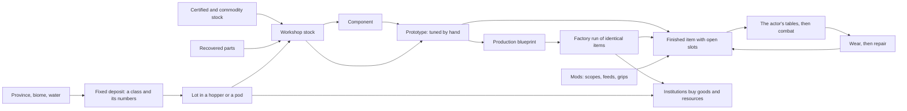

# Resources, crafting and the item model

Design proposal, 2026-10-10, fourth pass; the user's answers have settled the shape. How
the modular weapons of the [equipment package](equipment/README.md) become
things a household gets the materials for, makes, fits, wears out and sells.
Written to be argued with. It follows [the setting](../SETTING.md),
[progression](progression.md), [small industry](frontier-life/small-industry.md)
and the [equipment rules](equipment/equipment-rules.md), and it leans on the
research in [crafting systems](../research/crafting-systems.md). Every number
here is a paper number.

Decided so far, by the user:

- **Resource classes with varying numerical properties, Star Wars Galaxies
  (SWG) style**, with **eleven attributes**.
- **Fixed deposits.** A deposit is where it is, with the numbers it has. No
  expiring spawns and no hunt for the next one.
- **Experimentation with some randomness.**
- **A production blueprint for manufacturing**: a prototype recorded and
  repeated by a factory, **bound to minimum requirements** on its inputs,
  not to the exact stock the prototype used.
- **Wear, and a repair path.**
- **A sink is needed eventually**, and the institutions buying equipment and
  resources is the candidate.
- **Specialised crafting professions**, which suit benched characters, with
  **one Weaponsmith** for every kind of weapon.
- **Mod slots on finished items**, a scope on a rifle being the example,
  and **the smith can increase how moddable an item is**.
- **Gear in use is individual; everything else is a stack** (4.1).
- **Quality moves a mod's effect by up to 60 percent** around the authored
  value (4.3).
- **Selling may change the world eventually.** Out of scope for now: the
  institutions' boards only pay (7).
- **Singleplayer.**
- Already decided elsewhere and kept: a 250-point budget and a bench of four,
  no permanent loss of a character, melee and ranged equally viable, a
  weapon keeps its handling identity through modification, a combat
  character never has to learn fabrication to stay equipped.

Left to this document's defaults, the user having no view yet: the details
of moddability (4.2) and whether a repair ever costs maximum condition
(4.6). Section 11 lists them.

The rest is proposal.

## 1. What is borrowed, and what is not

The research note takes SWG's system apart. In one paragraph: every resource
belonged to a class in a tree, every find rolled its own values for the
attributes its class carried, inside the class's caps; a schematic asked for
classes, broad or narrow, and turned the attributes of what was put in into
the item's numbers by fixed weights; the crafter then spent a small budget of
experimentation, each point a roll, on the lines they cared about; a good
prototype became a manufacturing schematic and a factory ran copies; items
wore out, so the best crafter with the best stock always had customers.

| Lever | What it did in SWG | Here |
| --- | --- | --- |
| Classes with caps | A schematic's choice of class is a real choice | Kept whole. The world already has the ground for it: provinces, biomes, water, species |
| Eleven rolled attributes | No two finds alike; "best" depends on the recipe | Kept, with plain physical meanings (3.2) |
| Expiring finds | Scarcity, stockpiles, a resource trade | Dropped. Deposits are fixed (3.3). Variety between two items comes from the crafter's rolls instead |
| Experimentation rolls | The crafter's gamble and signature | Kept, gentler: no roll destroys the materials (5.3) |
| Manufacturing schematics | One lucky prototype became a run of identical goods | Kept as the production blueprint (5.4) |
| Decay | Repeat business | Kept as wear and repair, without destroying the item (4.6) |
| Interdependence through the skill cap | Nobody could do everything, so everybody traded | The bench is the household's answer; the institutions are its market (7) |

What is deliberately not borrowed:

- **Crafting XP from volume.** A Weaponsmith needed about 1 400 rifles'
  worth of XP, and players wrote macros to make them in practice mode. Raph
  Koster's own retrospective names the fix that was cut: XP when the item
  is used.
- **Hidden formulas.** SWG's were reverse-engineered by players and lived in
  third-party databases. Here every ceiling, weight, chance and threshold is
  on the crafting screen before anything is committed.
- **A lottery number.** Overall Quality ran 1 to 1000 on nearly every class
  and was the main driver of hoarding. No attribute here is uncapped.
- **A statistic that makes bought equipment worthless.** A vendor's goods
  stay the standard that everything else is measured against.

## 2. The chain



Who touches it: the **Rigger** draws the deposit, the **Runner** moves it,
the **Fabricator** makes components and common goods, a **specialist** makes
the finished thing, the **Broker** gets the leases, licences and contracts,
and whoever holds the certification carries the result. Four people cannot
cover that chain, which is the point: the household buys what it does not
make and sells what it makes too much of.

## 3. Resources

### 3.1 The class tree

Three levels and then the deposit itself: family, class, type. A schematic's
slot names any level. "Any structural metal" takes whatever is in the hopper;
"light alloy" narrows it; naming a type is rare and reserved for specialist
goods.

The classes come from what the world generator already knows about a point:

| Family | Class | Types (first basin) | Where, by existing data |
| --- | --- | --- | --- |
| Mineral | Structural metal | Ferrous ore, light alloy ore | Basalt and folded provinces; granite |
| Mineral | Conductor | Red conductor, trace conductor | Folded and karst; rare in badlands |
| Mineral | Ceramic feedstock | Clay, silica sand, kaolin | Badlands; sandstone; weathered granite |
| Mineral | Crystal | Quartz, calcite, volcanic glass | Granite; karst; basalt |
| Mineral | Reactive | Sulphur, evaporite salt | Basalt; badlands and desert basins |
| Fluid | Brine | Coastal brine, basin brine | The coast biome; lake beds in dry biomes |
| Fluid | Process gas | Processor offtake | An atmospheric processor's service platform, by lease |
| Grown | Timber | Oak, birch, fir, pine | The flora registry's own species |
| Grown | Fibre | Reed, dry grass | Wet banks (where the reeds already are); savanna |
| Grown | Resin | Conifer resin | Fir and pine stands |
| Grown | Cultivar | Engineered polymer crop | Plains, on leased or commons land |
| Animal | Dermal plate | Reedback, latchmaw | Shed plates on a herd's route; a hunting contract |
| Animal | Membrane and tissue | Glasswing, siltbell | A Medic's sampling, not a harvest |
| Recovered | Landing composite, salvaged electronics | by site | `landing` and `station` sites, finite |
| Certified | Seals, certified electronics, medical stock | by maker | Bought; flat numbers; a maker's provenance |

A province's `.geology.ron` gains a short list of the classes it can hold,
the way it already lists its rock kit. Recovered parts are the equipment
package's "exploration yields intact parts"; certified stock is its
"purchased seals and certified electronics keep trade relevant", with no
deposit and no roll.

The first proof needs two classes, as small industry said. The table is the
budget the content grows into.

### 3.2 Eleven attributes

On SWG's scale of 1 to 1000. A class carries some of them, never all; an
attribute a class does not carry is absent, not zero, and a schematic that
weights it for that slot is a content error caught at load. (SWG never
settled what a missing attribute counted as, and the surviving sources give
three different answers.)

| Attribute | Short | What it is | SWG's nearest | Typical use |
| --- | --- | --- | --- | --- |
| Purity | PU | How little of it is something else | Overall Quality | In most formulas; the general term |
| Strength | ST | Load before it deforms | Unit Toughness | Frames, stocks, supports |
| Toughness | TG | How it takes shock | Shock Resistance | Housings, heads, armour |
| Hardness | HD | How it keeps a surface | none | Edges, bores, lenses |
| Conductivity | CN | Electrical | Conductivity | Harnesses, cells, coils |
| Heat tolerance | HT | Holds its properties hot | Heat Resistance | Liners, cooling, emitters |
| Stability | SB | Resists corrosion and age | Decay Resistance | Service life of anything |
| Density | DN | Mass for its volume | none | Reads both ways: light for handling, heavy for impact |
| Potency | PT | Chemical or biological energy | Potential Energy | Cells, charges, medicine |
| Workability | WK | How forgiving it is to work | Malleability | The crafter's odds (5.3), not the item |
| Biocompatibility | BC | How a body takes it | Flavor | Medicine, implants' consumables, grips against skin |

Which a class carries:

| Class | Carries |
| --- | --- |
| Structural metal | PU ST TG HD HT SB DN WK |
| Conductor | PU CN HT SB DN WK |
| Ceramic feedstock | PU HD HT SB DN WK |
| Crystal | PU HD HT SB CN |
| Reactive | PU PT SB |
| Brine | PU PT CN |
| Process gas | PU PT |
| Timber | PU ST TG SB DN WK |
| Fibre | PU ST TG DN WK |
| Resin | PU TG HT SB WK BC |
| Cultivar | PU TG SB DN WK BC |
| Dermal plate | PU ST TG HD DN BC |
| Membrane and tissue | PU PT SB BC |

Three choices differ from SWG on purpose:

- **The names mean what they say.** SWG's attributes had no meaning beyond
  the schematic weights ("a resource with low decay resistance does not
  rot"). Here Stability really does set service life and Density really is
  weight, so a player can guess a formula before reading it.
- **Density reads both ways.** Every SWG attribute was "higher is better".
  A baton head wants dense metal and a pistol frame wants light metal, so
  one class has two best deposits and a mediocre one can be the right one.
- **Purity is capped like the rest.** Each class has its own range for it,
  so there is no single number whose top roll beats everything.

Each class has a floor and a cap per attribute. Light alloy might run
PU 300 to 900, ST 250 to 700, HD 200 to 600, DN 150 to 450, WK 400 to 1000;
ferrous ore ST 450 to 1000, HD 400 to 950 and DN 600 to 950. The caps are
what make a class an identity: no light alloy is ever as strong as good
ferrous ore. Formulas use the raw number, not the percentage of the cap, so
the class matters as much as the roll.

### 3.3 Fixed deposits

A deposit is a class or type, a place, a richness that falls off from its
centre, and one value per attribute. It is a pure function of the world seed
and the resource registry, placed after the sites in the manner of the site
placement and weighted by the province pair, the biome and the water record
there. It does not expire, it does not run out, and its numbers never change.

There is no hunt. The basin's deposits are a matter of record: the survey
office in Port Serein lists each with its class and its published assay, and
they are on the map. A basin holds a handful per class, and they differ.
The attributes of one deposit are not rolled independently: one "grade" roll
is shared and each attribute adds its own noise, so most deposits are spiky
(excellent in one number, plain in the rest). With eleven attributes and
per-schematic weights, which deposit is best depends on what is being made.

What takes the hunt's place is **access**. Every deposit is on somebody's
ground: a Pelagic concession with a service pad and a fee, a Borough commons
with negotiated use, a remote claim with no road. The questions are the
setting's own: whose land, on what terms, by which route, and what the
neighbours think of the pump. A dense deposit beyond a damaged bridge can be
worth less than a plain one beside a town.

The consequence should be said plainly. With fixed, bottomless deposits the
resource side of a recipe is solved once the household has access to the
right ground. What stays alive is getting that access, moving the stock,
the crafter's skill and luck, and what the institutions want this month.
That is the user's choice and a sound one for singleplayer; it means the
variety between two rifles comes from the workshop, not from the ore.

### 3.4 Lots

What is drawn from a deposit is a **lot**: the class, the deposit's name and
numbers, a quantity. Lots never mix silently. A blend is an explicit workshop
operation that makes a new lot with quantity-weighted numbers, previewed
first, as small industry proposed. A finished item records where its
materials came from, which the equipment data contract already reserves a
field for (`material_lots`).

Certified and commodity stock sits at a flat 500 on what it carries. That
number is the anchor of the whole system: section 4.3 defines it as the
quality at which a crafted part equals the catalogue's authored value.

The Surveyor is left with siting (where on a deposit's richness a pad
yields best), routes, and reading stations and tracks. The tree's Deposits
branch shrinks to that, which is honest: the user did not want the search.

## 4. Items

### 4.1 Stacks, and gear in use

Decided: gear in use is individual and everything else is a stack.

The reasons are the other decisions. Wear means this rifle is at 40 percent
and that one is fresh. Mod slots mean this rifle carries the long optic.
Moddability means this rifle has five open slots and that one four. Rolled
experimentation means two cells from the same lots came out differently.
And a blueprint run means two hundred cells that are exactly the same.

```ron
// A stack: every unit is the same, so one record and a count.
(def: "veyra:module.rifle_extended_cell", batch: 88, count: 40,
 lines: { "capacity": 640, "reload_time": 437 })

// A single: a thing that has gained a history of its own.
(def: "veyra:weapon.patrol_carbine", batch: 12, single: 4127,
 lines: { "interval": 560, "durability": 710, "moddability": 640 },
 condition: 620,
 fitted: { Sight: 4131, Feed: (batch: 88) })
```

Resources, components, supplies and everything a factory makes are stacks,
and behave like an ordinary inventory: a name, a number, a tooltip. An item
becomes a single when it is used: it has worn, or it has mods fitted, or it
was tuned by hand and differs from its batch. In practice that is the dozen
weapons and tools the household actually carries. A single that is fresh,
bare and identical to a stack folds back into it.

One rule holds for both: **a record stores quality per line, never the
resulting number.** The number is computed from the definition every time
the actor is fitted. A balance pass that retunes the catalogue then changes
every existing item consistently, the combat tables stay the single source
of numbers, and the duel harness can sweep quality without knowing anything
about resources.

### 4.2 Built in, or fitted: components and mods

Two kinds of part, and the difference is the whole of the user's point
about scopes:

| | Component | Mod |
| --- | --- | --- |
| What | An input to crafting: a frame casting, a liner, a cell core | A finished item in its own right: a scope, an extended cell, a grip |
| When | Consumed when the item is made | Fitted to a finished item afterwards, and removed again |
| Effect | Sets the ceilings of the item's own lines | Multiplies the host's numbers by its own banded factors (4.3) |
| Where | A slot of the schematic | A slot of the finished item |
| Who | Whoever crafts the item | A workshop, out of combat, as the equipment rules say |

A definition declares its mod slots. The workbench catalogue already does:
the patrol carbine has six (sight, feed, fore-end, stock, muzzle, grip), the
field blade two. Each slot has an interface and a stock fitting. The stock
fitting is part of the crafted item and stays with it when a mod takes its
place, as the equipment rules decided. A mod names the interface it fits,
and a cross-maker fit needs an adapter built into the mod, which is the
package's first DIY example.

A mod is crafted like anything else, with its own schematic, lines, luck and
blueprint. So the sight on a rifle can be a different crafter's work, a
different deposit's crystal and a different day's luck from the rifle
itself, and it moves to the next rifle when this one is sold.

The rule is general, not a weapon feature. Any definition may declare slots:
a survey receiver its coil, an extractor its head and filter, a shield
emitter its cell, the implant cuff its one utility, a drone its battery and
sensor. One record shape, one fitting transaction, one screen.

**The smith decides how moddable an item is.** Decided by the user. The
mechanism below is this document's default, which the user left open: base
slots, thresholds and rework stand until play says otherwise.

- A definition marks some of its slots as **base** and the rest as
  **extra**. Base slots are open on every example, bought or made. The
  geometry fixes the full set, so the most an item can ever have is what
  the workbench already models.
- A host item has a **moddability** line, crafted like any other: its
  ceiling comes from the frame's rigidity and the hardness of what the
  mounts are cut in, and the smith's experimentation points raise it. Each
  extra slot opens at a threshold on that line.
- A slot that is not open keeps its stock fitting and takes nothing else.

For the patrol carbine, with sight, feed and grip as base:

| Moddability | Open slots | What it is |
| --- | --- | --- |
| Below 400 | 3 | A rough build: sight, feed, grip |
| 400 | 4 | Adds the stock. A bought carbine, at 500, is here |
| 600 | 5 | Adds the muzzle |
| 800 | 6 | Adds the fore-end: everything the chassis can carry |

- **Rework.** A smith can also open the next slot on a weapon that already
  exists, bought ones included: a workshop job that consumes a mount
  component and rolls once against the line's ceiling. So a household with
  a Weaponsmith can improve what it bought, and one without can pay a
  resident smith to.
- The same holds for every family: the Armourer for an emitter's slots, the
  Instrument maker for a receiver's.

Two consequences. A specialist's work is visible at a glance, as a count of
slots, before any number is read. And the workbench's named configurations
stop fitting every example: a five-mod preset needs a carbine at 600 or
better, so a preset should state the moddability it needs. Points spent on
moddability are points not spent on the signature line, which is the
smith's real choice: a fine plain rifle, or a platform.

### 4.3 From quality to a number

The catalogue gives each mod effect a factor relative to its host's stock
value, and a direction (the JSON metrics already declare which way is a
benefit). Quality moves the factor inside a band around the authored value,
with vendor grade, 500, landing exactly on it:

```text
q = line quality / 1000
benefit:   factor = 1 + (authored - 1) * (0.4 + 1.2 q)
drawback:  factor = 1 + (authored - 1) * (1.5 - 1.0 q)
```

The service compact optic is authored as aim spread 0.90 and equip time 1.06:

| Line | Poor (q 0) | Vendor (q 0.5) | Best (q 1) |
| --- | --- | --- | --- |
| Aim spread (benefit) | 0.96 | 0.90 | 0.84 |
| Equip time (drawback) | 1.09 | 1.06 | 1.03 |

- **Identity holds.** A mod's benefit and its drawback keep their signs.
  Quality can halve a drawback and never removes it.
- **The catalogue stays the baseline.** Everything Codex authored is the
  vendor-grade case, unchanged.
- **The spread is bounded.** Step 11 widened it on the user's word that base
  weapons may be made much worse to reward crafting: the best part does 1.6
  of its benefit and half its harm, the poorest four tenths of its benefit
  and half again its harm. The harness holds the tables to it.

The equipment contract holds every composed factor inside 0.60 to 1.35. The
band stretches some combinations past that: the support projector's two brace
penalties compose to 1.265 as authored and to about 1.35 at the poorest
quality, and a 1.25 capacity cell reaches 1.40 at the best, past the bound
for that one part. The
exhaustive test over the 802 legal assemblies has to run at both quality
extremes, and where it fails either the bound or the band is adjusted on
purpose.

Counts quantise. On the live carbine's 24 rounds a 1.25 cell is 30 rounds;
the band runs from 26 at the poorest to 34 at the best, and each round is
about a fifth of the quality scale. A count line should show the count and
the next threshold, not a percentage.

### 4.4 The host item

A chassis is crafted too, and its lines move its own row rather than a
factor. Proposal: each chassis family has one **signature line** with a
band of its own (the patrol carbine ships 1.30 to 0.90 of the table's
interval, widened from the proposed 5 percent on the user's word of
2026-10-11; the carbine's Action line is half its harness's conductance
and half its frame's Stability, and the harness is made from a conductor
(`veyra:schematic.harness`), so 800 is a figure a smith can make and a bought
harness (500) caps a carbine near 700; others would be spread for the precision rifle, posture for
the scattergun and the baton), a
**durability** line that sets how slowly it wears, and later heat capacity
and mass. Damage is not a crafted line at first. A lethal number that
depends on ore is the fastest way to make bought equipment feel like a
mistake, and the duel contracts are not yet settled enough to absorb it.

### 4.5 What the simulation can honour today

The catalogue's thirteen properties against the sim's vocabulary
(`WEAPON_FIELDS`, `ACTION_FIELDS`, `ACTOR_FIELDS`):

| Property | Uses in the catalogue | Sim number today |
| --- | --- | --- |
| Equip time | 21 | `Swap.duration`, but one row for every weapon; needs a per-weapon value |
| Aim spread | 12 | `aim_spread` (degrees, half angle) on the weapon row; live since step 10, the carbine's 2.0 degrees aimed and 4.0 from the hip since step 11's follow-up |
| Capacity | 10 | `magazine` |
| Reload time | 9 | `reload` |
| Recoil recovery | 8 | None. The reticle blooms on the client only |
| Hit posture | 5 | `posture` (weapon row, action row) |
| Cooling rate | 4 | None. No heat |
| Recovery time | 3 | Part of an action's `duration` and `dodge_cancel` |
| Brace time | 3 | None. No bracing |
| Aim move speed | 3 | `aim_speed_scale`, on the actor |
| Repeat interval | 2 | `interval` |
| Attack stamina | 2 | `stamina` on an action row |
| Hit damage | 1 | `damage` |

Five properties land on a live number as they are, four more with a small
change, and four (spread, recoil, heat, bracing) are mechanics that do not
exist. Those four are a third of all mod effects by count (27 of 83), and
equip time, the commonest property, is another quarter. A scope, the user's
own example, does nothing until spread exists. The first fitted mod should
therefore be a feed (capacity and reload, both live), and spread is the
first mechanic worth building after it.

The larger structural fact: `strata_sim::combat::Weapon` is an enum of two,
and it keys the tables, the certifications and the household save. A crafted
weapon is a definition and a record, not an enum variant. The enum becomes
the weapon's *family* (its animation set and firing mechanism) and the row
an actor reads comes from the item in hand with its mods applied. That is
the equipment package's "establish item authority" stage and nothing in this
document can run before it.

### 4.6 Wear and repair

Decided: things wear, and there is a way to mend them.

- **What wears.** A weapon or tool in use: a little for every shot, cut or
  reading, more for a heavy blow taken on it, and a visible knock to
  everything carried when its bearer goes down. That last is the setback
  the progression document asks for (goods, never the character) and is
  what SWG charged on death.
- **How fast.** The item's durability line, fed by Stability and Toughness.
  A well-made rifle lasts several outings between services; a rough one
  needs the workshop after one.
- **What wear does.** Above a quarter of its condition an item performs as
  made. Below, its lines slide toward their poorest values. At nothing it
  still works, at its worst. It is never destroyed and never lost.
- **Mods** share their host's wear while fitted and keep their own state
  when removed, so a worn scope is worn on the next rifle too.
- **Repair.** At a workshop, by someone with the Fabricator's Repair boxes:
  full condition, for a **repair kit** and a short job. In the field, a kit
  alone restores part of it. Kits are crafted and consumed, with a line for
  how much one restores. A specialist mends their own family for fewer
  kits.

The dial left over is whether a repair costs a little of the item's maximum
condition, as SWG, Dune: Awakening and Star Citizen's plans all have it, so
that an item is eventually retired. Proposal: not at first. Kits and time
are a real cost, and section 7 is the sink. If played sessions show the
household's gear lasting forever at no felt cost, this is the dial to turn.

### 4.7 Beyond weapons

The same shape covers the rest: a supply's restoration amount is a banded
line on potency (a field dressing of 25 health might run 21 to 29); a survey
coil's range; a filter cartridge's service life, which was small industry's
first product; an extractor head's yield; a shield emitter's capacity and
recharge, which are `shield`, `shield_regen` and `hurt_wait` on the actor
table today. Implants stay clinic goods. Armour beyond the shield has no
combat design yet.

## 5. Crafting

### 5.1 A schematic

```ron
(
    id: "veyra:schematic.rifle_extended_cell",
    makes: "veyra:module.rifle_extended_cell",
    profession: "weaponsmith.fittings.2",   // the box that teaches it
    licence: Some("veyra:maker.kestrel"),
    fixture: "cells",                       // the workshop fixture it needs
    complexity: 2,
    slots: [
        (id: "core",    takes: Component("veyra:component.cell_core"), count: 1),
        (id: "harness", takes: Component("veyra:component.harness"),   count: 1),
        (id: "casing",  takes: Class("mineral.structural.light_alloy"), units: 40),
        (id: "seals",   takes: Certified("veyra:certified.seal_set"),  count: 1),
    ],
    lines: [
        (line: "capacity", from: [
            (slot: "core",    stat: "charge_density", weight: 0.60),
            (slot: "harness", stat: CN,               weight: 0.25),
            (slot: "casing",  stat: PU,               weight: 0.15),
        ]),
        (line: "reload_time", from: [
            (slot: "casing", stat: Light(DN), weight: 0.60),   // 1000 - DN
            (slot: "casing", stat: ST,        weight: 0.40),
        ]),
    ],
)
```

A component exposes named output stats on the same 1 to 1000 scale, so a
component in a slot is read exactly like a resource. Depth is capped at two
(resource, component, product). SWG's trees were two or three deep with
slots that demanded ten identical sub-assemblies, which made a factory
mandatory for a single rifle.

### 5.2 Components

About ten, shared across the catalogue, so a new item is a new schematic
over familiar parts rather than a new supply chain:

| Component | Made from | Output stats | Used in |
| --- | --- | --- | --- |
| Frame casting | Structural metal | Rigidity, lightness | Chassis, stocks, supports |
| Liner | Ceramic feedstock | Heat hold, bore finish | Fore-ends, muzzles, cooling |
| Lens blank | Crystal | Clarity, stability | Sights |
| Harness | Conductor | Conductance | Feeds, powered heads, coils |
| Cell core | Reactive and brine | Charge density, stability | Feeds, shield cells |
| Furniture | Cultivar, resin or timber | Grip, lightness | Grips, stocks |
| Edge blank | Structural metal | Hardness, toughness | Blades, cutter heads |
| Head mass | Structural metal | Mass, toughness | Batons |
| Seal set | Certified | Flat | Almost everything |
| Control board | Certified or recovered | Flat, or one exceptional stat | Sights, powered parts |

Components are the Fabricator's trade (section 6). A specialist buys them
in, or the household's Fabricator runs them off a blueprint.

### 5.3 The session, with luck

**Ceiling.** For each line, the weighted sum of the chosen inputs' stats over
1000. This is what the materials allow, and no skill or luck exceeds it.

**Assembly.** Each line lands at a share of its ceiling set by the fixture
and the crafter's boxes: about 0.5 for a novice at a basic fixture, 0.7 for
a master at a good one. No roll. Assembly always yields a usable item.

**Experimentation.** The crafter has a small budget of points, from their
boxes. Each point is spent on one line and **rolled**, and the result lifts
that line by a share of its ceiling, never past it:

| Result | Lift | Steady hand | Bold hand |
| --- | --- | --- | --- |
| Exceptional | +0.16 | 5% | 25% |
| Good | +0.10 | 55% | 25% |
| Fair | +0.06 | 35% | 25% |
| Poor | +0.02 | 5% | 15% |
| Setback | -0.04 | never | 10% |

```text
ceiling  = sum(weight * stat) / 1000
quality  = ceiling * min(1, assembly + sum(lifts on this line))
```

The chances shown are a journeyman's. Three things move them a row upward:
the crafter's experimentation boxes, the fixture, and the average
Workability of what is in the slots, which is what SWG used Malleability
for. The crafter chooses the hand for each point. Steady is for getting
there; bold is for reaching a ceiling in fewer points and freeing one for
another line, at the risk of going backwards.

There are never enough points for every line, and the rolls decide how far
the leftover goes. That is the "some randomness": two crafters with the same
stock make different cells, and the same crafter makes a different one
tomorrow. What is not at stake: the materials (committed at assembly, never
destroyed by a roll) and the ceiling (set by the ground).

SWG's shape was the same with a lower start and a sharper tail: perfect
materials gave 30 percent of a line from assembly, a master's ten points
were worth 7 percent each on a great result, and a critical failure took 7
percent off and damaged a second line. At master skill it had stopped being
a gamble and become a ritual of city, food and buff bonuses before the
click. The two hands put the choice of risk back in the crafter's own
hands instead.

The roll is drawn from a counter kept in the household's save, which is
written on every change, so a result stands once it is made.

### 5.4 The production blueprint

A finished, tuned item is a **prototype**. At a workshop, a crafter with the
Batches boxes records it as a **production blueprint**:

```ron
(
    id: 31,
    of: "veyra:schematic.rifle_extended_cell",
    lines: { "capacity": 640, "reload_time": 437 },   // the prototype's, exactly
    requires: [                                        // the least that will do
        (slot: "core",    component: "veyra:component.cell_core",
                          min: { "charge_density": 652 }),
        (slot: "harness", component: "veyra:component.harness", min: { CN: 500 }),
        (slot: "casing",  class: "mineral.structural.light_alloy",
                          min: { PU: 610, ST: 540 }, max: { DN: 320 }),
        (slot: "seals",   certified: "veyra:certified.seal_set"),
    ],
    runs_left: 100,
    recorded_by: "Ilse Varga",
)
```

- **It copies the prototype exactly.** A factory does not roll. Luck is
  spent once, by hand, and a lucky prototype is then worth a hundred copies.
  This is what gives the roll its weight: a run of bad luck costs one item,
  a run of good luck is a product line.
- **It is finite.** The run count comes from the crafter's Batches boxes and
  the schematic's complexity. When it is spent, someone prototypes again,
  and may do better or worse.
- **It asks for a minimum, not for the same stock.** Decided by the user.
  Each slot records its class and, for every attribute the schematic
  weights there, the value the prototype's input had: a floor, or a ceiling
  where the schematic wants less of it, as with density above. Any lot or
  component batch that meets them feeds the run. Better stock is accepted
  and gains nothing: the output is the prototype, exactly.
- **So a blueprint travels.** It is not tied to a lease or a deposit. A
  second deposit that clears the minimums is a second source, an
  institution that buys the blueprint can feed it from its own stores, and
  a lost lease is an inconvenience rather than a dead product. The factory
  says which requirement a rejected lot failed.
- **It can be recorded below the prototype.** A crafter may record at lower
  lines than the prototype reached, which lowers the minimums in step. That
  is how a fine prototype becomes a dependable product that ordinary stock
  can feed.
- **It runs in a factory.** The workshop fabricator of small industry, in
  batch mode: loaded with the blueprint and its inputs, it makes one unit
  per stretch of played time (a few seconds per point of complexity by
  hand in SWG, four times that in a factory), draws power, and pauses
  safely when inputs or output space run out.
- **Its output is a stack.** One batch number, one record, a count. A slot
  that asks for several identical parts takes them from one batch.
- **It is an item.** It can be stored, carried to another workshop, sold to
  an institution as a licence to make, or given to a resident fabricator
  who then stocks that part.
- **A benched character runs it.** "Run the workshop" in the progression
  document's standing jobs is exactly this: the blueprints queued, worked
  at a fraction of played speed.

Hand work and factory work then have different jobs. The hand makes the one
rifle the arrival carries, rolled for and worth a story. The factory makes
the cells, the kits, the filters and the orders.

### 5.5 A worked example

An extended cell for the carbine. Authored: capacity 1.25, reload time 1.15.
The figures take every experimentation point as a Good result.

The household has Calder salt (an evaporite: PT 820, PU 640) and Serein
brine (PT 560, CN 730). The cell core's charge density weights salt potency
0.5, brine potency 0.3 and brine conductivity 0.2:

```text
ceiling = 0.5*820 + 0.3*560 + 0.2*730 = 724
quality = 724 * min(1, 0.6 + 0.1*3)   = 652      (three points on it)
```

The cell takes that core, a bought harness (CN 500) and 40 units of Harrow
light alloy (PU 610, ST 540, DN 320):

```text
capacity ceiling = 0.60*652 + 0.25*500 + 0.15*610      = 608
capacity quality = 608 * min(1, 0.6 + 0.1*4)           = 608
reload ceiling   = 0.60*(1000-320) + 0.40*540          = 624
reload quality   = 624 * min(1, 0.6 + 0.1*1)           = 437

capacity factor  = 1 + 0.25*(0.6 + 0.8*0.608) = 1.272  -> 30 rounds
reload factor    = 1 + 0.15*(1.3 - 0.6*0.437) = 1.156  -> 1.56 s
```

A store-bought cell is 30 rounds and 1.55 s, so this one is a wash. That is
the honest result for middling stock and a journeyman, and it tells the
player what to change: a salt of potency 950 and a harness made from a
conductor of 800 puts the capacity line at 718 and the magazine at 31; the
best everything gives 32.

Luck moves it by about a round. With the first stock, Fair, Fair and Poor
on the core and a poor run on the cell leave the line near 450 and the
magazine at 29. With the better stock the same luck decides between 30 and
31. The prototype that came out at 30 goes in the stock box. The one that
came out at 31 is the one to record, and the next hundred cells are all 31.

### 5.6 Recovered parts

A control board pulled from a failed monitoring station has flat numbers
except one, which sits above anything a certified board offers. It fits a
component slot like any other and lifts one line's ceiling past what the
ground can supply. This is SWG's looted component, and it ties the
expedition to the workshop: the best sight in the basin needs something only
an explorer brings home. A recovered part cannot be on a blueprint for more
runs than there are parts. Routine animals still do not drop gun parts.

## 6. Professions

Decided: specialised crafting professions. SWG's shape was a common Artisan
and elite specialists above it, and the progression document already has
the mechanism: a basic tree anyone can start, and elites that need boxes
from two basics.

**The Fabricator is the Artisan.** Components, common goods, repair kits,
repairs, and blueprints for all of those.

| Fabricator branch | What its boxes do |
| --- | --- |
| Fixtures | Which component families a workshop can make; the assembly share |
| Materials | Experimentation points and odds; blending and refining a lot |
| Batches | Recording a blueprint; run size; the standing job's speed |
| Repair | Workshop and field repair; fitting and removing mods; dismantling for parts |

**Specialists are elites**, each needing the Fabricator and the trade it
serves:

| Elite | Needs | Makes | Branches (working) |
| --- | --- | --- | --- |
| **Weaponsmith** | Fabricator 3, and Marksman 2 or Blade 2 | Every weapon: chassis, blades and heads, every weapon mod, and their moddability | Frames, Edges, Fittings, Tuning |
| **Armourer** | Fabricator 3, Rigger 2 | Shield emitters and their cells, plate, harnesses | Emitters, Plate, Harness, Tuning |
| **Chemist** | Medic 3, Fabricator 2 | Dressings, ampoules, cell chemistry, reactive charges, sterile stock | Compounds, Cells, Sterile work, Yield |
| **Instrument maker** | Fabricator 3, Surveyor 2 | Coils, sensors, optics' lens work, drones, uncertified boards | Coils, Lenses, Drones, Calibration |
| **Station engineer** (exists) | Rigger 3, Fabricator 2 | Extractor heads, fixtures, power units, factory tooling | Processors, Water, Diagnosis, Retrofits |

Four new elites and one existing one given its making role. They are taught
by independent workshops and by a maker's service shop, with the maker's
licence as the thing a Broker has to obtain. One Weaponsmith covers ranged
and melee alike, as the user decided and as SWG had it: Frames is the
ranged chassis, Edges the blades and heads, Fittings the mods and the
opening of slots, Tuning the experimentation. Its either-or prerequisite
needs a small addition to the graph loader.

**What it costs.** Every tree is 98 points. A full Fabricator and one full
specialist, with the few boxes of the trade it serves, is about 208 of 250:
one whole seat on the bench. A household of four that also wants to fight
and to hold its leases can keep one specialist, perhaps two. The other three
or four specialities it buys, commissions from a resident, or hires at the
Exchange. That is the pressure the progression document wanted from the
cap, and it gives the residents' workshops a reason to exist.

**Why this suits the bench.** A crafter is the character a player least
wants to walk around as and most wants to own. Benched, the specialist runs
the workshop: blueprints queued, repairs waiting for the others when they
come home. The player steps into them for the part that is play, which is
the prototype: choosing the stock, spending the points, deciding which hand
to roll.

**XP by doing, not by volume.** Fabrication XP comes from the first item of a
schematic, from an order delivered, from a line that reaches a higher share
of its ceiling than the crafter has reached before, from repair work, and
from use: a share of the XP a crafted weapon earns in the household's hands
goes to whoever made it. That last one is the usage-based XP SWG designed
and cut for database load, and a household is small enough to afford it.
The fiftieth identical cell off a blueprint earns nothing.

## 7. The sink: what the institutions buy

Decided: the institutions buy equipment and resources, and for now a sale
only pays. That a sale might change the world is wanted eventually and is
out of scope here; the last part of this section keeps the idea for then.

**Two kinds of demand.**

- **Upkeep.** An institution's people wear things out as the household's do.
  Pelagic's wardens go through cells, kits and rifles; the Borough's water
  crews through filters and tools; the Institute's field teams through
  coils, inserts and medical stock. Upkeep demand refills with played time.
- **Projects.** An intake for the processor, a bridge on the pass road, a
  monitoring line across the marsh. A project is a stated bill of resources
  and goods, larger than upkeep and bought once. For now it is a big order
  with a name and an end.

| Buyer | Upkeep | A project |
| --- | --- | --- |
| Pelagic Works | Warden weapons and cells to a certified tolerance; filters; conductor | The processor's east intake: structural metal, liners, control boards |
| The Borough Assembly | Filters, tools, repair kits, timber and fibre | The pass road bridge: ferrous ore, frame castings |
| The Continuity Institute | Coils, sampling inserts, medical stock, brine | The marsh monitoring line: sensors, coils, sterile stock |
| Settlement shops | A little of anything at vendor grade, cheaply | none |

**A procurement board** at each institution's office lists its lines: the
item or resource class, a minimum on named lines or attributes, the quantity
still wanted, and the price.

- **Demand is finite.** A line pays in full up to what is wanted and then
  falls away steeply, so no item is an endless source of money.
- **Quality is paid for.** Above the minimum, each point earns a premium up
  to a cap. A certified batch off one blueprint, every unit the same, is
  what Pelagic means by certified.
- **Resources sell too, for less.** Raw lots have a floor price and a buyer,
  which gives an extractor's surplus somewhere to go, but the margin stays
  in the workshop.
- **Blueprints sell.** An institution or a resident will buy the right to
  make a good part, once.

**Later: sales that change the world.** Not in scope now. The shape it
would take, so that nothing built first rules it out:

- A project that completes leaves a visible result, and the three
  institutions' projects pull against each other. Supplying the intake and
  supplying the monitoring line are two answers to the water dispute.
- Pelagic's wardens carry the batch the household sold them, maker's mark
  and all. If the household later fights those wardens, it fights its own
  cells.
- Standing rises with deliveries to tolerance, and standing is how a
  household earns a lease, a licence or an elite's teacher.

What that asks of the first version is only that a sale records who bought
what, from which batch.

**Where the credits go.** A sink needs the money to leave as well: leases
and pad fees, maker licences, certified parts, power, freight, clinic dues,
hired hands' contracts, fixtures, and commissions for what the household
cannot make. The household model of the progression document is where the
two sides are balanced, with one target to start from: a household that
stops selling should feel it within a few played hours, and one that sells
well should be buying access, not accumulating.

## 8. What the engine needs

By layer, following the rule that an arrow never points up:

| Crate | Gains |
| --- | --- |
| `strata-registry` | `resource` (class tree, caps, the attribute matrix: `assets/resources/*.ron`), `item` (definitions, their lines and mod slots), `schematic`, `procurement` (buyers and their lines). Checked at load like the skill graph: a schematic may only weight a stat its slot's class carries, and only lines its product defines. |
| `strata-worldgen` | `deposits`: fixed, placed after the sites from the seed and the registry over `Sample::provinces`, the biome and `Sample::water`. Not a height stage, so no `GENERATOR_VERSION` bump. `just worldmap` gains a `-deposits` layer. |
| `strata-sim` | `items`: stacks and singles, an inventory, a loadout with fitted mods; the merge grows from `apply(tables, graph, sheet)` to take the loadout, in the order the data contract fixed (the item's row, then boxes, then mod factors once); wear in the tick; crafting, fitting, repair and sale as transactions consumed in the tick. |
| `apps/game` | The household's stock, blueprints and craft counter in its save; a workbench, a factory and a procurement board as new `Interaction` kinds; the crafting, fitting and board screens on the slotted stack; factory runs as a standing job. |
| `tools/balance` | A loadout on a side of a bout, with quality and condition as sweep dimensions; a contract of the form "the best legal build beats stock by no more than a stated margin". |
| `veyra-weapons` | Stays the authoring and geometry crate for the client and the content step. Its catalogue reaches the registry as RON (it already emits `workbench-catalogue.ron`), with the property labels replaced by typed ids that the registry checks against the sim's vocabulary. |

Singleplayer is decided, so none of this is replicated and the protocol is
not touched. The layering still holds: the rules live in the sim, the
screens ask. Learn, forget and the bench switch write the sim's components
directly today, which progression section 12 names as a stand-in; crafting
and fitting should start as transactions in the tick rather than become a
fourth exception.

### Order of work

Each slice is small enough to play and to judge:

| Slice | What it proves | Done when |
| --- | --- | --- |
| 0. Items | A weapon in hand is a record of a definition; the two live rows are the first two definitions; stacks and singles in the save | The existing contracts and the scripted path pass unchanged; the save round-trips an inventory |
| 1. A fitted mod | One feed, bought, fitted at a workbench, changes `magazine` and `reload` through the merge | The harness shows the difference; removing it restores the row exactly; pools are preserved, not refilled |
| 2. Deposits and lots | The registry, the fixed placement, the worldmap layer; two classes drawn by hand into lots | Two deposits of one class differ and both are on the map |
| 3. One schematic | The cell of 5.5 crafted at a workbench, with the experimentation rolls | Two crafts from the same lots differ; quality sweeps in the harness |
| 4. Blueprint and factory | A prototype recorded, a run made, a benched Fabricator working it | A hundred identical cells from one blueprint; a lot under the minimums is refused and the factory says why |
| 5. Wear and repair | Condition falls with use and with being downed; a kit and a workshop restore it | A worn carbine measurably underperforms in the harness and is restored exactly |
| 6. One buyer | Pelagic's board with three upkeep lines and one project order | Demand ends at the stated quantity; a sale records the buyer and the batch |
| 7. Spread | The first missing mechanic, so a scope does something | Deterministic scenarios before any tuning |
| 8. A specialist | The Weaponsmith tree with real boxes, and moddability | A crafted chassis with more open slots than a bought one, carrying crafted mods, in another bench member's hands |

Slices 0 and 1 are the equipment package's own next stages and are needed
whatever else changes.

## 9. Balancing

Quality is one more table dimension, so the existing procedure holds:

- The harness sweeps a loadout's line qualities at 0, 500 and 1000, and its
  condition at fresh and worn, and reports time to kill and damage taken
  against the stock build. A chosen band bounds the best build's advantage;
  a first guess is that best against vendor grade should move a fair duel
  by less than two boxes of one branch do.
- An experimentation model: the distribution of a line's final quality by
  skill, points and hand, from the table in 5.3. It answers how often a
  journeyman reaches the ceiling and how many prototypes a good blueprint
  costs.
- The household model gains its first real flows: upkeep and project
  demand in, kits and stock out, credits to leases and licences.

## 10. What changed from the first draft

- Deposits lost their finite pockets, the frontier gradient and the
  survey reading by ranges. They are fixed and on the map.
- Eight attributes became eleven, with Hardness, Stability and
  Biocompatibility added and thermal tolerance renamed.
- Deterministic tuning became rolled experimentation with two hands.
- Batches became the production blueprint, an item in its own right.
- Wear moved from "later" to decided.
- One proposed Gunsmith became five specialists over the Fabricator.
- Orders to a tolerance became institutional procurement with projects.
- Components and mods are now distinguished, and slots are general.
- Third pass: the smith sets how many slots are open, a blueprint asks for
  minimums instead of the prototype's exact stock, and the weapon trade is
  one profession.
- Fourth pass: gear in use is individual, the 40 percent band is set, and
  sales that change the world are deferred.

## 11. Defaults the user has not weighed in on

None of these blocks the first slices.

1. **Retirement** (4.6): repair restores everything. The dial held back is
   a small loss of maximum condition per repair, so gear is eventually
   replaced.
2. **Crafted damage** (4.4): a chassis has one signature line within 5
   percent and no crafted damage line.
3. **Moddability's details** (4.2): two or three base slots per chassis,
   thresholds at 400, 600 and 800, and rework on a finished weapon allowed.
