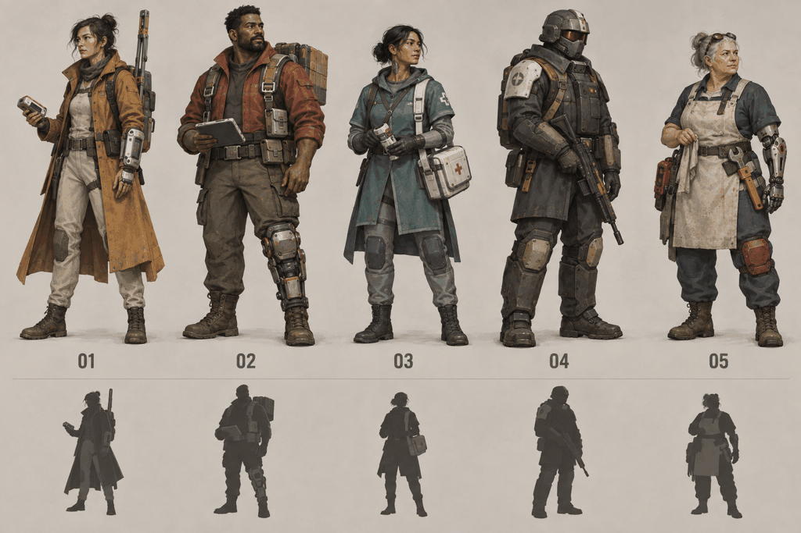
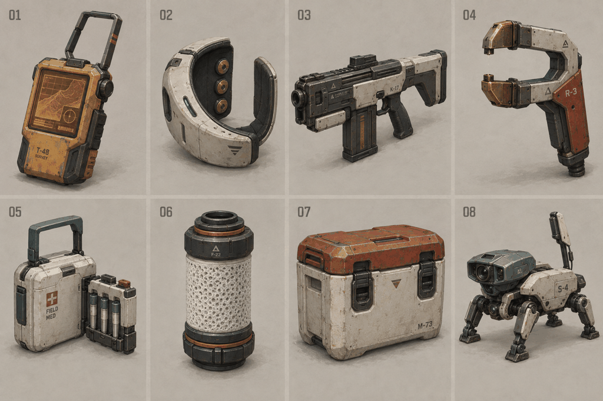
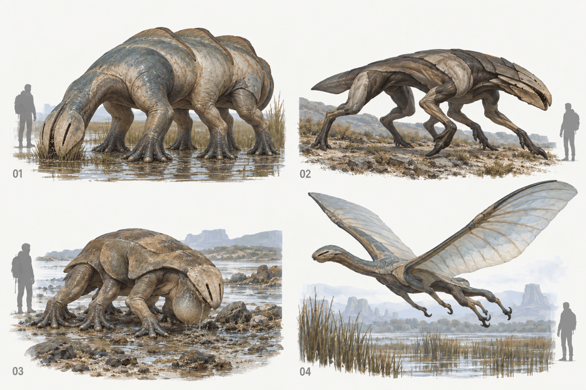
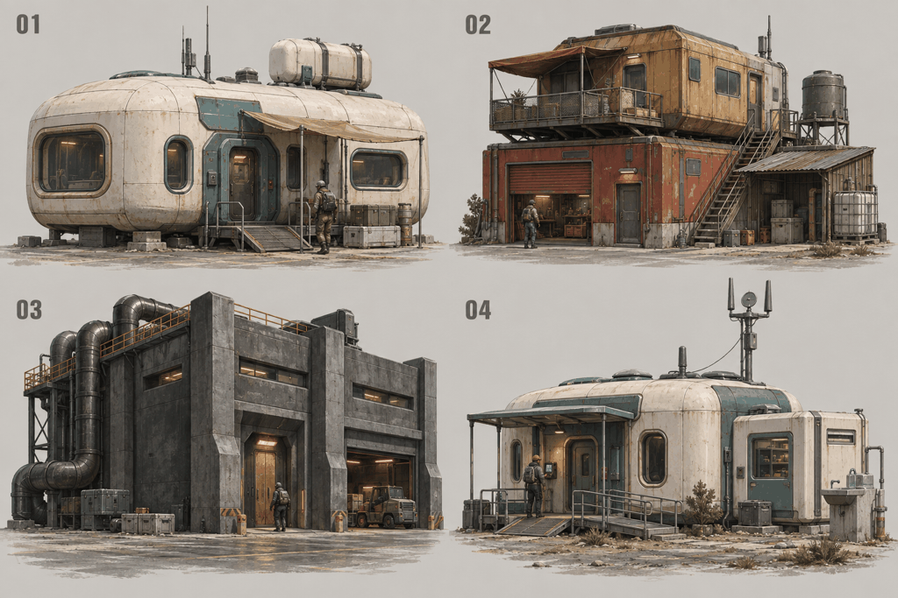
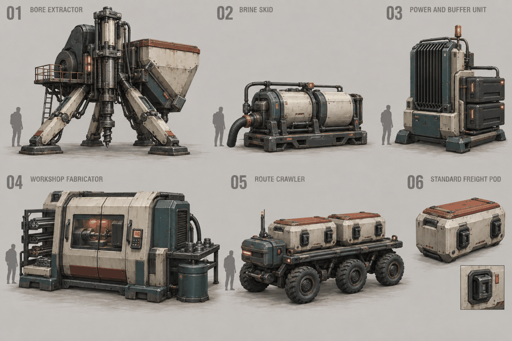
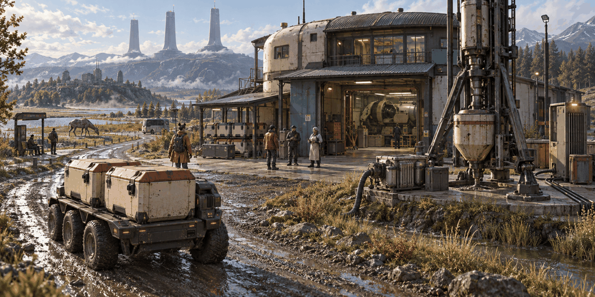

# Veyra: frontier lives and small industry

Concept pack, 2026-09-29. **Exploratory proposals for review**, extending
[the setting](../../SETTING.md), [Port Serein](../port-serein.md) and its
[established style](../port-serein-style.md). Names, species, recipes, quantities
and progression here are working proposals. This pack adds art and game design;
it does not implement these assets or systems.

The player arrives in a place with jobs, neighbors, strange wildlife and goods
that have to come from somewhere. Surveying a valley, repairing a pump, carrying
freight and making a better field tool should connect to the same people and
places as adventure, combat and dialogue.

This pass assumes **singleplayer** as the intended experience. The existing
engine's server authority and layering remain implementation constraints. NPC
customers, hired freight and persistent local relationships provide the economy
and social context that player populations supplied in the MMO inspirations.

## Art direction

Carry the existing stylised realism into clothing, machines and animals:
recognizable large forms, practical proportions, modest heroic emphasis, soft
manufactured edges and wear explained by use. Charcoal structure, old ivory
shells, muted teal instruments, ochre fieldwear and oxide-red repairs recur
across the pack. Small amber indicators communicate machine state.

Give equipment a provenance. A Pelagic cuff can be bought secondhand and worn
with an independent coat; an Institute medic may use a Borough-repaired cargo
case. Affiliations affect access and relationships without becoming costume
locks or fixed character classes.

## 01. People

Left to right: independent surveyor, Borough freight runner, Continuity field
medic, Pelagic infrastructure warden and independent fabricator. Coats, cargo
harnesses, medical satchels, armor blocks and aprons give them different
silhouettes. Ordinary faces and personal repairs keep the world inhabited.

[Character briefs and equipment functions](catalogue.md#people) define their
work, playable skills and modeling priorities. These are outfit families a
player can combine, and residents the player can encounter.

## 02. Equipment

The sheet numbers correspond to: survey receiver, implant interface cuff,
pulse carbine, induction repair tool, medical cassette, filter cartridge,
hand-carried cargo canister and scout drone. Tools have visible mechanisms and
replaceable parts. [The item catalogue](catalogue.md#equipment) links them to
adventure and production.

## 03. Native fauna

Reedback, latchmaw, siltbell and glasswing occupy different ecological roles:
grazer, pursuit predator, scavenger and marsh glider. They make water use and
terraforming visible through behavior. Their proposed shared anatomy uses
three limb pairs and layered dermal shields.

**Art review:** a focused second pass shortens the grazer's feeding neck,
introduces paired cheek plates, folds its dorsal ridges and makes the predator's
middle limb pair clearer. The [first anatomy draft](concepts/03-creatures.png)
is retained for comparison. A clean side view and locomotion study are required
before building meshes; perspective still obscures some far-side joints.
[Creature briefs](catalogue.md#creatures) describe behavior and encounters.

## 04. Building families

01 Landing service module, 02 Borough workshop-house, 03 Pelagic fabrication
annex, 04 Continuity field station. Continuity adapts existing Landing buildings;
it is an occupancy and fittings variant, not another construction generation.
These families extend the city's established history into the basin.

[Building briefs](catalogue.md#buildings) identify reusable parts, access and
variation. Grounding, doorway dimensions and geometry budgets still follow
[Port Serein's style specification](../port-serein-style.md).

## 05. Production and freight

01 bore extractor, 02 brine skid, 03 power and buffer unit, 04 workshop
fabricator, 05 route crawler, 06 standard freight pod. A removable pod and
repeatable docking latch connect the machinery's visual language.

[Small industry](small-industry.md) specifies surveying, batch production,
material quality, freight, finite demand and a proposed first playable loop.

## 06. The yard in its landscape

The scene tests how equipment, a workshop, cargo access and residents belong
together. A service road connects the yard to established settlements; a
processor anchors the regional horizon. This is a newly generated scene,
not a paintover or evidence of current terrain, weather, water or lighting.
Its composition is a reference for a later blockout.

## Production handoff

Start with one surveyor outfit, one receiver, one cargo pod, one extractor,
one fabricator and a reused workshop shell. Validate their scale together
before expanding the catalogue. Reedback and siltbell are the first fauna
studies because different noncombat behaviors will make the region feel alive.

Buildings and regular industrial props should use the existing Rust/ashlar
recipe workflow. Organic characters and creatures need an explicit modeling
and rigging decision. These PNGs are review references, not textures, generated
3D models or permission to replace the procedural vegetation pipeline.

The next modeling sheets should show front, side and back views; separate
movable parts; material slots; feet, grips and connector dimensions. Clothing
needs clearance through crouching and walking; animals need a resolved limb
count and gait. Machine movement should be readable from a path, with static
parts merged where interaction does not need them separate. Budgets require
measurement on assets in the engine.

The six selected boards and retained first creature draft were produced with
**built-in ImageGen**. [Full prompts](prompts.json) and the
[creature revision prompt](revisions.json) preserve the exact requests.
[Generation records](generations.json) list file
dimensions and hashes. In-image serials, crosses and incidental markings are
generated decoration; faction identity and item identifiers belong in authored
content. [Review notes](review.md) record the remaining art limitations.
