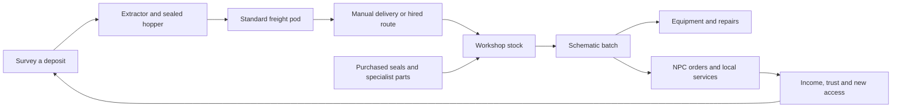

# Small industry in a singleplayer frontier RPG

Design proposal, 2026-09-29. Companion to the
[concept sheets](README.md#05-production-and-freight). These systems are future
work. Quantities below are tunable paper-design examples, not engine behavior.

## Player promise

Find a useful place, set up a small operation, arrange transport and make
something the region needs. A workshop is a home and a connection to neighbors.
It can support an adventurer's equipment, a trader's contracts or an engineer's
specialization. Buying finished goods and hiring services remain viable.

Take the SWG-like appeal of surveyed resources, unattended extractors,
material quality and schematic batches. Keep the initial operation compact:
one or two raw materials, a few visible machines and destination-based freight.
Each expansion should unlock work, a useful product or a relationship.

## Surveying and siting

The receiver provides a broad bearing and estimated resource strength. A probe
at the site confirms resource family, expected yield and relevant qualities.
The preview also shows distance to road access, available power and known land
use. A dense deposit beyond a damaged bridge can be less useful than a modest
one beside a settlement.

Use stable deposits for the first basin. A resource has a named **lot** with
qualities that remain inspectable after extraction and transport. Do not require
constant relocation to chase randomly changing spawns. Rich pockets, recovery
rates and new exploration regions can be later experiments.

Sites have a visible story: a leased Pelagic service pad with reliable access,
a Borough commons with negotiated use, or a remote claim with fewer services.
Access can come through an introduction, purchase or local job. Show existing
water use, wildlife passages and infrastructure before the player commits.
An installation preview must explain denied placement and its necessary access.

## Machine families

| Sheet | Machine | Input and output | Readable movement and upgrade |
| --- | --- | --- | --- |
| 01 | Bore extractor | Draws mineral feedstock from a surveyed deposit into a removable sealed hopper; uses charge | Slow central drill movement and hopper gauge; better heads improve yield or reduce power use |
| 02 | Brine skid | Collects and conditions brine into a sealed fluid pod; uses charge and a replaceable filter | Pump cadence and pressure gauge; cartridges favor service life or cleaner concentrate |
| 03 | Power and buffer unit | Holds purchased charge or connects to an agreed local supply; provides one shared yard power budget | Battery drawers and coarse status indicator; capacity extends unattended work |
| 04 | Workshop fabricator | Converts a recipe's input lot and purchased specialist parts into a counted batch | One active chuck or press, input rack and output tray; fixtures unlock product families |
| 05 | Route crawler | Moves sealed pods between prepared loading pads | Sensor head, six wheels, consistent pod latches; larger capacity or better suspension changes routes |
| 06 | Standard freight pod | Holds a finite quantity of one cargo type with lot identity | Docking latch, seal and fill indicator; same interface at extractor, warehouse and crawler |

The hopper, handheld canister and freight pod share a visual family. Their
capacity and coupling dimensions differ explicitly. Fluid pods are sealed and
lined; a pod cannot accept an incompatible cargo merely because it looks alike.

The factory is an enclosed workshop machine running a selected schematic.
Local refining and fabrication can be sequential modes of the same machine
initially. A later dedicated refinery is worthwhile only if it creates another
interesting sourcing or specialization choice.

## Material quality and products

Use two understandable qualities per resource family, displayed with concrete
effects. A mineral lot might have **purity** and **conductivity**. Filter
ceramics favor purity; sensor coils favor conductivity. Brine concentrate might
have **ionic strength** and **contamination**, where less contamination helps
medical products. Start with minerals and two uses; introduce brine later.

Lots stay separate in storage by default. A recipe identifies which lot it will
consume. If blending is added, preview its quantity-weighted quality before
confirming. A standard minimum produces a reliable usable item. Exceptional
lots earn specialist orders or bounded bonuses, rather than making basic
equipment obsolete.

| Product family | Purpose | Reason to improve it | Who supplies expertise or buys it |
| --- | --- | --- | --- |
| Ceramic filter cartridges | Repair pumps and stations; maintain brine skids | Longer service life | Local fabricator, Borough water crews |
| Survey coils and sensor modules | Better receiver range or cleaner readings | Useful exploration reach and precision | Survey offices, Continuity field teams |
| Battery sleeves and thermal blocks | Equipment and power-unit servicing | Lower charge demand or better storage | Pelagic maintenance contracts |
| Sterile sampling inserts | Field medicine and ecological jobs | Reduced sample contamination | Clinic or field medic |

The player can handcraft a prototype, record an approved schematic and ask the
fabricator to repeat a finite batch. Purchased seals, certified electronics and
medical supplies keep trade relevant. Learning a recipe can involve a person,
a dismantled machine or a commissioned prototype.

## Freight and transport

Begin with manual cargo delivery and hired freight. The first automatic route
has a source pad, destination pad, cargo filter, reserve quantity and batch cap.
Choose destinations on a map or at their terminals, with a preview of travel
time, charge or fee, capacity and known access restrictions.

A crawler loads only cargo above the source's reserve, up to the pod's capacity
and the destination's available space. It returns with empty pods, or with a
configured compatible backhaul. Source stock is removed exactly once at loading;
transit cargo remains inspectable until unloaded. Full storage or absent cargo
makes a vehicle wait safely and explains why.

Inside the yard, short direct service connections and loading pads handle the
movement. Larger settlements have shared depots, giving the player a place to
meet workers and consolidate goods. Later freight skimmers can trade higher
charge costs for access beyond roads; the six-wheel crawler is the first
transport asset to validate.

Use route problems as authored, discoverable adventures: repair a bridge,
negotiate checkpoint access or identify a leaking seal attracting predators.
Display known trouble before dispatch. Routine unattended production should
remain dependable, with encounter frequency controlled deliberately.

## Singleplayer pacing and demand

Production advances through played simulation time; saving and closing the
game stops its clock. Storage, power and selected batch size bound unattended
output. A long expedition can return to full bins without creating debt or
destroying equipment. Resolve production behavior under a pause menu when the
singleplayer pause policy is implemented; the current game keeps simulating.

Maintenance comes due visibly and reduces efficiency or safely pauses a
machine. Repairs resume it from its saved state. A resident can offer paid
servicing as a later convenience. Avoid recurring real-time bills and machine
loss for taking a break from the game.

NPC contracts replace dependence on an online player market. A clinic orders
twelve sterile inserts; a water crew orders ten standard filters; Pelagic pays
more for a certified batch. Accepted orders reserve a finite demand and show
requirements up front. General vendors buy only limited quantities at a lower
price. Surplus can supply your own equipment, be stored or recycled, so a full
factory does not guarantee unlimited income.

A first yard offers at most one extractor, one fabricator and one transport
route. A later proposal is up to three owned production sites and two active
routes in the basin, with larger civic facilities providing context and hired
services. These are pacing limits to test, not technical entity budgets.

## A paper example

The water crew asks for ten ceramic filters. You can buy them, commission a
fabricator or make them yourself. The first industrial walkthrough supplies
enough starter stock to complete one filter quickly; the longer batch runs
while you pursue another local job.

| Variable | Trial value |
| --- | --- |
| Extractor yield | 2 mineral units per played minute |
| Extractor hopper | 120 units: 60 minutes of extraction from empty |
| Freight pod capacity | 120 units of this mineral cargo |
| Nearby route round trip | 8 played minutes, including transfer |
| Filter recipe | 6 mineral units, 1 purchased seal, 2 factory charge units |
| Fabrication time | 3 played minutes per filter |
| Order batch | 10 filters: 60 mineral units, 10 seals, 20 factory charge units |

Extraction and fabrication have the same average material rate, but a factory
cannot start before inputs arrive. Freight and initial stock determine the
first delivery time. Extractor and vehicle charge are separate visible costs;
the 20-unit total above covers fabrication only. Commissioning prices should
be compared with material, seal, power and freight costs before profit is set.

When the ten-filter batch is complete, the factory stops and retains unused
stock. If the output tray fills early it pauses safely. Improving purity makes
a longer-lived filter and opens a specialist order. Improving transport access
can help more than adding extraction capacity.

## Proposed first playable proof

Use the existing failed-monitoring-station story as a shared introduction.
The local fabricator diagnoses its damaged cartridge. The player learns a
simple receiver reading and can purchase feedstock, commission the part or
lease a nearby extractor pad. A first batch supplies the repair and gives the
water crew a reason to ask for more.

The proof needs one mineral deposit, one pod type, one machine recipe, one
workshop, one customer and one route. Start freight manually; add the crawler
only after the transfers and storage limits are understandable.

Accept the proof when a player can:

1. Inspect a site and understand its yield, material quality, access and costs.
2. Complete a cartridge through purchase, commissioning or owned production.
3. Deliver it to the actual station and see the station's state change.
4. Load and unload a pod with stock and lot identity conserved.
5. Leave the area, save, reload and return to consistent cargo, machine progress
   and completed mission state.
6. Understand a machine or route waiting for inputs, space or power, and resume
   it without losing stock.
7. Fill an order whose demand ends at the stated quantity.

Keep later brine extraction, complex product chains, multiple routes, air
freight and large environmental changes as separate extensions. The first
yard should prove that production adds useful decisions and a lived-in place
to the RPG.
