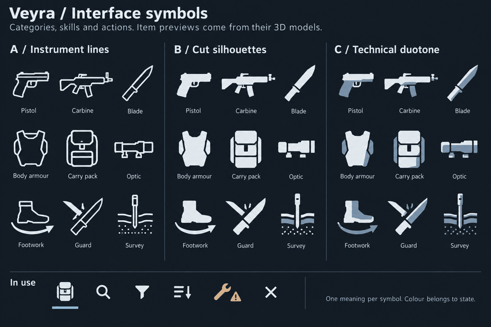
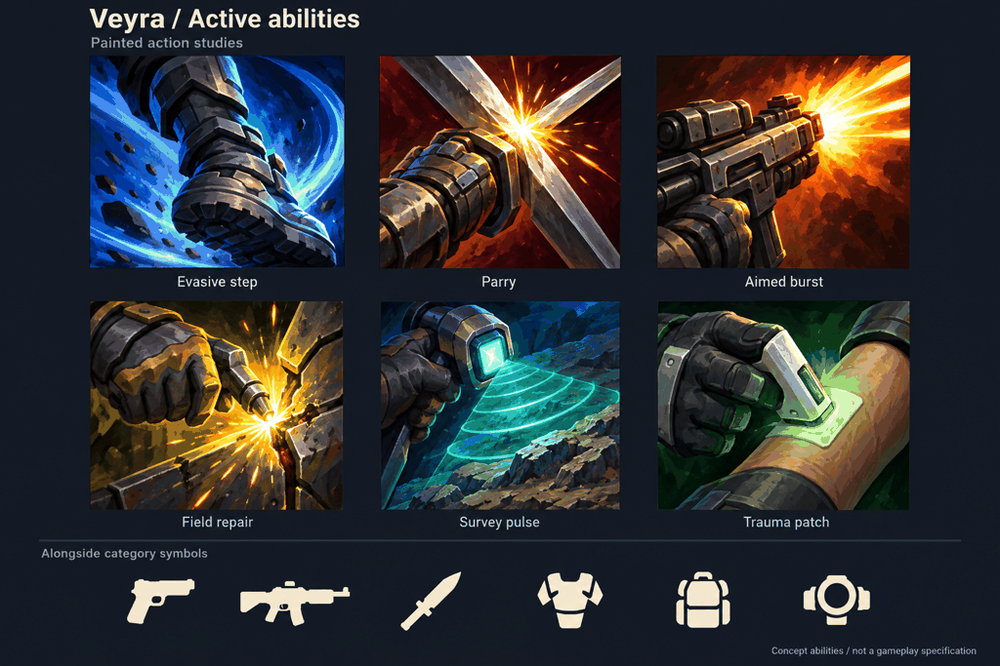

# Veyra icons

The icon language for artists and agents working on Veyra's UI.
Individual items use their 3D models; categories use solid symbols;
activated abilities use painted squares.

The collection contains **111 solid symbols and 96 painted actions and effects**.
Open the [searchable gallery](index.html) to browse the artwork, compare display
sizes and copy a runtime asset path. It works directly from disk without a server.
Agents can search the [JSON manifest](../../../assets/icons/catalogue.json)
or run `python3 tools/icon_library.py --find repair` from the repository root.
The [painted index](painted-index.md) describes every painting in plain language;
[metadata fields](metadata.md) explains how to select one programmatically.

The user approved column B of the symbol study and the painted ability study
on 2026-10-11. These images establish the visual direction.
They are concept sheets, with labels and multiple subjects, not runtime atlases.

## Approved references

### Category and UI symbols

Use column B, **Cut silhouettes**, in this sheet.
Columns A and C are alternatives and are not part of the chosen style.



### Ability artwork

Use the six large painted squares as the reference for colour, composition and brushwork.
Their names describe art examples, not committed gameplay abilities.
The small symbol strip is illustrative; column B above remains the symbol reference.



## Which image belongs where

| UI content | Treatment | Example |
|---|---|---|
| A particular item | Its 3D model, or an image derived from that model | The fitted patrol carbine |
| An equipment category or empty slot | A solid symbol | Carbine, optic, carry pack |
| A filter or UI operation | A solid symbol | Materials, search, transfer |
| A profession heading | A solid symbol | Marksman, surveyor |
| An activated ability | A painted square | A close crop of a blade parrying |
| An individual passive or effect | A painted square when shown with abilities | A specific protection effect |
| State, quantity or binding | Separate UI decoration | Cooldown, locked, rank, equipped |

A procedural item does not need a unique category icon.
Its model distinguishes its construction; the category symbol explains where it belongs.
Different quality values and skill ranks retain their base artwork.
A change of action or meaning can justify a new image.

## Solid symbols

Use solid silhouettes with slightly chamfered corners and generous negative spaces.
Recognition comes from the outer shape and a few functional cuts.
Keep the visual weight consistent across tall, round and long subjects.

Use a side view for weapon classes, with guns pointing right.
Use an upward-right diagonal for a blade and a front view for armour and packs.
The symbol represents a class, so avoid maker-specific fittings or model details.

Use one colour. Texture, distress, gradients, glow and a second shading plane
belong outside this family. Avoid decorative circuitry and enclosing hexagons.
An optic must read as an optic without its tiny screws or mounting marks.

Author on a 32-unit square with a nominal 3-unit margin.
Use optical alignment rather than stretching every subject to fill the same box.
Start with gaps at least 2 units wide, then inspect the rasterized result.
These are production starting values, not measured guarantees of legibility.

Keep editable SVG masters. Export white shapes on transparent PNG backgrounds
for runtime tinting; the current glass theme supplies the displayed colour.
The library supplies 16, 24, 32 and 64-pixel PNGs from each SVG.
Choose the export nearest the displayed size and respect its reviewed minimum.
Confirm display scaling before choosing an atlas resolution.

Review at 16, 24 and 32 displayed pixels against the glass panel and actual scene backgrounds.
Simplify or supply an explicit small variant if a mark fails at 16 pixels.
Labels remain available for unfamiliar categories and accessible controls.

## Painted abilities

The reference is the vivid painted action language of WoW ability icons,
translated into Veyra's equipment, medicine and frontier work.
Use original subjects and artwork, with a consistent painterly treatment.

Each square shows one dominant subject doing one readable thing.
Crop closely, use a strong diagonal or directional curve,
and concentrate the brightest light where the action happens.
Let the background fill the square, with darker corners supporting the focal shape.

Use broad painted forms, rich coloured shadows and strong light-dark separation.
Surface detail must survive the intended display size or be removed.
The boot, blade or tool should remain recognizable when the effect is obscured.
Motion marks and sparks describe the action; they need not promise literal in-world effects.

Give neighbouring abilities different silhouettes, compositions and dominant hues.
The approved sheet uses blue for movement, amber-red for a parry,
orange for firing, ochre for repair, teal for scanning and green for treatment.
These are examples, not a mandatory colour taxonomy for all abilities.

Technology should have a physical subject: a blade, power cell, tool, scanner or medical device.
Avoid replacing these with generic magic runes or a glowing abstract orb.
No text, numbers, borders, cooldown wedges or keybinding labels belong in the painting.

Keep a high-resolution square master, a 256-pixel PNG and a 64-pixel PNG export.
Review at 32, 48 and 64 displayed pixels before calling an asset ready.
Smaller effect displays need their own review and may need a simpler derivative.
Do not tint the painting with the monochrome symbol colour.

## State and framing

The UI owns slot borders, focus, selection, cooldown, rank, charges and keybindings.
Keep important subject matter near the centre, so these overlays do not hide its meaning.
Cooldown should leave enough of the image visible to identify the action.

The existing glass palette provides neutral ivory `#E6EDF3`,
selection blue `#7FD1FF`, warm emphasis `#FFB454` and danger red `#FF6B6B`.
Follow the existing semantic theme roles when implementing those states.
Colour has meaning in context; it is not enough to identify a warning or a locked control alone.

Separate a condition warning from the repair action and a lock from an equipped marker.
Do not paint an item's condition or procedural quality into its category symbol.

## Catalogue and delivery

The [catalogue](catalogue.md) lists all 207 meanings, runtime files and review status.
The symbols cover equipment, weapon classes, modules, materials, crafting,
controls, states, professions and map markers. The paintings cover combat,
movement, engineering, exploration, medicine, crew work and effects.
These are individual usable assets, not tiles sliced from the concept sheets.
Artwork IDs do not register engine identifiers or imply implemented gameplay features.

Use `assets-src/icons/symbols/` for editable symbol masters and
`assets-src/icons/abilities/` for painted masters.
Use `assets/icons/symbols/` and `assets/icons/abilities/` for runtime exports.

The [selection metadata](../../../assets-src/icons/selection.json) describes
what each icon means and depicts, its subjects, colours, UI role, suggested uses
and differences from related choices. Search uses these descriptions as well as tags.

The [symbol metadata](../../../assets-src/icons/symbols.json) and
[painted briefs](../../../assets-src/icons/ability-briefs.json) are the source catalogue.
The latter preserves the full prompt and style reference for every painting.
The [visual review record](../../../assets-src/icons/review.json) records a minimum
size, caveats and the source hash. A changed source becomes `unreviewed` on rebuild
until its exported sizes have been inspected again.

The [manifest](../../../assets/icons/catalogue.json) supplies stable IDs, search
tags, `asset_path`, size variants, source paths, tint rules and review notes.
`asset_path` and `exports` are relative to Bevy's `assets/` root; `source_path`
is relative to the repository. Use `status: ready` entries at or above their
`minimum_reviewed_px`. The review covers contact sheets on a dark panel,
grayscale paintings and partial cooldown overlays. Check contrast and scaling
in the actual screen when integrating.

For example, `veyra:icon.ui.repair` resolves to `icons/symbols/ui.repair.png`
and takes the theme colour. `veyra:icon.ability.field-repair` resolves to
`icons/abilities/ability.field-repair.png` and preserves its painted colour.

## Build and extend the library

Run these commands from the repository root:

```sh
python3 tools/icon_library.py --find repair
python3 tools/icon_library.py --find shield --family ability --role activated --colour blue --size 48
python3 tools/icon_library.py
python3 tools/icon_library.py --check
```

The build exports every source, validates dimensions, transparency and tinting,
then writes the manifest, gallery, catalogue and [review sheets](review/).
`--check` reads existing outputs and checks metadata, source and export hashes,
coverage and review status without rewriting files. `--find` reads the existing
manifest and returns matching IDs, asset paths and usage constraints as JSON.

The main script needs Python with Pillow. SVG export runs `/usr/bin/python3`
with PyGObject, librsvg 2 and Pycairo; use `--svg-python /path/to/python` if
those bindings live elsewhere. Gallery and review typography use the fonts
already in `assets/fonts/`. Rebuilding existing artwork needs no network access.

Add or edit a source, its brief and its entry in `assets-src/icons/selection.json`.
Rebuild, then inspect the review sheets
beside the nearest existing meanings. Record the source's SHA-256, minimum size
and any caveats in `assets-src/icons/review.json`, rebuild and run `--check`.
Do not hand-edit the generated manifest, HTML or catalogue. Edit the gallery's
template at `tools/icon_gallery.html` when changing its presentation.

Record each asset's source and runtime paths, prompt/reference, delivery status,
and smallest visually reviewed size in the catalogue.
For a generated painting, preserve the full prompt and the reference image used.
The [prompt recipes](prompts.md) provide the reusable starting brief.

Routine additions can follow this guide without another style approval.
Compare each new asset with the approved reference and the closest existing meanings.
Inspect a row of neighbours at display size, not just an enlarged picture in isolation.

The [project-local skill](../../../.agents/skills/veyra-icons/SKILL.md)
routes code and design agents through this workflow.
It can also be invoked as `$veyra-icons` in a session that discovers the local skill.

## Runtime boundary

The weapon picture pipeline already derives item images from procedural geometry.
Its fitting diagrams and model-derived item previews remain a separate source of artwork.
Do not replace them with the generic weapon-category symbols.

The current item adapter tints its baked item images.
Painted abilities require a full-colour path that does not inherit that tint.
Runtime integration must choose the relevant UI adapter explicitly;
this design does not add a new registry or rendering dependency.

## Provenance

Both reference sheets and all 96 individual paintings were generated with the built-in image generation tool.
The reference sheets were approved by the user during the icon design conversation.
The sheets remain style references; the individual exports have separate visual reviews.
Their generation briefs and the extension recipes are kept in [prompts.md](prompts.md).
