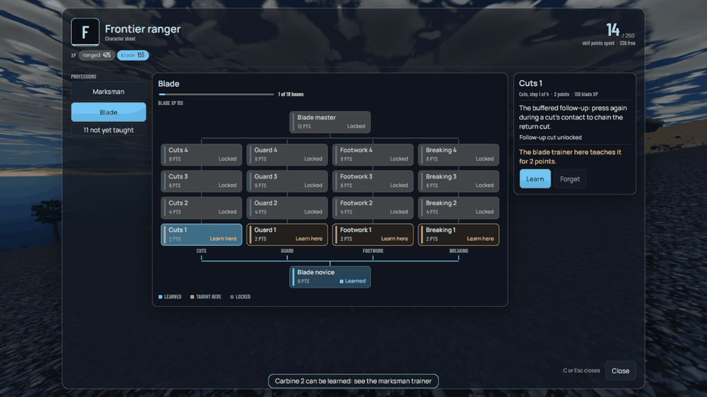
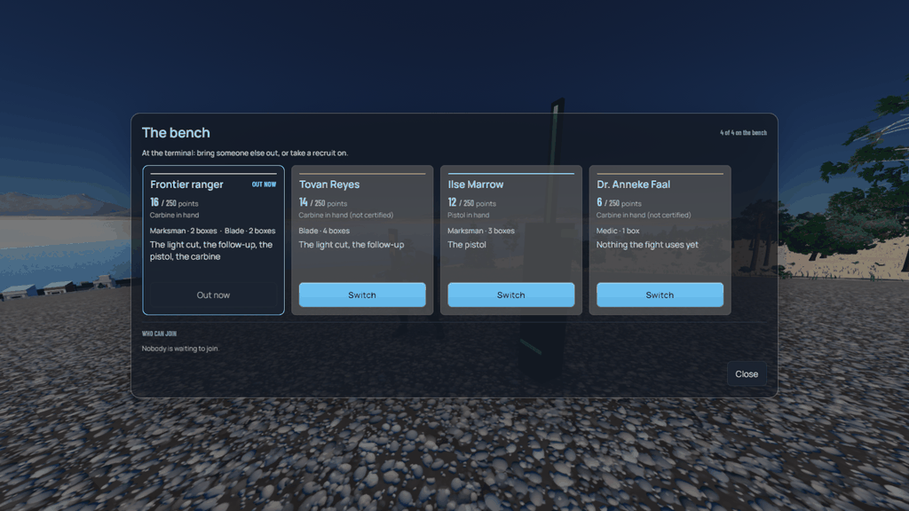
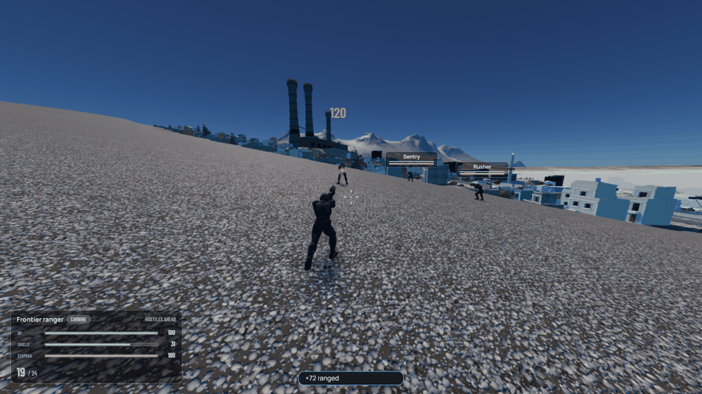
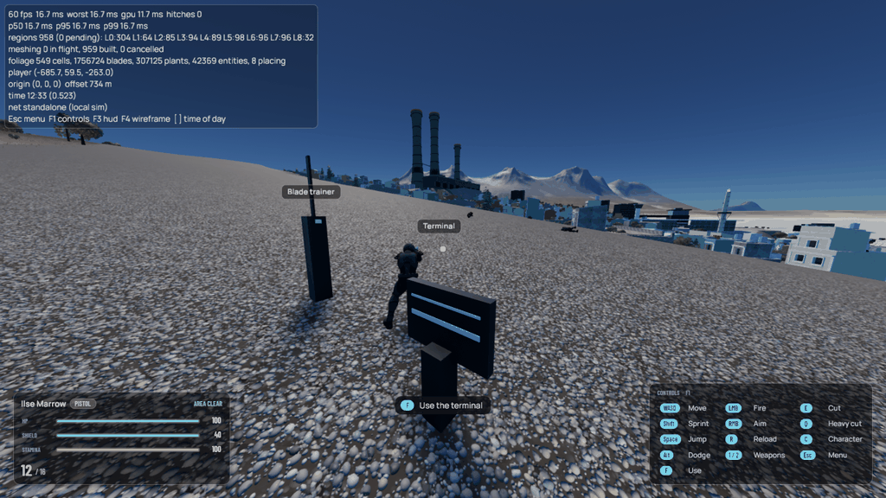
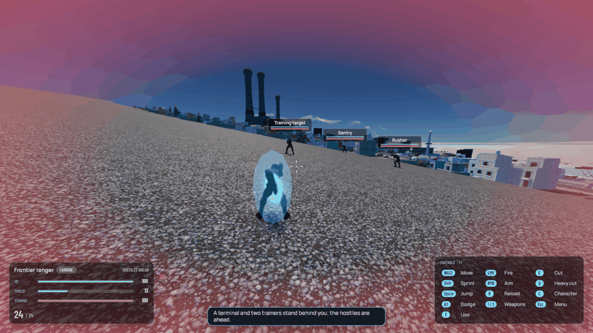
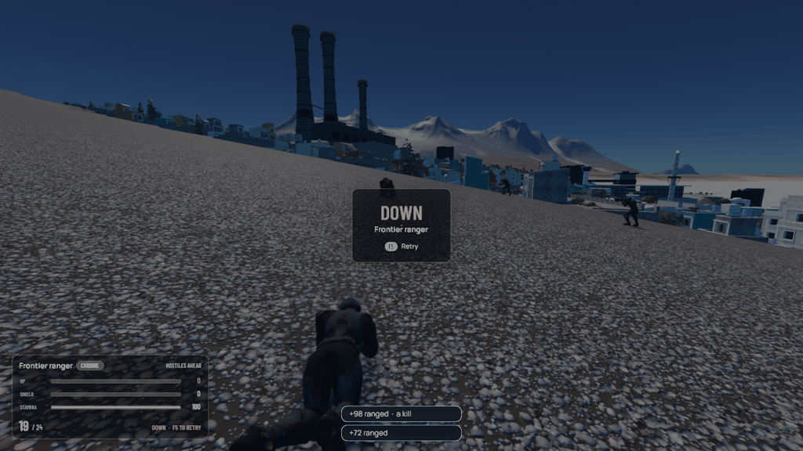

# Professions, skill points and the bench

Design proposal, 2026-10-01. A first shape for character progression,
written to be argued with. It follows [the setting](../SETTING.md), the
[frontier-life pack](frontier-life/README.md) and its
[small industry](frontier-life/small-industry.md) proposal, and it builds on
the [combat slice](combat/DESIGN.md) that already runs. Numbers are paper
numbers.

Decided so far, by the user:

- **Professions, Star Wars Galaxies style.** No classes. A character learns
  boxes from several profession trees, each box costing skill points from a
  fixed budget, so a character is a shape the player cut rather than a role
  they picked at the start.
- **A bench.** A player does not have one character; they acquire a bench of
  them during play and switch between them. Specialization is bought with
  the budget cap, breadth is bought with the bench.
- **250 points a character, a bench of four.**
- **A main character who does the talking.** The arrival is the
  household's voice: every conversation is theirs, and they are always
  present, just not visible, when the player is controlling a secondary.
  The others are the household's hands and skills, not its mouth.
- **Switching at a base or a terminal.** The household's home or workshop,
  and transit terminals; not at an inn in any settlement.
- **No permanent loss.** A benched character is never lost. Setbacks cost
  time, goods or standing, never the character. An injured character is off
  the bench until the household pays the clinic's dues.

The rest of this document is proposal.

## 1. What the two decisions buy

A hard skill-point cap makes every character a commitment: a master
fabricator who also carries a carbine is a weaker fabricator, and the player
feels that trade. SWG's whole social economy came from that cap, because
nobody could do everything, so everybody needed someone.

In a singleplayer game that pressure has nowhere to go: there is no one to
need. The bench is what makes the cap honest in singleplayer. The player
still cannot make one character do everything, but they can make a
*household* that does, and the household is built the way the character is,
by choices during play. The thing the player grows is the bench; the thing
the player plays is one person on it.

That framing also fits Veyra. Everyone arrives alone through Port Serein.
Over a game, a settler gathers a crew: a runner who owes them, a medic they
pulled out of a marsh, a fabricator whose shop they saved. On a frontier a
household is the unit that survives; the bench is that household made
mechanical.

## 2. The budget

| | Proposal |
| --- | --- |
| Skill points per character | 250 |
| A tree | one novice box, four branches of four boxes, one master box |
| Box cost | novice 6, branch boxes 2 / 4 / 6 / 8 up the branch, master 12 |
| A full tree | 6 + 4 × 20 + 12 = 98 points |
| What 250 buys | two full trees and a half, or one tree and three strong partials |
| Learning a box | its branch prerequisite, the XP of its kind, and a teacher or a manual |
| Forgetting a box | free, any time out of combat, points return; XP is kept |

Two and a half trees is the SWG number and it worked: a "pure" character is
a conscious sacrifice, a mixed one a conscious compromise. Forgetting being
free matters more here than it did there, because a bench character the
player parks for twenty hours should be reshapeable when they come back to
it. XP is the real investment and it is never lost.

XP comes in kinds, and a box needs the kind its tree is about: combat kinds
(ranged, blade), survey, machine, fabrication, medical, trade, wilderness.
A kind is earned by doing the thing, not by killing something near it; a
runner levels on deliveries, a medic on patients, a surveyor on deposits
found and stations read. This is what stops every character from being a
fighter who crafts on the side.

## 3. The professions

Eight basic trees anyone can start, five elite trees that need boxes from
two basics. The basics are the five frontier-life roles plus the three the
setting kept pointing at (machines, ecology, the deal). The elites are where
the institutions live: a tree the player can only enter by having become
someone an institution would hire.

### Basic trees

| Tree | Branches | What its master is | XP kind |
| --- | --- | --- | --- |
| **Marksman** | Carbine, Pistol, Steadiness, Field craft | Can fight at range from cover, reload under fire, use any ranged weapon | ranged |
| **Blade** | One hand, Guard, Glaive, Greatblade | The light-follow-up-heavy chain in full on three weapon classes and the guard; each class teaches its own abilities | blade |
| **Surveyor** | Deposits, Stations, Routes, Reading | Finds what the ground holds and where a route goes, reads tracks and failed machinery | survey |
| **Runner** | Loads, Roads, Contracts, Crews | Carries more, drives the crawler, holds route contracts, hires a route | trade |
| **Fabricator** | Fixtures, Batches, Materials, Repair | Runs a workshop, turns a lot into a batch, teaches schematics | fabrication |
| **Rigger** | Power, Extraction, Drones, Lines | Sets up and keeps machines running: extractors, buffers, pipes, a scout drone | machine |
| **Medic** | Wounds, Cassettes, Sampling, Field | Treats and stabilizes, reads water and tissue, works in the field | medical |
| **Broker** | Prices, Introductions, Leases, Disputes | Gets access: a lease, a pad, an introduction, a settlement to take a side | trade |

### Elite trees

A basic tree can be started by anyone the day they arrive. An elite tree
cannot be opened from nothing: its novice box requires named boxes from two
basic trees, so only a character who has already become a particular kind
of person can enter it. Elites are deeper and dearer, so an elite master is
most of a character's budget, and they are where a character's identity
lives: nobody is "a Marksman with some Broker", they are a Warden. In SWG
the elites were Bounty Hunter (Marksman and Scout), Combat Medic (Medic and
Marksman), Smuggler and the like; here the slot is used for the
institutions, so that learning one is a relationship with a faction and the
tree's uniform is what residents react to.

| Tree | Needs | Branches | Who teaches it |
| --- | --- | --- | --- |
| **Warden** | Marksman 3 boxes + Broker 2 | Escort, Plant, Access, Command | Pelagic Works |
| **Ranger** | Marksman 2 + Surveyor 3 | Tracking, Wilderness, Long shots, Native life | the Continuity Institute's field people |
| **Station engineer** | Rigger 3 + Fabricator 2 | Processors, Water, Diagnosis, Retrofits | Pelagic's plant crews, grudgingly |
| **Ecologist** | Medic 3 + Surveyor 2 | Species, Water, Change, Evidence | the Continuity Institute |
| **Assembly agent** | Broker 3 + Runner 2 | Commons, Water rights, Mutual aid, The vote | the Borough Assembly |

The elites are the game's answer to "what is my affiliation". No reputation
bar: a character who has learned Warden boxes *is* someone Pelagic trained,
and residents react to the uniform that implies. A character can hold boxes
from two institutions' trees, and the setting says what that costs: the
Institute's ecologist with a warden's plant access is exactly the person in
the middle of the water dispute.

### What a box does

A box changes numbers the sim already has, grants a certification, or opens
an interaction. The combat slice gives a concrete example of each kind:

| Box | Kind | Effect on the current combat numbers |
| --- | --- | --- |
| Blade novice | numbers | the light cut only; stamina 18 a cut |
| One hand 1 | opens | the buffered follow-up; the thrust ability |
| Blade novice | opens | the light and the heavy cut |
| Glaive 2 | numbers | dodge cancel opens at 0.26 s instead of 0.31 |
| Glaive 4 | numbers | dodge invulnerability 60 to 280 ms instead of 240 |
| Guard 1 | numbers | posture regeneration 35 → 48 a second; guarding costs a tenth less stamina |
| Greatblade 4 | numbers | heavy posture 80 → 110 |
| Marksman novice | certification | the pistol |
| Carbine 1 | certification | the carbine |
| Carbine 3 | numbers | cadence 240 → 200 ms |
| Steadiness 2 | numbers | aim-move speed 65 % → 80 % |
| Steadiness 4 | numbers | no recoil blend on the aim pose |
| Field craft 2 | opens | reload while sprinting |

Every effect is a value in a table the sim reads at spawn and on every
learn or forget; nothing in the sim knows the word "profession". The tables
are content (`assets/progression/*.ron`), the engine ships the graph, the
budget, the XP ledger and the modifier merge. That keeps the layering rule
and lets the trees be rewritten without touching a crate below the game.

## 4. The bench

### What a bench is

A bench is the set of characters a player can play. One is *out*; the rest
are *benched* and somewhere in the world. Switching happens at a **bench
place**: the household's base (its home or workshop) or a transit terminal.
It is a world action, not a menu: the character the player is leaving walks off to
their work, the one they are taking walks in. No switching in combat, in the
wilderness, or mid-job.

| | Proposal |
| --- | --- |
| Starting bench | one character, the arrival |
| Cap | four |
| Bench places | the household's base (home or workshop) and transit terminals |
| Switch cost | a walk to a bench place; the switched-to character arrives where they were last left, or at the bench place if that is on a route they would plausibly use |
| Per character | skills and XP, body and implants, outfit, personal reputation, who they know, where they are |
| Per household | money, the home, the workshop and its stock, schematics learned by anyone on the bench (but only the right skills can use them), vehicles, the route contracts |

The household owning the economy and the characters owning the skills is
the key split. It is what makes the bench a *team* rather than four
alternate saves: the fabricator's batch funds the warden's armour, the
surveyor's lot sits in the shared hopper for whoever can turn it into
something.

### Acquiring a character

A character joins the bench through play, never through a menu. Ways in:

- **The arrival.** The character the player made at the shuttle; the first
  of the household, not its lead.
- **The rescue.** Someone the player got out of something: the runner whose
  crawler the latchmaw took, the medic trapped at the failed station.
- **The partner.** A resident whose job the player did well enough, often
  enough, that they propose working together: the fabricator who wants a
  surveyor they can trust.
- **The hire.** Paid, at the Exchange, with skills already on them and a
  contract that ends if the household cannot pay.
- **The second arrival.** Later, a new settler the household sponsors; a
  fresh character with no boxes, for a player who wants to cut another shape.

A joined character arrives with their own boxes (a hired runner has Runner
boxes; a rescued medic has Medic), their own XP in those kinds, and their own
opinions about the institutions. The player can forget their boxes and
rebuild them, but that is a conversation, not a respec: a fabricator asked
to become a gunfighter has something to say about it.

### Benched characters work

A benched character is not frozen. They have a **standing job** the player
sets at the bench place, from what their skills allow:

| Standing job | Needs | What it does while benched |
| --- | --- | --- |
| Run the workshop | Fabricator boxes | works the queued batches; progress at a fraction of played speed |
| Run a route | Runner boxes, a crawler | moves pods along a contracted route; the small-industry freight system without the player driving |
| Keep the yard | Rigger boxes | restarts stalled machines, changes filters, keeps the power buffer up |
| Hold the clinic | Medic boxes | treats residents; income and trust at the settlement |
| Guard the plant | Warden boxes | a Pelagic contract; income, and the warden is where the trouble is when it comes |
| Rest | nothing | heals, and is where the player left them |

A standing job can go wrong, and a setback is **never a death**: the
investment in a character, their boxes, XP and relationships, is always
intact. What a setback costs instead:

| Setback | Cost |
| --- | --- |
| The warden loses a fight at the plant | injured: off the bench until the household pays the clinic's dues, and the plant contract on probation |
| The runner is turned back or the crawler is taken | the pod and its lot are lost, the crawler needs recovery or repair; the runner walks home |
| The yard's machine fails under the rigger | the batch is lost, the machine is down until repaired |
| The clinic is caught up in a dispute | standing with one institution drops; the medic is asked to leave town for a while |
| The household cannot pay a hired character | the contract ends and the character leaves the bench, with a standing offer to return once the household can pay the arrears |

Even the hire is not a loss: their boxes are theirs, and they come back.

This is the piece that turns the bench from a convenience into the economy.
Small industry asked for "hired routes" and "NPC services"; here they are
the player's own people doing the work the player taught them. It also gives
switching a reason beyond "I want the other skills": the player switches to
the runner because the route is blocked and someone has to go and see why.

### What a switch feels like

Switching should feel like changing whose hands you have, not changing a
loadout, while the voice stays the same:

- The camera and the HUD are the same; the body, the stance, the outfit,
  the weapons and the available moves are not.
- The main character talks. When a conversation starts while a secondary is
  out, the arrival's model is swapped in for it: the resident speaks to the
  arrival, who may be asked about who they brought, and the secondary's
  body returns when the conversation ends. The arrival is the household's
  memory too: "last time" is theirs, whoever was out.
- Standing with an institution is per character, through the elites. A
  household can be in good standing with Pelagic through its warden and in
  trouble with it through its ecologist, and the settlement knows both
  people live in the same house and that the arrival speaks for both. That
  is a story the game can tell about the water.

### Risks, and what to do about them

| Risk | Answer |
| --- | --- |
| The player spreads attachment thin and feels nothing for anyone | The arrival is the voice throughout, so the player's attachment has one anchor; the others are people the arrival gathered, each with a history and their own standing. The opening region is written for the arrival alone, and the bench opens after the first journey, not at the shuttle. |
| Switching becomes a menu optimisation | No switch away from a bench place; the walk is real; benched characters are busy, and pulling a runner off a route stops the route. |
| Four characters is four grinds | XP kinds are earned by the jobs the household is already doing; a benched fabricator working the queue earns fabrication XP slowly. Nobody grinds a bench character from zero unless they chose the second arrival. |
| The economy becomes self-sufficient and the world goes quiet | Caps: the bench cannot hold every profession, the elites need institutions, leases need the Broker, and the Broker needs the settlement. The household trades because it must. |
| Multiplayer | A bench is per account on a server; one character out at a time. Benched characters' standing jobs run server-side like any persisted local consequence, which the setting already requires for the station. |

## 5. How a session goes

The arrival, a surveyor, finds a deposit above the service town and leases
a pad through a Borough introduction. The fabricator in town needs filter
stock; the household cannot make it. Three missions later the fabricator
proposes a partnership and joins the bench. The player switches to the
fabricator at the workshop, learns the filter schematic, queues a batch,
and sets the standing job. Back as the surveyor, the route to the pad is
cut by a landslide; the surveyor can read the slope but cannot move the
pods. The Exchange has a runner for hire. The runner joins, the player
drives the crawler the long way once, then sets the route as a standing job
and goes back to surveying. When Pelagic's warden starts turning the
crawler back at the plant road, the household needs either a Broker who can
get a lease or a fight it is not equipped for, and the player decides what
kind of household this is going to be.

## 6. What the engine needs

In the order the first playable needs them:

1. **A skill graph registry.** Trees, branches, boxes, costs, prerequisites,
   XP kinds, and each box's modifiers, loaded from `assets/progression/`
   like the species and material registries; a version in the handshake.
2. **A character sheet component** on the sim side: boxes learned, XP by
   kind, points spent; the merge of box modifiers into the numbers the
   combat and motor code already read (`ActionSpec`, `WeaponSpec`,
   regeneration, certifications). Replicated, appended to the protocol.
3. **The XP ledger.** Events the sim already raises (a confirmed hit, a
   contact, a delivery, a batch) credited to kinds.
4. **The bench** as a server-side household record: characters, the one
   that is out, the shared stock, standing jobs ticking at a slow rate
   while the world is loaded and catching up when it is not, the way the
   station's persisted state must.
5. **Bench places** as settlement content, with the walk-in walk-out.
6. **Teachers and manuals** as the way boxes are learned, so professions are
   in the world and not in a menu.

None of this needs a new crate below the render layer; the registry sits in
`strata-registry`, the sheet and ledger in `strata-sim`, the bench beside
the player in the server, the trees in the game's assets.

## 7. Balancing: simulate before tuning

Decided: rates, costs and durations in this document are placeholders for
balancing passes. What has to be built first is the means to make a change
and know what it does before anyone plays it.

The principle is one model. The sim's numerical core already runs without
Bevy, a window or a GPU (`Combatant::step` is a plain function, and the
combat study drove it from a script and recorded a CSV). Every balance
tool runs *that* code, never a reimplementation of it in a spreadsheet, so
a prediction and the game cannot drift apart. Python sweeps and plots;
Rust is the model.

| Layer | What it is | What it answers |
| --- | --- | --- |
| **Tables** | Every tunable in `assets/combat/*.ron` (`actions`, `weapons`, `actor`, `opponents`; built, loaded by `strata_sim::combat_tables`, versioned in the handshake, and a test holds the shipped files to the numbers that were in code) and, to come, `assets/progression/*.ron`: box costs and modifiers, XP rates per event, dues rate, standing-job rates, prices. No number in code. | What changed between two commits, by diff. |
| **Duel harness** | `tools/balance` (`just balance`): bouts between policies (`HoldAndFire`, `CloseAndCut`, `Kite`, `Stand`, `Scripted`) over the real `strata-sim` and `strata-physics` combat, headless at 60 Hz with no clock, over a grid of table values (`--vary path=v1,v2` or `grid --spec`), many bouts a second. Prints CSV; `tools/balance/README.md` has the columns and presets. | Time to kill, damage taken, stamina and posture margins, how often a chain lands, pistol against carbine, a Blade master against a Marksman novice, every box's marginal effect. |
| **Progression model** | XP income per activity per hour measured from played sessions and the scripted runs, against box costs and XP gates, walked forward. | Hours to first elite, to a master, to a full bench; where a tree stalls because its XP kind is scarce; what a box costs in hours. |
| **Household model** | The small-industry paper example as a discrete-event run: standing jobs producing, routes delivering, batches selling, dues and leases taken out, over simulated days. | Income per hour by household shape, whether a setback's cost is a sting or a wipe, how long the clinic holds a master, whether self-sufficiency arrives too early. |
| **Feel contracts** | Target bands per metric, the way [combat/DESIGN.md](combat/DESIGN.md) already states a feel contract for the motor: a fair duel lasts 8 to 14 s, a novice loses to a master in under 6 s but lands at least one hit, first elite between 6 and 10 hours, clinic dues for a master about one hour of household income. The combat bands are `assets/combat/contracts.ron`, each a preset matchup, a metric and a range with its rationale; the `contracts` test of `tools/balance` (in `just test`, so in `just ci`) and `just balance-check` run them. A band the tables do not yet meet is held at what the harness measures and marked "measured, not yet chosen" (`chosen: false`): it is printed, not failed, until a tuning pass chooses it. | Whether a change is inside the bands; CI fails when a table change breaks a chosen band, as the perf gates fail on frame time. |
| **Ledger** | [`docs/balance/ledger.md`](../balance/ledger.md): each tuning change, its predicted metrics, and what the next played session measured, like `docs/perf/ledger.md`; [`docs/balance/README.md`](../balance/README.md) is the procedure. | Whether the model predicts play; where it is wrong, the model is fixed before the tables are. |

Order of building: the tables first (the combat numbers move out of
`Action::spec` and `Weapon::spec` into RON with a test that the shipped
tables reproduce today's values), then the duel harness (it is mostly the
combat script's headless path with policies and a grid), then the feel
contracts for combat, which the harness can check from the first day. The
progression and household models come with the trees and the standing
jobs they model; they are paper until then, and the paper versions should
be written in the same metrics so they are replaced, not reinvented.

What a balancing pass then looks like: change a table, run the harness,
read the bands, write the ledger line, play, measure, correct the model if
play disagreed. A number is never changed because it felt wrong in one
session; the session is a measurement against a prediction.

## 8. Open questions

- **Elite trees and the water dispute.** Three institutions, five elites: is
  the Borough's agent enough, or does the Assembly want a second (a
  commons engineer, a militia)? Should an elite require *leaving* another?
- **How big a tree is.** Four branches of four is SWG's shape; the combat
  slice has about twelve tunable knobs today, which fills Blade and Marksman
  comfortably. Surveyor and Broker need their interactions designed before
  their boxes mean anything; the trees above are a budget, not content.
- **Switch friction.** Is the walk to a base or terminal enough, or should
  a switch also cost in-world time (the hours it takes the other character
  to get there), so the household is spread over the basin rather than
  passing through a door?
- **Clinic dues** scale with the injured character's investment: the sum of
  the skill points in their boxes, so a master costs more to put back
  together than a novice, and a household that fields its most valuable
  people in the trouble pays for it. The rate is a balancing-pass number
  (section 7). Open: whether an institution's clinic discounts its own
  elites (Pelagic treating its wardens on the concession), and whether a
  Medic on the bench can treat the household's own at the cost of their
  time instead of money.

## 9. What is built (2026-10-01, the first slice)

The model below the render layer, as section 6 orders it: the graph, the
sheet, the merge and the ledger. Not built: the bench, bench places,
teachers and manuals, any screen, and replication. Combat is local-only
play in this slice; the protocol does not carry the sheet or the bench,
and nothing here was appended to it. The handshake's version of the
tables is unchanged; the graph's `version` is not yet in it.

### The data

`assets/progression/trees.ron` is the graph, read and checked by
`strata_registry::progression` (no Bevy) into `GameRegistries::progression`
and compiled in as `SkillGraph::shipped()` for tests and tools:

```ron
(
    version: 1,
    budget: 250,                       // points a character has
    rates: (damage: 1.0, kill: 50),    // what the ledger credits
    trees: [(
        id: "blade", name: "Blade", xp: Blade,
        placeholder: false, note: None,
        prerequisites: [],              // an elite names boxes of two basics
        novice: (id: "blade.novice", name: "Blade novice",
                 description: "The light cut, 18 stamina a cut.",
                 cost: 6, xp: 0, effects: [Unlock(action: "Light")]),
        branches: [(id: "blade.cuts", name: "Cuts", boxes: [ /* four */ ])],
        master: ( /* cost 12, xp 3000 */ ),
    )],
)
```

A box's `effects` are one of `Action(action, field, op, value)`,
`Weapon(weapon, field, op, value)`, `Actor(field, op, value)` with `op`
`Set`, `Add` or `Mul`; `Unlock(action)`; `Certify(weapon)`. The loader
refuses a duplicate id, a tree that is not four branches of four, a cost
other than 6 / 2 4 6 8 / 12, a tree that is not 98 points, a prerequisite
that names no box or a box of its own tree, a field, action or weapon the
sim has not got (a sim test holds that vocabulary to the real structs), and
a budget below one tree. XP gates are `150 / 400 / 900 / 1600` up a branch,
`3000` for a master, double for an elite. Thirteen trees ship: the eight
basics and five elites of section 3. Only Blade and Marksman carry effects;
the other eleven are `placeholder: true` with a `note`, every box with an
empty effects list, because no activity earns their XP kind yet. Surveyor is
real since ticket 0009 step 4 (surveying earns Survey XP; its boxes change the
ping, the sample and the bike), and Weaponsmith since ticket 0007. Fabricator is real since ticket 0009 step 5
(its boxes change the bench, the fabricator's run and repair, and teach
schematics; only Materials 4 waits on harvesters).

An action is closed to an actor until a box unlocks it only if some box in
the graph unlocks it; the same for a weapon and `Certify`. The shipped
graph gates Light, Followup and Heavy (Blade novice, Cuts 1, Cuts 3) and
the pistol and carbine (Marksman novice, Carbine 1). Dodge, reload and swap
are open to everyone.

`opponents.ron` gives the encounter's opponents sheets (`rusher`: Blade
novice to Cuts 3; `sentry`: Marksman novice to Carbine 2) and `player.ron`
the arrival's start (Blade to Cuts 3, Marksman to Carbine 1, so the combat
slice's whole moveset is there on day one; 26 points). Authored sheets are
checked against the graph (boxes exist, chains hold, the budget) but not
against the XP gates.

### The sheet

`strata_sim::progression::CharacterSheet` is a component
`{ learned: BTreeSet<String>, xp: BTreeMap<XpKind, u32> }`. Points spent
and free are derived from the graph. `learn(graph, id, teacher)` checks the
prerequisites (the novice for a branch's first box, the step below for the
rest, the top of every branch for a master, the named boxes for an elite's
novice), the XP of the tree's kind, the free points and then the teacher,
which the world decides and passes as a bool; `can_learn` is the same
without the write, for a UI to grey a box. `forget(graph, id, in_combat)`
returns the points and keeps the XP, refusing while a learned box depends
on it or while `in_combat`, which the caller reads from
`Combatant::in_combat(engaged)` (action not Ready, or engaged).

### The merge

`apply(tables, graph, sheet) -> EffectiveTables` is pure: the installed
`CombatTables` with every learned box's effects applied, all Sets then all
Adds then all Muls in graph order, so the result does not depend on the
order learned, plus the unlocked actions and certified weapons.
`Combatant::fit(graph, sheet)` stores it; from then on
`Combatant::spec(action)`, `weapon_spec()`, `with_actor(..)`, `unlocked()`
and `certified()` read it, and the physics, the view and the harness read
the actor's rows through them. A `Combatant` that was never fitted reads
the global tables live and may do everything, which keeps the balance
harness and every pre-existing test on their numbers. A heavy or a cut the
actor's boxes have not opened is dropped from the input, not buffered; an
uncertified weapon does not fire and a draw of it is refused at once.

### The ledger

`credit_xp` runs every tick in `SimSet::Observe` over the `CombatImpact`
messages, which now carry `dealt` (health and shield removed) and `lethal`.
A bolt that lands credits ranged XP of `dealt * rates.damage`, a blade
contact blade XP, and a killing hit `rates.kill` on top; the credit is
written to the attacker's sheet and announced as an `XpGained { entity,
kind, amount, kill }` message for a HUD. `game --combat` logs each credit
to the player as `xp: +24 ranged`.

### Known gaps in the shipped boxes

Two of the design's Marksman effects have no sim number yet and were
stood in for: Steadiness 4 ("no recoil blend on the aim pose") is
aimed-movement speed at 90 percent, and Field craft 2 ("reload while
sprinting") is a 15 percent quicker reload on either weapon. The dodge
contact window of Footwork 4 moves `contact_end` only, as the design says.
Every other Blade and Marksman effect is in the file. A description says
what the box is for (`A quicker carbine reload.`) and carries no number;
the sheet computes the before and after from the tables, so a table edit
never leaves a stale figure in the prose.

## 10. What is built (2026-10-01, the world side of the slice)

The bench, bench places and teachers of section 6, in `apps/game` and the
client, with no screens yet: everything below is exercisable headless and
by keyboard, and the next slice's screens open on the same messages.
Combat is still local-only play: nothing here is replicated, the protocol
was not touched, and a connected client has no household.

### The household

`apps/game/src/household.rs` holds the `Household` resource:

```rust
struct Household {
    version: u32,
    characters: Vec<Character>,   // the bench; [0] is the arrival, never removed
    active: usize,                // who is out
    recruits: Vec<Character>,     // who can still join, in the order offered
}
struct Character {
    name: String,
    sheet: CharacterSheet,        // the sim's own component, as saved
    weapon: Weapon, ammo: u16, holstered_ammo: u16,
    tint: u8,                     // an index into the view's palette
    left_at: Option<WorldPos>,    // where a swap left them; None never played
}
```

The first day is `assets/progression/household.ron`, read and checked by
`strata_registry::progression` (`HouseholdDef { arrival, recruits }`,
each a `MemberDef { name, tint, sheet }`, every sheet checked against the
graph like the opponents'): the arrival is the combat slice's ranger with
Blade novice, Marksman novice and Carbine 1 (14 points, 150 ranged XP),
and three recruits: a blade-leaning fighter (Cuts 2 and Footwork 1), a
pistol marksman (Marksman novice, Pistol 2, so the pistol is in hand and
the carbine is not certified) and a medic with only the placeholder
Medic novice, who can do nothing yet and is there so the bench can show a
benched placeholder tree. `player.ron` now carries the same 14-point
start and is the fallback for a data set without a household file.
Recruits join free at a terminal; the design's ways in (the rescue, the
partner, the hire, the second arrival) are future work.

The household is saved as RON to `--household` (default
`scratch/household.ron`) on every change (an XP credit, a lesson, a join,
a swap) and read back at startup; `--fresh` ignores the file. It is
singleplayer-local: the server never sees it.

### Bench places and teachers

`strata_sim::progression::Interaction { kind, radius }` is a component on
a prop, with `InteractionKind::Terminal` or `Trainer { trees }` (graph
ids). `find_reach` runs every tick in `SimSet::Observe` and writes the
`Reach` resource: the nearest prop within its radius, its prompt
(`terminal`, `blade trainer`) and every tree a trainer within reach
teaches. `Reach::teaches(graph, box_id)` is the `teacher` argument of
`CharacterSheet::learn`, so a box is learned only beside a trainer whose
trees include it, and the terminal teaches nothing.

The game stands two bench places (`household::sites`), each a terminal
with a blade trainer 3.5 m to one side and a marksman trainer to the
other, placed on the ground by the encounter's own height query
(`household::ground_at`: the terrain sample, then a ray down through what
has streamed) once that ground exists. One is behind and to the right of
the combat staging spawn, facing it; the other is on the Exchange square,
four metres uphill of the `--at city` street spawn in the settlement's
frame. In seed 42 they stand at:

| Prop | Staging (default spawn) | Exchange (`--at city`) |
| --- | --- | --- |
| Terminal | (-685.1, 58.3, -261.4) | (-381.3, 38.0, -432.1) |
| Blade trainer | (-687.7, 58.9, -263.7) | (-379.0, 38.0, -434.8) |
| Marksman trainer | (-682.4, 57.7, -259.2) | (-383.5, 38.0, -429.4) |

In the window each is a slab and a post of cubes with an emissive strip
(teal for the terminal, green for the blade trainer, amber for the
marksman) and a small light of the same colour, so the place reads at
night. The combat HUD shows `F: terminal` or `F: blade trainer` within
reach, and F (gated like every other game input) raises
`strata_sim::progression::Interact { entity, kind }`.

### What F does until the screens exist

The game answers `Interact` (`household::handle_interact`): at a terminal
everyone who can join joins, then the bench cycles to the next character;
at a trainer the first box of the trainer's trees the sheet can take is
learned, and the refusals (not enough XP, not enough points) are logged.
A swap (`household::swap_to`) writes the active character's sheet,
weapon, ammo and position back, applies the next one's to the local
player's `Combatant` (full pools on its own rows, its weapon in hand),
sheet, `Name` (the HUD) and `BodyTint` (the body), and is refused while
the actor is not `Ready` or hostiles are engaged. The switched-to
character arrives where the player stands; the walk-in of section 4 is
future work. F5 resets the encounter and keeps every sheet, its XP and
the weapon in hand: progress is never reset.

### The ledger in play

`credit_xp` runs in the game; `household::track_xp` copies the player's
sheet into the household on every credit, so the file always has the
latest XP. The kill credit is the encounter's own death handling
(`CombatImpact::lethal`).

### The scripted path

`--script-progression` (implies `--combat-script`) fights the encounter
melee first, closing on the rusher and cutting whenever the body is free
so the kill earns blade XP, keeps cutting the training target until
Cuts 1's gate is paid, walks to the blade trainer, asks for the lesson,
walks to the terminal, lets the recruits join and brings the pistol
marksman out, logging each step (`script: ...`, `household: ...`).
Without `--frames` the run exits when the path is walked; headless it
takes about twenty seconds, since a scripted headless loop is not paced.
The test `household::tests::the_scripted_path_earns_learns_swaps_and_saves`
runs that in process and reads the file back: XP grew, Cuts 1 is learned,
the pistol marksman is active with the pistol in hand, the bench is four,
and the file round-trips.

## 11. What is built (2026-10-02, the screens)

The character sheet, the bench and the HUD's progress notices, on the
slotted stack beside the pause and settings screens, in the glass theme.
Everything a screen decides is the sim's decision put into words: the
sheet calls `CharacterSheet::learn` and `forget` and shows the refusal
they return; the bench lights a button only where the design allows a
switch. Combat is still local-only play: the screens read and write the
local player and the game's household, and nothing of either is
replicated. The protocol was not touched.



### The character sheet

`strata_client::ui::sheet`, kind `strata:sheet`, a page with a scrim.
Opened by C with nothing else open (C closes it from the top, Escape
too), by F at a trainer (on the first tree the trainer teaches), and by
the pause menu's Character button. The screen is built from the local
player's `CharacterSheet`, the graph, the sim's `Reach` and every trainer
in the world, and rebuilt in place (`replace_screen`) whenever any of
those change while it is up, so a hit that pays a gate or a step into a
trainer's reach shows the same frame.

The header is the name, a portrait slot with a strip in the character's
tint (the bench's card wears the same), the points spent against the
budget and an XP chip per kind earned (the shown tree's kind always).
The panel is 94 percent of the window up to 1320 px, and the trees
scroll inside it, so a 1280 by 720 window keeps the details panel and
Close inside the border (the bench the same; a harness test holds both).
The left column is a tab per tree, the trees with effects first and the
eleven placeholders folded to one line (`11 not yet taught`) that
unfolds on a click; a placeholder's cards all read `not
yet in the game`, its status line is the tree's note and Learn stays
off, since no trainer teaches it and nothing earns its XP. The
middle is the tree as the design draws it: the novice at the bottom,
four branches rising, the master on top, joined by ticks and rails
that light in the accent where the box below is learned, so progress
reads as a lit path upward; a progress bar and the box count head the
panel and a legend closes it. Each card wears a state stripe down its
left edge (accent learned, warm taught here, grey locked), the box's
name, and under it the cost (`2 PTS`) and one short state word or
figure at the right: `Learned` beside an accent square, `Learn here`
(every rule passes and a trainer of the tree is within reach, warm
bookmark frame), `Trainer`, `150 / 400 XP`, `Locked`, `No points`,
`Not yet`; the states are `sheet::BoxState::of`, which is `can_learn`'s
refusal by name, and a test holds every state's word to two words with
none repeated. The right
panel describes the selected box (the next box the sheet has not
learned, until one is clicked): its place and cost, the file's
description, one plain line per effect generated from the tables with
the number it moves from and to on this sheet (`Follow-up cut unlocked`,
`Light cut dodge cancel at 0.31 s to 0.26 s`, `Carbine reload 1.35 s to
1.15 s`), a status sentence (`The blade trainer here teaches it for 2
points.`, `Needs the blade trainer, 212 m to the north-west.`, `Needs
150 blade XP; has 0.`, `Learned. Cuts 2 still needs it.`) and the Learn
and Forget buttons, live only when the sim would say yes. A press
refits the actor at once and reports under the buttons.

### The bench



`strata_client::ui::bench`, kind `strata:bench`. Opened by F at a
terminal with its buttons live, and by the pause menu's Bench button
read-only, which the screen says. The household is the game's: it
publishes a `BenchView` (name, tint, weapon and sheet per character, who
is out, who can join, the cap) whenever its `Household` changes, and the
client derives the rest from the graph: points spent, the trees with
boxes in them as counts (`Blade · 4 boxes`, never `Blade 4`, which reads
as a level beside the sheet's `Cuts 4`), the weapon in hand with `(not
certified)` when the sheet does not certify it, and a line of what those
boxes open (`The light cut, the follow-up, the pistol`). Read-only from
the pause, the note says how far and which way the nearest terminal is.
A card is framed in the accent for the character
who is out, with a strip across its top in the character's tint; the
others carry Switch, enabled at a terminal while nobody is fighting, and
the recruits below carry Join, enabled at a terminal with room on the
bench.

Switch sends nothing at once. The client fades the screen to black
(0.35 s), sends `BenchRequest::Switch(index)` and closes the bench while
it is dark, and brings the world back over half a second with the other
character standing in it and their name on the HUD line; the game's
`household::answer_bench` does the swap (refusing it away from a
terminal, whatever sent the request, and if a fight began meanwhile) and
answers with a `BenchOutcome`, toasted. Join goes out at
once and is toasted the same way. The game no longer answers `Interact`
itself; the client does, and the script learns and swaps directly.

### The HUD



The vitals cluster (`combat_hud`, a slotted HUD layer in the glass
theme at the bottom left) carries the character's name, a chip with the
weapon in hand (and a warm `NOT CERTIFIED` chip when the sheet does not
certify it, since the trigger will do nothing) and the encounter's state
at the right (`HOSTILES AHEAD`, `ENGAGED`, `AREA CLEAR`); under it three
labelled bars with their figures (health turns danger below 30 percent,
the shield's maximum is the actor's capacity), then the ammo as a large
figure over the magazine that turns warm with an `R RELOAD` hint at a
quarter magazine, and the action's word when it is not Ready
(`RELOADING`, `STAGGERED`; down has its card instead). The XP figures left
the HUD: the toasts and the sheet carry them. The key legend is a
controls card at the bottom right, shown for eight seconds when the
player arrives and after every bench swap, and F1 any time. A hit the
local player lands floats its damage over the victim (`combat_text`:
Barlow, anchored to the victim's world position and re-projected every
frame, rising and fading over 0.9 s, warm for a cut, danger and larger
for a kill, at most 24 alive; hits on the same victim within 0.3 s
merge into one running figure that pops on each increment, and a new run
pushes the older figures on that victim up a line); every hostile wears
a nameplate (`nameplates`: its name on a glass pill over a danger health
track and an accent shield line, anchored 1.25 m over its position,
fading over the last 15 m of 60 m, gone when it is dead), and the
numbers rise from above the plate. The reticle is the client's own: a
dot and four bars whose gap closes while aiming and blooms with recoil,
warm over a standing hostile. A hurt shows as a danger `-N` beside the
health row, a red vignette at the window's edge that lets go over half a
second, and the four ticks round the reticle pop on a hit and turn
danger on a kill; under 30 percent health the vignette and the HP
figure pulse; when the player is down the world's UI hides, the vitals
stay, and a centred `DOWN` card with the name and an F5 glyph fades in
until the retry. A harness test holds the bars in line and F1 flipping
the card. `ui::progress` toasts the ledger's credits to
the local player summed over half a second, so a burst reads as one `+72
ranged` and a kill as `+74 blade  ·  a kill`, announces a box whose every
rule but the trainer newly passes (`Cuts 1 can be learned: see the blade
trainer`), silently rebasing when the learned set itself changed (a
lesson, a swap), and warns once a press when the sheet refused it (`Not
certified on the carbine`, `The heavy cut needs Cuts 3`), which the sim
reports through `Combatant::refusals` and `refused`. On the first day
(a household started, not loaded) a notice says where the bench place
stands, each prop within 30 m wears its name over its head on a small
glass pill that fades over the last 10 m, and the
blade trainer (a tall blade on the post) and the marksman (a target
board) are told apart by silhouette. `ui::prompt` is the F
chip, a glass layer near the bottom centre that says `Use the terminal`
or `Train with the blade trainer` while the sim's reach names one, and
hides with the screens like the reticle. The vitals, the controls card,
the floating numbers and the prop labels hide under a screen too.







### Keys and flags

A screen on the stack owns the keys and the mouse; the sim runs on
under it as it does under the pause; Escape closes it. Both screens fade
in over the theme's 180 ms as the pause does, and a rebuild after a
learn, a forget or a switch replaces the screen in place without fading
again; a close is immediate (slotted has no out-transition). The debug
statistics (F3) are off by default and `--stats` starts with them on.
Every screen and HUD layer was laid out at 1600 by 900, so the UI scales
with the window: the Display tab's Interface scale is Auto (the window's
height over 900, between 1 and 2 in quarter steps: 1.25 at 1080p, 1.5
at 1440p, 2 at 4K) or a fixed 100 to 200 %. `--open-sheet`
and `--open-bench` push the screen on frame 120 like `--open-pause`,
with the debug statistics off even under `--stats`; with `--script-progression` the script
opens the sheet at the blade trainer instead of asking for the lesson
(the path ends there) and the bench at the terminal once the recruits
joined, instead of the swap. The screenshots above are
`--script-progression --open-sheet --shot-frames 1960`,
`--script-progression --open-bench --shot-frames 2040` and
`--script-progression --shot-frames 560,2030` (560 catches a hit in
the first exchange; 600 falls between two), each with `--fresh
--window 1600x900 --time 0.5` under xvfb, shrunk to 1280 wide. No
scripted run otherwise hurts the player, so `--script-hurt n` has the
nearest hostile that can strike land `n` blows from four seconds into
the fight, a second apart, at its table's value through the sim's own
`Combatant::hit`: `--script-hurt 1 --shot-frames 250` is the hurt
screenshot and `--script-hurt 8 --shot-frames 620` the fall.

### Tests

`crates/strata-client/tests/ui.rs` drives the sheet headless through
`slotted-test`: C opens it on the tree the points went into, Learn is
off with the XP paid and no trainer in reach, a trainer spawned beside
the player lights it on the next tick, a click learns the box and refits
the actor, Forget refuses the novice that Cuts 1 depends on and takes
Cuts 1 back, a tab switches the tree and Escape closes. A second test
reaches both screens from the pause and finds the bench read-only. The
module tests hold `BoxState`, the effect lines, the trainer sentence,
the bench's summary and which buttons each bench state lights.

### Not built

No portrait art (the slot holds the initial). The trees are not
scrollable: thirteen tabs fit a 900 px window and no more. The bench
switch arrives where the player stands; the walk-in and the standing
jobs of section 4 are unchanged from section 10. The box hint and the
XP toasts are the client's and never reach a server.

## 12. What runs (2026-10-02)

The slice as it stands, in one place; the sections above say how each
part is built.

Implemented: the data (`assets/progression/trees.ron`, `opponents.ron`,
`player.ron`, `household.ron`; sections 2 and 3 as decided: 250 points,
a novice, four branches of four and a master a tree, costs 6 / 2 4 6 8 /
12, XP gates by kind), the sheet and the merge in `strata-sim`
(section 9), XP earned by doing the thing (damage and kills credit the
weapon's kind), a bench of four with switching at a terminal and
teaching at a trainer (section 10), the character sheet, the bench and
the HUD's notices on the slotted stack (section 11), and the harness's
box dimension: a side of a bout on a sheet, `balance sweep` for every
box's marginal effect, and two chosen bands (`cuts-3-lands-the-heavy`,
`blade-master-beats-novice`) in `assets/combat/contracts.ron`, with the
first sweep in [the ledger](../balance/ledger.md).

Not implemented: no replication (combat and the sheet are local-only
play; the protocol was not touched and the graph's version is not in the
handshake). Known stand-in: Learn and Forget on the sheet and the bench
switch write the sim's `CharacterSheet` and `Combatant` directly from
the client's `Update` and the game's `answer_bench`, where ADR 0004 has
the sim own the player through `PlayerIntent` consumed in the tick; the
existing `Interact` message is the shape, and a `Learn { id }` /
`Forget { id }` / `Switch` consumed in `SimTick` is the next structural
step, so a server can own the rules with no screen change. Recruits join free (no acquisition by play, no standing
jobs, no walk-in; the switched-to character arrives where the player
stands); eleven of the thirteen trees are placeholders with no effects
and no activity that earns their kind; no clinic, so no dues and no
injury (section 4's setbacks are not in the game); no portrait art.
The first box sweep found that today's fair duels end before any
first-step box can tell, so the box costs are untouched until the
tables meet the duel-length band.


