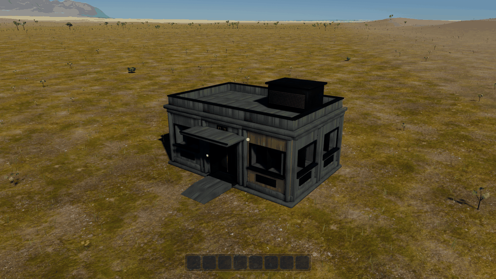
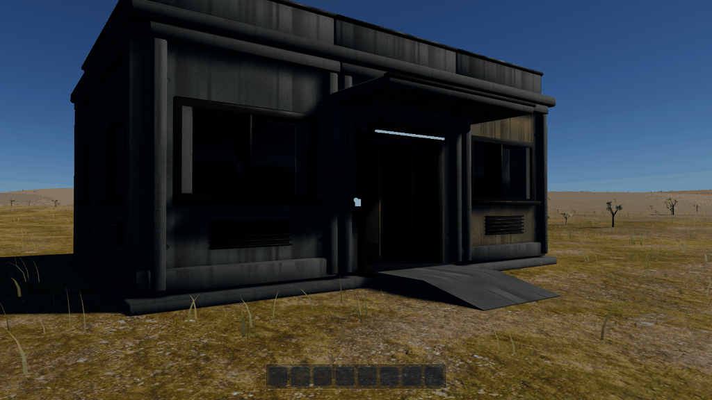
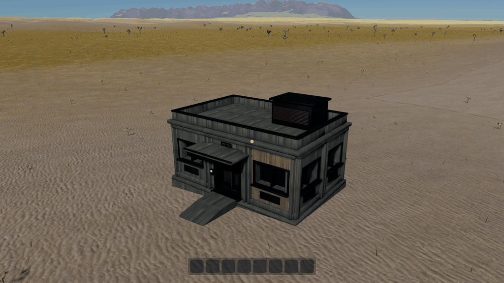
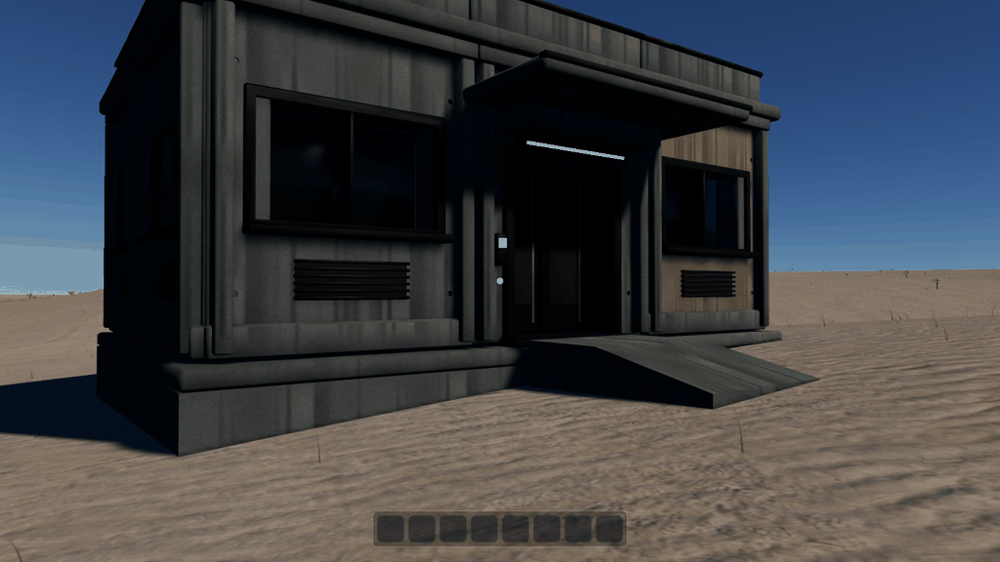
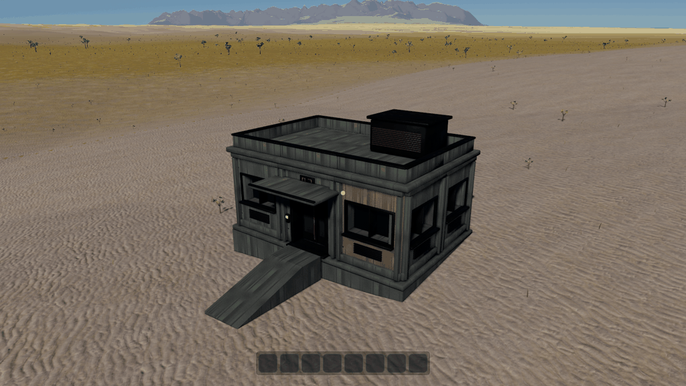
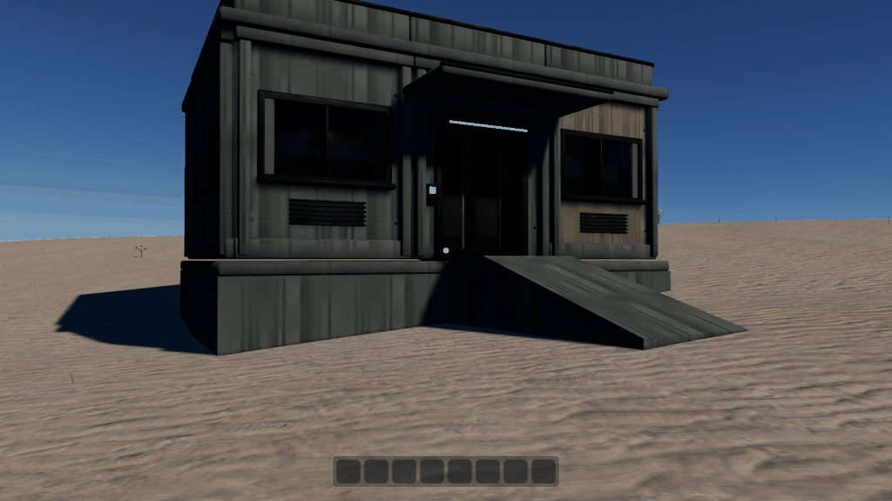

# Rust outpost terrain integration

Verified 2026-09-13. All six in-world views below were regenerated after the grass
clearance fix. The earlier capture crashes and the synchronous-compilation
workaround are documented in [recovery notes](RECOVERY.md).

The same Rust outpost now stands on three existing seed-42 sites, with level
floors, segmented foundations, a landing and ramp, static collision, and shared
vegetation clearance. No world-generation or material assets were changed.
The door remains closed; this delivery makes its threshold reachable.

## Measured sites

*Note, 2026-09-30: the table, the six captures below and the log are of the
sites as they were until ticket 0004's step 2b, on the plateau at (-1500,
-12000). That step ran a mountain range through the plateau (the old sites
are now at 1 220 to 1 830 m on its flank, at slopes of 53 to 64 degrees), and the
game's sites moved, by measurement, to the forest plain south-east of Port
Serein: flat (1000, -3620), slope (1020, -3800) and uneven (1200, -2480),
yaws as below (`apps/game/src/grounding.rs`). Ticket 0004's step 4 gave that
plain the domes of its granite, and they moved again, by measurement, to
flat (1080, -2600), slope (1040, -2760) and uneven (1080, -2440), with 0.037,
1.50 and 2.58 m of relief under the outpost's footprint (0.046, 1.51 and 2.66
m since that step's review). `capture.py` reads the sites
from there, so it frames the new ones; the captures and the table here have
not been retaken. Run a capture under `xvfb-run -a -s "-screen 0
2560x1440x24"`.*

Heights are world metres from the exact LOD0 triangle surface under the footprint.
The site called flat has 3.6 cm of natural relief, rather than an artificial plane.

| Site | Origin X/Z | Yaw | Ground min/max | Building origin Y | Floor Y | Ramp length | Rise/run |
|---|---|---|---|---|---|---|---|
| Flat | -1420, -12200 | 0 | 149.3760 / 149.4122 | 149.6322 | 149.6122 | 1.5 m | 0.2255 |
| Slope | -1540, -12000 | 0.65 rad | 155.9044 / 157.1255 | 157.3455 | 157.3255 | 2.0 m | 0.2164 |
| Uneven | -1540, -11880 | 0.65 rad | 157.9958 / 159.8032 | 160.0232 | 160.0032 | 4.5 m | 0.2784 |

The entrance threshold sits at building-local Y=0.10; the main slab top is -0.02,
and its underside is -0.32. The retained upper building is unchanged. The policy
uses 0.20 m floor clearance, 0.35 m burial, 0.32 m support thickness, 2 m maximum
support span, and 4 m maximum vertical depth. Access is 2.4 m wide, with a 1.5 m
landing, maximum grade 0.28 and maximum ramp length 18 m, searched in 0.5 m steps.
The toe accommodates up to 0.20 m cross-width terrain variation and sits 15 mm above
the highest ground in its 10 cm contact band. Vegetation bounds expand by 0.75 m.
These are content values, not defaults baked into the core solver.

Each site adds 22 foundation segments and two access prisms, 288 triangles total.
The upper building reuses the existing part meshes and PBR handles across all
three sites. Foundations and access use identical corners for render meshes and
convex collision. Upper collision is an explicit simplified content proxy set,
including the closed door leaves; decorative trims do not become obstacles.

## Reproduce

From the repository root:

```sh
CARGO_BUILD_JOBS=2 cargo build -p game -p building-preview
# Walk to the selected entrance; all three buildings are loaded:
taskset -c 0-3 ./target/debug/game --serial-pipelines --grounding-study uneven
# Print one capture command without launching a GPU window:
python docs/research/building-grounding/capture.py --site uneven --view ground
# Optional offline search of the surrounding valley:
cargo run -p veyra-buildings --example sites
```

The capture script prints one command by default; `--run` launches that view with
synchronous shader compilation, four-core affinity, vsync, an 8 MB worker stack and
a five-minute timeout. There are no automatic retries or batch runs. These settings
completed all six captures without another compiler crash. They are a verification
workaround, not proof of a driver fix. Logs persist beside the script across reboot.

All captures use baseline rendering, sun time 0.62, 1600x900 and frame 420. The
uneven ground-level view stands farther back to include the entire longer ramp.
These are actual engine screenshots, with the normal terrain, vegetation and UI.

| Site | Overview | Ground level |
|---|---|---|
| Flat |  |  |
| Slope |  |  |
| Uneven |  |  |

The views show buried foundation bases along the slopes, level slab tops and clear
ramps/landings. Vegetation remains around the reservations. Ground-level views
include the downhill ramp edge and toe. The door remains a closed static proxy.

## Verification and boundaries

Pure tests cover flat and sloped planes, arbitrary yaw and translation, the actual
triangle diagonal, interior high points, support depressions, approach obstructions,
convex winding, occupancy, invalid data and unfit sites. The actual character test
walks a generated ramp on a rotated sloping fixture, reaches the closed threshold,
and checks visual/body alignment after a 5 km origin rebase. A game fixture test
fits all three real sites and verifies that existing vegetation reservations are
preserved and approach bounds are installed before streaming. The foliage and tree
collision paths consume the same existing reservation resource.

Preparation happens before interactive startup. It builds an immutable source from
the same registry files and seed that the normal loader subsequently uses. Fitting
and native CSG run once; there is no per-frame meshing. Missing materials or unsuitable
sites fail startup with context. The fixture is incompatible with network, headless,
flight modes. Ordinary startup remains unchanged.

This is a fixed fixture, with no building streaming/LOD, terrain edits, dynamic
vegetation invalidation, moving doors or road generator. The fitter works with one
rectangular footprint and one straight approach; it rejects sites that need a more
elaborate solution. Conservative yawed occupancy clears some extra land at corners.
The 81 m sampling adapter is sized for this outpost; callers authoring larger sites
must supply adequate patch coverage.

Validation: full `just ci` passed after the grass fix, serial-pipeline flag and
removal of the retired building prototype, with `CARGO_BUILD_JOBS=1`,
`RUST_MIN_STACK=8388608` and `RUST_TEST_THREADS=2`. This includes formatting,
warnings-fatal Clippy, workspace tests and standalone headless checks. The ordinary
headless ten-frame smoke run, Rustdoc and the standalone Rust preview capture also
passed. The Blender building pipeline, its assets and old fixture were removed at
the user's request; the Rust workflow is the sole building pipeline.
