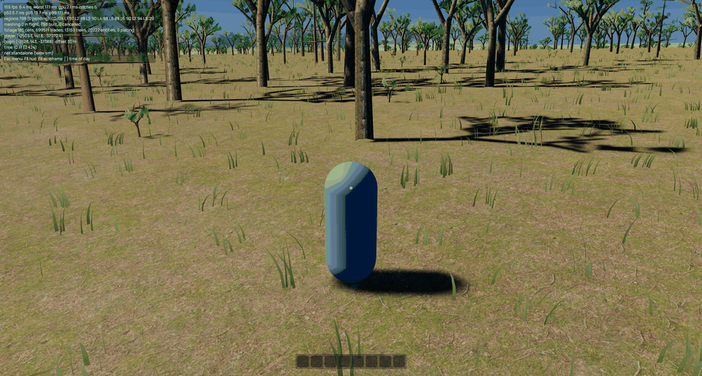
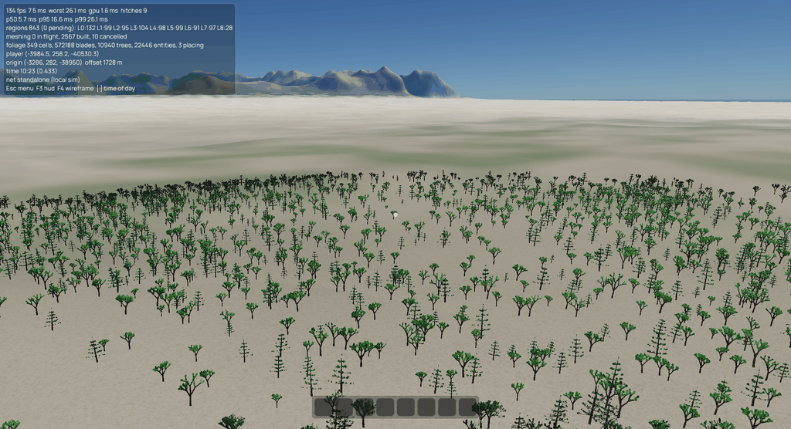
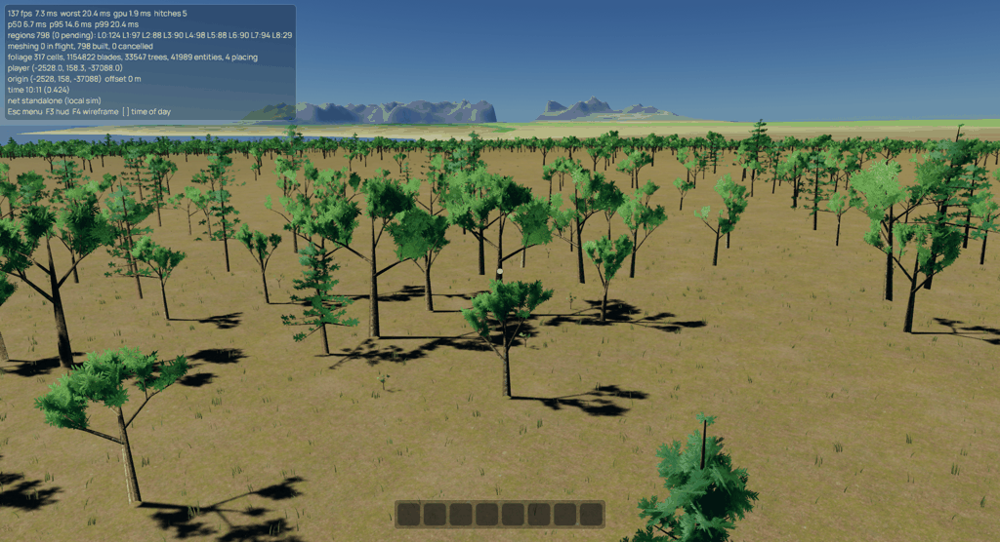
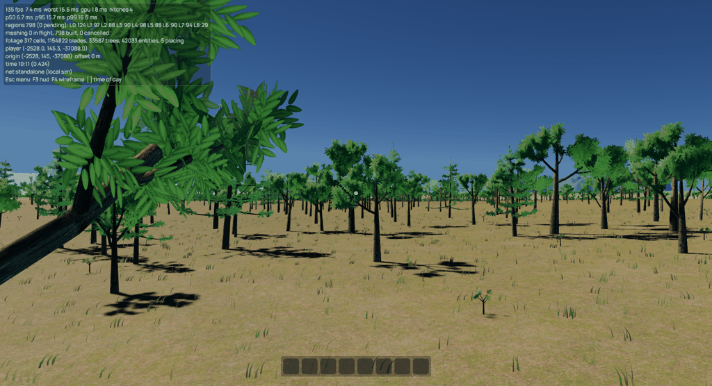
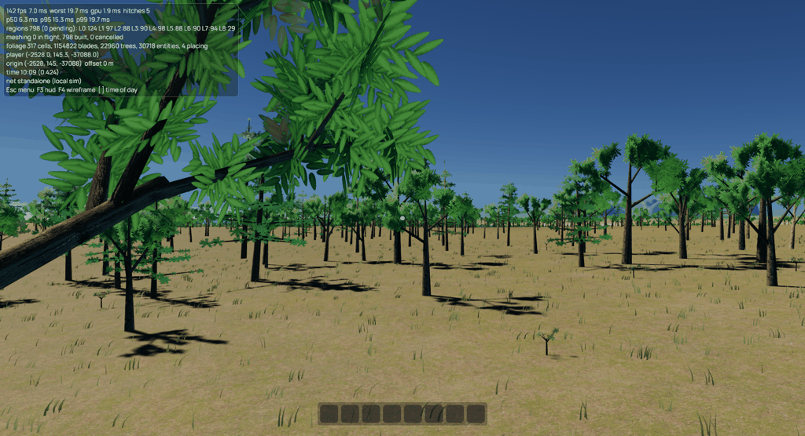

# Foliage stability and variety

2026-09-12. Follow-up to the foliage spike and ADR 0005.

## What changed

The client owns persistent 64 m foliage cells. Terrain LOD changes no longer
destroy their vegetation. Approaching cells gain finer tree meshes without
resetting the installed meshes, placement or grow-in timestamp. Grass is
requested separately inside its preparation radius. A bounded placement cache
preserves records on short return trips; leaving the world clears it.

The scheduler prioritizes nearby cells with a bias along travel, limits
outstanding cell jobs, resumes installation per tree LOD and retires children
incrementally. Default limits are in `FoliageConfig`: 8 outstanding jobs,
4 dispatches and 4 collected results per frame, 600 inserted and 600 removed
entities, 1 MiB uploaded and a 1.5 ms soft collection budget. A single larger
grass cell may upload alone so small configured budgets cannot deadlock it.
The cache is bounded by 32 MiB and 256 cells, including empty cells.

Grass distribution combines the existing landscape hydration/cover with
continuous 24 m and 7 m patches and small tufts. Species `grass_shape` controls
width, resting curvature, tip droop and dead-blade proportion. Candidate count
and the 16-byte GPU record remain bounded as before. Trunk rejection uses
spatial bins rather than scanning all plants for every blade.

85% of candidate roots are grouped within 0.25–0.45 m of jittered tuft centers;
the remainder are isolated shoots. Tufts stay inside their owning cell and use
world lattice hashes, including at negative coordinates.





Roots are quantized before sampling the ground and use the terrain's triangle
diagonal. A grass render entity's origin is at the middle of its ground height
range; the shader subtracts that offset from blade roots. Both CPU culling and
GPU LOD/dither calculations now measure distance at ground height. Using only
an elevated AABB was insufficient: the shader still measured from the model
origin and discarded nearby grass on high ground.

Trees have eight-view color/normal impostors baked from their actual near
geometry. Alpha-weighted, coverage-preserving mipmaps keep thin branches.
Reduced meshes retain the near skeleton; pine species gain a leader and
tapered whorls without changing trunk collider dimensions. Only near meshes
cast shadows. The common tree shader transforms world wind into tree space,
and tint no longer depends on spawn time.

Wind uploads after render-origin synchronization and carries both current and
previous origins. Its two noise octaves are periodic over 4096 m. Both prepasses
use previous growth time and origin, preventing rebase and first-frame growth
from inventing large motion vectors.

## Validation

Run the same seed, spawn and window size for each comparison. Finish compilation
before measuring. The game now reports real, unclamped frame times, p50/p95/p99
and worst over the full log interval. The old logger clipped stalls at 250 ms
and mixed half-second averages with two-second worst frames.

```sh
just ci
cargo build --release -p game --offline
target/release/game --flight --flight-secs 30 --spawn=-2528,-37088 --window 1920x1080
target/release/game --flight --flight-secs 30 --spawn=-2528,-37088 --window 1920x1080 --no-foliage
target/release/game --frames 600 --spawn=-2528,-37088 --look=-2.2 --window 1920x1080 --screenshot ground.png
target/release/game --frames 600 --spawn=-2528,-37088 --look=-2.2 --window 1920x1080 --aa taa --screenshot ground-taa.png
```

Before this change, the 30-second foliage flight repeatedly reported 77–149 ms
worst frames after initial loading, commonly 103–134 fps, with another slowdown
near the end. A 15-second no-foliage control held roughly 159–164 fps after
loading. These are the reviewed release binary's measurements, not a guarantee
for other machines or seeds.

The final 30-second flight with foliage reported 11 frames above 50 ms,
including startup, versus 130 in the reviewed run. After the first six seconds,
reported worst frames were 22–58 ms, with p99 20–40 ms, and timed GPU passes
around 1.5–1.7 ms. Many intervals ran 129–146 fps, but some fell to roughly
60 fps. A subsequent no-foliage control itself ran near 60 fps, with low GPU
times and 18 hitches including startup. The desktop/display environment varied
between runs, so these measurements support reduced streaming spikes, not a
precise FPS speedup claim. The final TAA walk settled around 155 fps with grass
visible and timed GPU passes around 2.1 ms.

The final TAA flight also crossed an origin rebase and exited successfully;
its post-rebase intervals reported 137–138 fps, with no shader validation
errors. Ground, distant-tree and post-rebase screenshots were inspected.

The full CI stages passed: formatting, warnings-as-errors clippy, all 212
workspace test cases, and the isolated headless/server dependency checks and
tests. The sandbox's default temporary directory was read-only, so the last
stage used `just --tempdir /tmp server-check` after the other stages passed.

Regression tests cover cell identity through terrain replacement, incremental
LOD upgrades, retention/cache behavior, entity/upload budgets, deterministic
placement, shared patch boundaries including negative coordinates, ground
triangulation, exclusion bins, conifer collider invariance, near/mid geometry
agreement, impostor atlas contents, previous-origin buffer layout, and real
frame stalls above 250 ms.

## Tree morphology follow-up

Oak and pine each cache eight variants, up from four. Variant hashes change
crown width, branch spread and crown clearance, in addition to height. Oaks
have a continuous leader with staggered scaffold limbs and tapering, upward
seeking tips. Pines have irregular bough tiers, inner-bough foliage and a
graduated leader crown. Mid LOD still decimates the exact near skeleton;
the distant atlas is baked from that same variant. Placement rules, collider
formulas, draw ranges and streaming budgets are unchanged.

Two visual checkpoints were reviewed. The first was rejected for repetitive
Y-shaped oak forks, sparse pine poles and oversized radial leaf stars. The
second adds fuller crowns and replaces the radial textures with smaller
leaves and needles following branchlets, without adding texture dimensions
or per-instance texture variants. The result remains stylized low-poly foliage.



Repeat the canopy view with wind disabled to isolate shape from animation:

```sh
target/release/game --flycam --camera-altitude 18 --frames 600 --spawn=-2528,-37088 --look=-2.2 --window 1920x1080 --aa taa --wind 0 --screenshot crowns.png
```

`--camera-altitude` also sets scripted flight height; its default remains 120 m.
Shared mesh/atlas creation measured 180 ms versus 78 ms before this follow-up,
a one-time startup cost for the additional variants and finer leaf textures.

The clean 30-second TAA flight completed with no shader validation errors,
seven frames above 50 ms including startup, and roughly 99–114 fps after
loading. Timed GPU passes were around 1.3–1.4 ms. An earlier overlapping
CI/flight sample had substantially more stalls and is not used as a clean
performance comparison. These remain local observations, not FPS guarantees.
Tests cover actual shipped tree species/seeds/variants, normalized crown
variation, deterministic rebuilding, finite geometry and normals, fewer than
1200 near triangles per variant, and reproducible leaf-mask center coverage.
The final `just --tempdir /tmp ci` passed formatting, strict clippy, workspace
tests and isolated headless/server checks.

## Remaining limits

### Organic growth pass

The accepted foliage baseline is committed as `f80c736`. The next pass adds
three-segment curves to branches longer than one metre, with shallow droop
and deterministic lateral bow. Short twigs stay single segments. Adjacent
rings share their exact positions, normals and bark UVs. Leaves and child
branches sample the rendered polyline, not a separate smooth approximation,
so attachments remain on the wood. The shared whole-tree wind stays unchanged.

Oak variants have three or four scaffold limbs with uneven attachment heights.
Pine variants vary tier count, bough count per tier and crown breadth, keeping
the existing eight cached variants per species. Placement, collider formulas,
streaming distances and budgets are unchanged. Near geometry remains bounded
below 2600 triangles per shipped variant, versus the former 1200 test ceiling;
mid meshes keep the same curved skeleton and impostors bake the new shape.

Regression tests cover curved paths, shared ring positions/UVs/normals, leaf
attachment, outward closed surfaces, deterministic variants and LOD subsets.
One initial placement integration run exited with SIGSEGV; the geometry unit
tests passed, and isolated placement reruns passed. No root cause for that
one-off process failure was established.

Locked-camera close-ups at wind 1 and 3 retained their attachments. The clean
30-second TAA flight completed without shader errors, at 103–119 fps after
loading, with six frames above 50 ms including startup. Shared mesh/atlas
generation measured 200 ms versus the previous 180 ms. These are local
observations, not guaranteed frame rates.
The final `just --tempdir /tmp ci` passed, including the isolated server checks.



### Close-up attachment correction

The subsequent ground-level review exposed defects missed by the canopy
screenshots: independent branch/leaf wind weights bent connected pieces by
different amounts about the ground, and bark tube triangles faced inward.
Backface culling consequently exposed the far/interior shell at junctions.
Leaf-card centers were also offset above their supporting twigs.

Trees now use one rigid primary sway shared by wood, leaves and impostors in
all passes, with small leaf flutter retained. This deliberately replaces
independent branch motion; secondary bending needs actual inherited branch
pivots before it can be restored safely. The root stays at mesh ground level
even above the nominal tree height. Bark winding is outward in near/mid LOD,
tube ends are capped, and leaf sprays are centered on their supporting wood.

Regression tests check outward closed bark tubes in both mesh LODs and that
every near leaf-card center lies on a woody segment for all shipped tree
variants. Close-up captures at wind 0, 1 and 3 exercise attachment and shading:

```sh
target/release/game --flycam --lock-camera --camera-altitude 5 --camera-pitch 0.25 --frames 600 --spawn=-2528,-37088 --look=-2.2 --window 1920x1080 --aa taa --wind 0 --screenshot joints.png
```

The meshes still use intersecting low-poly tubes, not welded branch collars;
this fixes detached/hollow geometry, not all close-range botanical detailing.
`--lock-camera` prevents live mouse/keyboard input changing the inspection
view. Full CI passed after the attachment and winding corrections.



### General limits

Range follow-up: grass now fades out over 400–480 m (previously 280–320 m),
and tree impostors over 1200–1600 m (previously 600–800 m). Near geometry,
shadow distances and streaming budgets are unchanged. Trees and bushes appear
at full size on arrival; only grass retains the grow-in animation. The shared
tree vertex helper applies this consistently to color, depth and motion vectors.

- The baker uses eight azimuths with nearest-view selection. Elevation views,
  view interpolation and depth-correct octahedral impostors remain a separate
  visual upgrade. Trees viewed steeply from above can reveal the card.
- Triangle attachment matches the finest terrain. Its distant geomorph can
  still differ slightly from the fixed foliage root height near fade-out.
- The time budget ends between atomic operations. Grass output is now capped
  at 32,768 records (512 KiB). Tree mesh/atlas preparation runs off-thread,
  followed by at most one prepared mesh/image installation per frame. A single
  bounded asset remains atomic. CPU application and buffer creation are logged.
- The review hardening adds deterministic cross-cell exclusion using bounded
  neighboring candidate strips. Production rendering and physics share this
  path; grid-only fixture helpers intentionally describe isolated cells.
- Grass growth now uses a full elapsed timestamp in the material. Cells do
  not repeat their grow-in after the former 109-minute clock wrap.

### Review hardening validation, 2026-09-12

Regression coverage now includes stable plant identities and shapes after
unrelated registry additions, non-colliding decorative species, positive and
negative cell-boundary exclusion, aggregate candidate budgets, deterministic
grass thinning across species, and grass-only palette indices beyond global
flora ID 31. Physics limits trunk installation to 256 per frame and tests
incremental completion. Client tests exercise independent detail retirement,
whole-cell eviction while detail is queued, and one-asset installation steps.

The client logs resident CPU record bytes, resident grass buffer bytes and
grass bytes awaiting retirement. Near tree meshes and grass retire at their
own hysteresis distances while far trees keep the persistent cell root.
See ADR 0005's review amendment for the limits and identity contract.

`just --tempdir /tmp ci` passes: formatting, Clippy with warnings denied,
234 workspace tests and 168 tests in the isolated headless/server check.
The wall-clock worldgen benchmark remains ignored by default. The `/tmp`
override is needed because this review environment's normal `just` temporary
directory is read-only.

A release MSAA render at the woodland location `(-2528, -37088)` completed
1,000 frames, and a 30-second TAA flight from that location completed 1,742
frames with origin rebases and budgeted detail retirement. Both saved their
screenshots without shader errors. These were correctness smoke checks while
other validation ran, not isolated performance comparisons. They still
reported frame hitches; no claim of a hitch-free frame rate follows from
bounded foliage installation.
