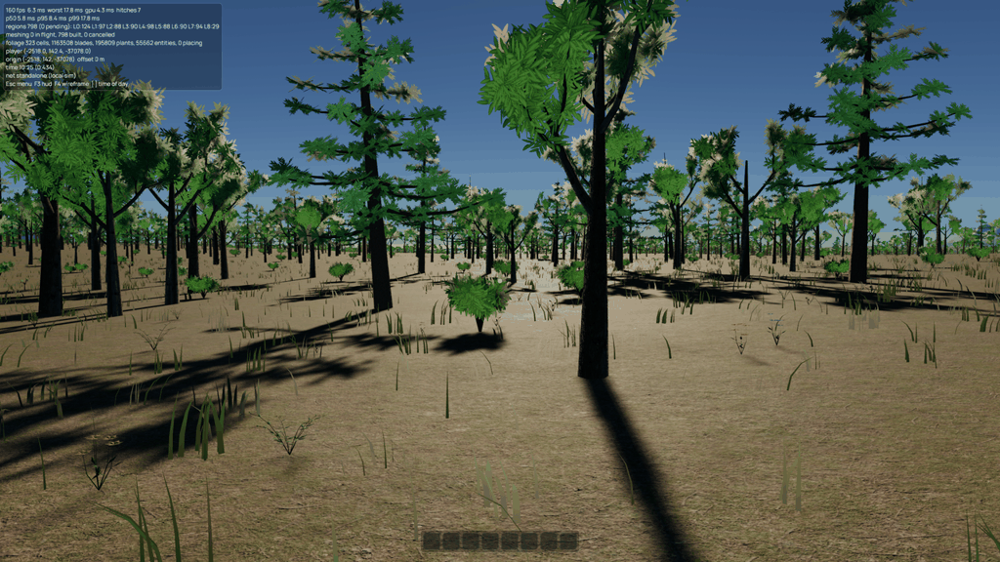
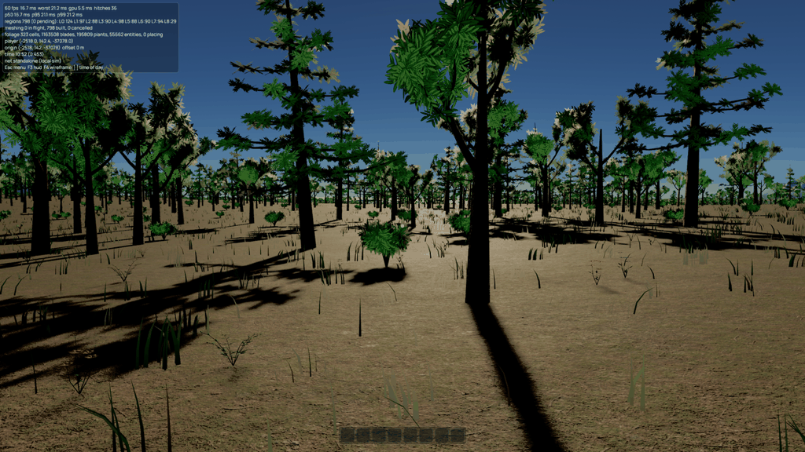
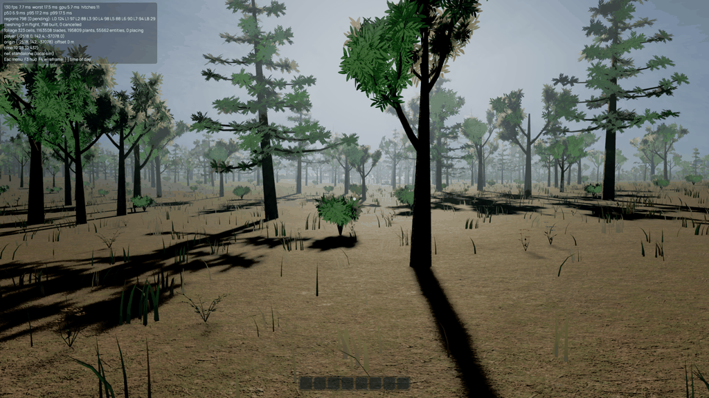
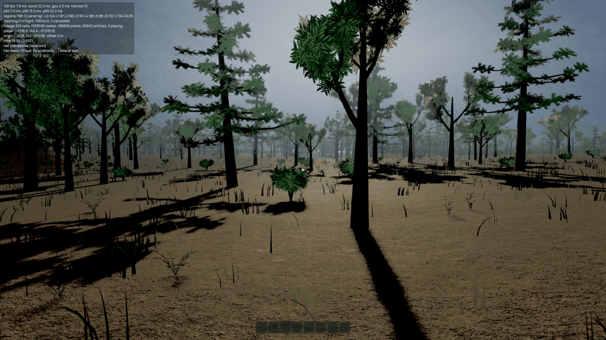
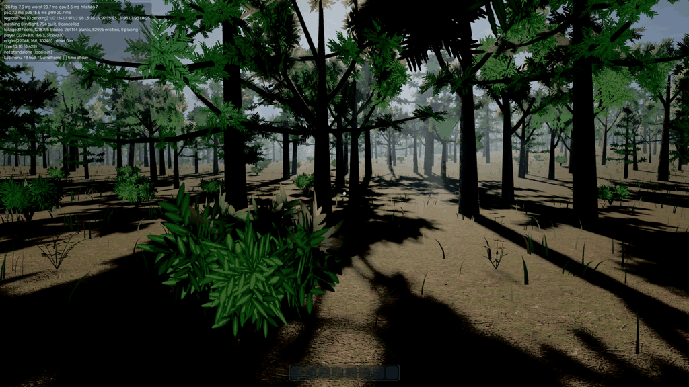
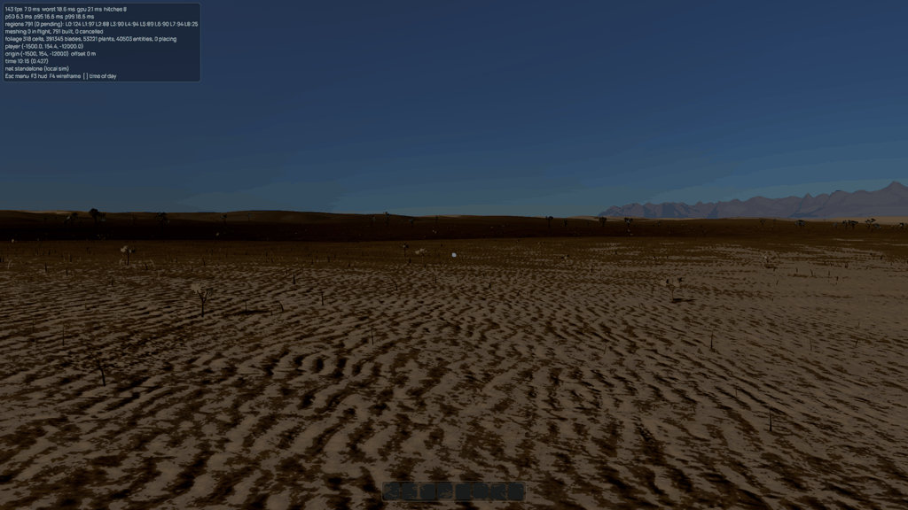
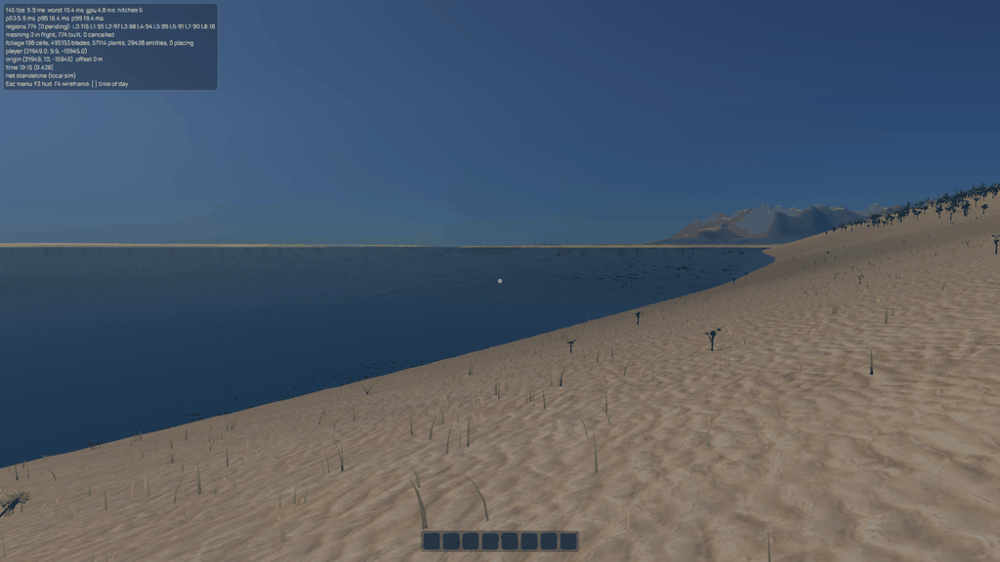

# Render look study

2026-09-12. Bevy 0.19.1, native Vulkan, NVIDIA RTX 4090.

## Direction

Start exploration with **Sunlit Mist**: deep foreground shadows, slightly reduced saturation, pale cool air separating the trees, and light scattered through canopy gaps. Clear Contrast is the cheaper, clearer alternative. Cinematic Woodland pushes the darker mood and adds a deliberately separate lens treatment. Baseline is the fallback when no exported look is saved. Exported looks now reload automatically on startup.

The current tree shapes, flat ground patches and sharply defined grass still influence the result. Post processing gives separation and mood; it does not replace richer silhouettes or surface variation. The mist reads primarily as depth and broad shafts in this fixture, rather than spectacular theatrical beams.

| Look | Exposure / fill | Contrast / saturation | Extra passes |
|---|---|---|---|
| Baseline | 14.2 / 1.0 | 1.0 / 1.0 | Existing atmosphere; MSAA 4 in normal use. Since 2026-09-27 the baseline is EV 14.4 with sky fill 4.0, chosen from contact sheets of the terraced city and the woodland (fill 1 to 4, AgX with and without grading); this table records the study as it was run. |
| Clear Contrast | 14.45 / 0.75 | 1.12 / 0.92 | TAA, medium SSAO |
| Sunlit Mist | 14.45 / 0.75 | 1.12 / 0.92 | Clear Contrast + local fog (0.018), bloom (0.025) |
| Cinematic Woodland | 14.65 / 0.6 | 1.18 / 0.85 | TAA, SSAO, fog (0.028), bloom (0.04), Gaussian DOF and motion blur |

All start with ACES. AgX is an independent live comparison. Fog uses 32 steps, scattering 0.6, forward scattering 0.6 and light strength 4.0. Cinematic DOF focuses at 10 m, f/2.8, with blur capped at 8 pixels; motion blur uses a quarter-frame shutter. These are starting points, not automatic focus or exposure systems.

## Live exploration

```sh
cargo build --release -p game
target/release/game --study-scene woodland --render-look sunlit-mist --visual-time .32
```

Press **F6**. Preset selection and baseline comparison stay above four tabs: Look, Light, Air and Lens. Baseline comparison holds edits; Reset restores the selected preset; Export RON writes `render-look.ron` beside the game's normal settings file and automatically reloads it on the next launch. Further edits require another export to persist. Missing saved files use Baseline; invalid or unreadable saved files report a warning and use Baseline. The panel captures gameplay input while simulation and streaming continue. F3 toggles the performance HUD.

```sh
target/release/game --render-look-file /path/to/render-look.ron
target/release/game --render-look sunlit-mist --ev100 14.3 --export-render-look /tmp/look.ron
```

An explicit file wins over the preset name, and either explicit option bypasses the automatically saved look. Use `--render-look baseline` to start fresh without deleting the saved file. Explicit `--ev100`, `--haze` and `--no-shadows` override the file. Explicit `--aa` overrides the camera AA policy; SSAO is suppressed when MSAA is selected. `--aa auto` follows the look. AA overrides remain CLI policy rather than being baked into exported RON.

Studies use seed 42 and cannot be combined with a connected client or an explicit spawn. `--visual-time` freezes the rendered sun only; the HUD reports the still-running simulation clock. Without `--study-scene`, the look still grades the world but has no local fog volume. The four fixture locations were woodland `(-2518,-37078)`, grove `(22048,30240)`, valley `(-1500,-12000)` and coast `(21949,-15945)` when these studies were taken; ticket 0004 moved the ranges and re-sited three of them (`crates/strata-atmosphere/src/study.rs` has the current ones), so the captures in `render-look/` show the ground before that ticket.

## Reproduction and measurement

```sh
python3 tools/render-study.py --output /tmp/render-presets --fullscreen --times .32
python3 tools/render-study.py --output /tmp/render-effects --fullscreen --times .32 --ablations
python3 tools/render-study.py --output /tmp/render-matrix --fullscreen \
  --scenes woodland grove valley coast --times .32 .5 .68
```

The script records exact commands, isolated user settings, exported RON files, full logs, screenshots, image dimensions and the final three timing windows. It fixes seed, camera position, heading, pitch, FOV, wind and visual sun time. The Linux captures use an isolated `XDG_CONFIG_HOME`, FOV 45 degrees and foliage distance 100%, independent of normal user preferences. Fullscreen uses the primary monitor. A dimension mismatch is a failure, not an accepted 1440p result.

Every cost comparison forces TAA, including Baseline, so the difference measures the look rather than a simultaneous AA change. This Baseline benchmark is therefore not the default MSAA 4 gameplay configuration. GPU values are the new `render/camera_frame/elapsed_gpu` timestamp interval around Bevy's camera driver, averaged over the last three logged windows. This includes fog and DOF, which lack their own Bevy diagnostic scopes; the old HUD sum understated those passes and is not used for the final costs. The interval includes GPU idle gaps between submitted camera commands, so CPU submission can influence it. CPU p50/p95/p99 and worst-frame figures remain in the JSON. GPU clock changes, other desktop activity and asynchronous streaming limit precision; costs are directional and should not be added as if every pass were independent.

### Presets

Final whole-camera timing, same settled woodland and capture conditions as the effect comparison below.

| Preset | Camera GPU interval (ms) | Difference from Baseline (ms) |
|---|---:|---:|
| baseline | 4.13 | +0.00 |
| clear-contrast | 5.60 | +1.47 |
| sunlit-mist | 5.63 | +1.50 |
| cinematic-woodland | 5.93 | +1.80 |

Sunlit Mist adds about **1.5 ms**, and Cinematic Woodland about **1.8 ms**, in this sample against the 2 ms target. This is provisional headroom, not a cross-scene guarantee. The separately captured effect totals differ, especially for SSAO, so these deltas should not be treated as precise isolated pass costs. All four final runs have identical settled vegetation counts. [Raw windows and commands](render-look/presets/results.json).

**baseline**



**clear-contrast**



**sunlit-mist**



**cinematic-woodland**




### Individual effects

2700-frame woodland captures at visual time 0.32, TAA, wind off, FOV 45, 100% foliage distance and 2560x1440. All seven runs end with the same 323 foliage cells, 1,163,508 blades, 195,809 plants and no placement in flight.

| Case | Camera GPU interval (ms) | Difference from grading (ms) |
|---|---:|---:|
| grading | 4.20 | +0.00 |
| contact | 4.33 | +0.13 |
| ssao | 4.50 | +0.30 |
| bloom | 4.43 | +0.23 |
| fog | 4.90 | +0.70 |
| dof | 4.20 | +0.00 |
| motion | 4.20 | +0.00 |

These are single runs, and logged samples are rounded to 0.1 ms. DOF and static motion blur were below the resolution of this comparison, not proven free. The [raw windows, commands and foliage counts](render-look/effects/results.json), per-case logs and RON settings are retained.


## Scene and boundary checks

Sunlit Mist was captured in woodland, grove, valley and the corrected coastal fixture at 0.32, 0.50 and 0.68 visual time. These 1200-frame runs are visual checks, not the final cost measurements. [Capture records](render-look/scene-captures.json) retain the commands. The denser grove makes shafts more apparent. Noon is less dramatic; the open valley and coast mainly show grading and a shallow band of mist.







**Known boundary defect, reproduced:** at the woodland volume's top face, moving the camera from 37.95 m to 38.05 m above the sampled ground introduces a sharp lower edge in the mist. The volume extends to ground + 38 m, placing the second camera just outside it and within a near-plane distance. This is consistent with the upstream camera-outside clipping issue; no engine patch is included.

```sh
# Use 37.95 for the inside view, 38.05 for the outside view.
XDG_CONFIG_HOME=/tmp/render-presets/config target/release/game \
  --study-scene woodland --render-look sunlit-mist --visual-time .32 \
  --flycam --lock-camera --camera-altitude 38.05 --camera-pitch=-0.25 \
  --look=-1.25 --wind 0 --fullscreen --frames 1200 --screenshot /tmp/boundary.png
```

[Inside capture](render-look/boundary/inside.png), [outside capture](render-look/boundary/outside.png). The logs are beside the images. The volume is not ready for unrestricted flying through its boundary; retain the authored ground-level study scope until this is resolved upstream or separately addressed.

## Findings and limits

- **Contact shadows:** Bevy defaults made thin grass and leaf cards harshly black. Presets leave them off. The optional toggle uses a shorter 0.1 m ray and 0.015 m thickness. Judge it in motion before adopting it.
- **Fog:** density alone produced excessive dark extinction. Independent scattered-light strength made restrained density useful. The 320 x 48 x 320 m volume uses a 32-cubed density texture with soft edges and broad variation. It is world-anchored, not camera-following, and is not global weather.
- **Occlusion and TAA:** SSAO requires MSAA off. Existing grass prepass code writes procedural normals; Bevy still logs its generic missing-mesh-normal warning because that mesh does not store normal attributes. No extra dummy normals were added just to silence the warning. Masked foliage and wind still need subjective motion review when deciding production AA.
- **Lens effects:** Cinematic is a comparison preset. Fixed focus and motion blur can hurt navigation readability. The static cost captures intentionally freeze wind; they cannot establish the quality of moving foliage or camera blur.
- **Volume boundaries:** upstream [Bevy issue 25333](https://github.com/bevyengine/bevy/issues/25333) tracks a camera-outside/near-plane volumetric issue. This study does not fork the engine. Use the fixed fixture and an exact camera pose for a reproducer if it occurs; do not promote local fog to streamed world weather on the strength of these stills.

Relevant upstream examples: [volumetric fog](https://bevy.org/examples-webgpu/3d-rendering/volumetric-fog/), [contact shadows](https://bevy.org/examples/3d-rendering/contact-shadows/), [color grading](https://bevy.org/examples/3d-rendering/color-grading/). Implementation details follow the installed 0.19.1 source. See [ADR 0007](../adr/0007-render-look-studies.md) for ownership and scope.

## Verification

`just --tempdir /tmp ci` passes: formatting, clippy with warnings denied, workspace tests and the server dependency checks. Atmosphere tests cover validated RON round trips, effect removal, pre-existing prepass ownership, AA overrides, late cameras, world-anchored fog rebasing, translation/rotation cuts and visual time remaining separate from simulation time. The slotted harness verifies F6 input capture, baseline restoration, reset and exported settings.

A Cinematic Woodland flight with wind enabled completed 2,200 frames, travelled roughly 5.5 km and crossed multiple render-origin shifts without shader errors or a panic. Captures at frames 1,200 and 2,200 show the local mist left behind, with directional ground blur during motion. This is a smoke test, not a guarantee against every temporal artifact. [Flight log](render-look/flight.log).

```sh
XDG_CONFIG_HOME=/tmp/render-presets/config target/release/game \
  --study-scene woodland --render-look cinematic-woodland --visual-time .32 \
  --flight --camera-altitude 20 --camera-pitch=-0.1 --fullscreen --frames 2200 \
  --shot-frames 300,1200,2200 --screenshot '/tmp/flight-{frame}.png'
```

### Live-toggle regression

The initial implementation could crash when returning from Cinematic Woodland to Baseline: Bevy 0.19.1 left its background motion-vector pipeline on the render-world camera after removing `MotionVectorPrepass`. That pipeline still expected normal/motion color attachments in a depth-only pass. The atmosphere integration now removes the stale pipeline and bind group after preparation, before rendering, including when background motion vectors are explicitly disabled. Enabled views keep their normal background motion-vector rendering.

The sky example reproduced the exact validation error before the fix. After the fix it completed 1,800 frames and 20 live transitions through presets, SSAO, TAA, MSAA and motion blur without rendering errors. A render-schedule regression test checks that cleanup has happened before encoding and that re-enabled views keep their pipeline. [Before log](render-look/live-toggle-before.log), [after log](render-look/live-toggle-after.log).

```sh
cargo run --release -p strata-atmosphere --example sky -- --cycle-looks --frames 1800
```

## The sun (2026-10-02, lighting plan phase 1)

The baseline look gains three things: `SunDisk` on the sun (`SkySettings::sun_disk_intensity`, a multiplier on `SunDisk::EARTH`; Bevy draws `EARTH` for a sun without the component, so zero is the component at zero intensity, not its removal), bloom on at 0.03, and screen-space light rays (`strata_atmosphere::light_rays`). All of it is on the F6 panel: bloom threshold on Look, sun disc and the five light-ray values on Light.

**Bloom.** With a threshold the bloom is additive. Bevy's energy-conserving composite would pull the frame towards a blur that is black below the threshold. `RenderLook::bloom_threshold` is 2.0 in exposed HDR units, with a soft knee half as wide (from 1.0) and a low-frequency boost of 0.5 so the glow becomes a halo. Zero brings back the old unthresholded bloom. Bevy's first downsample runs before the threshold and damps each of its five 13-tap groups to a luminance of about 4 (`bloom.wgsl`, `karis_average`), so what reaches the threshold tops out near 20 for a broad bright patch and near 16 for a lone texel such as the sun's disc. A threshold up to the validation's 10 therefore still blooms the sun. The first pick, 0.6, was checked only on the woodland at noon, where it differed from no bloom by no more than two no-bloom runs differ from each other. Bright ground goes over it. Inverting the tonemapper on 1600x900 captures at EV 14.4 puts the coast's sand and sea at noon at a median of 0.8 and up to 1.8, and Port Serein's pale walls at noon up to 1.7. Against captures without bloom, 0.6 lifted the whole coast frame by 0.77 of 255 (the floor between two no-bloom runs is 0.03) and haloed the dark bushes on the sand by 3 of 255 or more, and lifted the city at noon by 0.21 (floor 0.02). At 1.5 the coast's lift is 0.08; at 2.0 it is 0.026 and the city's 0.0, both at the floor. Snow's colour is about 1.4 times sand's, so a sunlit snowfield may reach 2 to 4 and sit in the knee; no snow fixture was captured. What still blooms at 2.0: the city's emissive strips and lamps at night (EV 3) lift the ring round them by 0.89 of 255, against 1.76 at 0.6 and 0.58 at 3.0. The sun's own bloom halo is small at any threshold (0.23 of 255 at 0.6, 0.06 at 2.0, round the disc in the street at 0.70); the glow round the low sun in the captures is the atmosphere's and the light rays'. The lit windows of Port Serein do not glow at any threshold above the lit ground's brightness. At night they are about 0.5 in HDR units and a few pixels wide, so the first downsample averages them away. Making them bloom is the plan's phase 5 (emissives at a bloom-visible level), not a lower threshold.

**Light rays.** The rays are two passes after bloom and before tonemapping. A half-resolution march takes 24 steps (8 to 48) from each pixel towards the sun's position on screen. Each step weighs 0.96 of the one before, and the sum is normalised by those weights. It sums an inverse-square glow around the sun wherever the depth buffer holds sky above the horizon's line on screen. That line exists because the sea writes no depth. A four-tap tent at full resolution then adds the result. The rays take the sun's colour through the atmosphere's transmittance table at the camera, times a tint (default 1, 0.94, 0.84). They are scaled by how much of a disc a twelfth of the screen high around the sun is open sky (floored at a quarter), and they fade as the sun leaves the screen or sets. A sun behind the camera skips both passes.

`FullscreenMaterial` was not used: its bind group is the colour target, a sampler and one uniform, with no depth, and it draws only at full resolution. The source is the glow's shape rather than the frame's colour, because the frame holds the blue sky at about the lit ground's brightness and the disc at ten thousand times it, so any clamp of the colour would decide the look by itself and shift with the exposure. The dither is fixed per pixel because the pass runs after TAA. Captures are in `scratch/look/sun-*.png`: the woodland at 0.27 and 0.73 looking into the sun, before and after, and at 0.27 from 12 m, where the sun is in the crowns rather than hidden behind the near tree. They show shafts carved by the crowns and the mountain, no banding, and a frame with the sun behind the camera that is unchanged.

**Cost**, at 2560x1440 on the woodland with `--fog 0`, 1500 frames, looking into the sun at 0.73, from the passes' own GPU timers (`light_rays::log_gpu_time` with `--stats`). Bloom costs 0.29 to 0.30 ms; it cost 0.23 on the study's older, cheaper frame. The rays' march costs 0.18 ms and their composite 0.033 ms. The disc adds no pass: it is a few instructions in the sky's own shader, and the whole-frame difference is below this run-to-run noise. Those three come to 0.51 ms, but the phase's 0.6 ms ceiling also covers the temporal shadow filter, now the default, which costs about 0.19 ms over the Gaussian in the opaque pass (next section). The phase as built is therefore about 0.70 ms with the sun on screen, 0.1 ms over its ceiling, and about 0.49 ms (bloom and the filter) with the sun off screen. The levers, none taken yet: the Gaussian filter gives back the 0.19 ms for slightly harder far shadow edges, and fewer ray steps cut the march, which is most of the rays' cost and scales with the step count. Whole-frame GPU means across repeated runs moved by up to 0.5 ms (one outlier by 4 ms) with nothing changed, so only the per-pass timers resolve these deltas. At the bench's pose (0.45, yaw -1.25, sun off screen) the rays draw nothing and only bloom's 0.3 ms remains.

## Shadow filtering and soft shadows (2026-10-02, lighting plan phase 1)

Two tunables, both on the F6 panel's Light tab. `RenderLook::shadow_filter` sets the camera's `ShadowFilteringMethod`. A look file stores it as a string: `"hardware2x2"`, `"gaussian"` or `"temporal"`. The default is `temporal`, which `look::apply_cameras` turns into `gaussian` on a camera without TAA (an `--aa msaa4` or `off` override). Bevy's temporal filter rotates its eight taps every frame, and without TAA nothing averages that rotation. Until now every camera had Bevy's default, the Gaussian. `SkySettings::soft_shadow_size` is `DirectionalLight::soft_shadow_size` behind Bevy's `experimental_pbr_pcss` feature, which `strata-atmosphere` turns on in its own `bevy` feature list. The feature adds two linear samplers to the mesh view bind group and a shader def. It never reaches the headless graph (`just server-check` passes, and `cargo tree -e features` of the headless facade shows no `pcss`). `None`, the default, is the ordinary filtered shadow.

**Measured** on the woodland study scene at 2560x1440, `--fog 0`, `--time 0.333` (visual time frozen), 1500 frames per run, from a locked camera at 1.8 m with the sun to the side (yaw 0, pitch -0.22): a near rock, a pine trunk whose shadow runs 20 m across the frame, and distant crowns. Whole-frame GPU means (`--bench-out`) moved by up to 0.4 ms between runs with the same settings, so the numbers are the opaque pass's own GPU timer, which is where shadows are sampled. `look::log_shadow_gpu_time` logs it every two seconds, and the mean is taken over the last half of each run.

| Setting | Runs | Opaque pass GPU ms | Whole frame GPU ms |
| --- | --- | --- | --- |
| `hardware2x2` | 2 | 3.31 (3.24, 3.38) | 13.11 |
| `gaussian` | 2 | 3.23 (3.26, 3.19) | 12.88 |
| `temporal` | 4 | 3.42 (3.38 to 3.47) | 13.05 |
| `temporal` + PCSS 0.1 | 2 | 3.39 (3.50, 3.28) | 13.11 |
| `temporal` + PCSS 0.25 | 2 | 3.43 (3.36, 3.51) | 13.05 |
| `temporal` + PCSS 10 | 2 | 3.41 (3.44, 3.38) | 13.08 |

Temporal costs about 0.19 ms over the Gaussian, and the two ranges do not overlap. Hardware 2x2 is not measurably cheaper than either. PCSS at any size is within noise of temporal. The transparent pass is 0.005 ms in every case.

**Captures** are `scratch/look/shadow-{hw,gauss,temporal,pcss010,pcss025,pcss2,pcss5,pcss10}.png`, at 1600x900 and the same pose, 400 frames. Hardware 2x2 steps visibly along the far edges, the Gaussian is smoother, and temporal under TAA is the smoothest of the three. PCSS at 0.1 and 0.25 is indistinguishable from temporal: the mean per-pixel difference is 0.04 of 255, against 0.08 between the Gaussian and temporal. The reason is in Bevy's shader, not the scene. Directional PCSS blurs by `max(size * (blocker - receiver) / receiver, 0.5)`, with both depths in the cascade's 0 to 1 orthographic range, against a fixed 1 for the plain temporal filter. Below a size of about 2, every edge sits at the 0.5 floor, which is never softer than temporal. The 0 to 0.5 m range the plan assumed is a sun size in metres, which this parameter is not. The validation range is 0 to 16 instead; Bevy's own example uses 10. At 10 the far tip of the rock's shadow and the far end of the trunk's shadow soften slightly while the contacts stay crisp, with no acne or banding (mean difference 0.08 of 255). At 2 and 5 the change is barely visible.

**Decision:** temporal is the default filter. PCSS stays off by default, with the field and the feature in place. It is free within noise (under the plan's 0.3 ms bar), but in the plan's 0.1 to 0.25 range it does nothing. At 10 the softening is too slight to choose over a frame without it, and the size's meaning shifts with the cascade's depth range, so one value cannot be tuned once for every view. A tighter first cascade, or Bevy's PCSS gaining a sun-angle parameter, would be the time to look again.

## Clouds (2026-10-02, lighting plan phase 2b)

A 2D cloud layer and the shadows it casts, `strata_atmosphere::clouds` and `assets/shaders/clouds.wgsl`. One density image serves both. Three tunables on `SkySettings`, validated in `LookFile::validate` and on the F6 panel's Air tab: `cloud_cover` (0 to 1, default 0.45), `cloud_scale` (metres per repeat of the image, 500 to 50 000, default 6000) and `cloud_speed` (m/s, 0 to 60, default 6). Every preset takes the defaults, so every preset now draws clouds at 0.45; a look saved before the fields existed loads with them.

**The image.** 512 x 512, generated once on the async compute pool when `WorldSeed` arrives: six octaves of value noise (periods 3 to 96 per tile) for fields and gaps, plus two octaves of inverted Worley F1 (periods 5 and 11) that round the cloud into heaps, every lattice wrapped at the edge so the image tiles. Only additions, multiplications, `floor` and `sqrt`, so it is the same bits on every machine. The cover is a quantile of the image, so 0.45 is cloud over 45 % of the sky; zero hides the layer and removes `DirectionalLightTexture` from the sun.

**The shadow.** `DirectionalLightTexture { tiled: true }` on the sun, behind Bevy's `pbr_light_textures` feature, which `strata-atmosphere` appends to its own `bevy` feature list (it turns on `pbr_clustered_decals` too, whose binding array the texture is read through; render side only). `pbr_lighting.wgsl` reads it at `uv = local.xy * (-0.5, 0.5) + 0.5`, where `local` is the inverse of the sun's `GlobalTransform` applied to the shaded point, with the first decal image's sampler at mip zero. Scaling and translating the sun would lay the mask square to the sun: stretched along the sun's azimuth, and swinging with the time of day while the clouds overhead did not. So once Bevy has built the cascades, the light frusta and the light's visibility from the sun's rotation, `project_shadow` replaces the sun's `GlobalTransform` with an affine map whose first two rows send a ground point to the layer's image coordinate where the ray from it towards the sun crosses the layer, and whose third column is the direction to the sun. The render world reads nothing else of a directional light's transform (`dir_to_light` is `back()`, the third column), and `restore_sun_transform` puts the rotation back before the next propagation. A shadow therefore lies under the cloud that casts it, kilometres off at a low sun, and moves with it; `the_sun_s_texture_falls_where_the_layer_blocks_the_sun` checks the projection against Bevy's lookup. The mask is the cover's ramp at 0.85 strength (a cloud still lets diffuse light down) blurred twice with a 5-texel box, about 23 m at 6 km a tile, then bilinear, which is the shadow's soft edge. The wind moves image and shadow by `SimClock` along `strata_sim::Wind`'s direction (fixed, 0.8, 0.6), so two clients at one tick see the same shadows.

**The layer.** A 240 km quad at 1.8 km above sea level that follows the primary observer horizontally, `CloudMaterial` with premultiplied alpha (Bevy's premultiplied pipeline writes no depth, so the fog pass's depth read is untouched), no prepass, no shadow, both faces. Each directional light reaches the cloud through Bevy's transmittance table at the cloud's own radius (the mesh view bindings carry the atmosphere), so a dawn sun arrives dim and red; a second read of the image towards the sun darkens a cloud that another shades, and a blue sky share fills the body. The fog pass's aerial-perspective lookup is a screen pass over depth and not reusable from a material; Bevy has composited the sky and its aerial perspective before the transparent pass, so the layer multiplies its light and its opacity by the air's transmittance between camera and cloud (two reads of the same table) and lets the haze already behind it show through. Alpha fades to zero over the last ten degrees above the horizon and over the outer fifth of the quad, so the edge never shows.

**Cost**, 2560x1440 under xvfb, 1500 frames per run, `--fog 0`, `baseline` look with only `cloud_cover` changed, from `look::log_shadow_gpu_time` (`--stats`): the median of the last eight two-second readings of the opaque and transparent passes' own GPU timers. Coast: the coast study scene at noon (`--time 0.5`, visual time frozen), locked camera at 1.8 m, yaw -1.25, pitch -0.05, sky about 40 % of the frame. Canopy: the woodland at 08:00 (0.333) facing the sun, the look fixture's pose.

| Pose | Cover | Opaque ms | Transparent ms |
| --- | --- | --- | --- |
| coast | 0 | 0.865 | 0.031 |
| coast | 0.45 | 0.865 | 0.056 |
| coast | 0.8 | 0.873 | 0.059 |
| canopy | 0 | 1.395 | 0.008 |
| canopy | 0.45 | 1.397 | 0.019 |
| canopy | 0.8 | 1.400 | 0.018 |

The layer costs 0.025 to 0.028 ms on the coast and about 0.011 under the canopy, where the crowns hide most of the sky. The shadow's lookup in the opaque pass is within 0.01 ms of cover 0, inside the readings' spread (single readings spiked to 1.2 to 3.6 ms in every configuration). The phase is about 0.04 ms against its 0.3 ms ceiling. Not measured: the opaque pass with the `pbr_light_textures` feature compiled out; cover 0 keeps the shader def and skips only the read.

**Captures** at 1600x900, 400 frames, `scratch/look/clouds-{coast,canopy}-{0,0.45,0.8}.png`, `clouds-dawn-0.45.png` (the dawn fixture) and `clouds-move-400.png` and `clouds-move-700.png` (coast at 0.8, 9.3 s of sim apart; `clouds-move-pair.png` stacks the right half of both). Between the two the sunlit patch on the far slope shrinks and its edge moves along the ridge. Clear sky is unchanged: on the coast, pixels that are clear at 0.45 differ from cover 0 by 0.18 of 255 on average (99th percentile 2). The quad's edge does not show at any cover. At dawn the clouds are dim and warm against a dark blue sky. At 0.8 the coast's shadowed sand is at 0.51 of its cover-0 brightness, the canopy's ground at about 0.6.

**Limits.** The screen-space light rays (`light_rays`) and the sun disc do not know about the layer: with the sun behind thick cloud (canopy at 0.8) the rays still stream round the trunk at full strength and the disc shows faintly through the cloud; the rays should be scaled by the layer's transmittance at the sun's direction. The sea takes almost none of the shadow (5 % at 0.8), being mostly reflection. The layer from above, in flight over 1.8 km, was not captured. The clouds are smooth blobs with grey hearts from below; a sharper detail octave or a second layer is the cheap next step before any ray-marched volume.

**After review (2026-10-03).** Under a sun height of 0.01 (0.57 degrees) the sun now drops the texture and keeps its own rotation. The projection had clamped the sun's height there, and its third column is what Bevy lights along, so from sunset until the sun was 7 degrees down the scene, the sky and the disc were lit by a sun 0.57 degrees up; `a_set_sun_keeps_its_direction_and_drops_the_shadow` holds it. Just after sunset (coast, 0.7568, the sun 2 degrees down) cover 0.45 and cover 0 now differ by under half a level of 255 below the sky. The valley fog's pass reads the same mask (ticket 0003, after review); Bevy's volumetric pass, which draws the local volumes, does not read light textures, so a market run under a cloud stays sunlit.

## Local fog volumes (2026-10-03, lighting plan phase 2c)

Dusty air under Port Serein's market canopies and under dense crowns, drawn by Bevy's own volumetric fog. `RenderLook::local_fog` (default on, a look saved before it loads as on) puts `VolumetricFog` on the camera at `RenderLook::local_fog_steps` steps (default 6, validated 4 to 64, jitter 0.5 under TAA, no ambient: Bevy 0.19.1 adds the ambient unexposed and unweighted by density, a flat veil over the box) and `VolumetricLight` on the sun. Both are on the F6 panel's Air tab ("Local fog volumes", "Local fog steps"). The study scene's mist keeps the camera while the look gives it a density, as before. The volumes are plain `FogVolume`s the world spawns; `strata_atmosphere::local_fog` covers what Bevy's pass gets wrong around them.

**The city.** Port Serein has no arcade or covered walkway: what covers its streets is the Exchange's market, rows of stalls with cloth canopies at 2 to 3.4 m along two bowed aisles. The layout knows the market only as one building and the game links no generator, so `apps/game/src/settlement.rs` reads the stalls off the baked building: each stall's counter is its one collision proxy (element `counter`, which nothing else in the city declares), seen as an `AshlarCollider` for the frame before `drop_proxies` takes it. Counters within 7 m of each other form a run, cut along its mean direction into lengths of at most 18 m; each run's box reaches 3 m past its counters across the aisle and stands 3.2 m high from 0.3 m under the lowest counter's foot. Port Serein makes 8 runs. A run within 80 m of the observer gets a volume, loses it past 120 m, and at most the nearest 12 live. Extinction 0.02 per metre at full density, warm dust colour, scattering 0.5, absorption 0.08, asymmetry 0.6.

**The canopy.** `strata_foliage::fog_volumes`: a resident foliage cell whose near tree entities hold at least 24 distinct plants of a tree species (the woodland's cells within 120 m hold 0 to 42) gets a flat box from half a metre under its lowest tree's foot to 2 m under its median crown's underside (0.4 of the species' mean baked height, times the plant's scale), at most 8 live, within 80 m and dropped past 120 m. A box is wider than its cell by its fade so two dense neighbours fade into each other evenly. Extinction 0.015 per metre, lower than the city's: the boxes are up to 80 m across.

**Soft sides.** Every volume samples one generated 32 x 32 x 32 `R8Unorm` density image: one in the middle, fading to nothing over the outer fifth of each horizontal side (smoothstep ramps, so two boxes overlapping by their fade sum to an even density) and through the upper half of the height, times 0.7 to 1.0 of a soft value noise a few blobs across. The bottom does not fade, since a box stands on the ground. No box edge shows in any capture.

**Bevy 0.19.1 around the volumes.** Three things, each in `local_fog`'s module docs:
- The fog shader stops at the first directional light that is not volumetric, and `prepare_lights` sorts non-volumetric lights first, so with the moon present and not volumetric the sun never scatters. The moon is made volumetric whenever the sun is, and hidden while its illuminance is zero.
- The study scene's 320 m mist box would be marched at density zero, full screen, now that the camera always has `VolumetricFog`. It is parked while the look's density is zero.
- **The near plane (Bevy issue 25333).** 0.19.1 does not carry PR 25336: on 2026-10-03 the PR is open and unmerged, and `bevy_pbr-0.19.1/src/volumetric_fog/render.rs` still decides the interior path by `camera_is_inside_fog_volume` (the eye inside the unit cube), drawing front faces otherwise. The bug reproduces: with the camera 5 cm above a market run looking down, the volume drew nothing (pass at 0.05 ms, the frame identical to one with the fog off, `scratch/look/p2c-bug-shell-nofix*.png`). The plan's fallback was to stop the volumes 1 m short of where the camera can be. With an orbit camera that is anywhere, so a market run would shrink to nothing; instead `local_fog::swallow_the_camera` writes each root volume's drawn box into its `GlobalTransform` after propagation: a camera outside a box but within 0.5 m of it (four near planes) has the sides it is beyond moved out to take it 0.25 m inside, so Bevy takes its full-screen interior path. The `Transform` stays the world's. The density fades to nothing at the sides and top, so the growth does not show. At the same 5 cm pose the volume now draws, uncut (`scratch/look/volumes-shell-{s6,off}.png`).

**Cost**, 2560x1440 under xvfb, `baseline` look with only the local fog fields changed, `--fog 0` (so the ground fog pass is not registered), `--time 0.333 --visual-time 0.333`, locked flycam at yaw -1.2525, 1500 frames per run, from the pass's own GPU span (`local_fog::log_gpu_time` with `--stats`: a span from just after the transparent pass to just before TAA, which brackets Bevy's volumetric pass and, with `--fog` on, the ground fog pass, whose own span it subtracts). Since the review the ground fog pass runs first, in the main pass's set, and the span starts after it. Each number is the median of the last two thirds of the two-second readings.

One thing decides these numbers more than the scene: the card's clock. A lone game under xvfb runs at about 25 fps with the GPU 20 to 40 % busy, and the driver drops it to P5 or P8 (645 to 1290 MHz against 2730), which stretches every pass up to four times and makes it swing from reading to reading: alone, the inside pose at 6 steps read 0.43 to 1.1 ms (median 0.62) while the opaque pass beside it read 0.8 to 4.5. With another game on the card the clock holds at 2730 MHz and the opaque pass is steady to within a few percent, but the other game's work is time-sliced into some spans. So each pose was measured under load: either beside other agents' runs ("shared") or beside a small 960x540 game of our own (`clockpin`, the coast with no volumes). The second inflates the span more. Only runs whose opaque pass held steady are in the table.

| Pose | Volumes in view | Steps | Pass GPU ms |
| --- | --- | --- | --- |
| Local fog off (any pose) | 0 | - | 0.008 |
| City `--at city`, the market behind the camera | 0 of 8 | 8 / 6 | 0.065 shared / 0.088 clockpin |
| City `--spawn -420,-433`, 1.8 m, inside a run under the canopies, facing the sun (pitch 0.12) | 3, camera in 1 | 8 | 0.427 and 0.404 shared, 0.514 clockpin |
| same | 3, camera in 1 | 6 | 0.335 shared, 0.397 clockpin |
| same | 3, camera in 1 | 4 | 0.262 shared |
| City `--spawn -416,-431`, 10 m over a run looking down (pitch -1.5) | 2, filling the screen | 8 / 6 | 0.349 shared / 0.291 clockpin |
| City `--spawn -420,-440`, 45 m over the market (pitch -1.2) | 4 | 8 | 0.147 shared |
| City `--spawn -421,-441`, 80 m over the market (pitch -1.4) | 8 | 6 | 0.108 clockpin |
| Canopy fixture (woodland, 1.8 m, pitch 0.30) | 3, nearest 4 m away | 8 / 6 | 0.250 and 0.256 / 0.206, shared |

The cost is the screen area a volume covers times the steps, not the count: eight volumes small in the view cost a third of one around the camera. With no volume in view, `VolumetricFog` on the camera still costs about 0.06 to 0.08 ms. The worst case is the one the game is made of, the camera inside a market run, which marches every pixel: 0.34 to 0.40 ms at 6 steps against the phase's 0.4 ms ceiling, and 0.40 to 0.51 at 8, over it. **The default is therefore 6 steps** (it was 8 in the first build). At 6 and 8 the city captures differ by 0.84 of 255 on average (99th percentile 5), and nothing in them bands. The canopy, from outside its volumes, is 0.21 ms.

**Captures** at 1600x900, 400 frames, `--fog 0`:
- `scratch/look/volumes-city-{off,s8,s6,s4}.png`: inside a market run at 08:00 facing the sun (the pose above). The aisle fills with warm, faintly sunlit dust that is densest down the aisle where the sun gets in between the canopies, with the canopies' shadows cut into it on the paving. It reads as dusty air, not smoke: against fog off the frame below the HUD lifts by 4.3 of 255 on average.
- `scratch/look/volumes-canopy-{off,s6}.png`: the canopy fixture. A soft sunlit haze lies under the crowns in the middle distance, towards the sun, with no box edge anywhere (mean lift 0.6 of 255, up to 18 in the haze).
- `scratch/look/volumes-shell-{off,s6}.png`: the near-plane check, the camera 5 cm over a run looking down (`--camera-altitude 2.95`). The fog is drawn across the whole frame, not cut along a diagonal and not missing.

**Limits.** The city's lamps are `VolumetricLight`s so they glow in the market's air at night. Bevy's pass loops over the cluster's point lights at every step, so a market at night costs more than the day numbers above; that was not measured. A canopy cell's trees are counted from its near tree entities, so a cell's box appears a few frames after its trees are installed and is re-measured every half second until it settles. Port Serein's covered streets are the market's eight runs; the houses' door awnings and the landing's awning get no volume. The volumes take the sun's shadow cascades, so past the last cascade (`shadow_distance`) a volume is lit as if unshadowed; at 80 m reach that never happens with the current cascades.

## Sky visibility (2026-10-03, lighting plan phase 3a)

The sky's fill is the only light shade has, and until now every point took all of it. Phase 3a bakes how much of the sky each point sees into the world, off the frame, and the shaders scale the fill by it: `RenderLook::sky_visibility` (0 to 1, default 1; 0 is the look before the bake), on the F6 panel's light tab as "Sky visibility". It costs nothing per frame: no pass, a few multiplies in the terrain, tree, grass and impostor fragments.

**Ground** (`strata_terrain::mesh`, the module docs' "Sky"). Every vertex carries `[visibility, bent_x, bent_z]` and its parent level's value (`ATTRIBUTE_TERRAIN_SKY` and `_PARENT`, vertex locations 3 and 4, morphed with the height; the stage output is the old `world_y` widened to a `vec4`, since there is no free location). Eight azimuths (the axes and the diagonals) read the ground at 4, 8 and 32 ray units, a unit being the vertex step but never under 2 m (so 8, 16 and 64 m at the two finest levels, 256 m to 2 km at LOD 6). An azimuth's steepest rise `t` over the vertex leaves `1 / (1 + t^2)` of that sector's cosine-weighted sky (cos^2 of its elevation, no transcendental), divided by what the vertex's own tangent plane leaves: an even slope reads as open, because Bevy's environment light is already looked up along the normal and sees the ground below the horizon there. The bent normal is the visibility-weighted mean of each sector's open bisector. The heights come from two world-aligned lattices (4 and 16 units apart) that reuse the grid's own samples; being a pure function of the level, two regions agree on their shared edge and a node's morph target is bit for bit what its parent draws (`a_node_carries_its_parents_sky_and_neighbours_agree_on_their_edge`). Trees are not in the heightfield and the placer's output does not reach the terrain's region task, so under the drawn trees the ground loses its COVER attribute's alpha of the sky, fading out where the ground turns into the canopy's colour past them. In `terrain.wgsl` the fill is `mix(1, max(visibility * canopy, 0.25), strength)`, on `diffuse_occlusion` and `specular_occlusion`; the sun keeps the mapped normal, and the sky's lookup is bent towards the bent normal by the ratio of a uniform sky's irradiance about each, `(1 + n_env.y) / (1 + N.y)`, only where the ground is occluded.

**Plants** (`strata_flora::sky_terms`, `Plant::sky`). From the crowns of the cell's and the halo's trees, no rays: a crown is a sphere at 0.65 of its tree's height, radius 0.3 of the height (0.2 for needles), and one seen at distance `d` and elevation sine `s` takes `(r / d)^2 s` of the cosine-weighted sky, only within two of its radii. A tree's term is taken at its crown's underside (0.45 of its height) past every crown but its own (the baked mesh already darkens a crown's inside); a bush's or a rock's halfway up. Near levels read it from the mesh tag's top byte, impostors from the batch record (the tint hash's next eight bits), both opening towards the crown's top (`mix(term, 1, 0.6 * height)`). Grass reads the crown shade over it from a 2 m raster, packed into the high three bits of the record's species byte (`GrassBlade::crown_sky`; the palette keeps the low five). Everything floors at a quarter. The strength reaches the foliage through the wind buffer every foliage shader binds (`WindParams::sky_visibility`) and the impostor uniform's `shading.z`.

**Cost**, measured A/B with the release harnesses in `crates/strata-terrain/tests/sky_timing.rs` and `crates/strata-flora/tests/sky_timing.rs` (36 regions a level, 144 cells, round the canopy fixture's woodland; best of four interleaved rounds):

| Level | Mesher before ms | After ms | Change |
| --- | --- | --- | --- |
| 0 | 8.92 | 9.82 | +10.1 % |
| 1 | 10.49 | 11.45 | +9.2 % |
| 2 | 12.09 | 13.09 | +8.3 % |
| 3 | 11.68 | 12.67 | +8.5 % |
| 4 | 10.55 | 11.45 | +8.5 % |
| 5 | 11.19 | 11.56 | +3.3 % |
| 6 | 10.82 | 11.09 | +2.4 % |

The first build (reaches 4, 12 and 36 units, every vertex marched) cost +21 to +26 %; three changes brought it under the 15 % ceiling: reaches of 32 rather than 36 and a near lattice out to 8 units (280 extra samples a region rather than 496, 128 at the finest levels), rays from the even vertices alone with the odd ones interpolated along the triangles, and the parent's term from its own even vertices (a quarter of the child's), so a region marches 1089 plus 289 vertices. The placer's sky terms are 5.6 us a cell against about 18 ms for the whole placement; the grass raster is a thousand crown sums a cell; neither shows above the run-to-run noise. Frame cost on the canopy pose, 2560x1440 under xvfb, 1500 frames, `--bench-out`: GPU mean 12.81 ms at strength 0 against 13.03 and 12.89 at 1, main p50 5.89 against 5.80 and 5.99 (another agent's game shared the card).

**Captures**, 1600x900, 400 frames, `--fog 0`, irradiance probes off (`scratch/look/sky-0.ron`, `sky-1.ron`):
- `scratch/look/sky-canopy-{0,1}.png`, the canopy fixture: the forest floor in the trunks' shade from 41.1 to 36.6 of 255 (the darkest 30 % of the ground band, 47.2 to 44.6), still the sky's blue-grey; the crowns barely change, since the fixture's woodland has a few trees a cell and the near oak is the tallest.
- `scratch/look/sky-frontier-{0,1}.png`, the default spawn at noon facing the hostiles' hill: an even, open slope, 70.6 to 70.0. That is the point: open ground keeps its fill.
- `scratch/look/sky-range-{0,1}.png` (a pose of this phase, `scratch/look/sky-capture-range.sh`): the ravine the bake finds darkest near the spawn's mountains (x 6024 z -16688, 0.44 of the sky at LOD 2), from its floor looking along it at 14:24 with its walls in shade: frame mean 80.4 to 70.8, the walls darker and still blue, nothing black.
- The other poses tried (`sky-valley`, `sky-aerial`, `sky-hollow`, `sky-cirque`) change by under a level of 255: the valley study scene is an open slope, the darkest LOD 0 hollow near the spawn is a terrace of Port Serein, and the cirque camera sat in the snow.

**Findings and limits.** Seed 42's ground is mostly open at the scales the rays read: at LOD 3 over 12 km round the spawn the mean visibility on land is 254.9 of 255 and the darkest 227, so the ground term shows in ravines and cirques and little elsewhere; under the trees the canopy term does the work. A crown's term comes from the species' height range by variant hash (`tree::variant_height`), not the library's baked height, which the flora table does not keep; settlement-planted trees are open (255). The phase 3b irradiance probes are multiplied by the same `diffuse_occlusion`, so with both on the ground's horizon is counted twice where the probes' own horizon already darkens it; the captures above have the probes off.

## Cloud shapes and the sun under cloud (2026-10-03, lighting plan phase 2b follow-up)

The first layer was a uniform field of round white blobs of one size (`scratch/look/clouds-coast-0.45.png`). This pass reshapes the image and makes the sun, its glare and its rays go behind a cloud. Files: `strata_atmosphere::clouds`, `assets/shaders/clouds.wgsl`, `light_rays.rs` and `move_sun` in `lib.rs`. No new tunable: `cloud_cover`, `cloud_scale` and `cloud_speed` keep their meaning and defaults, so the presets and their reproduction tests are unchanged.

**The image** (`density_field`, still 512 x 512, generated on the async compute pool from the world seed with only additions, multiplications, `floor` and `sqrt`). Three channels:
- *Detail*, one tile (6 km at the default scale): heaps of three sizes, a dome over one jittered point per cell with a radius of its own (0.3 to 0.9 cell), at periods 5, 11 and 24 to the tile (heights 1, 0.8, 0.55), merged by a polynomial smooth max so touching heaps round into one instead of meeting along a crease; plus 14 % of a fine fractal and 6 % of a squared ridged octave that crease the edge. All of it is read through a domain warp of up to 0.12 of the tile at periods 2 and 4 (bends whole clouds) and a second warp of a fifth of that at periods 20 and 40 on top (frays their edges). A broad warp of higher frequency folded the domain and drew stripes; periods 2 and 4 keep it a smooth swirl.
- *Coverage*, over four tiles (24 km): two octaves of value noise at periods 3 and 6 to that repeat (cells of 8 and 4 km), through a warp of its own that rounds the value noise's square cells, eased by a smoothstep from 0.36 to 0.64 into a gate. The detail is multiplied by `0.62 + 0.38 gate`, so a gap between groups keeps only its tallest heaps. The coverage first sat inside one tile (periods 4 and 8 to the tile), which made "groups" 1.5 to 3 km across, the size of a single big cloud: in the sky they read as more blobs, not as groups. Spanning four tiles also hides the tile's own repeat in where clouds gather.
- *Slope*, the detail's gradient magnitude per tile over 24, by central differences across the wrap.

`opacity(density, group, slope, threshold)` is the one definition of how opaque the layer is, used by the shader, the shadow mask, the cover's ladder and the sun's veil: the gated density over the threshold, through a ramp 1.8 times wider at a group's fringe than in its middle, times a fade over 0.02 tile (120 m) of distance inside the edge (the density's excess over its slope, so an edge is equally soft where the noise rises steeply and where it rises slowly), with an optical depth from 2 at the edge to 10 at the heart, times 0.55 to 1 from a group's fringe to its middle (a group thins towards its edge). The shader gets every constant through the uniform (`CloudParams::edge`, `depth`, `cover`), so the GPU and the CPU cannot drift apart.

**The cover** still means the share of the sky under cloud: now the share where the drawn cloud is at least half opaque. A texel's opacity falls monotonically as the threshold rises, so each texel's half-opaque threshold is found by bisection (20 steps) when the image is baked, over the mask's million texels; the cover's threshold is the `1 - cover` quantile of that ladder (`cover_ladder`, `cover_threshold`). Measured on the texels between those the ladder is made of, covers 0.2, 0.45 and 0.8 come out within 0.01 (`a_cover_is_that_share_of_the_sky`).

**The shadow mask** spans the coverage's four tiles at 1024 x 1024 (23 m a texel, box blur radius 1, twice), the layer's opacity at 0.85 strength, so a thin cloud at a group's fringe casts a lighter shadow than a full one. The sun's projection and the fog's copy of it use the four-tile frame. Making it takes 16 to 18 ms in release, so it is made on the async compute pool when the cover changes; the layer keeps the old cover's threshold and mask until both are ready and then takes them together, so the F6 slider does not hitch.

**The shader.** Five reads of the image: the detail and slope at the tile's coordinate, the coverage at the four-tile coordinate, the finer read that frays the edge (now 0.08, halved in a group's middle), and two towards the sun. The short one (60 m over the sun's height, up to 300 m) is read 2.5 mips coarse for a cheap thickness: cloud just sunward of a point means it is inside the body, greyer the deeper it lies; none means it is the sunward edge, lit full and given a glow in the sun's colour. The body's depth is taken from the same coarse read, not from the alpha's own heart, which follows the fine noise and streaked the shading. The long read is the old shading of one cloud by another. The horizon fade and the quad's rim are unchanged.

**The sun under cloud.** `clouds::SunVeil { clear }` is worked out on the CPU once a frame in `update_layer`: the point where the line from the primary observer towards the sun crosses the layer's height, in world `xz` less the wind's drift, read bilinearly from the CPU copy of the image (tile and coverage frames as the shader has them), through `opacity`, times the horizon's fade; one above the layer and with the sun down. `move_sun` multiplies `SunDisk::intensity` by it, so the disc and the bloom halo that grows from it go behind a cloud; `light_rays::update_uniforms` multiplies the rays' strength by it (no texture read in the march) and, under a thousandth, sets it to zero, which skips both passes. The value is in the light-rays GPU log line ("sun clear of cloud") under `--stats`. `the_sun_is_veiled_by_the_cloud_on_the_line_of_sight_to_it` checks a heart, a gap, an eye above the layer, a set sun, and that a drift by the step from the gap to the heart clears the sun.

**Cost**, 2560x1440 under xvfb, 1500 frames, `--fog 0`, baseline look with only the cloud fields changed, from the passes' own GPU timers under `--stats` (the transparent pass from `look::log_shadow_gpu_time`, the rays from `light_rays::log_gpu_time`), medians of the last two thirds of the two-second readings. The card sat at a low clock in nearly every run (opaque pass 2.5 to 3.2 ms against 0.87 in the first clouds study), so the table gives the transparent pass both as measured and as a share of the opaque pass beside it, which held steady across runs and clocks.

| Pose | Cover | Opaque ms | Transparent ms | Transparent / opaque |
| --- | --- | --- | --- | --- |
| coast fixture (two runs) | 0 | 2.54, 2.63 | 0.092, 0.096 | 0.0366, 0.0366 |
| coast fixture (two runs) | 0.45 | 2.59, 2.77 | 0.201, 0.207 | 0.0785, 0.0778 |
| coast fixture, full clock | 0.8 | 1.00 | 0.080 | 0.0804 |
| sun pose, sky nearly the whole frame (two runs) | 0 | 3.26, 3.19 | 0.115, 0.117 | 0.036, 0.037 |
| sun pose (two runs) | 0.45, still | 3.13, 3.18 | 0.240, 0.247 | 0.077, 0.078 |

The layer is the difference: 0.042 of the opaque pass on the coast and 0.041 in the sun pose. In the one run at full clock (coast, 0.8, opaque 1.00 ms, matching the first study's 0.87) that is 0.044 ms; the readings at 1.4 ms of opaque in the coast runs give 0.058 to 0.062. The first layer was 0.025 to 0.028 ms at full clock (0.029 of the opaque pass), so the new one costs about 1.5 times it, 0.04 to 0.06 ms at a working clock, under the 0.1 ms ceiling. At the card's low clock and with the sky filling the frame it reads 0.13 ms, three times everything else in that run. The light rays gain nothing on the GPU: march 0.202 to 0.217 ms and composite 0.038 to 0.045 ms with and without clouds and with the sun behind one (the factor is a multiplication in the uniform), against the 0.02 ms allowance. Off the frame: the image bakes in 0.10 to 0.17 s and the ladder in 0.34 s (0.66 s with a game on the CPU beside it) on the async compute pool at start-up; a new cover's mask takes 16 to 18 ms there. On the frame the CPU adds one bilinear read of three channels and one `opacity` per frame.

**Captures** at 1600x900, 400 frames, `--fog 0`, `scratch/look/clouds2-*.png`:
- `clouds2-coast-{0.3,0.5,0.8}.png`: the coast fixture at noon. At 0.3 a dense group fills the upper right while the left half is open blue with scattered small clouds; at 0.5 the same group is larger and the left is a field of separate clouds with clear gaps; at 0.8 it is a broken overcast with blue leads. Clouds run from a few pixels to a quarter of the frame across, edges are ragged and soft, bodies grey in the middle and white towards the sun.
- `clouds2-dawn.png`: the dawn fixture at 0.45. Warm, dim clouds in groups with dark blue gaps, larger and more ragged than `clouds-dawn-0.45.png`'s even blobs.
- `clouds2-sun-beside.png` and `clouds2-sun-behind.png`, and `clouds2-sun-pair.png` (both, and a crop of each around the sun): the coast study scene at 1.8 m facing the sun (yaw `look.sun_yaw(t)`, pitch the sun's elevation less 0.12), cover 0.45, `cloud_speed` 0 so the clouds stand still, and `--time`/`--visual-time` stepped by 0.005 from 0.33 under `--stats` until the logged "sun clear of cloud" was 1 in one pose and near 0 in the next: 0.320 is beside a cloud (clear 1.000), 0.325 behind one (clear 0.025). Beside, the disc, its halo and the sun's glare whiten the upper third of the sky and the sea has its glint; behind, the sky around the sun is clean blue and white cloud with no halo, and the disc is a small pale dot, which is what a sun behind cloud of that thickness (optical depth about 3.7) shows.
- `clouds2-move-{1000,1300}.png` and `clouds2-move-pair.png` (both and their difference times four): the coast at 0.8 with the default 6 m/s wind, 300 frames apart at 35 fps, about 8.5 s. The cloud edges have moved in the sky, and the ground under the camera dims by 12.7 of 255 on average as a cloud's shadow arrives over it (each quarter of the frame by 11.6 to 12.9). The earlier pair at frames 400 and 700 brightened by 13 as one passed off, while the world was still streaming.

**Limits.** The tile still repeats inside a group: a large heap recurs every 6 km, visible in a plan view of the mask, softened in the sky by the coverage and the perspective. Clouds in the gaps are rounder than those in a group, being single heaps. The CPU veil reads the image without the shader's finer fraying read, so at a cloud's very edge the disc can dim a few metres before or after the drawn edge. The pale dot of the disc behind thin cloud remains by design (the veil is `1 - opacity`, as asked); a sharper curve for the disc alone would remove it. The layer seen from above, in flight, was not captured.

## Irradiance probes (2026-10-03, lighting plan phase 3b)

`strata_terrain::probes`: the sky by direction and one bounce off the ground, as Bevy's `IrradianceVolume`, so shade takes coloured light. `RenderLook::irradiance` (0 to 4, default 1, "Irradiance probes" on the F6 panel's light tab) is every volume's intensity times the sky fill; at 0 the volumes are hidden and the environment map lights the shade as before.

**What is baked.** Every built LOD 0 region within 192 m of the observer gets, on the async compute pool, 8 x 4 x 8 ambient cubes over its square grown by an eighth of its side on each side (so neighbours cross-fade over 16 m), from 8 m under its lowest ground to 64 m over its highest, as a child of the region entity. Per probe column the bake samples the heightfield along 8 azimuths at 4 to 1024 m (doubling) and keeps the horizon's tangent per azimuth at the ground and at each probe (no probe sits less than 1 m over its ground). A face is the cosine-weighted mean radiance of what it sees over a 64-direction equal-area grid: over the horizon the sky, under it the ground under the probe, which is its albedo (the biomes' far tints, sRGB by the cubic fit, under the canopy's colour by its cover; open water 0.04) times the sun on it where its own horizon lets the sun in plus the open sky on it. Only divisions and square roots touch the world, so a region bakes to the same bits on every machine; the light is packed from the kept horizons again (on the pool) when the sun turns 3.75 degrees (fifteen minutes), a light changes by a tenth, the sky fill changes or the cloud layer's clear share moves by a tenth.

**Bevy 0.19.1 around the volumes.** Four things decide the design, each in the module's docs:
- A view takes at most eight volumes (`MAX_VIEW_LIGHT_PROBES`), those in the frustum, nearest centre first. LOD 0 regions tile the ground 160 m out (about 25), so LOD 1 regions get no probes: one would never be among the nearest eight.
- With any volume in a view the PBR shader takes the volumes' light in place of the environment map's diffuse light for every fragment, inside a volume or not (`found_diffuse_indirect` is set unconditionally in `pbr_functions.wgsl`). Outside the probes the shade would go black. One more volume, a single ambient cube 200 km wide on the camera, holds the open sky over flat ground of the probes' mean albedo; its falloff of 50 gives it a hundredth of the weight at its centre, so Bevy's normalised blend makes it a percent inside a region probe and everything outside one.
- The face layout: `irradiance_volume.wgsl` adds half the rows for a normal's negative component, so the positive faces are in the first half of the rows, as the module doc's table shows but not its formula (`t = y + Ry` for the positive faces). Packed by the formula, a level floor took the ground's light: the first city capture had an olive plaza.
- The cost is the screen the region volumes cover, not how many there are (below), so only the two nearest a point 32 m ahead of the observer along the view are drawn; the rest stay baked without their `LightProbe`, which takes them out of Bevy's gathering. A drawn probe ranks 12 m nearer than it is, so two regions about as near do not swap as the camera turns.

**The sky, fitted to Bevy's.** The probes replace the environment map's diffuse light everywhere in view, so their sky has to be the drawn sky's. The CPU has no atmosphere tables; the sky is single scattering through a plane-parallel slab of Bevy's Earth medium at the default haze 0.55 (Rayleigh and Mie coefficients from `ScatteringMedium::earth`, spherical-shell air mass, Cornette-Shanks phase) plus an even multiple-scattering share, then a per-channel gain fitted against the environment map: Port Serein's street (`--at city --look 3.14159`, no clouds) lit by the fallback alone with the bounce off, against the same frame at irradiance 0, on the shaded floor, the character and the shadows, in linear output. Before the gain, red matched at noon and blue was an eighth short; at 17:30 (sun six degrees up) the analytic sky gave 0.8, 0.7 and 0.55 of Bevy's light. With `[1.0, 1.06, 1.2] + [0.33, 0.35, 0.61] (1 - mu)^4` the shaded floor and the shadows agree within 5 % at noon and 17:30, the character within a tenth (blue short at noon), and the morning within a tenth; a vertical wall facing away from a sun on the horizon is still a quarter short in red (Bevy's horizon is warmer than the slab's).

**Fill and bounce.** The sky fill (4) lifts the sky's light so shade does not go black under ACES; the sun's bounce is physical and needs no lift, so the pack divides it by the fill the intensity multiplies back. Without that, a fallback-lit city 300 m off went from blue-grey to sand (red 2.35 times) under a cloud's shadow.

**Clouds.** The cloud layer's shadow is a texture on the sun the terrain cannot read. The F6 panel's module (`ui/render.rs`, beside the sky visibility's bridge) copies the layer's clear share at the camera (`clouds::SunVeil::clear`) and over the sky (`1 - cloud_cover`) into `probes::ProbeClouds`; the region probes' bounce takes the first, the fallback's the second.

**With the sky visibility (phase 3a).** Bevy multiplies the volume's light by the fragment's diffuse occlusion, which carries the terrain's baked visibility, so a probe that took its whole horizon darkened a gully twice: its lowest layer sits 1 m over the gully's floor and saw the same walls the vertex term reads out to 64 m (corrected after review, 2026-10-03). The two now split the sky by elevation: per direction the probe keeps, of the sky over its near horizon (its ray steps within the vertex term's 65 m), the share that is also over its whole horizon (`probes::sky_share`), so the vertex term's share times the probe's is the sky over the whole horizon. Dropping the near steps alone was tried first and changed nothing in the ravine pose (`scratch/look/sky-capture-range.sh`, clouds off): its walls rise higher past 64 m, so the far steps still took the sky the vertex term had. With the split a shaded wall there keeps linear 0.067, 0.072, 0.109 against 0.074, 0.069, 0.090 before and 0.059, 0.078, 0.137 with the probes off: about half the lost sky back, the warm bounce kept.

**Cost.** Bake (release, on the pool, wall time per region with the pool shared with the meshers): 9.2 to 11.1 ms mean, 11.5 to 18.6 ms the longest, 40 regions at the canopy fixture and 42 at the street; a re-pack of all of them 1.4 to 1.7 ms. Nothing of it runs on the frame: the main thread inserts one 12 KB image per finished region. GPU, 2560x1440 under xvfb, `baseline` look, `--fog 0`, 3000 frames with the probes hidden every other 8 s (an A/B within one run: separate runs drifted by 0.15 ms with the card's clock), the median of the two-second readings of each state after the first of each window, raw and normalised by the SSAO pass's time (full-screen work the probes do not touch):

| Pose | Region probes drawn | Opaque pass, ms more (raw / normalised) |
| --- | --- | --- |
| Canopy fixture (woodland 08:00, 1.8 m, facing the sun) | 2, nearest a point 32 m ahead (the default) | 0.06 / 0.17 |
| same | 2 nearest the observer | 0.13 / 0.23 |
| same | 3 (two runs) | 0.24 / 0.32 and 0.34 / 0.32 |
| same | 3 or 4 (one rank of slack, since replaced by the 12 m bonus) | 0.55 / 0.44 |
| same | 3 or 4, box topped 12 m over the ground | 0.40 / 0.44 |
| same | 4 nearest the observer | 0.58 / 0.39 |
| same | all (Bevy takes 7), cross-fade 0.25, 0.10 and 0.05 of the side | 0.43 / 0.52, 0.51 / 0.55, 0.40 / 0.43 |
| same | 1 (the observer's region) | -0.17 / 0.18 |
| Dusk street fixture (city 16:48, 1.8 m, facing the sun) | 2 | 0.26 / 0.11 |
| same | 3 or 4 | 0.17 / 0.18 |
| same | all (7) | 0.40 / 0.29 |

The clustering pass, which sorts the volumes into froxels, took 0.01 to 0.02 ms more in every run. With all of them hidden (irradiance 0) nothing is drawn and the cost is the environment map's as before. A fragment in a region volume samples it and the fallback (two volumes, six 3D taps through a binding array indexed per fragment), so the cost follows the screen they cover; the box's height and the cross-fade width (0.05 to 0.25 of the side measured the same) do not move it. Two drawn is under the phase's 0.3 ms ceiling at both poses; three is over it in the woodland.

**Captures** at 1600x900, 400 frames, `--fog 0`, `scratch/look/probe-*-{0,1}.png` (irradiance 0 and 1):
- `probe-frontier-{0,1}`: the default spawn at noon facing the hostiles' hill. The field and the camera are under a cloud's shadow at that moment, so it is the shade case: the ground and the character keep the environment map's light (linear ratios 1.04, 0.97, 0.89 and 1.06, 0.95, 0.85: a slope's probes see some ground where the environment map saw sky), and the fallback-lit city 300 m off is warmer than before (1.5, 1.0, 0.8), the bounce at the sky's mean clear share.
- `probe-city-{0,1}`: the street at 17:30 (`--at city --time 0.73 --look 3.14159`). The sun is behind the city's hill, so the ground is shaded and nothing bounces: the plaza floor, the wall and the character are within 5 % of the environment map's frame, and the shade is the same blue. That is the hill's shadow, which the 1 km rays now find; with rays to 256 m the bake took the plaza's ground for sunlit and bounced a warm glow into it.
- `probe-dusk-street-{0c,1c}` (pose added for this phase: the look fixtures' dusk street, 16:48 facing the sun up the terraces, no clouds): the shaded plaza where it shows. Every face turned from the sun lifts warm off the sunlit paving: the cylinder at the left 1.97, 1.30, 0.92 in linear red, green, blue, the terminal 1.56, 1.24, 0.99, the bench 1.64, 1.28, 1.05, the stalls 1.22, 1.09, 0.97, the tower 1.25, 1.13, 0.98; the shaded paving under the tree is unchanged (1.0, 0.98, 0.94). Shade is no longer the sky's blue alone.
- `probe-canopy-{0,1}`: the canopy fixture. Within 2 to 8 % (the forest floor a little darker, since the probes see the hills' horizon); nothing black, no edges.
- `probe-seams-{0c,1c}` and `probe-seams-diff.png` (pose added: 40 m over the frontier looking down the city's edge at 07:12, the difference times six around grey): the ground's change is smooth across several region borders, with no line along any of them, and no lift on the ground in the buildings' shadows (no light in the ground); the lift is on the walls and the stair's flank.

**Limits.** Buildings and trees are not in the heightfield: a plaza's probes see the open sky where the houses stand and the bounce comes from the ground alone, so shaded walls take a warm lift from the sunlit paving and the shaded paving takes none from the sunlit walls. The cloud layer's shadow is the camera's for every drawn probe; a probe 100 m off in sun while the camera is under a cloud loses its bounce. The haze is the default's (0.55); a haze moved in the F6 panel changes the drawn sky and not the probes'. Only two regions get the bounce, about 64 to 128 m ahead of the player; past them the fallback's open sky over flat ground of the mean albedo, which matches the environment map within the fit. Turning the probes on or off in the F6 panel changes Bevy's view key, so the first toggle compiles the PBR pipelines again (a hitch, once).

## Colour scripting (2026-10-03, lighting plan phase 4a)

`strata_atmosphere::grade`: a colour grade per biome and per time of day, blended under the observer and written on the camera's `ColorGrading`. The biome grades are an optional `grade: (...)` in each `assets/biomes/*.biome.ron` (`strata_registry::Grade`, checked in the registry's freeze), the time keys `assets/look/times.ron` (dawn, day, dusk, night; read from the asset root at startup over a compiled-in copy). `RenderLook::grade` (0 to 1, default 1, "Colour grade (biome, time)" on the F6 panel's look tab) is the strength; at 0 the camera has the look's own contrast and saturation alone.

**The blend.** Every 100 ms the world is sampled at the primary observer; the two biomes' grades are mixed by their shares and the frame eases towards that over about a second (time constant 0.35 s; a jump of over 300 m snaps). The time keys weigh by the sun's height: night is `darkness`, the curve exposure adapts by; the golden hour is the rest of the light while the sun is under about 30 degrees, split into dawn and dusk by the sun's side of the sky, so the weights are continuous through noon and midnight. The biome and time grades are offsets from neutral, summed, scaled by the strength, then laid over the look: the grade's saturation multiplies the look's `post_saturation`, its contrast the look's contrast on the shadows and midtones, temperature, tint and hue go to the global section, lift to the shadows and gain to the highlights.

**Bevy's units, measured.** Temperature and tint shift the white point's CIE *x* and *y* directly, so they are strong: 0.01 of temperature takes red to 0.91 and blue to 1.03 of itself, 0.08 (the size first proposed for the coast) takes red to a third. The shipped grades are a few thousandths. Contrast pivots at exposed linear 0.5, above nearly every pixel, so a contrast over 1 darkens and saturates the darks: at 1.04 the market's red awning at the dusk street went from 42, 28, 20 to 33, 17, 8. The shipped grades leave contrast at 1 and make a place clear with highlight gain. Lift and gain are grey (a scalar per section), so a grade cannot tint the shade: a warm dusk takes some of the shade's sky blue, and at night a lift greyed the blue away, so night has none.

**The grades.** Coast cool and clear (temperature -0.008, saturation 0.95, gain 1.03), ocean a touch cooler, forest green-gold (0.004, tint -0.012, saturation 1.06, lift 0.002), plains and savanna warm, desert warm and bleached, highlands neutral and clear, mountains and tundra cool with less colour, each with its reason in its file. Day is neutral, dawn and dusk warm (0.008 and 0.02) with their shade lifted 0.003, night blue (-0.014 with a magenta tint of 0.014, which turns Bevy's cool axis from cyan towards blue) at 0.8 saturation. No grade uses hue, so Bevy compiles the rotation out.

**Captures** at 1600x900, 400 frames, `--fog 0`, `scratch/look/grade-<pose>-{0,1}.png` (grade 0 through `--render-look-file` with `(look: (grade: 0.0))`, 1 the baseline), mean sRGB levels of 255 in the regions named:
- `coast` (the coast fixture, noon): biome Coast 1.0, day 1.0; temperature -0.008, post saturation 0.95, gain 1.03. Cooler and clearer: the sea -3.7 red, the sky -3.2 red and +1.3 blue, the sand -4.0 red and +3.3 blue with its saturation 0.28 to 0.25, so it reads paler.
- `canopy` (the woodland, 08:00): Forest 1.0, dawn 0.13; temperature 0.0051, tint -0.0117, post saturation 1.065, lift 0.0024. Warmer and greener: the leaves +1.4 green and -1.7 blue (saturation 0.23 to 0.28), the forest floor 0.23 to 0.29 of saturation.
- `dusk-street` (the street, 16:48, sun 15 degrees up): Coast 0.99 (Port Serein stands in the coast biome, whose cool takes some of the dusk), dusk 0.67; temperature 0.0056, post saturation 1.005, lift 0.002, gain 1.03. Warm: the frame +2.8 red, the sky +2.7. The paint keeps its colour: the red awning 41.8, 28.0, 20.2 to 43.5, 28.6, 21.0 (hue 21.8 to 20.2 degrees, saturation 0.515 to 0.518), the terrace houses hue 45 to 32 with saturation up, nothing paler. The shaded paving is +3 red and its blue saturation 0.15 to 0.11: the grade cannot keep the shade blue (above).
- `frontier` (the default spawn, `--time 0.95`): Coast 0.67, Forest 0.33, night 1.0; temperature -0.018, tint 0.010, post saturation 0.786, gain 1.02. Bluer: the ground -1.0 red and +1.4 blue (saturation 0.28 to 0.35), the sky -1.6 red and +2.0 blue. The night's blue is mostly the moon's already; the grade turns it from slate towards blue and takes the colour out of everything else.

**Cost.** The tonemapping pass applies `ColorGrading` every frame either way; the grades switch on its white balance (a 3x3 matrix) and sectional grading (a few operations a pixel). Its GPU time at the canopy fixture, 2560x1440 under Xvfb, 1500 frames, median of the two-second readings after 30 s, four runs a side alternating: grade 0 0.038, 0.019, 0.024 and 0.026 ms, grade 1 0.035, 0.037, 0.028 and 0.050 ms, about 0.01 ms more (0.025 against 0.036, the median runs) inside a run-to-run spread of 0.03, against the phase's 0.1 ms. On the main thread one `WorldSource::sample` every 100 ms, 16 us median (8 to 57 us across the poses), and a few dozen float operations a frame.

## Exposure, the vignette and the hurt's aberration (2026-10-03, lighting plan phase 4b)

`crates/strata-atmosphere/src/exposure.rs`: Bevy's `AutoExposure` (histogram, its own compute pass), a `Vignette` at rest and a `ChromaticAberration` that the client's `combat_hud::update_aberration` drives from the hurt. Tunables in `RenderLook` (`exposure_mode`, `auto_exposure_range_ev`, `auto_exposure_key`, the two speeds, `vignette`, `vignette_radius`, `vignette_smoothness`, `aberration`), on the F6 panel (Light and Lens tabs).

**How the auto exposure sits on the manual curve.** Bevy's PBR, sky and fog shaders multiply by the camera's `Exposure` before writing the HDR target, so the histogram is of light the manual curve (`ev100` by day, lerped to `night_ev100`) has already exposed, and what auto adds to the colour grading's exposure is a correction on top. Its target is fixed by Bevy: the metered mean log2 luminance (10 to 90 % of the histogram) goes to zero plus a compensation curve's value. The curve (`compensation_points`) makes the correction `key - mean` held inside the band, so `range` in Bevy's component is the histogram's span (16 stops round the key, so a forest floor under the band still counts as dark instead of dropping into Bevy's zeroth bin, which its mean leaves out) and the band is the curve's. Bevy keeps the curve in 256 entries of 8 bits read by truncation, which settled bright scenes 0.05 stops under the manual curve; half a step of each (`rounding_offset`) brought the four look fixtures to within 0.04 of it.

**The trial.** A walk from closed forest into a field and back (`--spawn=-43510,-3450 --look 0.5236 --auto-walk --frames 3700 --time 0.333`, 1600x900; the bench's walk from the default spawn now ends against a wall in the city at the first frame), frames 300, 1200 to 2400 every 50 and 3600 (`scratch/look/exposure-seq/{manual,auto,auto2}-*.png`, the four asked-for frames as `scratch/look/exposure-walk-{manual,auto,auto2}-*.png`, `exposure-walk-strip.png` manual over the default). Metered by undoing sRGB and Bevy's ACES fit on the captures, log2 of the exposed mean:

| Frame | Where | Manual | Auto, band +-1.5, key -3.5 | Auto, band -1.5..0, key -4 (default) |
| --- | --- | --- | --- | --- |
| 300 | forest floor | -5.44 (sRGB mean 20) | -4.22 | -4.08 (47) |
| 1250 | last trees | -4.63 | -3.81 | -3.65 |
| 1300 | first frame in the field | -3.51 | -2.99 | -3.34 |
| 1350 to 1550 | field, sun | -3.41 to -3.58 | -3.52 to -3.70 | -3.46 to -3.61 |
| 1700 to 2150 | field, a cloud's shadow crossing | -3.92 to -4.13 | -3.63 to -3.71 | -3.96 to -4.15 |
| 3600 | forest again | -4.84 | -3.72 | -4.16 |

Leaving the trees reads: the field's first second is bright (0.5 stops over manual with the symmetric band, 0.2 with the default; the brightening speed of 1.5 stops a second inside Bevy's exponential section is a time constant of one second) and then settles on the manual curve. The forest does not pump: under the trees the metered mean of consecutive frames moved 0.1 where manual moved 0.6. The symmetric band failed the rest: on the look fixtures (`scratch/look/exposure-fixture-{manual,auto,auto2,default}-*.png`, `exposure-fixture-pair-*.png` manual over symmetric) it darkened the coast at noon by 1.55 stops (sRGB mean 153 to 83, a grey sky), the dusk street by 0.78, the canopy and the dawn by 0.43 and 0.45, and it took half of a cloud's shadow off the field (+0.44), which is the moving light phase 2 built. With the band only brightening and the key at the field in a cloud's shadow, the four fixtures, the street at 16:48 facing away from the sun (`exposure-away-*`) and the city at midnight (`exposure-night-*`) are the manual curve's within 0.04 stops, the cloud's shadow is kept, and the forest floor is lifted 0.7 to 1.4 stops.

**Decision.** Auto is the default, with the band `[-1.5, 0.0]` (not the plan's symmetric 1.5) and the key -4.0. The forest floor at 08:00 metered nearly two stops under the open ground the manual curve was tuned on and read as black (a mean of 20 of 255); the eye's adaptation is what makes walking out of the trees feel like it, and the brightening-only band gives that without touching any scene the manual curve already got right. It also answers the dusk clamp: a scene brighter than the key is the manual curve's, so the city at 16:48 cannot be exposed past what it was tuned at (the dusk-street fixture under auto is +0.04 stops). Manual is one word in a look file (`exposure_mode: "manual"`) or the F6 switch.

**Vignette.** 0.18 with Bevy's radius 0.75 and smoothness 5. Bevy mixes it into the HDR image before tonemapping and the HUD is drawn over the tonemapped frame, so the text and bars are untouched and only the scene behind the glass panels darkens: with the HUD up (`exposure-rest.png` against `exposure-rest-novignette.png`, frame 250 of `--script-progression`) the vitals panel is 2.7 levels of 255 darker on average (3.2 on its bare glass), the controls card 2.5 (3.0), the frame's centre 0.5, the corners 12.

**Aberration.** The component is on the camera at intensity 0, which Bevy's extraction skips, so at rest it costs nothing. The client keeps its own envelope with the vignette's decay (4 a second; `Feedback::hurt` falls at 18, a blink on the frame's edge) and writes `aberration * level`, at least half of it while down, times `ABERRATION_FULL` (0.02, Bevy's default: a streak 1 % of the window at its edge at strength 1). On the hurt (`exposure-hurt-1.png`, `--script-hurt 1`, frame 250, against `exposure-hurt-1-noaberration.png`) the roofs and clouds in the corners split into red and blue edges; on the fall (`exposure-hurt-8.png`, frame 620, against `-noaberration`) the held half shows as thinner fringes on the clouds and the building edges at the frame's sides. The centre, where the aim is, does not move. Bevy's 8 taps per pixel made the effect pass 0.09 to 0.10 ms while it was on; 4 taps (`ABERRATION_SAMPLES`) are 0.05 and the streak is a few texels, so it does not band.

**Cost**, the passes' own GPU timers at 2560x1440 under Xvfb, 1500 frames, median of the two-second readings after 30 s:

| Pose | Auto exposure | Effect stack (vignette, and aberration when on) | Tonemapping |
| --- | --- | --- | --- |
| Canopy fixture, auto | 0.114 | 0.036 | 0.058 |
| Dusk street fixture, auto | 0.112 | 0.029 | 0.047 |
| Canopy fixture, manual | - | 0.035 | 0.055 |
| Down after `--script-hurt 8`, 8 taps | 0.114 to 0.158 | 0.092 to 0.099 | 0.063 to 0.069 |
| same, 4 taps | 0.101 to 0.115 | 0.048 to 0.053 (0.026 to 0.033 before the fall) | 0.039 to 0.048 |

At rest the auto exposure and the effect stack cost 0.14 to 0.15 ms, and with the grade's 0.01 in the tonemapping pass the phase is about 0.16 ms by day, over the plan's 0.1 ms ceiling for the whole phase (corrected after review: this paragraph first called 0.15 the ceiling); while the aberration is on (half a second after a hit, and while down) about 0.17. The ceiling was raised to 0.2 ms rather than auto made opt-in (below). The auto exposure is most of it and has no knob in Bevy 0.19.1: the histogram reads every pixel of the view at full resolution. 1600x900 measured 0.057 for it and 0.014 for the vignette.

**Limits.** The key is one number for every time of day; by night the band closes instead (below), so a scene the key would have lifted is the manual night curve's. The speeds are Bevy's per-direction speeds named for the scene, not the image: `auto_exposure_speed_brighten` (1.5) is how fast it follows a scene that got brighter, `auto_exposure_speed_darken` (3) one that got darker. The trial walk's camera clips through a crown at frame 1200, so that frame is a branch, not the forest.

**By night, after review (2026-10-03).** The key is a daylight scene's, and the band only brightened, so any night frame that metered under it was lifted towards a cloudy morning. Measured at `--time 0.95` (`scratch/look/exposure-night-{forest,walk}-{manual,night1,night0}.png`, 1600x900, 400 frames, `--fog 0`; log2 of the mean linear luminance after undoing sRGB): the woodland study scene facing the moonlit field went from -5.75 under the manual curve to -4.28 with the band open at night (sRGB mean 27 to 50), the trial walk's forest start from -7.21 to -5.54 (10 to 30), which reads as an overcast day under the trees and undoes `night_ev100` and the night grade. The brightening end now closes with `Night::darkness` towards `RenderLook::auto_exposure_night` of itself (0 by default, "Auto exposure by night (share)" on the F6 panel's Light tab; `exposure::night_band`), rounded to sixteenths of the way so dusk rebuilds the 256-texel curve sixteen times; the darkening end is kept. With the default both poses are the manual curve's within 0.06 stops (-5.69 and -7.23). A closed band corrects nothing, so the camera drops `AutoExposure` while it is closed; Bevy starts a returning view's correction at zero, where a closed band had settled it, so the dawn opens it without a jump, and a changed `AutoExposure` keeps the adapted state (`buffers.rs` skips the state buffer), so the closing itself is continuous.

**The ceiling, after review.** The plan gave the whole phase 0.1 ms; by day it is about 0.16 (auto exposure 0.113, effect stack 0.038 to 0.042, the grade's 0.01 in tonemapping, at the canopy fixture, 2560x1440 under Xvfb, 1500 frames, `--stats`, re-measured with the night change), and at night 0.05, since the histogram pass is gone (effect stack 0.036 to 0.042, auto exposure absent, same pose at `--time 0.95`). Auto stays the default and the phase's ceiling is raised to 0.2 ms on purpose: Bevy's histogram reads every pixel and has no resolution knob, so the only way under 0.1 is to drop it, and it is the one part of the phase that fixes a fault the captures show (the forest floor at 08:00 at a mean of 20 of 255). The lever, if Phase 6 needs the 0.11 ms back, is `exposure_mode: "manual"` and a brighter manual curve under crowns (the baked sky visibility at the camera is a free meter for that), not a cut-down histogram.

## Grass against the low sun, and emissives over the bloom threshold (2026-10-03, lighting plan phase 5b)

**Why Bevy's transmission does not do it.** Grass is lit by the ground's normal, carried per blade, so a field shades as its slope; the material's `diffuse_transmission` of 0.4 is a second Lambert lobe about the opposite of that normal. A sun above the ground never reaches it on a blade's front face. The material is double sided, so a back face has its normal flipped down: its direct lobe sees no sun and its transmission lobe sees all of it. With 0.4 a front face takes 0.6 of the sun and the sky above and a back face 0.4, and which face shows depends on the blade's yaw against the eye. The setting is a front-to-back mixer with the same mean at any value (at 0.5 both faces would match). It was left at 0.4 so the established look is kept, and it gives nothing towards a backlit blade.

**The term** (`assets/shaders/grass.wgsl`, `backlight`). After `apply_pbr_lighting` each blade adds, for each directional light above the horizon that is behind it as seen from the eye: the blade's colour times the sun's own light, taken from Bevy's `directional_light` on a surface facing the light, so the air's reddening and the cloud layer's shadow come with it. That is scaled by:
- 0.35 (`TRANSMISSION`, a thin leaf's share);
- how squarely the blade's face meets the sun, wrapped by 0.5. The face's normal is new to the vertex output (`PlacedVertex::face`, the horizontal direction a blade bows in), since the normal the lighting uses is the ground's;
- a forward lobe of the eye's angle to the sun, `0.4 cos^2 + 0.6 cos^8`;
- plus a rim on blades seen edge on, `(1 - |face . view|)^4`, at half the transmission and with the broad lobe;
- a fade over the last 0.06 of sun height;
- the sun's cascade shadow, one more lookup per fragment, skipped where the sum is zero;
- the sky term under crowns (phase 3a), so a blade under a crown is darker.

`RenderLook::grass_rim` (0 to 2, default 1, on F6 under light) scales all of it and reaches the shader through the wind buffer's twelfth float (`WindParams::grass_rim`, `FoliageSky::grass_rim`). At 0 the function returns before any work.

**Captures** (`scratch/look/surf-*.png`, 1600x900, 400 frames, 900 where a spawn had to stream, `--wind 0 --fog 0`, the look tool's isolated settings). All are at `--time 0.73` (the sun 5.9 degrees up), facing it (yaw 1.4985, pitch -0.02), `grass_rim` 0 against 1.
- The canopy fixture's camera (`woodland-rim{0,1}`) and the coast fixture's (`coast-rim{0,1}`) stand in the shadow of a hill or the island at that hour. Their frames differ by 0.8 and 1.0 levels of 255 summed over RGB, the same as two runs: grass in shade does not glow.
- The coast's prairie, 700 m north of the fixture (`coast-prairie-rim{0,1}` at (21300, -15100), clouds off, and `coast-prairie-072-*` at 0.72), has the sun behind the twin peaks to the west until after 0.72. That is the same result.
- An open plain 13 km east of the origin (`prairie-rim{0,1,2}` at (13450, 1250)) carries it. At 0 the near blades stand as dark silhouettes on the sunlit ground. At 1 they are lit straw-gold through, the frame 1.5 levels brighter on average. At 2 they glow.
- A sunlit wood (`canopy-sun-rim{0,1}` at (-7300, 21300)) shows the lit tufts in the path's light brightening while those in the trunks' shadows stay as they were.

Auto exposure answers the brighter grass, so the ground round it is a little darker at 1 than at 0.

**Cost.** The term is in the opaque pass, so it was measured in run with the grass rim switched between 0 and 1 every 8 s, through a temporary environment switch that is not in the tree. The setup was 2560x1440 under Xvfb, 1500 frames, `--stats`. Each 1 window was compared against the mean of its two neighbours, with the first reading after each switch dropped. The card's clock swung the opaque pass between 1.5 and 3.1 ms from run to run at the same pose, and the paired difference of one evaluation was within its noise: -0.16 to +0.05 ms (median) over three prairie runs and three sunlit-wood runs, standard error 0.04 to 0.12. To get under the noise, a copy of the assets evaluated the term eight times per fragment (`--assets`, each at a slightly different position so the shadow lookups are not shared). The A/B then gave +0.06 ms on the prairie and +0.11 ms in the sunlit wood (standard error 0.04 and 0.03), so one evaluation is about 0.01 ms, against the phase's 0.15 ms.

**Emissives.** A material's emission is drawn in exposed HDR units as it stands: its exposure weight is Bevy's default of 0, so the night's EV 3 does not enter, and bloom's threshold of 2 applies to the brightest channel. The lit window's map (`library:office-window`) averages about 0.3, brighter towards the ceiling, so `serein:pane-warm` at (1.5, 0.82, 0.3) put a window's brightest channel at about 0.45 on average. That is the 0.5 the phase 1 section measured.
- Windows: now (12, 6.56, 2.4) and the cool pane (6.05, 8.25, 9.9), a mean brightest channel of 3.6 and 3.0.
- Lamps under 3 were lifted into the band: the shop at (3.6, 2.2, 0.9), the tower's slit at (2.25, 3.0, 3.5), the rail lamps at (2.7, 3.15, 3.6). The lanterns (7), the pads' lights (5), the floodlights (6.6), the teal strip (6.5 on a map near 1), the warning (14) and the beacon (24) were already over 3 and are unchanged.
- By day, `DAY_GLOW` went from 0.04 to 0.02. A window's brightest channel is then about 0.07, the beacon 0.48 and the lanterns 0.14, all far under the threshold.
- `just content` re-bakes the library, since the constants live in `generated/materials/library.materials.ron`.

At night (`--at city --time 0.95`, `city-night-{before,after}` at yaw 0, `street-night-{before,after}` framed as the dusk street) the windows go from a dim amber with the room's detail to a bright cream. Their cores rise from 129 to 226 of 255. ACES takes most of their colour at this level.

The halo is not there at the look's bloom of 0.03. Against a capture with bloom at 0 (`city-night-after-nobloom`), the 80 px block round three hillside windows (each about 12 by 10 px) is lifted 0.05 levels on average, at most 10 at their edges. The teal strip's block is lifted 0.06. That is under what the moving clouds leave between two runs (patches of sky 20 to 50 levels apart). Bloom's first downsample averages a window this small with the dark wall round it, and the 0.03 strength then scales what is left over the threshold.
- Three times this emission (`city-night-x3`, tried on the baked file and not kept) lifts the ring round the windows by 0.41 levels on average and up to 20 at the edges, a faint soft edge, with no further loss of colour (they are white already).
- The look's bloom at 0.1 with this emission (`city-night-after-bloom10`) lifts the windows' block 0.23 and the strip's 0.33.

So the plan's band of 3 to 4 makes the windows cross the threshold but does not by itself give a visible halo at a few pixels. The levers are a brighter night (emission near 10, which needs a day share per material, since one uniform `DAY_GLOW` would then light the windows by day or put out the warning lights), a stronger bloom, or a lower threshold by night.

By day (`dusk-street-{before,after}`, 0.70, darkness 0) nothing blooms: the frame differs from the old one only where the lanterns and pad lights are half as bright, and no window reads as lit.

**Open.** The halo, as above. The windows' warmth at night is lost to the tonemapper at this level; a more saturated emission (less green and blue) is the way to keep it. The coast fixture and its prairie face a hill or the peaks at 0.73, so a pose with grass against the low sun near the coast needs a later sun or another spot.

## The water (2026-10-03, lighting plan phase 5a)

`strata_terrain::water` and `assets/shaders/water.wgsl`. Tunables in `RenderLook` (`water_reflection`, `water_foam`, both 0 to 1, default 1, on the F6 panel's Look tab, carried to `strata_terrain::water::WaterLook` by the client's `sync_water`); the wave scales, speeds, fade distances, foam depth and reach, reflectance and tint are `WaterConfig` fields.

**Why the lakes were a white sheet.** Bevy gives a forward material's environment specular through `apply_pbr_lighting`, scaled by the view's `light_probes.intensity_for_view`, which is `AtmosphereEnvironmentMapLight::intensity`: the look's sky fill, 4. The fill is there to lift the shade's diffuse light; on the water it mirrored the sky four times over, at a grazing angle where Fresnel is near one. The generated cubemap is the sky-view table's inscattering only (`bevy_pbr/src/atmosphere/environment.wgsl`): no sun disc and no cloud layer, which is a quad drawn in the same transparent pass. So the clouds are not reflected; a reflection of them would have to read the cloud image in the water shader.

**The surface.** One 256 x 256 image made at start-up (forty cosines with whole cycles per tile, headings within 63 degrees of the wind and one in eight against it, lengths 3 to 32 cycles a tile, amplitudes as the length to the 1.5; slopes in `rg`, height in `b`; three octaves of tileable value noise in `a` for the foam), mipmapped on the CPU. Two reads of it: the swell (37 m tile, slope up to 0.22, 1.3 m/s downwind) and the chop (9.7 m, 0.14, 0.7 m/s, 0.7 rad off the wind). A normal map was chosen over four Gerstner waves: the same two texture reads cost about what four analytic waves' sines do, forty waves do not repeat visibly where four do, and the mips filter the far slopes where analytic waves alias. The layers fade out from 90 to 300 m while the perceptual roughness rises from 0.12 to 0.28, which keeps the sun's track on far water (the slopes that would have spread the reflection are now the roughness) without a normal map shimmering at a grazing angle. The frames are wrapped in `f64` on the CPU with the render origin and the sim clock, so a rebase does not move the waves.

**The reflection.** Premultiplied alpha in place of `Blend`, so the reflection is not dimmed with the body's opacity: Bevy lights the body (base colour times its own opacity times one less the Fresnel) and the sun's glitter (its GGX lobe on the perturbed normal, through the atmosphere's transmittance and the cloud shadow's light texture), with `specular_occlusion` at 0 so its environment specular is off; the shader reads the sky from the same cubemap at intensity one, at the near water's blur, with the reflected ray kept two degrees over the horizon (under it the map is the dark inscattering of a ray that meets the ground within metres, and a blurred read there darkened the far water). Schlick from the perturbed normal with the material's reflectance (0.5) times `specular_tint` (0.86, 0.95, 1.0) sets the mirror's share and what it takes from the floor. The tint was 0.78 at first; that greyed the dawn lake's warm horizon, so it is now a lean, not a filter. The sea receives the sun's shadow now (it did not): without it the glitter shone on water in a hill's shadow with the sun behind the hill (`scratch/look/water-dusk-hill.png`, the same pose before had a full track).

**The air.** Bevy's aerial perspective is drawn before the transparent pass and only over opaque depth, so far water was as bright as near water. The shader dims the water's light by the air's transmittance (the cloud layer's two-read ratio) and adds the sky just over the horizon in that heading times what the air took, over the water's coverage.

**Foam.** Shore and crests, broken by the noise channel at its own frame (23 m, 0.25 m/s), albedo 0.55 lit by Bevy, under the bloom threshold at noon. The shore band by depth (2.5 m straight down) draws nothing at the coast fixture: the debug view of the depth showed the sea bed 30 m down within a pixel of the waterline, which is how the world's coasts are generated. So the shader also looks for land in the depth prepass: along each world axis a point 8 m out on the water's plane is projected; if its pixel shows ground at or over the water's level within 8 m of the point, three halvings find the edge. Four depth reads in open water, up to sixteen at the shore, inside 400 m only. The gate is an `if`: it was a `select` at first, which evaluates both arguments, so until review the search ran over all the water to the horizon and the costs below were measured with it unbounded. A jittered variant (four random taps a frame for TAA to average) left a speckled band at 400 frames; the halvings are stable. Crest foam where the combined height is over 0.77, within the waves' fade.

**Cost**, the transparent pass's own GPU timer (`look::log_shadow_gpu_time`, `--stats`), 2560x1440 under Xvfb, 1500 frames, median of the readings after 30 s; the pass also holds the cloud layer. Before is the phase 4 binary and shader:

| Pose | Before | After | After, with the sea receiving shadows |
| --- | --- | --- | --- |
| Sea filling the frame (`--flycam --spawn 47000,-20000 --camera-altitude 4 --camera-pitch=-0.35 --look=1.4618 --time 0.5`) | 0.134 | 0.202 (0.201, 0.201 in two later A/B runs) | 0.233 |
| Coast fixture | 0.075 | 0.098 | 0.239 at an opaque pass of 2.39 ms against before's 0.181 at 2.56 (a low clock); 0.109 against 0.077 normalised to the first runs' opaque pass |
| Dawn fixture | 0.071 | 0.088 | 0.250 at 4.61 against 0.180 at 4.19 (low clock); 0.087 against 0.069 normalised |

So the water costs about 0.10 ms over the old plane with the sea filling the frame (0.07 the surface, the haze and the shore search; 0.03 the shadow lookups), 0.02 to 0.03 at the fixtures; the whole transparent pass, clouds included, is 0.233 ms with the sea filling the frame, inside the phase's 0.3.

**Captures**, 1600x900, 400 frames: `scratch/look/water-coast.png` (noon: waves, sparse whitecaps, a surf line along the sand), `water-dawn.png` (the lake mirrors the olive and amber band over the horizon and the bluer sky above it, no white sheet; the dark blue band at the far shore is the valley fog's top, gone with `--fog 0`), `water-dusk.png` (`--time 0.72` facing the sun from open water at 47000,-20000: the glitter track from the horizon to the camera), `water-dusk-hill.png` (facing the sun behind a hill: no track), `water-sea.png` (the timing pose).

**Limits.** No clouds in the reflection and no reflection of the land (no planar or screen-space reflection). The shore search sees only what is on screen, so foam at the frame's edge can thin. Near the camera at 4 m the swell is soft: the shortest wave in the chop is 30 cm. The wind's strength does not calm the sea (the look fixtures run `--wind 0`); only its heading is used.

## Clouds as volumes, and moving (2026-10-03, lighting plan phase 2b, third pass)

The user's words on the reshaped layer: the clouds "do not seem volumous and they do not move". Still one 2D image and no ray march: the volume is shading and a second deck, the motion a faster wind, a second speed and an edge that changes as it drifts. Files: `strata_atmosphere::clouds`, `assets/shaders/clouds.wgsl`, `SkySettings` in `lib.rs`, `LookFile::validate`, the F6 panel's Air tab (`ui/render.rs`).

**Tunables** (`SkySettings`, validated, on the panel): `cloud_speed` 6 to 22 m/s; `cloud_shear` 0.8 (the upper deck's speed over the lower's, 0 to 4); `cloud_upper_cover` 0.6 (the upper deck's cover as a share of `cloud_cover`, so cover 0 still hides everything; 0 to 2); `cloud_thickness` 400 m (0 to 2000; 0 shades flat); `cloud_evolution` 0.02 per second (0 to 0.5). No preset sets a cloud field, so every preset takes the new defaults and the preset reproduction tests are unchanged; `the_cloud_tunables_are_range_checked_and_round_trip` covers the four new fields' ranges, and a look saved before them loads with the defaults.

**Drift.** At 6 m/s a kilometre-wide cloud took three minutes to pass overhead. At 22 it takes 45 s. The upper deck moves at `cloud_shear` times that along the wind veered 20 degrees (`UPPER_VEER`). The first pick, 1.5 (the wind strengthening with height), made both decks cross the sky at the same angular rate (1.5 x 1.8/2.6 = 1.04) and the parallax vanished; at 0.8 the upper one crosses at 0.55 of the lower's rate and the eye takes it for the farther. The shadow mask follows the lower deck's coverage frame wound on by the lower deck's drift, as before; `the_decks_drift_apart_and_the_shadow_keeps_the_lower_one` runs `update_layer` 100 s into the clock and checks that the projection's offset and scale are the drawn lower deck's coverage offset and scale, that the upper deck's differ, and that from the ground the lower deck is the one sorted forward. **Evolution** slides the finer read that frays an edge across the wind at `cloud_evolution` of its own repeats a second (17 m/s at the default tile), so edges boil as they pass. The mask and the veil never read that layer, so it cannot take them out of step.

Measured at the zenith pose (the coast at noon, `--camera-pitch=1.2`), 1600x900, frames 500 and 900, 10.0 s apart by the log (`scratch/look/clouds3-drift-{500,900}.png`, `clouds3-drift-pair.png` stacked): block matching of 64 px blocks gives two populations, 60 to 80 px (the upper deck) and 100 to 160 px (the lower deck, more towards the frame's lower edge, which is nearer). With the upper deck off, 96 px blocks moved a median of 120 px (25th to 75th percentile 113 to 134). Evolution: after the best shift, the mean absolute residual of a block between the two frames is 3.1 levels with `cloud_evolution` 0, 5.2 at 0.02 and 5.7 at 0.1 (upper deck off).

**Volume by shading.** The coarse density over the threshold is a height field `cloud_thickness` tall (`relief_height`: m(2 - m) of the excess over one less the threshold, steep at the edge and flat over the heart). Three coarse reads (mip 3 or coarser, 94 m texels at the default tile) a texel and a half round the point, one towards the sun and two a third of a turn either side, give its height, its slope (least squares) and how much cloud lies just sunward. The normal is the top's from above, the base's from below (its bulge 0.4 of the height), and towards the horizon the heap's flank at full slope laid over towards the horizontal. Per light:

- a face turned to the light reflects it, wrapped (0.35), dimmed by the cloud just sunward;
- a face turned away (a base under a high sun) is lit through the body: diffuse transmittance 1/(1 + 0.2 tau), with tau the body's optical depth (linear in the coarse excess, so it keeps rising into a big cloud's middle where the height has flattened) times 1 to 1.6 for a low light, plus the cloud just sunward. Dim through a heart a kilometre across, bright through a thin rim. The heaps inside a body darken it where the full-resolution density stands over the coarse mean;
- the silver lining: a Henyey-Greenstein lobe (g 0.7) times e^-tau, so it lives in the thin parts towards the sun;
- the sky on a top, or through a base (less through a deep one), and the sunlit ground's bounce (albedo 0.16, 0.15, 0.11 at 0.6) on a base.

A wall facing the eye was tried for clouds low in the sky in place of the laid-over flank. It lit every heap alike and flattened the dawn, where the flank model shows the sunward edges glowing and the bodies shaded (`scratch/look/clouds3-*` are the flank model).

**Volume by depth.** A second quad at 2.6 km (`UPPER_ALTITUDE`) with the same image on a 0.75 tile, shifted 2.4 and 3.9 km, its optical depth 0.7 of the lower's and its cover ramp 1.8 times as wide (at its higher threshold only the heaps' tops pass and the lower deck's ramp cut them out like paper), at 0.6 of the cover. Bevy sorts the transparent pass by view depth at the mesh's centre, which for two quads straight overhead is the same within their 800 m apart, so the deck nearer the eye vertically carries a sort bias of 1000 m forward (`Material::depth_bias`, `CloudMaterial::sort_bias`, set each frame from the observer's height): from the ground the lower deck composes over the upper one, and from above both, the other way. The near deck is pulled forward rather than the far one pushed back: pushed back, the lower deck seen from above 2.2 km at more than 34 degrees down sorted behind the sea's quad, so the sea was blended over it; the near deck is always the one closest to the eye. The upper deck casts no shadow. `SunVeil::clear` is now the product of both decks' clearness, so the disc, its halo and the rays go behind an upper cloud too.

**Shape.** A single parallax step: the image is read where the eye's ray meets the base (or the top from above), nearer the eye. At first the lift was the base's whole bulge (160 m) with a run of up to 600 m; a single step folds the image over itself once the run changes faster than the ground under it, and at every heap's edge it drew sharp shards and smears radiating from the zenith. Now the lift is a tenth of the bulge and the run at most twice the lift (32 m at most), faded out between sines 0.25 and 0.1, so no fold; `sun_clear` takes the same step on the CPU so the disc is veiled where the cloud is drawn. The mask does not, so a shadow can sit up to 32 m from its cloud.

**Horizon.** Every alpha read takes one more mip over the band (bias 1 at the horizon, 0 from a sine of 0.3 up). Five consecutive frames at the coast fixture, `--aa off`, mean absolute temporal second difference (drift is linear in time, shimmer is not) in the band 5 to 65 px over the horizon (rows 330 to 390, the sea's edge at 395): 0.04 levels, against 0.07 without the bias and 0.22 for the previous layer; 99th percentile 1 level. With TAA (the presets) 0.09. No shimmer.

**Cost.** First draft: 0.41 ms for both decks at the coast against 0.24 for the old layer, and the empty shader showed the raster and blend of both quads at 0.027, so it was the fragment work. Nearly all of it was the three alpha reads with explicit gradients (`textureSampleGrad`, so a clear pixel could leave before the shading): NVIDIA's texture units take several times a plain read for those, and dropping the parallax read, the ground's transmittance or the long sunward read each changed nothing measurable. The alpha's reads now take the hardware's own footprint with a bias (`textureSampleBias`, before any branch), and the shading's reads after the clear pixels leave name their mip outright (`textureSampleLevel`). Measured as before (2560x1440 under Xvfb, 1500 frames, `--fog 0`, medians of the last two thirds of `look::log_shadow_gpu_time`'s readings), the card at one clock throughout (bloom 0.18 to 0.19 ms in every run; opaque 2.1 to 2.3 ms at the coast, the low clock of the earlier cloud studies), two interleaved rounds at the coast:

| Pose | Clouds | Transparent ms | Layer ms (less cover 0) |
| --- | --- | --- | --- |
| coast fixture | cover 0 | 0.122, 0.122 | |
| coast fixture | previous layer (its shader, 6 m/s) | 0.203, 0.203 | 0.081 |
| coast fixture | lower deck alone | 0.190, 0.199 | 0.068, 0.077 |
| coast fixture | both decks | 0.259, 0.266 | 0.137, 0.144 |
| zenith pose, sky fills the frame | cover 0 | 0.005 | |
| zenith pose | previous layer | 0.056 | 0.051 |
| zenith pose | lower deck alone | 0.087 | 0.082 |
| zenith pose | both decks | 0.138 | 0.133 |

Both decks are 0.133 to 0.144 ms at this clock, under the 0.15 ceiling, against 0.051 to 0.081 for the previous single layer; the new lower deck alone is cheaper than the old layer at the coast (clear pixels leave early) and dearer at the zenith (more cloudy pixels, each shaded more). At the full clock of the first cloud study (opaque 0.87 to 1.0 ms) that scales to about 0.06. Off the frame nothing changed: the image and the ladder bake on the async compute pool at start-up and a new cover's mask there. On the frame the CPU adds the upper deck's threshold (an index into the ladder) and a second `sun_clear`, four bilinear reads in all.

**Captures**, 1600x900, 400 frames, `baseline` look, `--fog 0 --wind 0`, the look fixtures' poses (`tools/look.py`): `scratch/look/clouds3-coast.png` (noon: grey bodies with white sunlit flanks and rims, small upper-deck cloudlets between and behind the cumulus), `clouds3-coast-sun.png` (`--time 0.73` facing the sun, pitched up 0.25 from the fixture's framing: warm lit bases, the thin cloudlets near the sun glowing), `clouds3-canopy.png` (facing the sun at 08:00: dark grey bodies, silver edges and bright small cloudlets towards the sun), `clouds3-dawn.png` (amber heaps with the sunward edges lit and the bodies shaded, rows of them receding to the horizon), `clouds3-coast-zenith.png` (`--camera-pitch=1.2`: soft heaps, bright thin edges, a big cloud darker towards its middle), and the drift pair above. No banding in any; the horizon band is soft and still.

**Limits.** The upper deck casts no shadow but veils the sun, and the terrain probes' bounce reads the veil, so under an upper cloud a probe's bounce dims a little while the ground stays sunlit. The mask leaves out the parallax step (up to 32 m) and the evolving fray. The lens-shaped slivers where a ridge of the density crosses the threshold (the edge's slope fade is short there) are the previous layer's and remain; the upper deck adds more small fragments. At 22 m/s the sun goes in and out of cloud every several seconds at a cover of 0.45, and the disc, its bloom and the auto exposure swing with it (the drift pair's two frames differ in sky brightness for that reason); the terrain probes re-pack each time the sun's clearness moves a tenth, on the pool. The veil reads the parallax lift from mip 0 where the shader reads mip 3 or coarser. The layer seen from above, in flight, was not captured.

## The sun's cascades and the sky's environment map (2026-10-04, lighting plan phase 6, the profile's 4.3)

The profile (`docs/perf/profile-2026-10-03.md`, 4.3) found 26 649 caster draws a frame at the city street, over four cascades from 0.5 m to 20 km, and read them as the far building levels and terrain in the two far cascades. Measured per cascade and by distance from the camera (a temporary log of `CascadesVisibleEntities`, removed afterwards), that reading was half right. Bevy 0.19.1 gives each cascade every caster inside the light-space box around its slice of the view, open towards the sun. The box is axis-aligned to the light and holds the slice's whole height (1.6 km above and below the eye at 4 km), so it takes in the ground under the camera. At the bench's city pose the four cascades held 1 786, 6 814, 8 897 and 9 128 casters, and at the street at 17:30 the fourth cascade, which shades 3.1 to 20 km out, held 711 pieces within 60 m of the camera and 5 052 more within 250 m. Shortening the distance alone took the city from 26 625 to 23 512.

**What changed** (`SkySettings`, all validated and on the F6 panel's Light tab; the cascades are now rebuilt live, so the panel's distance and count are a trial):

- `trim_shadow_casters`, on (`strata_atmosphere::cascade_trim`). After Bevy fills the cascades and before they are extracted, each caster's box is swept away from the sun and tested against the six planes of the slice of the view frustum its cascade shades (a fragment picks its cascade by view depth). Each plane allows an interval of the sweep; an empty intersection is a caster whose shadow leaves the view, under its bottom edge or out at a side, before it reaches the slice. It is conservative: the ground in between does not stop the sweep, so a low sun behind the camera keeps almost everything, and nothing that could shade a fragment on screen or a step of the fog marched through the view is taken out.
- `shadow_distance` 20 km to 4 km and `shadow_cascades` 4 to 3: bounds 120, 693 and 4 000 m.
- `building_shadow_cascades` 2: a settlement piece group farther than the second cascade's bound (over 0.77 for a depth at the frame's corner, plus 40 m for a far cell's reach) carries `NotShadowCaster`, with 16 m of hysteresis; the skyline casts only when that reach passes the 1.7 km switch, which at the default it never does (`apps/game/src/settlement.rs`).
- `environment_map_size` 512 to 256 (read when a camera is dressed), and `environment_map_refresh_degrees` 1: the render world takes `RenderEnvironmentMap` off the camera on a frame the sky has not changed (sun within a degree, observer within 50 m of height, sky settings unchanged) once the filter has settled, so Bevy's filter builds no bind groups and dispatches no downsampling or convolution and the last filtered maps stay bound. It waits for the sky's and the filter's pipelines and then filters 60 frames before the first hold, and 4 after each change, because the filter reads the cubemap the sky drew the frame before. Bevy offers no update control of its own for the generated map; this needs no fork because nothing but the filter reads that component. The sky's own draw into the cubemap still runs every frame (its components are private to `bevy_pbr`).

**Measured**, `tools/bench.py`'s fixtures and pinned settings under Xvfb at 2560x1440 (a copy of its runner taking a look file, so one binary built from `HEAD` plus this change ran both looks; the old look is the same binary with the old values), interleaved:

| Fixture | Look | Render p95 ms | Main p95 ms | GPU mean ms | Casters (per cascade) |
| --- | --- | --- | --- | --- | --- |
| city-street | before (five runs) | 16.71, 16.83, 16.75, 17.07, 16.88 | 11.79, 11.78, 11.23, 11.67, 11.96 | 11.87, 11.83, 11.97, 11.98, 11.92 | 26 625 (1 786, 6 814, 8 897, 9 128) |
| city-street | 4 km, four cascades, trim, buildings, map (three runs) | 15.70, 14.85, 14.90 | 11.57, 11.99, 11.76 | 14.32, 17.56, 17.70 | 2 663 (534, 1 454, 594, 81) |
| city-street | the same without the trim | 16.36 | 11.71 | 13.11 | 23 512 (1 786, 4 247, 8 591, 8 888) |
| city-street | **shipped**: three cascades (three runs) | 14.66, 14.70, 14.66 | 11.58, 11.69, 11.53 | 12.43, 16.93, 17.17 | 2 123 (534, 1 480, 109) |
| woodland | before (four runs) | 16.31, 16.25, 16.11, 15.98 | 8.00, 7.98, 7.73, 7.84 | 13.44, 13.69, 12.16, 13.40 | 1 492 (116, 237, 453, 686) |
| woodland | 4 km, four cascades, trim, map (three runs) | 14.38, 14.85, 14.38 | 7.75, 7.76, 7.79 | 19.64, 16.68, 18.28 | 221 (46, 45, 67, 63) |
| woodland | the same without the trim | 21.61 | 8.35 | 12.56 | 1 081 |
| woodland | **shipped**: three cascades (two runs) | 14.35, 14.35 | 7.74, 7.72 | 19.98, 19.13 | 205 (46, 69, 90) |

The render thread's p95 is 2.1 ms lower at the city and 1.8 ms lower in the woodland, and the caster draws are 92 % and 86 % fewer; the main thread is unchanged within noise (the trim's own pass over the lists is about what the shorter cascades' culling saves).

**The GPU means went up, and that is the card's clock, not the frame.** Under Xvfb the frame is paced at about 63 ms with 12 ms of GPU work, and `nvidia-smi` sampled once a second through the last pair shows the card holding P3 with its memory at 5 001 MHz for the old look and dropping to P5 with its memory at 810 MHz for the shipped one (core 600 to 825 MHz in both): the lighter frame let the driver drop the memory clock sixfold. In the trimmed runs every pass slowed together, TAA (fixed work per pixel) from 0.13 to 0.20 ms to 1.1 ms and the prepass from 0.33 to 0.49 to 3.0 ms, which no change to the casters can do. Bevy leaves the cascades unscoped, so the comparison that survives the clock is the unscoped share (the camera frame less every scoped pass: the cascades, the atmosphere, the environment map and the gaps) over the opaque pass, both at the same clock in one run. At the city it fell from 2.54, 2.51 and 2.53 to 0.99, 1.20 and 0.99, in the woodland from 0.98 and 0.97 to 0.65 and 0.69; at the profile's clock (opaque 0.70 ms at the city, 1.78 in the woodland) that is about 1.0 ms and 0.5 ms of GPU. Without the trim it was 2.62 and 0.84, so the trim is most of it at the city.

**Captures**, 1600x900, 400 frames, `scratch/look/p6-shadow-{old,new,c3,d3000,env128,nobuild,build3}-<pose>.png` (`old` the previous values, `new` 4 km with four cascades, `c3` the shipped values, `d3000` the new values at 3 km), at the four look fixtures, the street at 17:30 (`plaza-0730`, the shaded plaza), the dusk water (`water-dusk`, 47000,-20000 at 0.72 facing the sun) and the default spawn at 0.72 from 1.8 and 120 m up looking east, north, south and into the sun (`frontier-072*`). Cloud drift and waves move between runs, so per-pixel differences sit in the sky and the sea; over the ground and the buildings every pair matches within a level or two (the plaza's floor and wall 18.4, 27.9, 44.1 and 41.0, 53.5, 62.8 in every look), with one exception below.

- Shadow distance: the dawn valley at 0.27 is in the hills' shadow at every distance, and from 120 m up at 0.72 the hill's shadow across the city and the plain is the same at 20, 4 and 3 km. No pose showed a far ridge's shadow at 6 to 10 km: looking north and south from 120 m the land past 4 km is the sea and the islands 10 to 20 km off, whose shaded sides face away from a western sun, and the aerial perspective has taken the contrast there. What is lost past 4 km is a ridge's cast shadow on a slope that faces the sun; the baked sky visibility and the probes darken only the sky's share there, not the sun's. 3 km looked the same as 4; 4 was kept, because with the trim a longer last cascade costs few casters.
- Three cascades against four: the look fixtures match (the dusk street to within a level at the 99th percentile); the second cascade's texels are about 1.8 times as wide (693 m against 387 m), which no capture showed.
- Buildings: with four cascades the second ended at 387 m and the buildings' reach with it, and from 120 m up at 0.72 a tower about 700 m out lost the long shadow it threw across the houses east of it (`p6-shadow-new-frontier-072-high-north.png` against `-old-`; `-nobuild-` and `-build3-` have it back). With three cascades the second ends at 693 m and that shadow is there (`-c3-`). With the trim the buildings' cut saves little: no casters at the city street under the bench's high sun, 171 of 2 741 (6 %) from 120 m up at a low one.
- Environment map: the shaded plaza is the same at 512, 256 and 128 (floor and wall means within 0.1); the dusk sea's means move by about a level either way, inside the run-to-run drift of the sky above it. 256 was kept over 128 for the near water's mirror read; the filter now runs only when the sky moves, so the size costs little either way.

**Limits.** The trim does not know the terrain, so with the sun low and behind the camera, the shadows running on along the view, it keeps nearly every caster: at the default spawn at 0.72 looking east, 21 177 against 23 074 before at eye height and 17 452 against 19 299 from 120 m up (looking north from 120 m it was 2 570 against 20 610). The next step is to stop a sweep at the ground's height under it, or to bound it by the sun's elevation and the tallest caster. The environment map's hold assumes nothing but the sun, the observer's height and `SkySettings` changes the sky; a change Bevy makes on its own (a new atmosphere asset) waits for the next degree of sun. The building reach is a distance from the observer, which for an orbit camera is a few metres from the camera; the slack covers it. The bench's GPU means are not usable while the card idles under a paced virtual display; the profile's own GPU span over the cascades (the statistics builder's work) is the measurement to repeat on a display.

Correction, 2026-10-04: `building_shadow_cascades` ships at 4, not 2. The
review of phase 6 showed that at 2 a tall building beyond about 940 m lost
a shadow that falls well inside the 4 km distance under a low sun, and with
the cascade trim on the cut saved almost nothing. A lower count is still on
the F6 panel. The GPU times quoted in the phase 6 sections were taken under
the virtual display with the card downclocked (P5, memory at 810 MHz); at
full clock the settled woodland frame reads 5.2 ms of GPU. `tools/bench.py`
now holds the card at maximum performance for a run and restores the mode.
