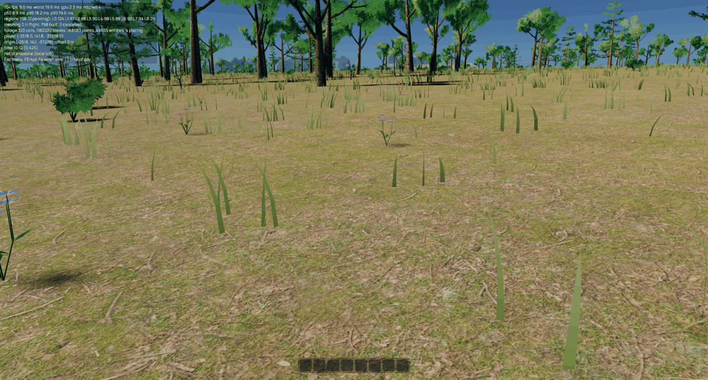
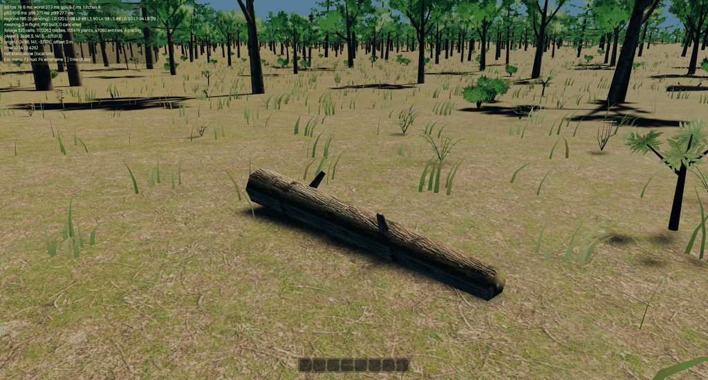

# Understory and deadwood

Five new biome-weighted species complement the grass and trees: amber and
violet flower clusters, woodland ferns, multi-stem shrubs and fallen logs.
Each has four deterministic variants. They use the existing placed-instance
pipeline as non-colliding decorations, not new gameplay objects.

`tree.form` selects `tree` (the backward-compatible default), `flower`,
`fern`, `shrub` or `log`. Flowers and ferns use geometric petals/leaflets
with solid materials; shrubs use masked broad-leaf sprays; logs reuse bark
textures with capped tapered sections and broken branch stubs. Individual
near meshes stay below 600 triangles. Ground detail placement is thinned by
a world-continuous 14 m patch field and obeys biome, moisture, cover, slope
and plant exclusion rules.

Flowers and ferns fade over 90–120 m; shrubs and logs over 150–180 m. Only
their near mesh is installed and no distant atlas is baked. Distant cells
retain CPU placement records but no render entities for these details. The
existing scheduler's job/entity/upload limits remain unchanged.

Logs do not sway or flutter. Their footprint is checked against a 5×5 grid
of ground samples, rejecting uneven support and cell-edge footprints. They
are slightly buried and use conservative slope limits. They are decorative:
players can walk through them. Slope-aligned deadwood and physical colliders
are future work.

The new species sort after the existing ids. A placement regression compares
the old species table with the extended one and asserts that existing trees
and scrub retain exact placement records. Other tests exercise every new
form/variant, complete finite vertex streams, bounds, static log wind markers,
and rejection of uneven or unsampled deadwood support. The placement snapshot
gains understory and loses a few grass blades to its exclusion footprints.

Ground-level visual checks used (historical: since ticket 0004 brought the
ranges near, (-2518, -37078) is a mountainside at 1 660 m and no longer a
forest floor; the `woodland` study scene is the forest to use now):

```sh
target/release/game --flycam --lock-camera --camera-altitude 1.2 --camera-pitch=-0.25 --frames 600 --spawn=-2518,-37078 --look=-2.2 --window 1920x1080 --aa taa --screenshot understory.png
```

## Verification

Full `just --tempdir /tmp ci` passed, followed by workspace/all-target Clippy
after adding the diagnostic `understory_locations` example. Locked-camera
captures were inspected for flowers, shrubs, fern silhouettes and grounded
deadwood. Ferns currently have a deliberately light, open silhouette.

A 30-second seed-42 flight from `--spawn=-2528,-37088` at 1920×1080 with
TAA completed 2,767 frames without logged errors. Late-run samples were
94–103 fps, with GPU time 1.7–1.9 ms and the hitch counter holding at four.
These are local smoke-test observations, not a controlled before/after
benchmark.




