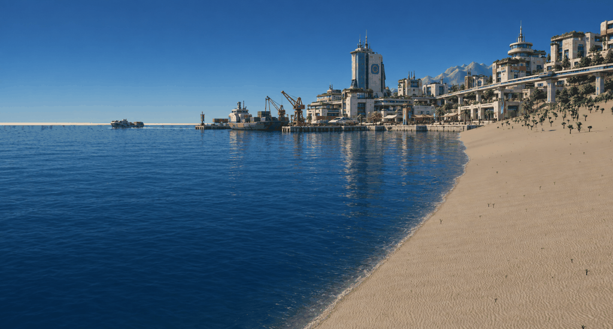
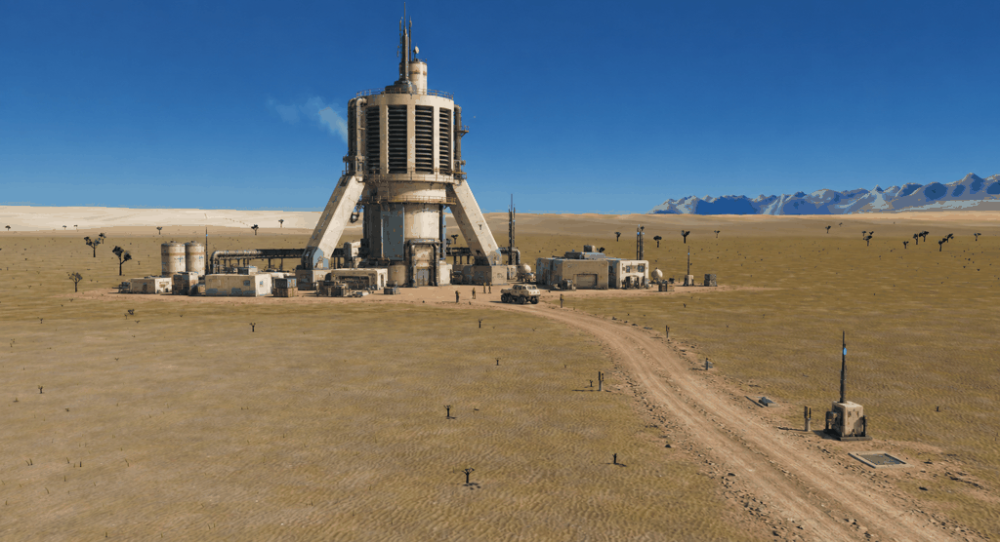
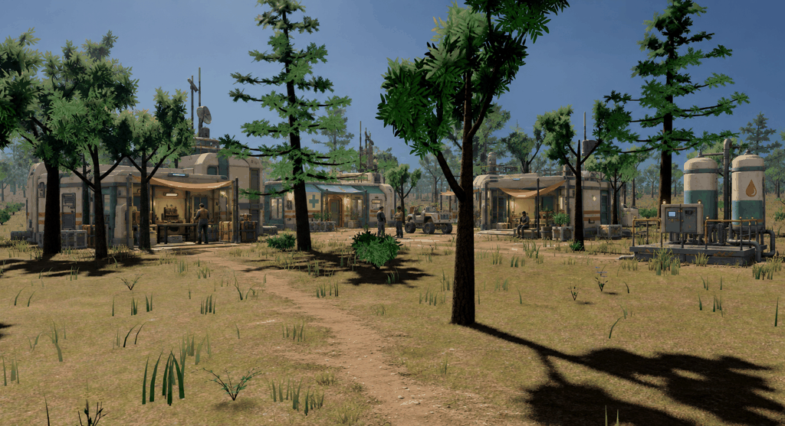

# Veyra visual direction: first screenshot studies

**New content concepts (2026-09-29):** [Frontier lives and small industry](../../design/frontier-life/README.md)
extends this direction into characters, equipment, native animals, building
families, extractors, fabrication and freight, with a proposed singleplayer loop.

**Latest direction:** [Dark corporate concrete](corporate-v6.md) explores a
Pelagic coastal district and frontier compound. The preceding scenes still felt
too cozy; this pass adds imposing institutional architecture.

**New scenes:** [Working waterfront, terraforming service yard, and roadside
freight stop](scenes-v5.md) extend the gritty direction to different locations.

**Material and wear reference:** [A settlement with repair history](gritty-v4.md), adding
grittier materials, mismatched construction, and visible maintenance history.
The [previous revision](balanced-v3.md) established the desired asset complexity
but looked too perfect.

Keep the engine's current terrain, trees, foliage, and lighting; simplify the
added assets to support local generation and modular Rust authoring. The fully faceted
[low-poly revision](low-poly-v2.md) was rejected. Initial studies below preserve
the setting compositions and the earlier, more detailed asset style.

2026-09-13. Three exploratory edits of freshly captured game screenshots,
following [the setting](../../SETTING.md). The buildings, machinery, vehicles,
and residents in the concepts are generated reference art for future game
content. This is a proposed visual direction for review.

## Shared visual language

- Pale concrete and ivory composite shells, with rounded corners and substantial
  structural forms.
- Dark inset machinery, muted teal panels, and restrained orange utility accents.
- Recognizable entrances, maintenance access, shaded gathering places, and
  services that explain how people live here.
- Clear daytime light and visible landscape between destinations. Technology
  establishes the futuristic identity through its silhouette and construction.
- Repeated materials across civic buildings, industrial infrastructure, and
  small settlement modules, with variation in scale and wear.

## Port Serein

A terraced coastal city with a working harbor, elevated transit, shaded public
space, and a distinctive civic skyline. The city's larger structures establish
the material vocabulary used by the smaller frontier buildings.

[Original coast screenshot](sources/coast.png). The edit keeps the broad coastal
composition and distant ridge, but also reinterprets the water surface,
reflections, and shoreline detail. Those changes are generated paintover drift
and have not been adopted as a water-rendering target.

## Atmospheric processor

A large ribbed intake structure on heavy buttresses, surrounded by maintenance
buildings and reached by a service road. The useful design reference is the
readable silhouette and the relationship between the machine and its support
settlement. Its final scale needs a game blockout; the prompt's approximate
120-metre height is an aspiration, not a measured dimension in the image.

[Original valley screenshot](sources/valley.png). The open plain, scattered
vegetation, and mountain ridge remain recognizable around the construction.

## Woodland borough

Small inhabited modules sit among existing trees: a workshop, a clinic, homes,
and shared water equipment. Porches, canopies, residents, and an informal yard
give the settlement a daily life. This is the strongest starting reference for
the first small settlement and its reusable building parts.

[Original woodland screenshot](sources/woodland.png). The foreground trunks,
flowers, and much of the tree arrangement remain useful anchors for comparing
the edit with the game. Generated building details and symbols are exploratory.

## Sources and reproduction

The release build completed successfully before capture. All three game runs
completed successfully using seed 42, a locked flycam, fixed visual time 0.42,
TAA, and a separate temporary settings directory. Original screenshots retain
the debug overlay; the built-in image editor removed it in the concepts.

- [Capture records](captures.json) contain the exact commands, settings, actual
  image dimensions, hashes, and source-to-concept mapping.
- [Prompts](prompts.json) contain the full final prompt for each edit. All three
  used the built-in `image_gen` tool with the corresponding screenshot as the
  edit target.
- `sources/` preserves unedited game captures and runtime logs; `concepts/`
  contains copies of the generated outputs.

The capture commands request a 1920x1080 window, but the window manager selected
different drawable dimensions. The manifest records the actual dimensions.
Generated edits also have different resolutions and should be compared by
composition rather than as pixel-identical overlays.
