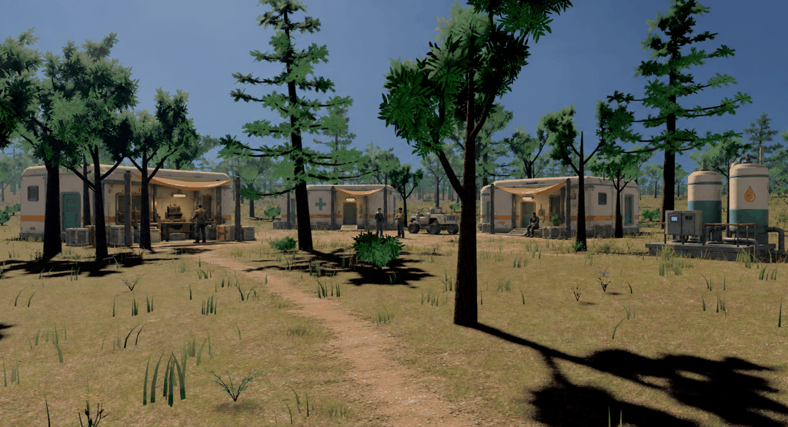

# Veyra visual direction: simpler assets in the existing world

**Follow-up:** the user found this version too perfect. The
[grittier revision](gritty-v4.md) explores repair history and varied materials
while retaining this asset-complexity direction.

2026-09-13. The engine's current terrain, relatively high-fidelity trees,
foliage, water, and lighting remain the environment target. The user rejected
the [faceted low-poly experiment](low-poly-v2.md) as too low-poly.

The production goal is economical, moderately detailed assets that fit that
environment. Local Trellis2/Pixal3D generation and modular Rust authoring guide how those
assets are made. The exact balance of geometry and materials needs a first
in-game asset trial.

## Woodland reference for review

This revision uses the original game screenshot as its edit target, with the
first concept as a settlement layout reference. Added buildings have smoother
bevels, restrained seams and vents, simpler rooflines, and fewer small fittings.
The tanks retain smooth surfaces and a compact set of functional pipework.

[Original game screenshot](sources/woodland.png) |
[First detailed concept](concepts/woodland-borough.png)

The forest's leaf forms, trunks, grass, terrain texture, and lighting remain
recognizable. This is an image edit rather than a pixel-identical overlay or a
render of implemented meshes. No engine rendering changes accompany it.

## Asset direction

- Keep the existing engine environment and lighting as the reference when
  reviewing new assets.
- Favor clean reusable forms, modest smooth bevels, and controlled shading.
  Spend geometry on silhouettes, entrances, and meaningful functional parts.
- Use convincing materials with restrained roughness variation, broad panel
  divisions, and a shared ivory, teal, charcoal, and muted orange palette.
- Reduce tiny cables, fittings, loose clutter, and dense mechanical decoration.
  Buildings should remain readable and substantial at player scale.
- Test a prefab shell and one piece of service machinery in the existing forest
  before expanding the production kit. Set mesh budgets from that trial.

The fully faceted environment and single-bevel toy-like look of v2 are rejected
directions. The v3 image is the next reference for review; it has not yet been
approved as the final asset target.

[Full prompt](prompts-balanced-v3.json) and
[generation record](generations-balanced-v3.json) preserve the two inputs and
the output. This revision used built-in ImageGen. The saved image is
`concepts/woodland-borough-balanced-v3.png`.
