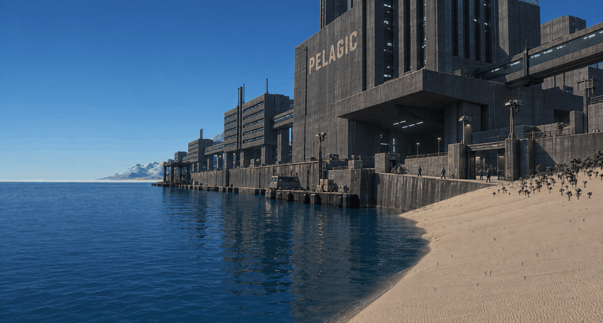
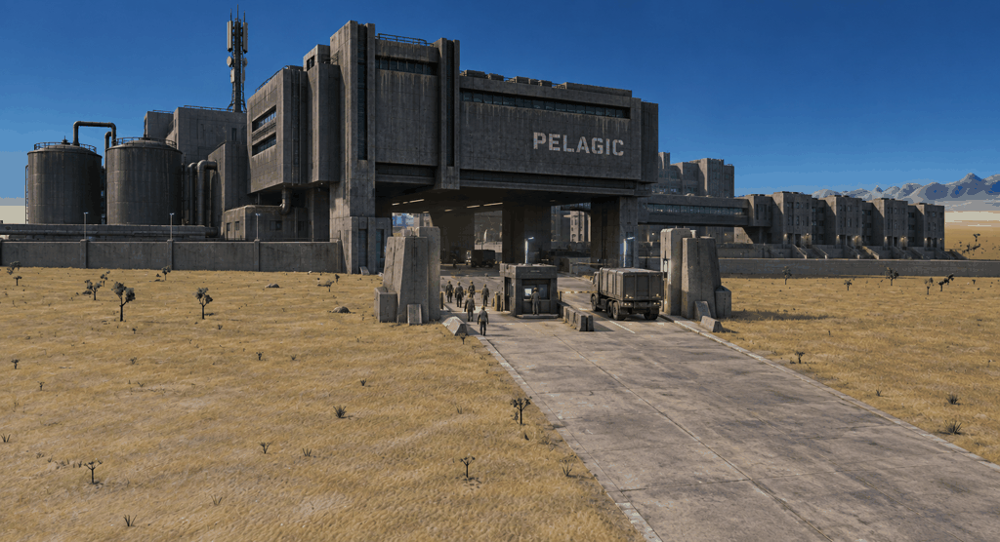

# Veyra: dark corporate concrete

2026-09-13. The user requested more of the dark corporate concrete atmosphere
they associate with Anarchy Online. Earlier studies still felt too cozy. These
two references explore Pelagic's institutional architecture through mass,
repetition, deep recesses, and controlled access. They are proposals for review.

## Coastal corporate district

Dark headquarters and housing slabs rise over a restricted service waterfront.
Enclosed connections, massive blank walls, narrow windows, and deep entrances
establish a company-owned district. Employees appear small beside the buildings.

[Original coast screenshot](sources/coast.png).

## Company frontier compound

A heavy administrative and processing block cantilevers over the approach.
Worker housing, tanks, services, and checkpoints share a repetitive structural
language. The road and entrances express the company's control of the facility.

[Original valley screenshot](sources/valley.png).

## Architectural direction

- Charcoal concrete, dark steel, deep structural shadow, and sparse cold work
  lighting give corporate places their mood under the existing daytime sky.
- Large slabs, piers, recessed bays, slit windows, enclosed bridges, and retaining
  walls form a reusable architectural kit.
- Institutional repetition and controlled circulation distinguish company-owned
  areas from individually modified settlements.
- Staining, patches, and old markings show age while the facilities remain
  operational. Sparse branding and human-scale access details establish use.

The contrast between corporate districts and independent places gives Veyra
more visual range. These studies add that vocabulary to the regional setting;
they do not assign every community the same architecture or moral character.

These are raster concepts, not implemented meshes. The image editor also changed
some terrain detail, shoreline, and perspective. Original source captures remain
the reference for the current engine environment. Geometry and material budgets
need validation on actual assets.

[Full prompts](prompts-corporate-v6.json) and
[generation records](generations-corporate-v6.json) document the built-in ImageGen
edits. Both PNGs are saved in `concepts/` with filenames ending in `-v6.png`.
