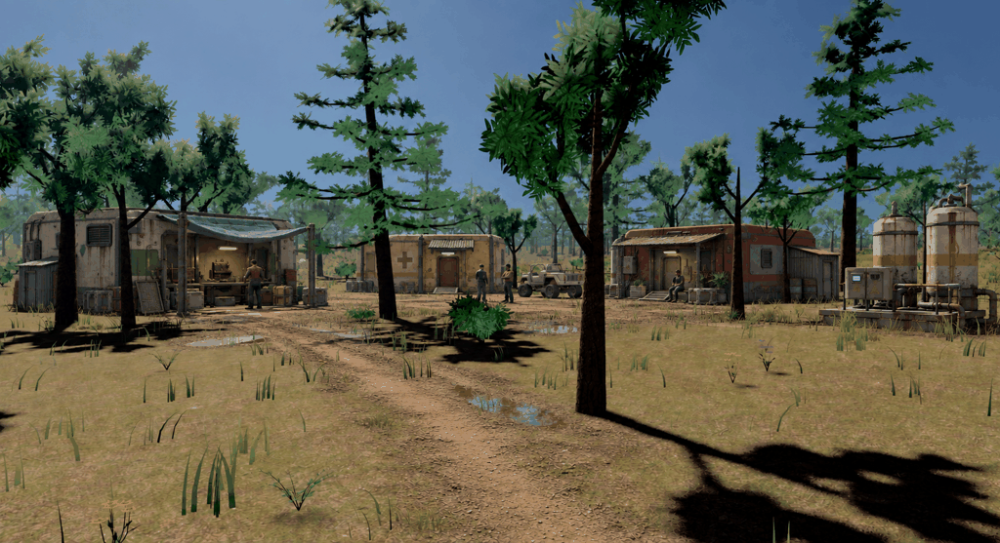

# Veyra visual direction: a settlement with repair history

2026-09-13. The previous revision looked too perfect. This study introduces
grittier industrial character while retaining the existing engine environment
and moderately detailed, reusable building forms. It is a reference for review.

[Previous clean version](concepts/woodland-borough-balanced-v3.png) |
[Original game screenshot](sources/woodland.png)

## Direction

- Mix construction generations: a heavy workshop, an old composite clinic,
  and a repainted residential module with an attached service shed.
- Show repair history through replacement panels, altered door surrounds,
  patched awnings, and mismatched colors. The settlement has accumulated changes.
- Place wear where use explains it: runoff beneath fittings, corrosion at metal
  seams, tracked mud at entrances, and wheel ruts in the service yard.
- Keep services working and residents present. Work lights, a functioning
  control cabinet, a chair, and personal planting show ongoing habitation.
- Use a broader industrial palette: weathered cream, concrete gray, faded green,
  oxide red, dark metal, and old safety markings. Materials vary between assets.

Much of the character can come from material variation, decals, and a small set
of repair panels and extensions. Preserve economical geometry and the current
trees, foliage, terrain, and lighting. Local yard surfaces and puddles in the
image are concept additions; they are not implemented engine changes.

[Full prompt](prompts-gritty-v4.json) and
[generation record](generations-gritty-v4.json) record the built-in ImageGen
edit. The saved output is `concepts/woodland-borough-gritty-v4.png`.
