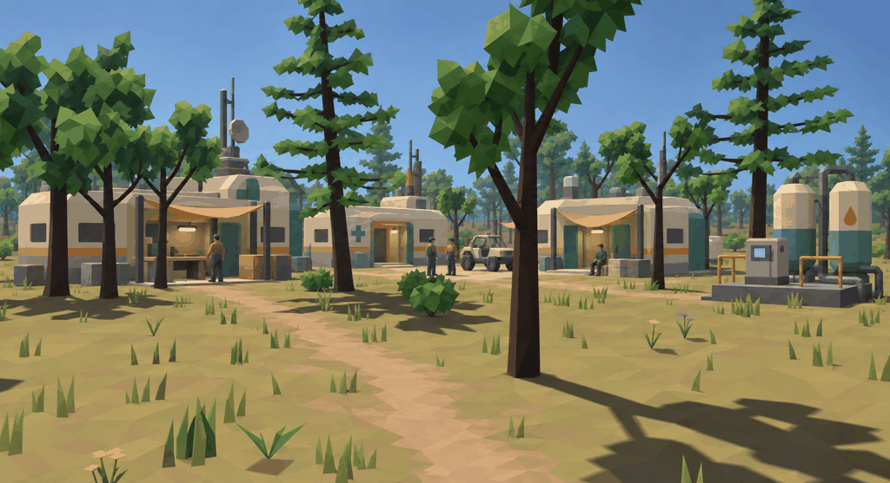
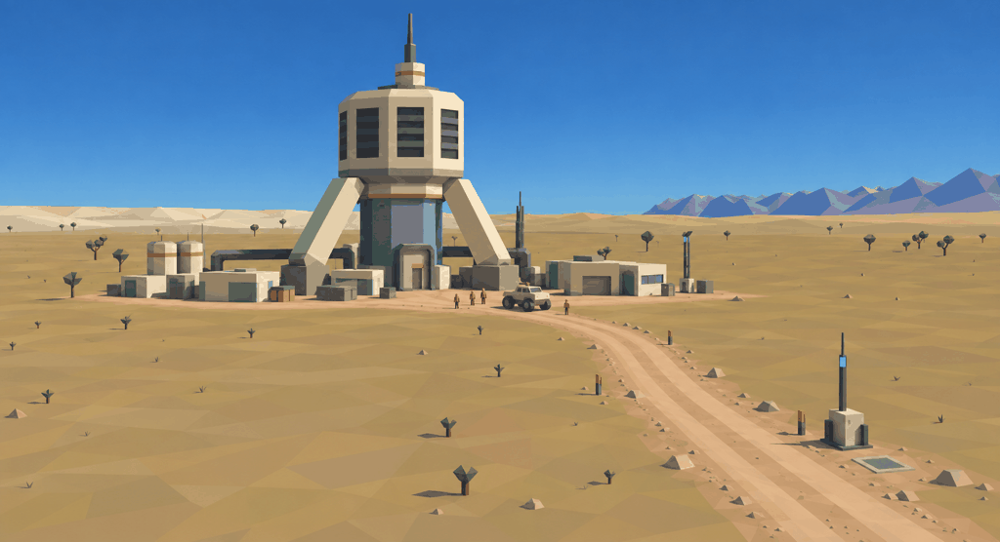
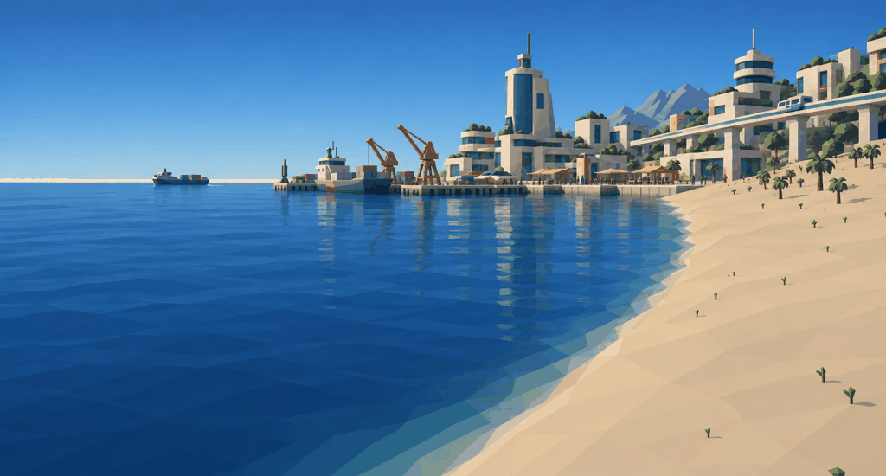

# Veyra visual direction: low-poly revision

**Rejected experiment, 2026-09-13.** These images went too far toward a faceted
low-poly look and changed the environment. The user wants to keep the current
engine's relatively high-fidelity trees and other rendering. See the
[corrected direction](balanced-v3.md). The notes below preserve the experiment
for comparison and are not the production target.

These are built-in ImageGen edits of the [first screenshot studies](README.md).
The earlier camera views, settlement layouts, and main silhouettes provide the
comparison. Original captures and first-pass edits remain available.

## Shape and material rules

- Build identity through silhouettes, proportions, large recesses, and color.
  Small details should be dispensable at normal gameplay distance.
- Favor chamfered boxes, broad planar faces, faceted cylinders, thick beams,
  simple pipe elbows, and reusable doors and windows. A single bevel facet can
  suggest the rounded prefab shells from the setting.
- Use a small shared material family: warm ivory, dark slate, muted teal, and
  ochre-orange accents. Keep material detail broad and restrained.
- Simplify vents into a few thick blades, window groups into dark bands, and
  equipment into readable solid forms. Use markings for details that do not
  affect silhouette.
- Give simple geometry depth through sunlight, shadows, and controlled shading.
  Preserve adult proportions and the sense of a functioning inhabited world.

## Woodland borough

The small settlement is the clearest starting reference. A repeated prefab shell
can serve as a workshop, clinic, or home through its doorway, porch, canopy,
markings, and adjacent equipment. The water plant uses faceted tanks and a few
thick pipe sections. Residents and the buggy establish scale.

[Earlier detailed concept](concepts/woodland-borough.png) |
[Original game screenshot](sources/woodland.png)

## Atmospheric processor

The landmark retains its identity with an octagonal intake body, heavy splayed
legs, broad dark vents, and a teal central shaft. The surrounding service
buildings share the settlement's simple volumes and materials.

[Earlier detailed concept](concepts/atmospheric-processor.png) |
[Original game screenshot](sources/valley.png)

## Port Serein

Repeated building masses, simple balcony slabs, window bands, transit supports,
and a few distinctive civic silhouettes create the larger settlement. The
harbor and waterfront communicate function through their layout and scale.

[Earlier detailed concept](concepts/port-serein.png) |
[Original game screenshot](sources/coast.png)

## Production implications

The planned workflow combines the user's local Trellis2/Pixal3D asset generation
with Blender modeling, cleanup, and assembly. Author regular architectural
modules and connection surfaces in Blender; use individually generated objects
where their shape benefits from that process. Bring both into the same material
family and level of geometric detail.

A useful first kit is a prefab shell, doorway, window insert, canopy, tank,
pipe elbow, control cabinet, and crate. Test their scale and appearance together
in the game before expanding the kit. Roads, steps, entrances, and joining
surfaces need deliberate placement and usable clearances.

These raster references establish appearance, not measured mesh budgets. Local
generation settings, topology cleanup, collision, materials, and LODs need
validation on actual assets. The image editor also simplified terrain, water,
and foliage across all three scenes; those are proposals for a coherent overall
look and have not been implemented in the renderer.

[Full prompts](prompts-low-poly-v2.json) and
[generation records](generations-low-poly-v2.json) preserve inputs, output paths,
dimensions, and hashes. All revised PNGs are saved in `concepts/` with the suffix
`-low-poly-v2.png`.
