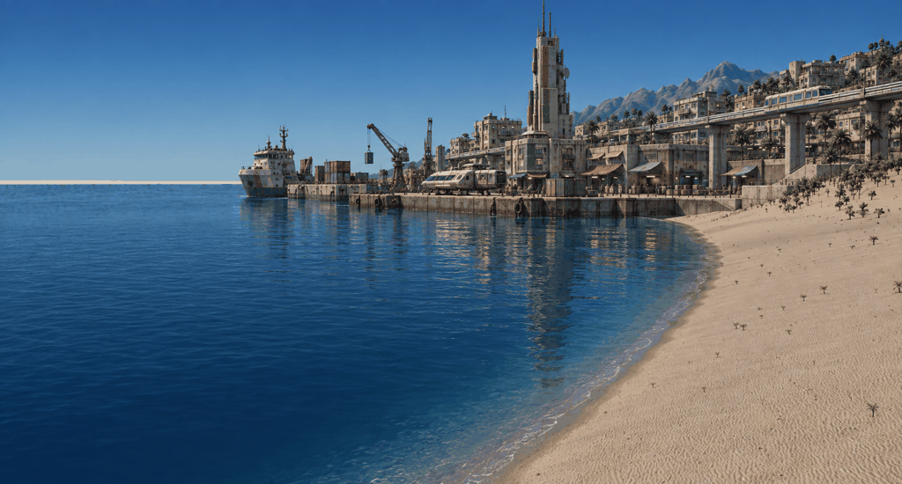
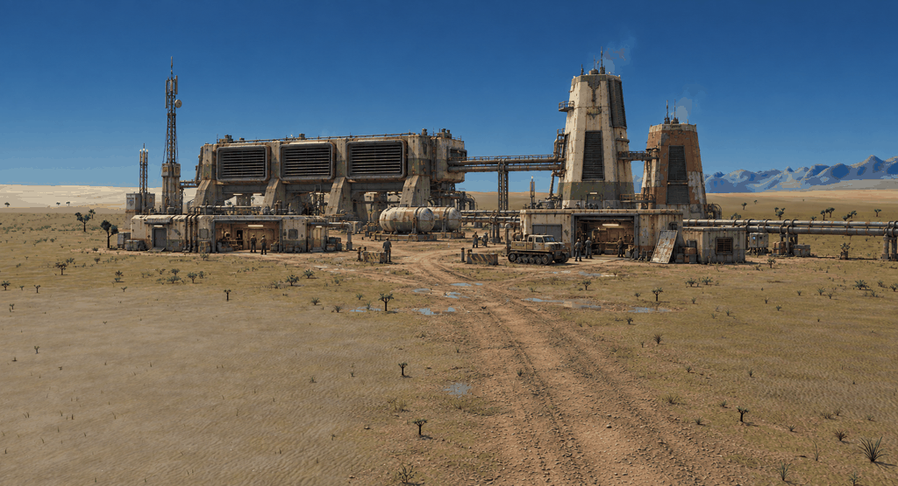
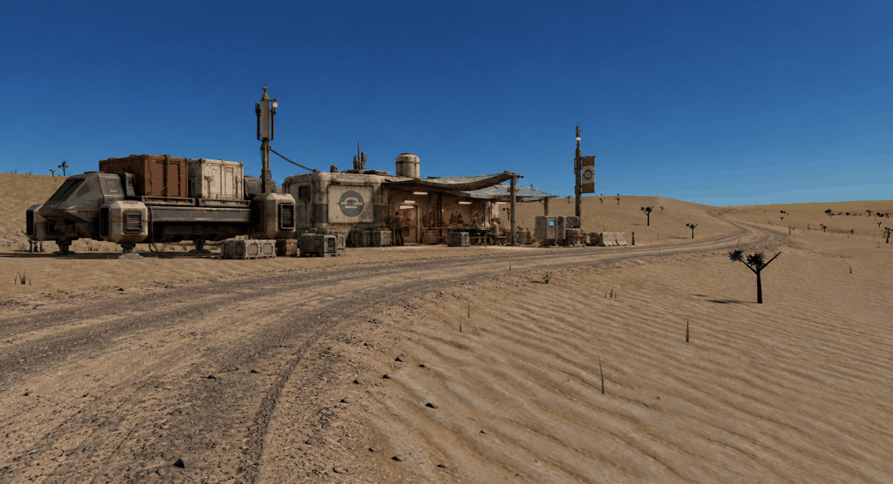

# Veyra: waterfront, service yard, and freight stop

2026-09-13. Three different places using the
[gritty woodland direction](gritty-v4.md): functioning infrastructure with age,
repair history, and uneven investment. Each is an edit of a game screenshot,
using the woodland image as a material and wear reference.

## Port Serein's working waterfront

Housing rises behind a cargo terminal, loading cranes, and an elevated transit
route. Older concrete construction, replacement panels, salt staining, and
varied awnings give the district a history. The tower and transit line establish
its skyline while freight activity explains the waterfront layout.

[Original screenshot](sources/coast.png). The edit reinterprets water,
shoreline, and mountain detail; those differences do not prescribe changes to
the current renderer.

## Terraforming service yard

A long atmospheric exchange hall and two unequal towers form a regional
installation. Control rooms, workshops, a crawler, pressure tanks, and accessible
pipe runs create human-scale work areas beneath the machinery. Repeated intake
modules and large tower forms provide a potential basis for a reusable asset kit.

[Original screenshot](sources/valley.png). The plain and mountain ridge give
the installation space and orientation. Access roads, yard surfaces, and all
equipment are proposed additions.

## Roadside freight stop

A parked freight tug, cargo-transfer area, canteen, and repair shelter make a
stop along a long service route. A worn fleet vehicle and a small number of
buildings give this location a different role from the woodland village.

[Original screenshot](sources/freight-stop.png). This source was captured for
the study at walking height, facing a different direction in the valley fixture.
The source terrain, saplings, and daylight remain recognizable around the road.

## Records

All three are raster references for review. The current engine environment
remains the target; image edits are not pixel-identical overlays. Fine asset
details still need simplification and validation in the Rust/local-generation
workflow. No scene geometry or rendering code was changed for these studies.

- [Full prompts](prompts-scenes-v5.json), using built-in ImageGen.
- [Generation and new capture records](generations-scenes-v5.json), including
  image paths, dimensions, hashes, and the freight-stop capture command.
- [Earlier source capture records](captures.json), for the coast and valley.

All three saved PNGs are in `concepts/`, with filenames ending in `-v5.png`.
