# 0007: Crafting into the game, screens first

Status: accepted 2026-10-10 ("lets do it"). Step 0, the mockups at
https://claude.ai/artifact/Rkf9jmhS3jsJYjQwAr2Rtd, was accepted the same
day ("looks good"). That night the user asked for every step to be worked
through unattended, "all the way to playable", so the steps below no
longer wait for the user's eye one by one: each is built, checked,
captured and committed, and what the user would have been asked is
written under the step instead. The full `just ci` runs once at the end.
Steps 1 to 3 are built (see "As built"). Written after the user played
the browser prototype of `docs/design/crafting.md` ("this seems very
promising") and asked for "a plan on moving this into our game proper.
UI/ux is a thing to nail here".

The rules are settled in [crafting.md](../design/crafting.md) and its
section 8 already names the engine work as slices 0 to 8. This ticket keeps
that order and adds what the design left out: where each screen opens, what
it shows, what it is built on, and how each one is judged before the next
is started.

## What the prototype proved, and what it cannot be

It proved the loop: a deposit's numbers reach a magazine count through a
lot, a component, a roll and a fitted mod, and every step is a decision.
The rules ran headless and reproduced the design's worked example (a cell
core ceiling of 724).

It is the wrong shape for the game in five ways, and each is a rule for
what follows:

| The prototype | The game |
| --- | --- |
| Seven tabs, reachable from anywhere | Places. A screen opens at a thing in the world with F, as the bench and the trainers do |
| Tables of every number | One item card, the same wherever an item is shown |
| Factors (`x 1.272`) | The unit the player feels, with the change: `30 rounds, +6` |
| Two-letter codes for the eleven attributes | Only the attributes this class carries, named, with the ones this slot weighs lit |
| Dropdowns for every pick | Slots that take a stack, with the candidates listed best first |

## The finding that shapes the build

`slotted`, the UI library the game's screens already stand on, is an
inventory framework first. The game uses its menu and theme half today
(pause, settings, the sheet, the bench) and none of its item half. Read
against the design, the item half fits closely:

| The design needs | slotted has |
| --- | --- |
| Stacks kept apart by batch, gear in use as singles | `ItemStack { id, count, patch }`: two stacks merge only when the id and the whole component patch are equal. A batch's quality lines are the patch; a carbine in use is a count of one whose patch holds its condition and what is fitted |
| A schematic slot that takes a class of resource | `SlotDef::accepts` with `Predicate::Tag`; the registry's item tags carry the class tree |
| A slot that shows what it wants before it is filled | Ghost and filter slots |
| The same card on every item, short and long | Composed tooltips in two tiers (hover, and Shift for more), built from parts the game registers |
| Moving stock between a store and a pack | Slot grids, a carried stack, shift-click routing, keyboard and gamepad focus |
| Condition, a factory run's progress | `bar`, `progress` and `tank`, bound to a menu's properties |
| A register of hundreds of rows | `virtual_grid` |
| The weapon turning in the fitting screen | `viewport`, which takes a live entity (feature off today) |
| "What is this lot good for" | The recipe browser (feature off today) |
| Every screen clicked through in a test | `slotted-test`, already used for the sheet and the bench |
| A local owner of the truth now, a server later | The `Authority` port |

So the recommendation is one representation from the save to the screen: a
`slotted_model::ItemStack`, with a typed view over its patch for the rules.
`strata-registry` already depends on `slotted-model` (no Bevy), so the sim
can hold stacks without a new dependency and without touching the headless
allowlist. `slotted-ecs` uses the umbrella `bevy` crate and stays on the
client side, where it already runs.

This is a recommendation to prove in step 1, not a fact. The game has never
opened a slotted menu over an inventory, and step 1 exists to find out what
that costs before six screens are designed around it.

## The rules for every screen

These are the acceptance criteria. A screen that breaks one is not done.

1. **One card.** A lot, a component, a mod, a weapon and a kit all show the
   same card: name and kind, where it came from, what it does in the
   game's units, its quality lines as bars. Hover gives the short card,
   Shift the long one, and a detail pane shows the long one pinned.
2. **Units, then change.** No factor is ever on screen. A line reads
   `Magazine 30 rounds +6`, measured against what is in that slot now.
3. **See it before it is spent.** Every pick moves the outcome before
   anything is consumed. A craft shows its floor and its ceiling
   (`27 to 30 rounds`) before Assemble; a roll shows its odds before the
   press; a sale shows the price with its premium before Sell.
4. **A refusal is at the thing refused, and says why.** A lot the factory
   will not take sits dimmed in the list with `PT 560, needs 700`. A shut
   mod slot reads `Opens at moddability 600`. A grey button never stands
   alone.
5. **Best first.** Candidates for a slot are sorted by what they would do
   for that slot's weighted line. One press fills every slot with the best
   stock; a second choice fills with the cheapest stock that meets a
   blueprint.
6. **Eleven is too many.** A card shows only the attributes its class
   carries (three to six). At a schematic slot the ones it weighs are lit
   and the rest are quiet. Names in full on the card, codes only in dense
   rows.
7. **Colour is never alone.** Every state has a word or a mark as well.
   The sheet's legend is the model.
8. **The world keeps running.** Every screen is a modal over a live world,
   as the pause is. Nothing waits on a screen being open.
9. **Keys and mouse now, focus always.** Every screen is reachable by
   focus alone through slotted's navigation, so a gamepad is tuning later
   and not a rewrite.
10. **The house style holds.** Barlow Condensed for numerals and uppercase
    labels, Manrope for prose, roles in the `strata.*` block of the
    theme, English in `strings.rs`, middle dots as separators, no default
    font anywhere.

## Places

| Thing in the world | F opens | Stands |
| --- | --- | --- |
| Locker | Stores | At the staging spawn and the household's base |
| Workbench | Fitting, and the crafting session | Beside the locker; one at each institution's workshop later |
| Fabricator | The factory | At the base |
| Procurement board | That institution's board | At Pelagic's office on the Exchange first |
| Survey post | The deposit's assay, and Draw | At each deposit, which is a site |
| Terminal (exists) | The bench, and the survey register as a second tab | As today |

From anywhere, a key of its own (I is unbound) opens what the character
carries and the weapon in hand, read-only for fitting. That mirrors the
bench, which the pause menu shows read-only and a terminal makes live.
The pause menu gains the same button.

## The screens

All sketches are at the game's 16:9 frame, on the glass panel the sheet
uses. They fix what is on a screen and in what order, not its pixels, and
their numbers are illustrative.
Step 0 turns them into mockups in the game's own skin.

### The card

```
 Extended cell                          MOD · FEED
 Crafted by Tovan Reyes · batch 0412
 ─────────────────────────────────────────────────
 Magazine          30 rounds                  +6
 Reload            1.56 s                +0.21 s
 ─────────────────────────────────────────────────
 CAPACITY   █████████████░░░░░░░░│░░░░  610
 HANDLING   █████████░░░░░░░░░░░░│░░░░  433
 ─────────────────────────────────────────────────
 Fits the patrol carbine's feed            Shift ▸
```

The tick on a bar is vendor grade (500). A worse change is in the theme's
warning role and carries a minus or a plus that reads the right way for
that line (a longer reload is worse). The long card adds what it was made
from and where that was drawn.

A lot's card has the same frame with the class range drawn under each bar,
which is the prototype's assay strip:

```
 Calder salt                        SALT · EVAPORITE
 Calder flats · 80 units
 ─────────────────────────────────────────────────
 Potency    ├──────────────█████████──┤   820   of 300 to 950
 Purity     ├────────██████───────────┤   610   of 200 to 900
 Stability  ├───███───────────────────┤   240   of 100 to 700
```

### Stores (the locker)

```
┌ Stores ─────────────────────────────────────────────── 2,500 cr ┐
│ ALL  LOTS  PARTS  MODS  GEAR  KITS            sort: newest ▾    │
│ ┌ The household's store ────────────┐ ┌ Carried ──────────────┐ │
│ │ ▣ ▣ ▣ ▣ ▣ ▣ ▣ ▣ ▣                 │ │ ▣ ▣ ▣ ▣ ▣ ▣            │ │
│ │ ▣ ▣ ▣ · · · · · ·                 │ │ · · · · · ·            │ │
│ │ · · · · · · · · ·                 │ ├ In hand ──────────────┤ │
│ └───────────────────────────────────┘ │ ▣ Patrol carbine  780  │ │
│ ┌ the long card of the focused stack ──────────────────────────┐│
│ └──────────────────────────────────────────────────────────────┘│
└─────────────────────────────────────────────────────────────────┘
```

Slot grids on slotted's inventories. A stack's corner shows its count and a
small quality pip, so two batches of one material tell apart at a glance.
Shift-click sends a stack across.

### Fitting (the workbench, first tab)

```
┌ Patrol carbine · Vigil ─────────── CONDITION ████████░░ 780 / 1000 ┐
│  SIGHT   ▣ Reflex sight            ┌──────────────────────────┐    │
│  FEED    ▣ Extended cell           │   the weapon, side on    │    │
│  GRIP    ▢ empty                   └──────────────────────────┘    │
│  STOCK   ▨ opens at moddability 600        MODDABILITY 500         │
│  MUZZLE  ▨ opens at 800                                            │
│  FORE    ▨ opens at 800                                            │
│ ┌ Fits FEED, from the store ───────┐ ┌ In hand ──── now ── bare ──┐│
│ │ ▸ Extended cell   30 rounds  +6  │ │ Magazine      30      24   ││
│ │   Quick cell      1.10 s  -0.25  │ │ Reload      1.56 s  1.35 s ││
│ │   Store cell      (fitted)       │ │ Shot every  0.24 s  0.24 s ││
│ └──────────────────────────────────┘ │ Not in the fight yet:      ││
│  [ Fit ]  [ Remove ]                 │ spread · recoil · cooling  ││
│  [ Repair · 1 kit ]  [ Rework ]      └────────────────────────────┘│
└────────────────────────────────────────────────────────────────────┘
```

Focusing a slot filters the list to what fits it. Focusing a candidate
previews it in the right-hand table before Fit. The weapon is a flat
diagram first and the turning model later (see step 8). Lines the fight
does not yet read are listed, named as such, and not hidden: the design's
section 4.5 is honest about them and the screen should be too.

### The crafting session (the workbench, second tab)

One screen, three states, never a wizard of separate pages.

```
┌ Workbench ────────────────────────────────────────── Tovan Reyes ┐
│ SCHEMATICS         │ CELL CORE            │ WHAT COMES OUT        │
│ Parts              │ Salt · 40 units      │ CAPACITY              │
│  ▸ Cell core    ●  │  ▣ Calder salt  820  │  ░░░████████▌   724   │
│    Frame        ●  │    Potency ×0.6      │  floor 362            │
│    Liner        ○  │ Brine · 20 units     │ In an extended cell:  │
│ Mods               │  ▣ Serein brine 560  │  27 to 30 rounds      │
│    Extended cell   │    Potency ×0.2      │ HANDLING              │
│ Weapons            │    Conductivity ×0.2 │  ░░██████▌      455   │
│    Patrol carbine  │                      │                       │
│ ● can be made now  │ [ Best stock ]       │ [ Assemble ]          │
└────────────────────┴──────────────────────┴───────────────────────┘
```

After Assemble the right column becomes the bench hand:

```
│ WHAT COMES OUT            8 points left │
│ CAPACITY   ████████░░░░░░│   362 of 724 │
│   [ Steady ]  ▁▇▅▁        most often +44 │
│   [ Bold ]    ▅▅▅▃▂       up to +116, may slip │
│ HANDLING   █████░░░░░│      228 of 455 │
│   [ Steady ]  [ Bold ]                  │
│ [ Finish ]                              │
```

The odds are drawn as the five bars of the roll table, not quoted as
percentages. A roll fills its bar over a third of a second with a sound and
a word (Good, Fair, Setback). Holding a button repeats. Finish shows the
finished card and offers Record as blueprint, with the derating as a
slider whose effect on the minimums is shown as it moves.

### The factory

```
┌ Fabricator ──────────────────────────────── worked by Ilse Marrow ┐
│ BLUEPRINTS       │ CELL CORE · batch of  [ 100 ]                   │
│ ▸ Cell core 724  │ Salt    needs Potency 700     ▣ Calder salt 820 │
│   Frame 610      │ Brine   needs Potency 500     ▢ nothing fits    │
│                  │   Serein brine  ▨ in store, Potency 560 ✓       │
│                  │   Marsh brine   ▨ Potency 410, needs 500        │
│                  │ Makes 100 cell cores at 724 · ready in 40 min   │
│                  │ [ Run ]                                         │
└──────────────────┴─────────────────────────────────────────────────┘
```

A run is a standing job in played time, announced by a toast when it is
done. The benched character working it is shown and is not available to
switch to until it ends or is stopped.

### A procurement board

```
┌ Pelagic Works · procurement ─────────────────────────────────────┐
│ UPKEEP                                                            │
│ Cell cores      wants 40 more   min CAPACITY 500   120 cr each    │
│   ████████░░░░  yours: 100 at 724 · pays 148 each   [ Sell 40 ]   │
│ Light alloy     wants 600 units min Strength 450     2 cr a unit  │
│   ░░░░░░░░░░░░  yours: Harrow 540, 200 units        [ Sell 200 ]  │
│ PROJECT · the east breakwater                                     │
│ Frames          wants 12        min STRENGTH 650    not met: 610  │
│ SOLD HERE  40 cell cores · batch 0412 · day 12                    │
└───────────────────────────────────────────────────────────────────┘
```

### The survey register and a survey post

At a deposit, the HUD card that names a place names the deposit and its
class, and F opens its assay (the lot card above, with Draw and its fee).
The register is a second tab on a terminal: every deposit the household
has stood at, with class, best line, distance and bearing. A map is not in
this ticket; the register's rows are what a map would pin.

### On the HUD

- The vitals cluster's magazine numeral already exists and simply reads
  the fitted number.
- The weapon's condition joins the cluster as a thin bar that only appears
  under half, and a chip reads `Carbine worn` at the quarter where the
  design's slide starts.
- A factory run, a sale and a finished craft use the XP toast.

## Where the truth lives

- **`strata-registry`**: resources, items, schematics, buyers, as the
  design's section 8 says. The class tree is published as item tags so a
  slot can ask for a class.
- **`strata-sim::items`**: the typed view over a stack's patch, the
  formulas, and every change to stock as a transaction consumed in the
  tick (craft, roll, finish, fit, remove, repair, rework, sell). The
  combatant carries its loadout and `apply` grows to take it. No Bevy UI,
  no slotted beyond `slotted-model`.
- **`apps/game`**: the household's store, blueprints, jobs and ledger in
  its save, beside the bench. The props.
- **`strata-client::ui`**: the screens, the card's tooltip parts, and an
  `Authority` that turns a click into a sim transaction and paints what
  the sim answers. Nothing here decides a rule, as on the sheet.
- **`assets/crafting/*.ron`**: every dial of the prototype's last tab. No
  crafting literal in code, the same rule as combat.

The prototype's JavaScript is not ported. Its formulas are re-derived from
the design and its outputs become the tests: the 724 ceiling, 30 rounds
and 1.56 s of section 5.5, the slot thresholds, the refusal reasons.

## Steps

Each step ends with screenshots under xvfb in `docs/design/crafting/` and a
headless walk (`--script-crafting`, in the manner of
`--script-progression`), and waits for the user's eye before the next.
Each screen gets an `--open-<screen>` flag for its still, and a
`slotted-test` test that drives it by role.

| Step | Design slice | Builds | The screen it lands | Done when |
| --- | --- | --- | --- | --- |
| 0 | none | Mockups of the card, stores, fitting and the session in the game's skin and frame, as a browser page over the prototype's rules | All four, as pictures that click | The user has changed what they want changed and the vocabulary (names of lines, attributes, states) is fixed |
| 1 | 0 | Items as stacks in the registry, the sim and the save; the carbine and pistol in hand as records; the slotted inventory spike; a locker | The card, stores | The combat contracts and the scripted progression pass unchanged; the save round-trips a store; a stack is carried across by mouse and by focus alone; the list of what slotted lacks is written down |
| 2 | 1 | The loadout in the merge; one bought feed mod; a workbench | Fitting, with the weapon drawn from its baked pictures ([ticket 0008](0008-weapon-pictures.md)) | The HUD reads 30; the balance harness shows the difference; removing the mod restores the row exactly |
| 3 | 2 | The resource registry, fixed deposits, the worldmap layer, survey posts, Draw | The lot card, the assay, the register | Two deposits of one class differ on the card and on the map; a drawn lot is in the store |
| 4 | 3 | One schematic chain (cell core, then the extended cell) with the rolls | The session | The worked example is craftable from a cold start in under a minute and fifteen presses; two crafts from the same lots differ |
| 5 | 4 | Blueprints, the fabricator, a standing job, a benched worker | Record as blueprint, the factory | A hundred identical cores; a lot under the minimum is refused in place with its number |
| 6 | 5 | Wear in the tick and on being downed, kits, repair | Condition on the card, the HUD and fitting | A worn carbine underperforms in the harness and is restored exactly |
| 7 | 6 | Pelagic's board | The board | Demand ends at its quantity; a sale records buyer and batch |
| 8 | none | Weapon parts baked by `just content`, composed at their sockets | The turning weapon in fitting, and the real weapon in the hand | A fitted scope is on the model in the screen and in the world |
| 9 | 8 | The Weaponsmith tree, moddability, rework | Shut slots opening | A crafted carbine with more open slots than a bought one, in another bench member's hands |
| 10 | 7 | Spread, so a sight does something | The first "not in the fight yet" line leaves that list | Deterministic scenarios before any tuning |

Notes on the order:

- Step 0 comes first because a wrong layout costs minutes in a browser and
  an afternoon in Rust. The prototype's rules are reused as they are; only
  the face changes.
- Step 1 is the risk. If slotted's item half fights the design (large
  unit counts, splitting a lot by amount, a card that compares against
  what is fitted), the gap is closed in slotted, which is the user's own
  library, or the screens fall back to the hand-built cards the sheet
  uses. Either way it is known before step 2.
- Step 8 is content, runs beside the others, and replaces the flat diagram
  without changing the screen around it. The game bakes nothing at run
  time, so the weapon's parts are baked by `just content` into
  `generated/weapons/` the way buildings and bridges are.
- Steps 9 and 10 keep the design's order for the specialist and for
  spread.

## As built

### Step 1: items, the pack, the store (2026-10-11)

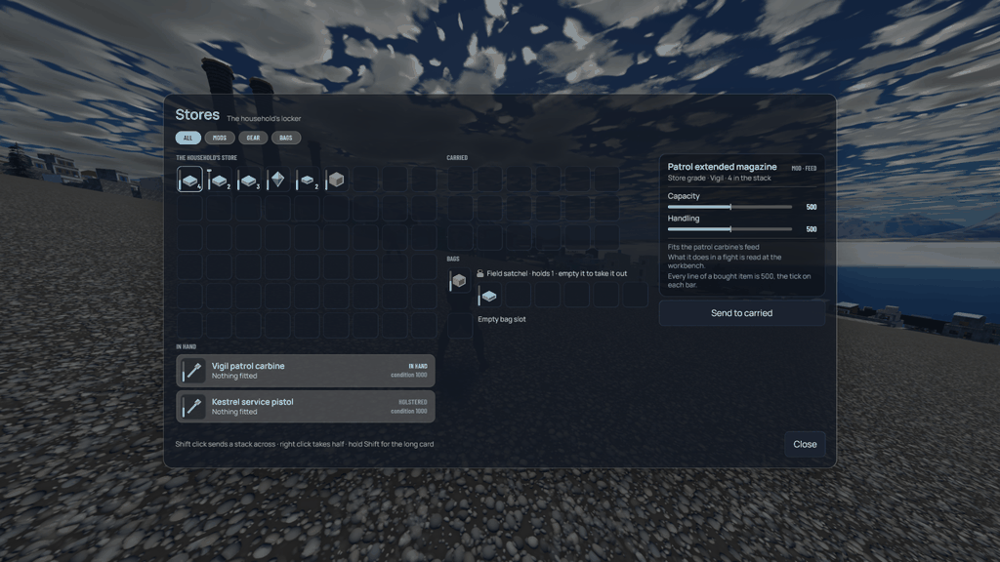
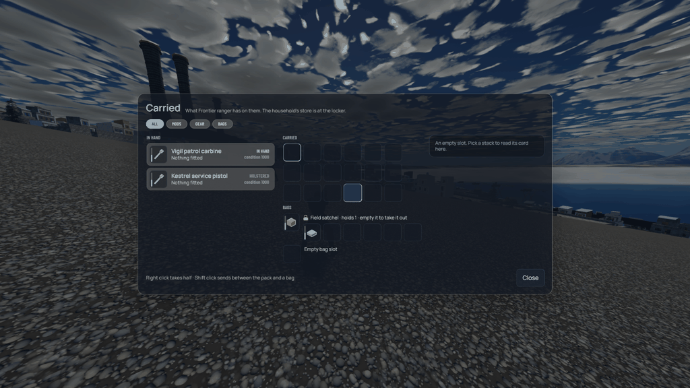
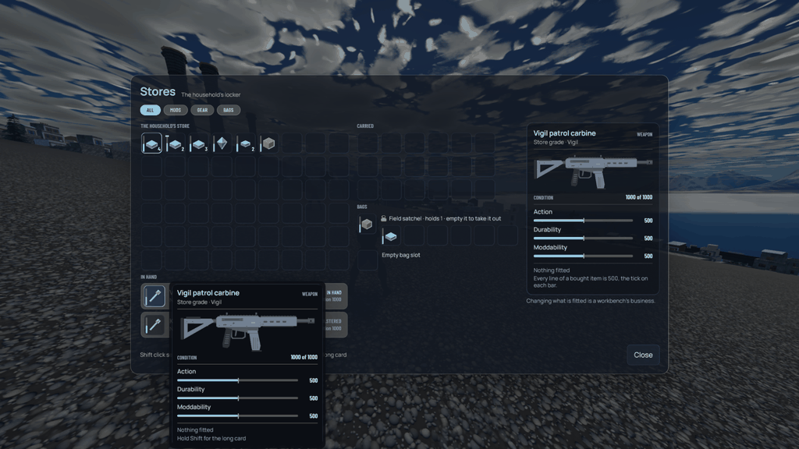

- **Items.** `assets/items/*.item.ron`, checked by
  `strata_registry::item` (`ItemCatalogue`): the patrol carbine and the
  service pistol, four of their modules, a field satchel (6 slots) and a
  haul pack (12). A record is a `slotted_model::ItemStack` whose patch holds
  `strata:batch`, `strata:by`, `strata:lines`, `strata:condition` and
  `strata:fitted`; `strata_sim::items::{read, write}` is the typed view.
  Two batches of one module never merge.
- **The rules are the sim's.** `strata_sim::items` holds `Pack` (3 rows of
  6, two bag slots, the cursor), `Hands` and `HouseholdStore` (9 by 6), all
  sized by `assets/items/carry.ron`. A click is a `StockRequest` consumed in
  the tick and replayed by slotted-model's own click rules on the truth; the
  screen is a mirror that is acked or resynced. A bag that holds something
  is locked and says so. A send with no room says "No room in the pack".
- **The save.** `Household::VERSION` is 2: each character's pack and hands,
  and the household's store. A version 1 file is upgraded and kept as
  `household.ron.v1.bak`; a file that will not parse is copied aside before
  anything is written.
- **The screen.** `strata_client::ui::stores`, kind `strata:stores`, in
  two forms: a locker's F opens the store beside the pack, key I (and the
  pause's Inventory button) the pack alone. Click carries, right-click
  halves, shift-click sends across, and all of it works by focus and keys
  alone (Accept, Secondary, Shift+Accept, a send button). The card
  (`ui::card`, `strata:item_card`) is one painter for the pinned pane and
  the hover: name, kind, provenance, a weapon's baked picture and
  condition, a bar per quality line with the store-grade tick. It shows no
  combat number yet.
- **The locker** stands two spacings past the marksman trainer at each
  bench place. `--open-stores` and `--open-inventory` open the screens for
  a still.
- **Unchanged, and checked:** the combat contracts, the determinism tests,
  the scripted progression, the headless allowlist. `Combatant` still keys
  its tables by the `Weapon` enum; the weapons in hand are records that
  name it as their family.

What the user would have been asked, decided for them and easy to change:

- The pack sits beside the store, not under it, so the pinned card keeps
  its own column. Cells are 44 units, not the mockup's 54.
- A crafted batch has a white cap on its quality pip. The pip alone could
  not tell 500 from 522.
- Filter chips are All, Mods, Gear, Bags, since there are no lots, parts or
  kits yet.
- Weapons in hand cannot be moved in this step.

Left rough, taken up in step 2 (all but the last, which stands):

- Cell icons are slotted's stand-in shapes. The baked pictures need a
  square icon each from the content step.
- The hover card repeats the pinned card and covers its neighbours.
- The send button sends the pinned stack, and the pin follows what the
  focus crosses, so by keys it is reliable only along empty cells. Carrying
  the stack always works.
- Tab order interleaves the grids, as slotted numbers each grid from
  nought.

### Step 2: the loadout in the merge, a feed mod, a workbench (2026-10-11)

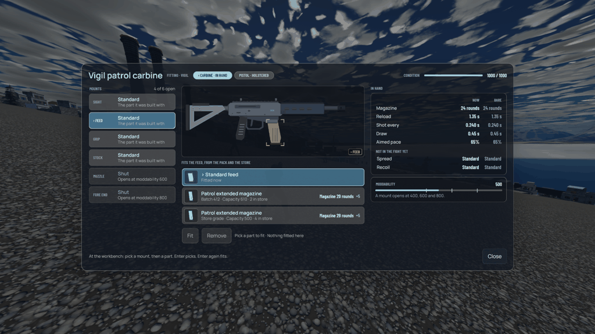
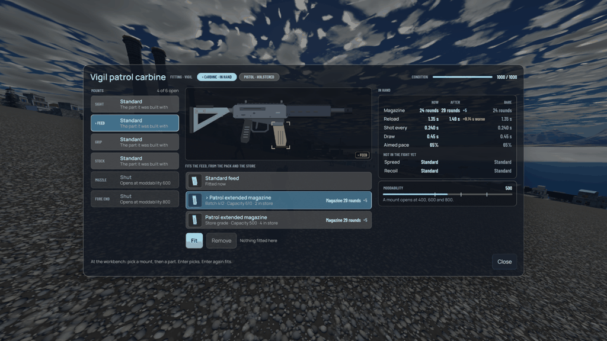
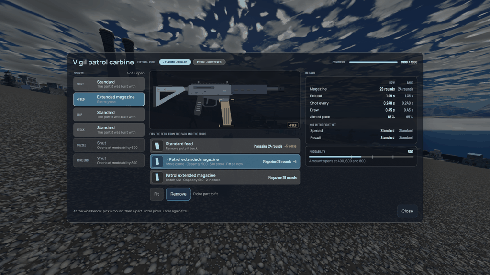
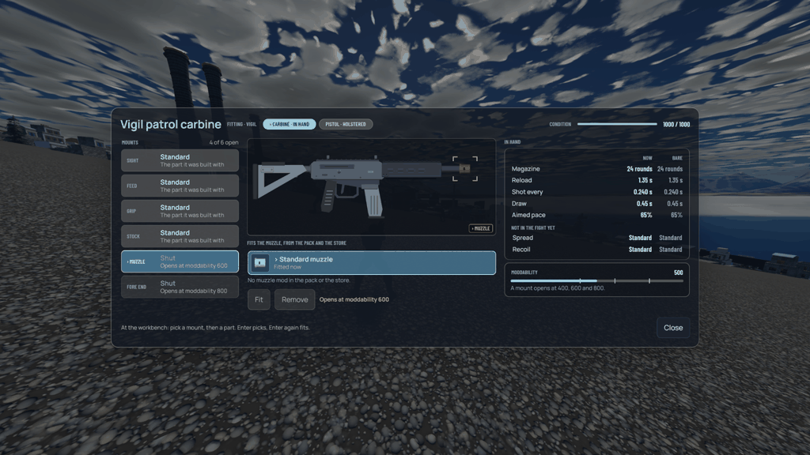
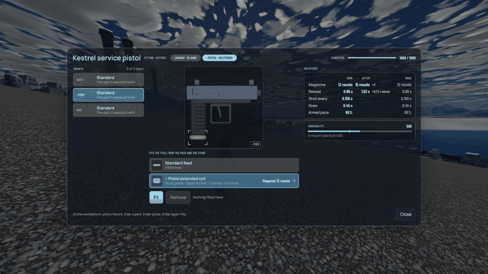
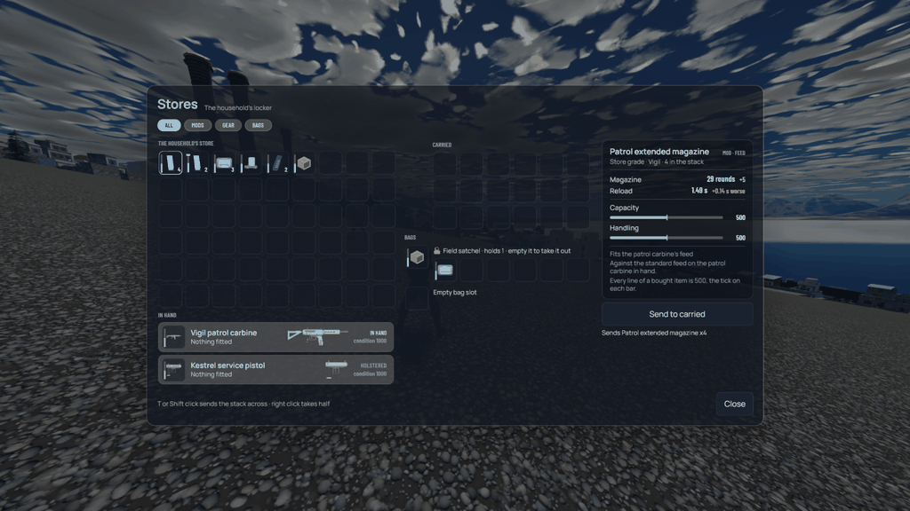

- **A module's effects are data.** Each module's item file carries its
  effects (the property, the authored factor, the quality line that drives
  it), which are `veyra_weapons::MODULES`' and are held to it by a test in
  `tools/content`. A weapon's file lists its mounts and the moddability
  each opens at. `assets/crafting/fitting.ron` holds the two bands of
  crafting.md 4.3, how a magazine is made whole, and which way each of the
  thirteen properties is better.
- **The merge.** `strata_sim::fitting`: the tables' row, then the sheet's
  boxes, then each fitted factor once, the magazine rounded once. Only a
  property the fight has a number for reaches the row (`live`: magazine,
  reload, interval, draw, aimed pace, damage, posture, cut stamina); the
  other five stay in the data and are shown as not in the fight yet. An
  actor with nothing fitted reads through the code path it read through
  before, which is why a removal restores the row bit for bit.
- **Fit and Remove** are requests consumed in the tick (`FitInbox`,
  `FitAnswer`), allowed with a workbench in reach and refused with a reason
  otherwise. A fit takes one unit from the pack, a bag or the store; a
  module that comes off goes to the pack, then a bag, then the store, and
  with no room the removal is refused. The rounds in the magazine are kept
  and clamped, never refilled, and the rounds a character was saved with
  are clamped the same way when their actor is made again (a bench switch,
  an encounter reset, the next run): a module taken off since has made the
  magazine smaller than the count. Requests that arrive in one tick are
  consumed in order, each on what the one before left; the screen sends
  one at a time and waits for its answer. The rules a screen greys its
  buttons by are the sim's own (`at_workbench`, `with`, `without`,
  `preview`, `host`, `lead`), asked and not written again.
- **The workbench** stands one spacing past the locker at each bench place
  and reaches the household's store. F opens the fitting screen live.
- **The screen.** `strata_client::ui::fitting`, kind `strata:fitting`:
  the mounts with a word for each state, the weapon drawn from its baked
  pieces with the mount in focus bracketed, the parts the stock has for
  that mount best first with what each would do, the table of now, after
  and bare, what is not in the fight yet, the moddability with a tick where
  each mount opens, Fit and Remove with the reason beside them when either
  is grey. A tab a weapon, in hand and holstered. Focus or the pointer on a
  part previews it in the AFTER column; Accept or a click picks it; Accept
  again, or Fit, fits it. The AFTER column is there only while it has a
  figure in it, so a weapon with nothing picked reads NOW beside BARE.
  Every figure is the sim's (`fitting::lines`); the screen multiplies
  nothing. From the stores and the inventory a weapon's cell opens the same
  screen, which away from a workbench is a reading. The mount in focus, the
  weapon shown and the part picked each have a mark before their name as
  well as their fill; the bracketed mount's name is on a tag in the
  drawing's lower right corner, clear of the weapon. A part's row says the
  quality of the line it is fitted for ("Batch 412 · Capacity 610"), which
  is what orders two magazines that both read 29 rounds. A fit is toasted
  with what the part does ("Fitted. Magazine 29 rounds."), and while the
  footer's line is the sim's last word the keys are said under it.
- **The card** shows a module's lines in units with the change against
  what the carried weapon has in that mount, and a weapon's magazine,
  reload and interval as fitted against bare.
- **Icons.** `just content` bakes a square icon beside every weapon picture
  and names it in the picture index (version 2). A cell draws it, tinted by
  the item's colour, where the index has one; a clone with nothing baked
  keeps the stand-in shapes. Bags keep a shape.
- **Stores polish.** No card is raised over the pinned one. T sends the
  stack the player is on, focused or pointed at, and nothing when the
  pointer is in use and on no cell; the send button says under it which
  stack it will send. The pack's cells are indented a cell and stand in
  line with a bag's, and the pack's heading stands over them. Beside the
  store a hand's row draws the weapon's whole picture at its own shape,
  since a long gun is a thin line in a square cell.
- **The balance harness** takes a loadout on a side (`--fit`, `--b-fit`):
  at 6.5 s a carbine with the store's magazine has fired 27 to the bare
  one's 24, and at 8.1 s both are at 29, the longer reload paid back.
- **The walk.** `--script-crafting` fits the store's magazine at the
  workbench, reads 29 on the `Combatant`, fires, removes it and reads the
  bare row back exactly; it runs in the game's scripted test.
  `--open-fitting [mount]` (`--fitting-hand`, `--fitting-pick`) and
  `--fitted <item>` are for stills. The weapon preview and
  `--open-weapon-diagram` are gone.

What the user would have been asked, decided for them and easy to change:

- **The magazine reads 29, not the 30 of the step's done-when.** The
  authored factor is 1.2 on 24 rounds, which is 28.8: rounded to nearest it
  is 29, as every other count in the sim is rounded; the mockup floors it
  to 28. `count: Floor` in `assets/crafting/fitting.ron` switches it. The
  30th round needs a capacity line of 683.
- The pistol's feed and grip are open on every example and its sight opens
  at 400, so a bought pistol has all three.
- Draw time is live, so the grip and the sight do something in a fight
  today (0.43 s and 0.46 s against 0.45 s). The draw's dodge window is
  kept at the same share of the draw, which is never, as it is bare; the
  client's draw pose runs the fitted length.
- `count: Floor` floors with a hair of slack, so a magazine whose product
  is whole but for its `f32` error (50 by 1.06) keeps its last round.
- Fitting is refused while the holder is in the middle of an action.
- A part is picked with Accept or a click and fitted with a second, or
  with Fit. Nothing is picked as the screen opens.
- The parts list shows the standard part and the module on the mount as
  rows of their own, as the mockup does; picking the standard part with a
  module fitted turns Fit into "Refit the standard part".
- A candidate leads with its first benefit, named: "Magazine 29 rounds +5".
- A change for the worse says "worse" in a word; a change for the better
  is its sign alone, and the missing word is its mark ("Magazine 29 rounds
  +5"). The display face has no triangle and no arrow, so the mockup's
  marks could not be used, and the mark before a picked row, the mount in
  focus and the weapon shown is a guillemet.
- On its mount's row a module's name drops the leading words it shares
  with the weapon's ("Extended magazine" on the patrol carbine), as the
  mockup shortens it; the parts list keeps the whole name.
- The line beside the buttons is in the refusal's colour only when it is
  a reason (no workbench, a shut mount, the sim's refusal); "Pick a part to
  fit" is in the footer's.
- Tab stops on Fit and Remove while they are grey, where the line beside
  them says why.
- An icon's tone is lifted so its lightest pixel is white (by three times
  at most). A dark grip was a smudge in a cell otherwise.
- The fitting screen is 1240 units wide with a table column of 392, wider
  than the mockup's 1112 and 322, so "+0.14 s worse" has a column of its
  own beside the AFTER figure and a part's row keeps to one line.

Left rough, for a later step:

- The workbench's own shape (a top on two pedestals, a tool board, a lamp)
  has not been seen from its front in a window; only its label and its
  prompt have.
- A picked part is not drawn on the weapon until it is fitted.
- A carbine's icon is still a thin line in a square cell of a grid; only
  the hands' rows beside the store draw it at its own shape.
- The rounds a character is saved with are counted at a bench switch, so
  the file can hold more than the magazine does after a removal. They are
  clamped when read; the file itself is not rewritten for it.
- A cell keeps slotted's focus ring while the pointer is in use, so with
  the pointer resting on another cell two are lit.
- The prompt chip can sit under the controls card for the eight seconds
  that card is up, as it could before this step.

What slotted lacked this time, each worked round in the game:

| Gap | Done in the game instead |
| --- | --- |
| A tooltip part has no world and cannot be told to stand down | A shared context the part reads through a lock: the weapons to measure against, and a quiet flag |
| A disabled primary button has no grey in the glass theme | Fit is the secondary variant while it cannot act, painted from a family of the game's own (`strata.fitting.act`) whose disabled look is fainter than the theme's |
| A text that may wrap is measured a word a line while its row is sized, and the height sticks | Captions and figures that must not grow a row are one line |
| A panel's border is always there, so a column that holds a grid to the unit must count its boxes | The bag column is sized with them |
| An item's icon cannot be tinted by its definition | The cell holds the tint each frame after slotted's render set |
| The input mode flips to keyboard on any key, the key that acts on the pointed cell included | The device is told by what moved last, the pointer or the focus |

### Step 3: resources, deposits, survey posts, Draw (2026-10-11)

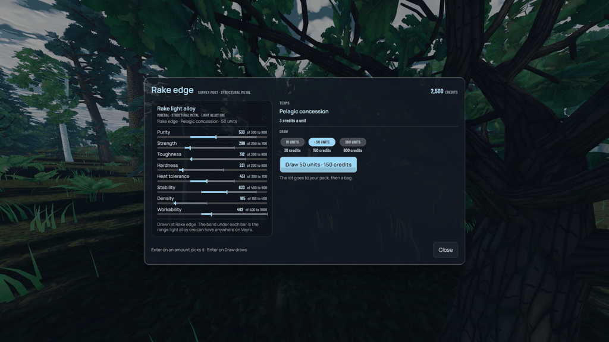
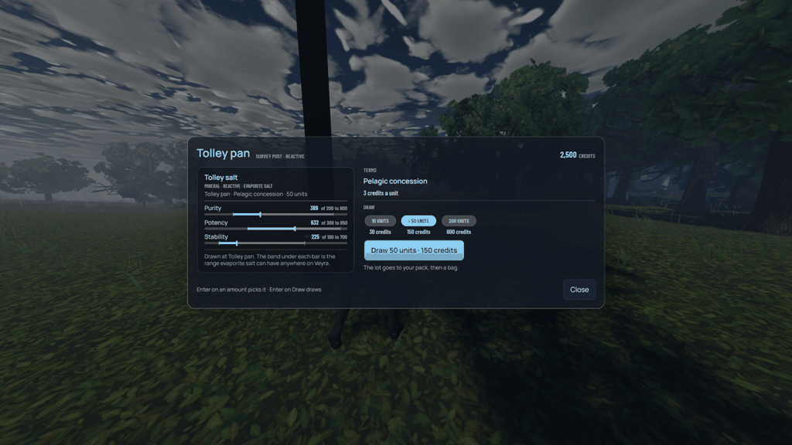
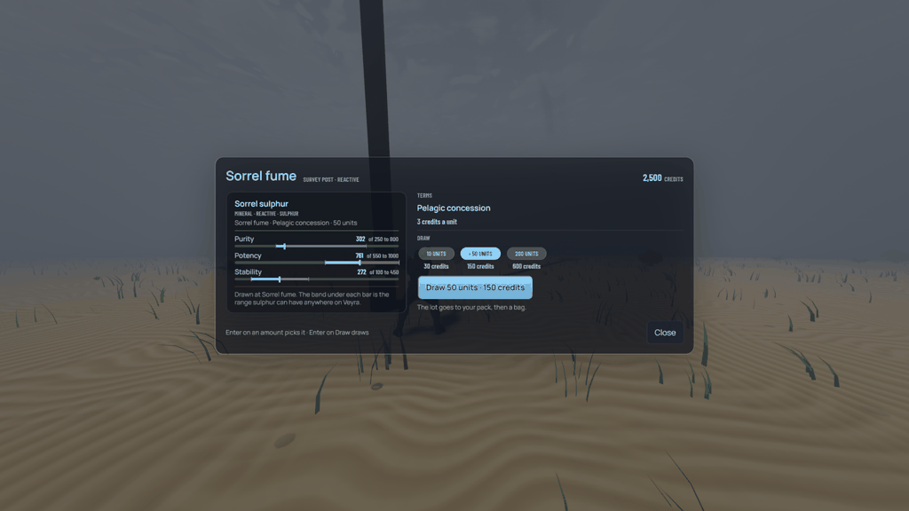
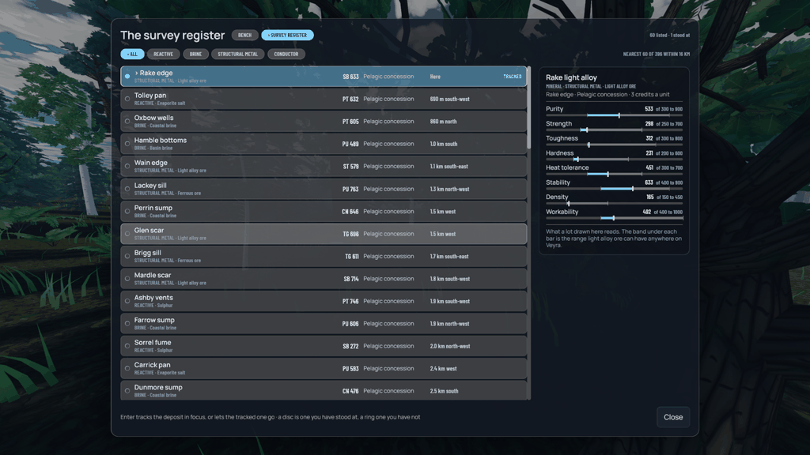
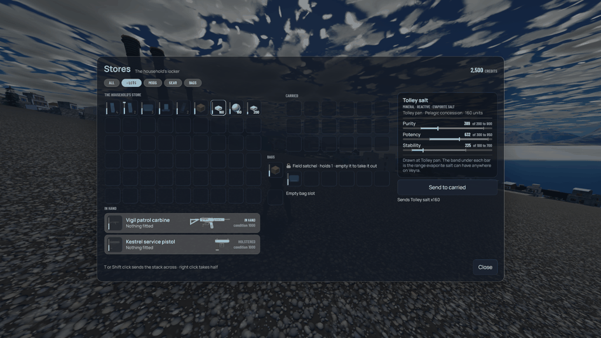
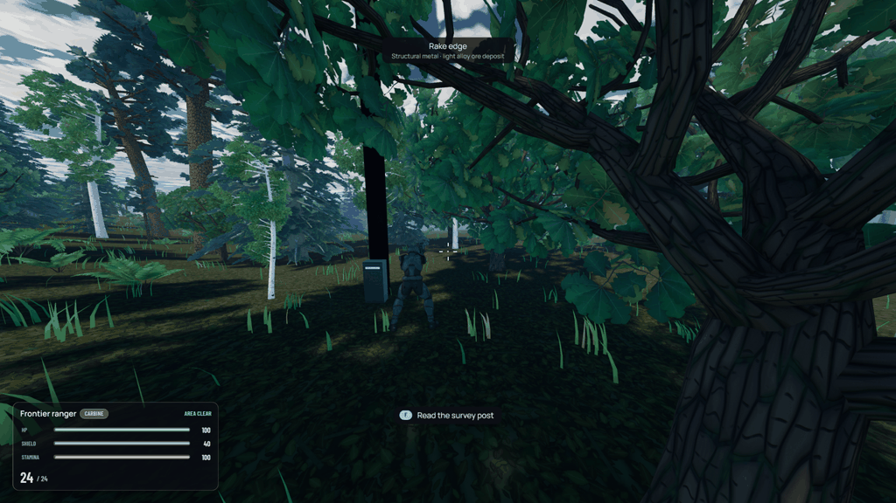
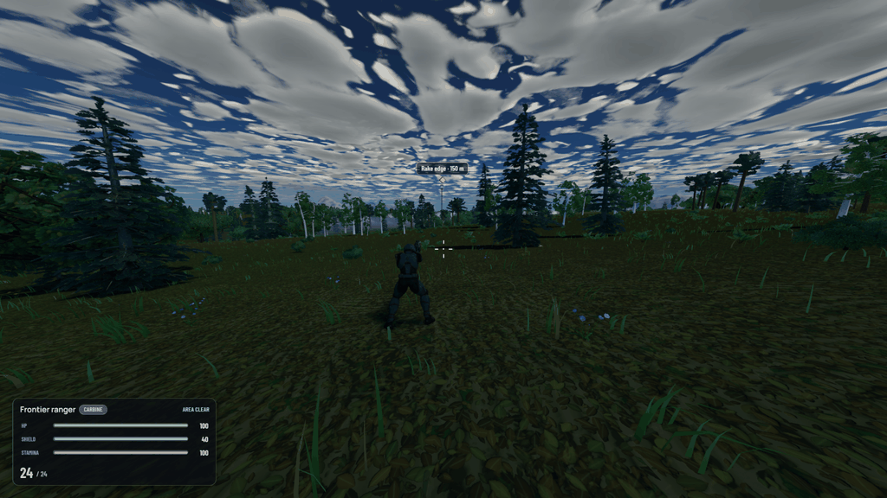
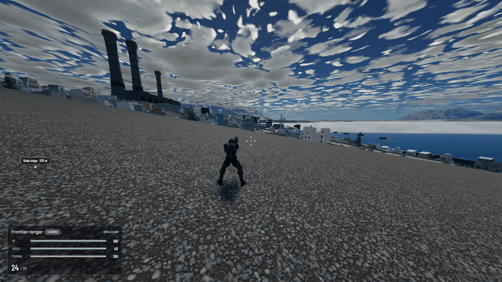
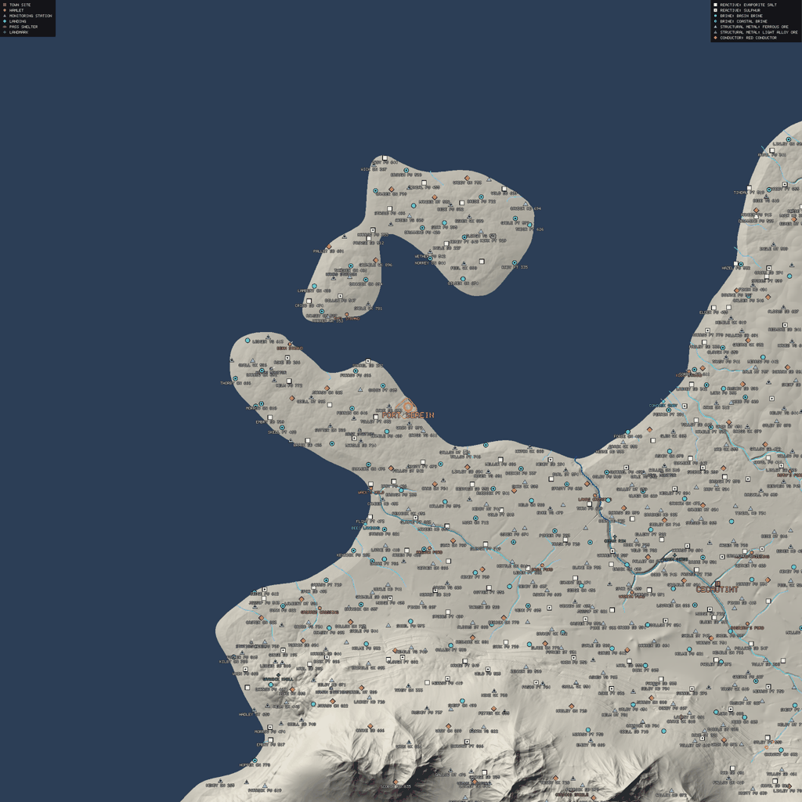
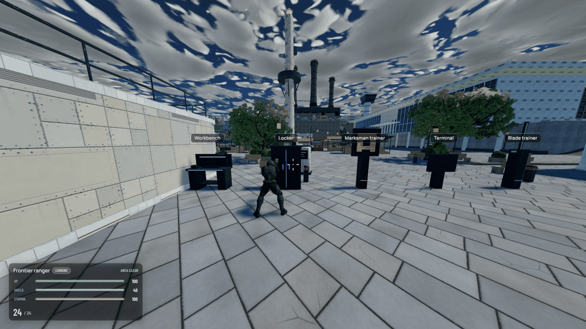

- **Resources are data.** `assets/resources/`: the class tree
  (`classes.ron`: two families, four classes, each naming the attributes
  it carries), a file a type with a floor and a cap for each of them and
  where it occurs, and `deposits.ron` with every dial. Loaded and checked
  by `strata_registry::resource` into `GameRegistries.resources`, in no
  version. Seven types: evaporite salt and sulphur (Reactive), coastal and
  basin brine (Brine), light alloy ore and ferrous ore (Structural metal),
  red conductor (Conductor).
- **Deposits are a pure function** of the seed, that data and the ground
  (`strata_worldgen::deposits`): a jittered lattice of 800 m cells, a
  type by the weights at the point, refused in water, on a road, on a pad
  and on steep ground, named from a list ("Calder flats", "Calder salt"),
  with one figure a carried attribute and its terms. Not in the bake, not
  in `world_version`. `just worldmap` draws the `-deposits` layer.
- **A lot is a stack.** The catalogue makes a lot item a type. Its patch
  names its deposit, so two lots merge only when they are of one deposit.
  Commodity stock is 500 on every line.
- **The purse** is the household's, 2,500 on the first day, in the save
  (version 3; a version 2 file is given the purse and the first lots once
  and kept as `.v2.bak`). A fresh store holds three real lots: salt, a
  brine and light alloy from the deposits nearest the spawn, looked for in
  rings that double from 1.6 km and asked for only on a first day and by
  an upgrade. An upgrade that cannot give every first lot (a world with no
  such deposit in range) is not written: the file keeps its older shape
  and a later start finishes it. One whose store is full is written, and
  the warning names the copy of the file as it was.
- **The survey record belongs to its world.** The save stamps the
  deposits stood at and the one tracked with the seed and the lattice's
  cell they were recorded in. Started in another world (another `--seed`,
  a changed `cell_m`) the record is neither shown nor written, and the
  file keeps it: an id is a cell, which there names other ground. In its
  own world nothing is pruned and no ground is sampled for it at startup
  but the tracked deposit's.
- **Survey posts** stand at each deposit within 1.5 km: a cabinet with a
  lit strip, behind it a dark mast 28 m tall and on that a lit top in the
  class's colour between two dark bars, with no collider. The mast's and
  the top's heights are data (`post.mast_m`, `post.top_m`), held over the
  tallest tree of the baked library by a test (a pine of 19.6 m at its
  largest size is 27.4 m), since a deposit can lie in a wood: at Rake
  edge, the nearest to the spawn, the top stands clear of the canopy from
  150 m. Standing at a post records the deposit as stood at.
- **Draw** is a request consumed in the tick: allowed with that deposit's
  post in reach, paid from the purse at the terms' fee, the lot put in the
  pack and then a bag, refused whole with a reason otherwise. Instant.
- **The lot's card** is the one card in a lot's form
  (`CardParams::of_lot`): named for its deposit, its family, class and
  type under the name, where it was drawn, on whose terms and how many
  units, then a line an attribute its class carries and no other. Each
  line has the attribute's full name, the figure, `of 300 to 950`, and
  under them a track on which the type's range is a band with an end at
  its floor and its cap, filled from the floor to the figure with a mark
  at the figure. The short card shows the four lines it stands highest in
  and says how many more Shift shows.
- **Stores.** A lot's cell is its family's shape in its class's colour,
  its count the units, its pip where it stands in its type's ranges. A
  Lots chip after All; the chip in force has the guillemet before its
  word as well as its fill. The household's credits at the right of the
  head, on both forms of the screen, following the purse.
- **The assay** (`ui::assay`, `strata:assay`), a survey post's F: the
  place and its class, the purse, the long card of the lot the amount
  picked would be, the terms and their fee a unit, the amounts (10, 50, a
  full stack of 200) each over what it costs, Draw with the amount and the
  cost in its label, and beside it why it cannot act: "Step up to the
  survey post", "Needs 150 credits, you have 80", "No room in the pack".
  An amount the purse does not cover reads "Needs 600 credits" under its
  chip. Every figure is the sim's (`lot`, `cost`, `offers`, `can_draw`). A
  lot drawn is toasted: "Drew 50 units of Tolley salt. 2,350 credits
  left."
- **The register** is the terminal's second tab, and reads the same from
  the pause's Bench button: the nearest 60 deposits within 16 km, nearest
  first, each with a disc (stood at) or a ring (not), its place over its
  class and type, its best line by its code, its terms, and how far and
  which way ("1.2 km south-west"). Its caption says what the list is of
  what there is ("NEAREST 60 OF 407 WITHIN 16 KM", "ALL 42 WITHIN 16
  KM"). Class chips filter it. The row under the focus or the pointer is
  marked and its lot card stands beside the list. Enter on a row tracks
  it, or lets the tracked one go; which of the two a press is, is decided
  in the tick (`SurveyRequest::ToggleTrack`). The tracked deposit keeps a
  row, the last, however far down the list or past the range it lies.
- **The tracker** (`ui::tracker`): the tracked deposit has a warm diamond
  on the HUD just over its post's lit top, with its name and distance on
  a dark plate, held inside the screen's edge on the side it lies when it
  is out of view or behind. It stands down at the deposit itself, where
  the place card names the place. Saved with the household.
- **The place card** names a deposit and its class within 30 m of its
  post ("Rake edge", "Structural metal · light alloy ore deposit"), by
  the sim's `standing_at`, and the chip reads "Read the survey post".
- **The walk.** `--script-crafting` stands at the post of the nearest
  deposit that charges a fee, draws ten units, reads the lot in the pack
  with the deposit's figures and the purse down by the fee, and carries
  it to the locker's store; it runs in the game's scripted test.
  `--at deposit[:type]`, `--at bench`, `--open-assay`, `--open-register`,
  `--track <type>`, `--stores-filter <chip>` and `--no-hostiles` (the
  encounter with nobody in it) are for stills. `--open-assay` lifts no
  rule: away from a post the screen says to step up to one.

Measured at seed 42 with the dials as shipped (`just worldmap`, 32 km
round the default spawn at -684, -270). 407 deposits lie within 16 km of
the spawn, and every type is under 3 km from the spawn and from Port
Serein:

| Type | Within 16 km | Nearest from the default spawn | Nearest from Port Serein |
| --- | --- | --- | --- |
| Basin brine | 42 | 1.34 km | 1.30 km |
| Coastal brine | 52 | 0.95 km | 1.31 km |
| Evaporite salt | 65 | 1.19 km | 1.35 km |
| Ferrous ore | 82 | 1.49 km | 1.14 km |
| Light alloy ore | 77 | 0.51 km | 0.67 km |
| Red conductor | 49 | 2.72 km | 2.55 km |
| Sulphur | 40 | 2.07 km | 2.43 km |

The first lots are 160 units of Tolley salt (1,189 m off), 160 of Oxbow
brine (945 m) and 200 of Rake light alloy (513 m). The scripted walk draws
10 units of Rake light alloy for 30 credits, leaving 2,470. The worldgen
determinism tests pass in release at two test threads (seven passed, the
probe ignored); the debug binary had died twice under load on this
machine before it reported.

What the user would have been asked, decided for them and easy to change:

- **A lot's line is two rows, not one.** The mockup's card is 348 wide and
  puts name, bar, figure and range on a row. The game's panes are 288 to
  340, where that leaves the bar forty units. The name, the figure and
  the range stand on a row and the bar under them has the card's width.
- **A lot's kind stands under its name.** Family, class and type are
  three words ("MINERAL · STRUCTURAL METAL · LIGHT ALLOY ORE"), which
  beside the name would wrap the name.
- The first lots are named by where they really are at seed 42: Tolley
  salt, Oxbow brine, Rake light alloy. The worked example's Calder,
  Serein and Harrow are not forced.
- The assay opens with the middle amount picked (50).
- Fees are 3 a unit on a Pelagic concession, 1 on a Borough commons, none
  on a remote claim. Everything within 3 km of Port Serein is a
  concession, so the first register is one word down that column.
- The register lists every deposit in range, stood at or not, and says
  which. The ticket's sketch listed only those stood at; a register that
  starts empty would give a first day nowhere to go.
- The row whose card is shown has the guillemet before its name; the
  tracked row is lit and says TRACKED.
- Tracking needs no terminal: the pause's register tracks too.
- **The mast is 28 m**, a radio mast more than a post, because it is the
  one way a post in a wood shows at all. `post.mast_m` and `post.top_m`
  in `deposits.ron` set it. The other way, keeping deposits out of woods
  by the sample's cover, would have moved every deposit and thinned the
  forest biomes, and was not taken.
- **North is +z everywhere now.** The bench's "nearest terminal is 12 m to
  the north" and the sheet's trainer line worded north as -z, the
  opposite of the map and of the register on the same screen. Both now
  use the sim's compass. This changes words on two screens of the
  progression step that had been seen as they were; if the other sense is
  wanted, `Compass::of` in the sim is the one place to turn.
- A filtered-out cell in the stores is dimmer than it was (0.08 of its
  strength, from 0.22). The UI blends in linear light, where 0.22 left
  half the brightness and the Lots filter was hard to read. It changes
  step 1's Mods and Gear filters the same way.
- An upgrade short of a first lot holds the whole save for that run
  rather than writing a household without it. At the default seed it
  cannot happen; in another world the run is played and not saved.
- A run in another world starts with an empty survey record and saves
  none of what it records there.

Left rough, for a later step:

- **Inside a wood a post is still found by the tracker, not by its art.**
  The mast clears the canopy and shows from open ground and from over the
  trees, but from under the crowns nothing above them does. At Rake edge a
  birch stands a step from the cabinet: flora placement does not know
  about deposits and a post has no collider.
- From the spawn's gravel the ground itself hides Rake edge's post at
  510 m; the tracked still shows the marker on the ridge and no mast.
- The lit top of a pale class (Reactive, Structural metal) is near white
  and is the colour of cloud. The dark bars over and under it are what is
  seen against a bright sky.
- A still of a screen opened on frame 120 is taken before the camera has
  settled behind the character, so the world behind the assay is a tree
  or the sky.
- With the pointer parked over a row, that row and the focused one are
  both lit, as two cells are on the stores screen.
- The terms column reads "Pelagic concession" on every row near the city.
- On the map, labels run into each other and into site names where
  deposits are dense, and several roots read alike at that size (Rake and
  Roke; Farrow, Fallow, Harrow, Garrow, Darrow, Barrow, Jarrow, Yarrow).
- The centred HUD layers (the prompt chip, the place card) have their
  node rewritten every frame by slotted and again by the game's hold, so
  their layout is redone each frame in a window. Unmeasured; to be read
  at the next bench milestone.
- The first-day notice still says the hostiles are ahead under
  `--no-hostiles`.

What slotted lacked this time, each worked round in the game:

| Gap | Done in the game instead |
| --- | --- |
| A HUD layer centred on an axis is placed at half the window's logical pixels, which `UiScale` then multiplies: at 1440p the prompt chip and the place card stood three quarters of the way across | `scale::centre_hud_layers` holds them at the midpoint in UI units, in `PostUpdate`, writing the node every frame the scale is not one |
| `sync_accessibility` inserts on nodes a replaced screen has since despawned, and panics, when an ordering edge from `SlottedUiSet::Render` moves where its commands are applied | No system of the game is ordered after that set by a new edge; the centring runs in `PostUpdate` |
| Neither typeface has a disc, a ring or a diamond | The register's marks and the tracker's diamond are drawn from boxes |
| A `Card` used as a toggle (a chip, a tab) has no on-state of its own | Each screen swaps the role family and writes the mark before the word by hand; the stores' chips now do too |
| A cell's count stands two units from its right edge, where three figures run into the border | The stores hold it five units in, each frame, beside the alpha they already hold |
| `rect_of` in slotted-test answers in UI units, not window pixels, and does not say so | The assertions are written in UI units |

### Step 4: schematics, the session, the rolls (2026-10-11)

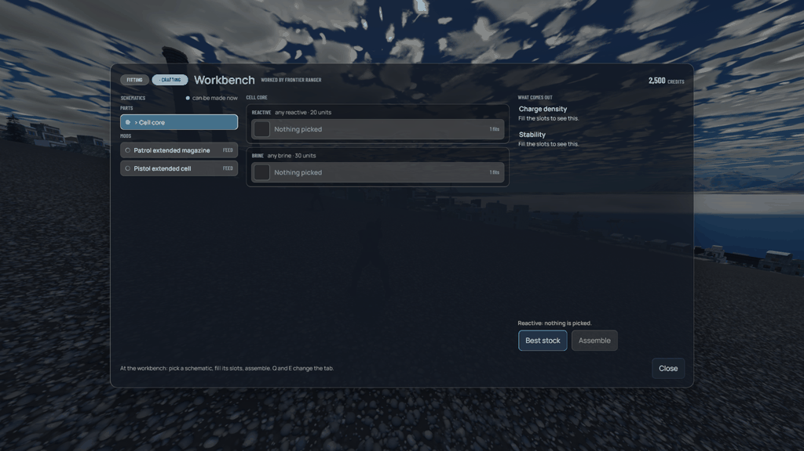
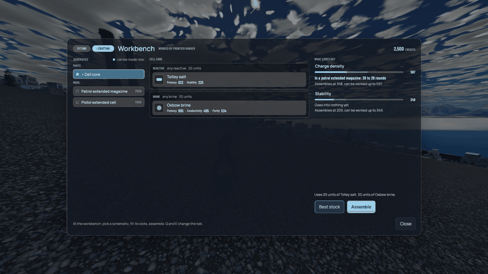
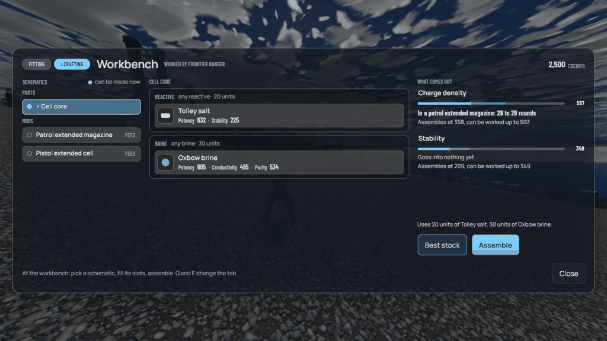
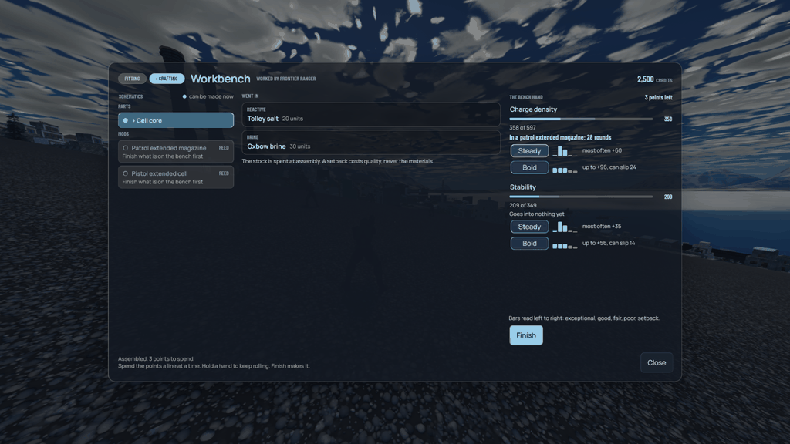
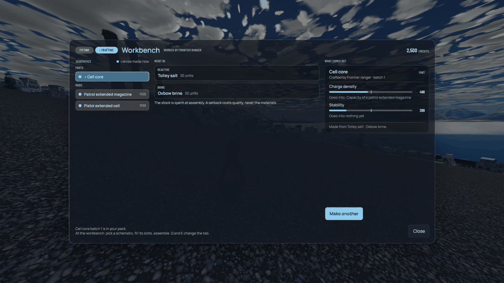
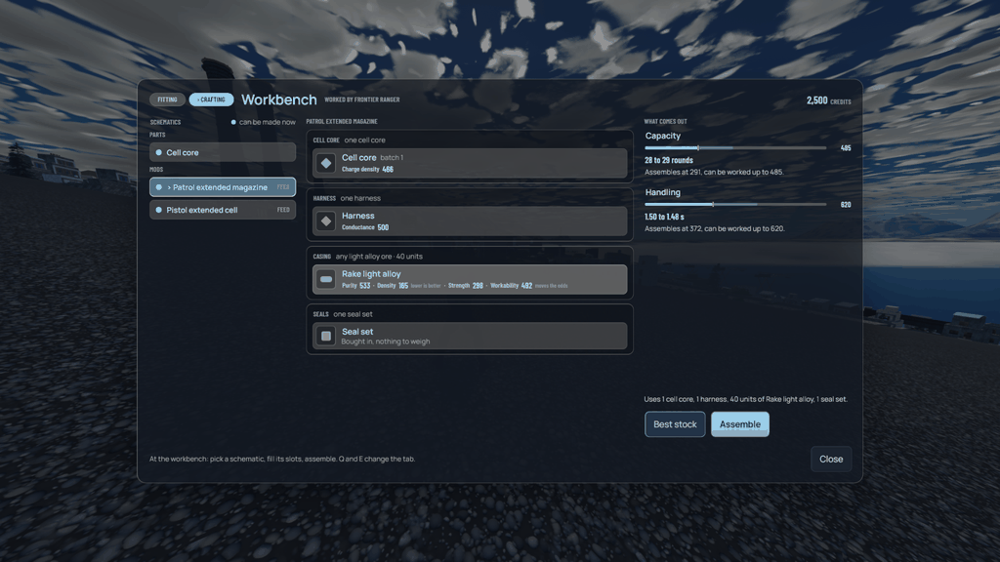
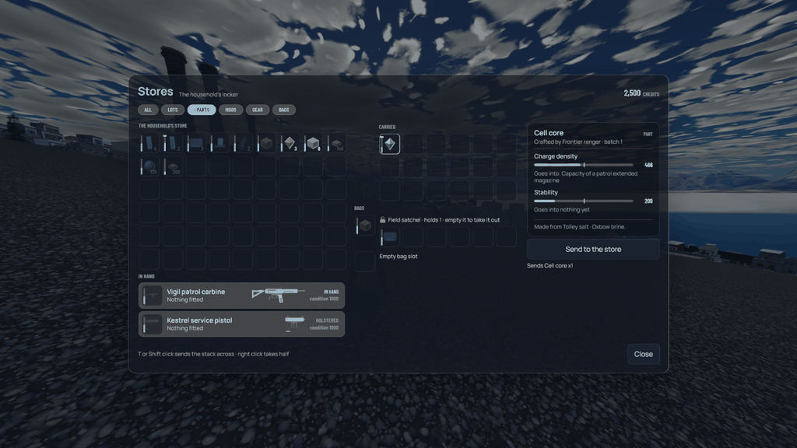

- **Schematics are data.** `assets/schematics/*.schematic.ron`, loaded and
  checked by `strata_registry::schematic` into `GameRegistries.schematics`,
  in no version: what it makes, its complexity, its slots (a lot by
  family, class or type with units, or a component or a commodity with a
  count) and a weighted recipe for every line of the product, read
  straight or as `Light`. Three ship: the cell core (20 units of any
  reactive, 30 of any brine) and the two extended magazines over it (a
  core, a harness, light alloy ore, a seal set). The teaching box, the
  licence and the fixture are in the format and enforced by nothing.
- **Two item kinds.** `Component` (the cell core, the harness) and
  `Commodity` (the seal set), and a `price` on a bought one. A fresh
  household starts with three harnesses and six seal sets; a version 3
  save is given them once and kept beside as `.v3.bak`. An item may also
  give the article a sentence names one of it with (`article: Some("an")`),
  so no screen guesses it from a letter; none that ships needs one.
- **The session is the sim's** (`strata_sim::crafting`), whole per-mille:
  a line's ceiling is the weighted sum of what is picked, assembly lands
  it at 0.6 of that, and each point lifts it by the roll table's share and
  never past it. A roll is drawn from the world's seed and a counter in
  the save. Assemble, Roll, Finish and Buy are requests consumed in the
  tick, allowed with a workbench in reach, each one transaction. The
  dials are `assets/crafting/session.ron`: the mockup's.
- **The save** is version 4 with the bench's work in it (`CraftState`: the
  roll counter, the batch counter, the open session, the ledger of what
  each batch was made from). The game copies the sim's state to the
  household and writes it before the screen hears the sim's answer, so a
  roll's counter is in the file before its outcome is shown. At load the
  bench's work is held to the data as it now is (`CraftState::repair`): a
  session with more points than a retuned dial gives is held to the dial,
  and a record of what went into something that no longer reads is
  dropped, each said in the log, with the file as it was kept beside as
  `.mended.bak`. Only what nothing can work on refuses the file: a session
  of a schematic that is gone, lines that are not its product's, a figure
  over 1000.
- **The screen** (`strata_client::ui::crafting`, kind `strata:crafting`)
  is the workbench's second tab. Both tabs start with one strip
  (`bench_tabs`); a click or the two tab keys change the tab in place, and
  F opens the tab last shown, or the session when something is on the
  bench. Three states of one definition: the slots with their candidates
  best first and what comes out on bars with the floor marked and the
  ceiling as the numeral; the bench hand, with the points left and Steady
  and Bold a line, their odds as five bars (`strata:roll_odds`) and
  never a figure; the finished thing's long card. The buttons that act
  stand at the foot of the right column in all three, so the primary one
  does not move through a craft. Every figure is asked of the sim:
  `candidates`, `best_stock`, `check_picks`, `preview`, `now`,
  `hand_odds`, `can_roll`, `lifts_odds`, `can_buy`.
- **Workability is seen before it is spent.** It moves the odds of the
  whole session and no line, so a candidate whose lot carries it shows
  the figure in its row, marked "moves the odds", and when what is picked
  lifts the row the sentence "Workable stock. The odds are a row better."
  stands under what Assemble would use, and again on the bench hand.
- **A roll.** The word is there when the sim has answered and the bar
  fills over a third of a second (`animate_roll`). A hand held rolls again
  as each roll lands (`repeat_held`): Accept kept down with the focus on
  it, or the pointer kept down over it. A pointer going down on a hand is
  the roll, since its click only comes when it is let go; that click then
  rolls nothing more.
- **The press budget.** From a workbench's F by the keys alone: the tab
  key, Accept on the schematic, on Best stock, on Assemble, a point a
  press and Finish. Nine presses for the core and eleven for the magazine
  after it, each counted from F by a UI test
  (`the_core_is_crafted_by_keys_alone_in_fifteen_presses`,
  `the_magazine_is_crafted_by_keys_alone_in_fifteen_presses`). The focus
  is led from each press to the next (`CraftingView::focus_for`).
- **Buy** at a slot that takes a bought part with none that will do: the
  price leaves the purse in the tick and the part goes into the slot.
- **The card.** A component's long card says under each bar where the line
  goes next; a commodity's says that it has no quality of its own; and
  the long card of anything the household made says what it was made
  from, by the household's ledger of batches (`CraftState::made`, read
  through `card::Against::made`). The stores gain a Parts chip.
- **The bar** (`card::BarParams`) gains a ceiling drawn behind the fill, a
  floor mark and a numeral of its own (`offered`, `worked`).
- **The walk.** `--script-crafting` assembles a core from the first lots,
  spends its points, finishes, makes the magazine with it, fits it and
  reads the `Combatant`, then makes a second core that differs.
  `--open-crafting [schematic]` with `--crafting-state
  empty|pick|hand|done` and `--craft-first <schematic>` are for stills.
  `hand`, `done` and `--craft-first` send the requests a player's presses
  would and what they do is saved, so they are refused on the default
  `--household` and run on one of their own (`--fresh --household
  scratch/crafting/shot.ron`).

Measured on a fresh household at seed 42 (release), from Tolley salt
(Potency 632, Stability 225), Oxbow brine (Purity 534, Potency 605,
Conductivity 495) and Rake light alloy (Purity 533, Strength 298, Density
165, Workability 492):

| | Floor | Ceiling | Reads |
| --- | --- | --- | --- |
| Cell core, charge density | 358 | 597 | In a patrol extended magazine: 28 to 29 rounds |
| Cell core, stability | 209 | 349 | Goes into nothing yet |
| Magazine from the first core (466), capacity | 291 | 485 | 28 to 29 rounds |
| Magazine, handling | 372 | 620 | 1.50 to 1.48 s |

The first core's three points, every one steady on charge density, come
to Poor, Fair and Good: 358 to 370, to 406, to 466, with stability left at
209. The second core from the same lots comes to 513 and the third to 490,
so two crafts from the same lots differ; the three are pinned in a sim
test, so a change to the roll stream fails loudly. The magazine made with
the first core reads 475 and 372 and gives the carbine 29 rounds and a
1.495 s reload, against 29 and 1.485 s for the bought one: a wash on the
first day's stock, as the design says of middling lots. The thirtieth
round needs a capacity of 683. The walk leaves the roll counter at 11, the
batch counter at 3 and the purse at 2,470.

Presses, counted from the workbench's F with no mouse: 9 for the cell
core (F, the tab key, the schematic, Best stock, Assemble, three points,
Finish) and 11 for the magazine after it (F, Down, the schematic, Best
stock, Assemble, five points, Finish), against a budget of fifteen.

What the user would have been asked, decided for them and easy to change:

- **A schematic opens with the best stock already in its slots**, as the
  mockup does, so Best stock is the press that puts it back after a
  change. The still with nothing picked is a state the flag asks for
  (`--crafting-state empty`); a player meets an empty slot only where
  the stock has nothing for it.
- **Stability of the core** weighs the salt's Stability 0.6 and the
  brine's Purity 0.4. The design left it "in the same spirit".
- A harness is 80 credits and a seal set 20. Buy offers one at a time.
- Workability only lifts the odds, a row, at an average of 700 or more.
  The order of a slot's list ignores it: best first is by the lines the
  slot weighs, and a workable alloy that is worse on those is listed
  under a plain one, with its figure saying what it would do.
- **Away from a workbench the tab is a reading** of what the character
  carries: the store is out of reach there, as on the fitting screen, so
  with the lots in the locker every slot says nothing in the pack fits.
- **A slot's row shows every figure its slot weighs**, for all of the
  product's lines: the salt reads Potency and Stability.
- A slot's count ("2 fit") is shown when there is something to choose or
  nothing picked; one candidate already in its slot shows none.
- The downstream line is said first under the bar and lit, since the
  rounds are what a part is made for; "Goes into nothing yet" is quiet.
- **Finish is not greyed for want of room.** It is pressed, the sim
  refuses, and "No room" stands beside it with the session untouched.
- **The reason Assemble is grey stands over the buttons**, not beside or
  under them as in the mockup: the column is too narrow for it beside two
  buttons, and over them it does not move them when it comes and goes.
- **A pointer rolls when it goes down on a hand**, not when it is let go,
  so that holding it is a hold. A press on a hand cannot be taken back by
  dragging off it, as a press on any other button can.
- **A copied save can replay a roll.** The point drawn for a counter is
  the same for both hands and every line, so a player who copies the file
  can see a result and then spend that counter on the other hand or on
  another line. Mixing the hand or the line into the draw would not close
  this: it would only change what is learnt from the first look, and it
  would move every household's next roll. It is left as a property of a
  singleplayer save.
- A save whose bench was mended at load is kept as it was beside the
  file (`.mended.bak`). A session's own record of what went in can be
  dropped that way; its lines, its points and the stock are untouched.
- The panel keeps one height through the three states (72 percent of the
  window at least), so it does not jump from the slots to the hand; the
  room that leaves is over the buttons, as the mockup's is.
- The schematics' column is 252 units and not the mockup's 236: the
  longest name with its mark and its mount is a line at that width.
- A stack in a list is drawn by its item's stand-in shape, flat, in its
  item's colour (`strata:stock_swatch`), not by the mockup's drawn
  icons.
- The maker is whoever assembled; somebody with no name is recorded with
  an empty one, which the card words as "the household". The ledger of
  what a batch was made from is kept by batch and never pruned.
- The footer names the two tab keys by what they are bound to on the
  device in use (Q and E as shipped).

Left rough, for a later step:

- Nobody can lose a schematic or lack one: every character knows all
  three until the Weaponsmith tree of step 9.
- No sound on a roll: the screens have no sound path of their own yet.
- No card is raised over a candidate; its row says the figures the slot
  weighs, and its workability, and no others.
- The Exceptional and Good bars of a hand's odds are one colour, as in the
  mockup, and the Fair grey is near it at this size: place in the row and
  the sentence under the bars say which is which. A chance of nought is a
  hairline one unit tall.
- On the bench hand the numeral at a bar's end repeats the figure of
  "358 of 597" under it.
- A part's card names only the first schematic that reads a line
  (`first_using`): the pistol's cell takes the core too and the card does
  not say so.
- The fitting tab's footer still names a key of its own ("Enter picks,
  Enter again fits"); only the crafting tab's is read from the bindings.
- The small marks on a row ("lower is better", "moves the odds", BEST)
  are ten units tall and thin at 720p.
- With a `min_width` beside its `width` on a column of the screen, the
  panel round it grew to its height limit whatever was in it. The columns
  give a width alone; the cause was not traced.
- The stills are taken on frame 120 and after, before the camera has
  settled, as step 3's were, and the pointer sits at the window's centre
  under xvfb, so the row it is over (the casing, in the magazine's still)
  is drawn hovered.

What slotted lacked this time, each worked round in the game:

| Gap | Done in the game instead |
| --- | --- |
| Only the four directions repeat while held; Accept does not | `repeat_held` reads the Accept keys of `UiBindings`, the pointers and the focus, and asks again as each roll lands |
| A button's `Activate` from a pointer comes at the click, when it is let go, so a pointer cannot begin a hold on a button | A pointer down on a hand (`ButtonState::pressed`) is the roll, and the click that follows is swallowed |
| A screen of two tabs that are two definitions has no tab strip of its own; `Tabs` pages one definition, and the hint bar names the tab keys only where a `Tabs` node is | Both screens draw the strip, `switch_tabs` claims `TabPrev` and `TabNext` and replaces one screen with the other, and the footer names the keys from `key_glyph_text` |
| A `Panel` asked to be one unit tall came out two, and takes its colour from a role only | The odds and a stack's shape are widgets of the game's own |
| `Themed` paints a node's fill and its border from the one role, so a fill that is data cannot have a themed border | The swatch reads its border from `Paint::for_role` once at the spawn |
| An item's baked stand-in icon is only drawn in a slot | A list's row draws a flat shape in the item's colour |

### Step 5: blueprints, the fabricator, a run (2026-10-11)

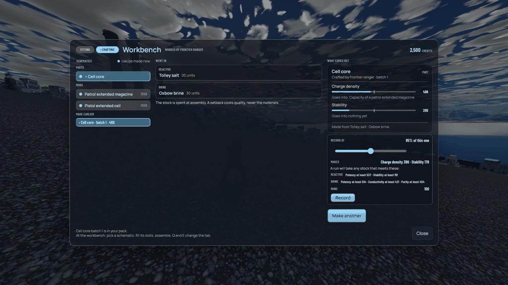
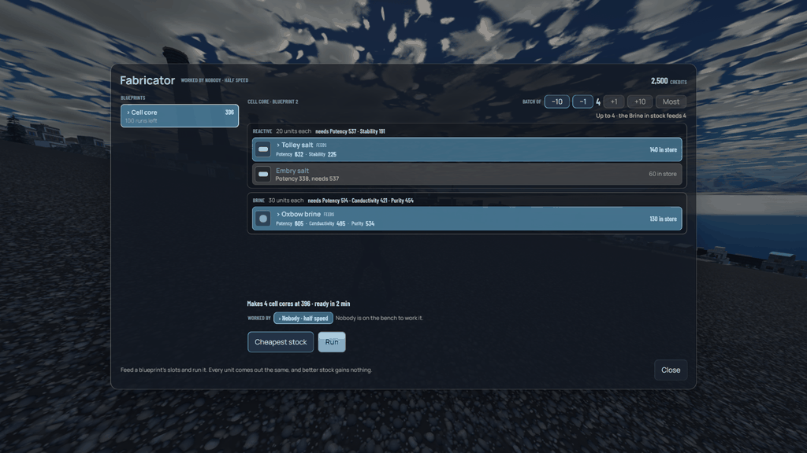
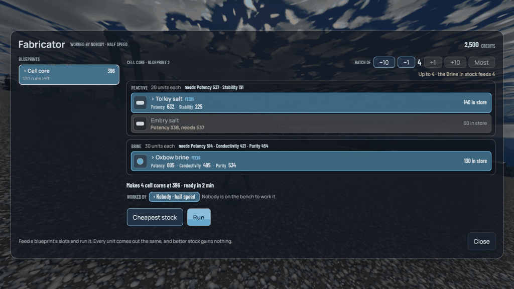
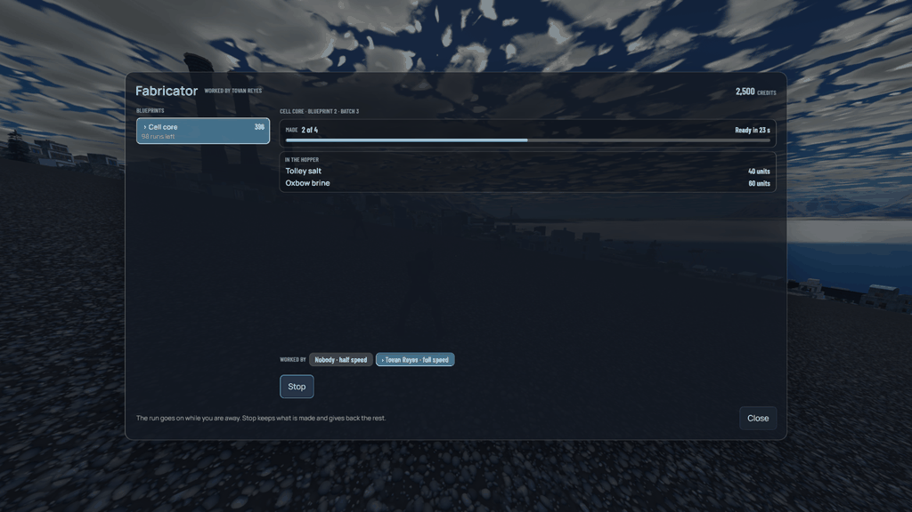
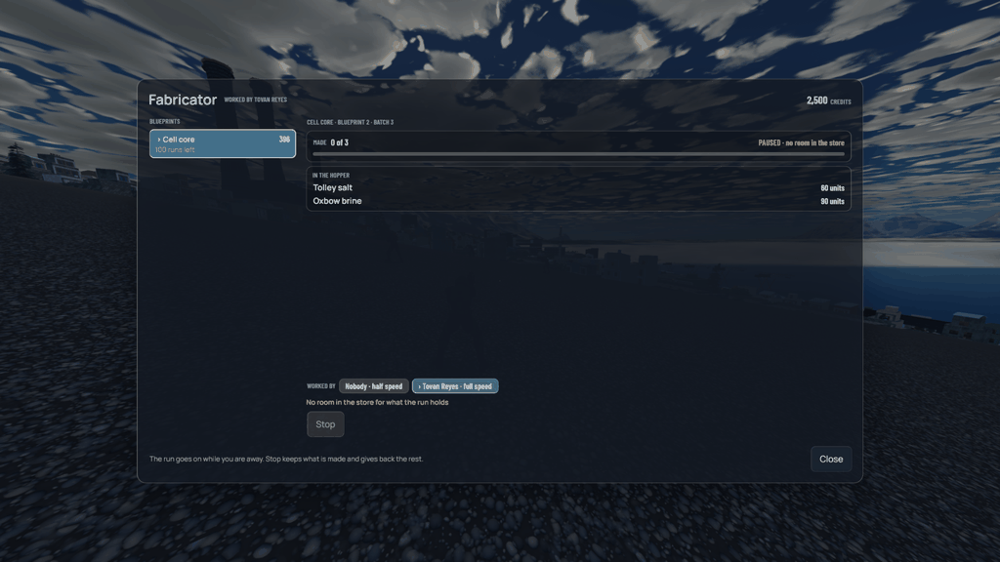
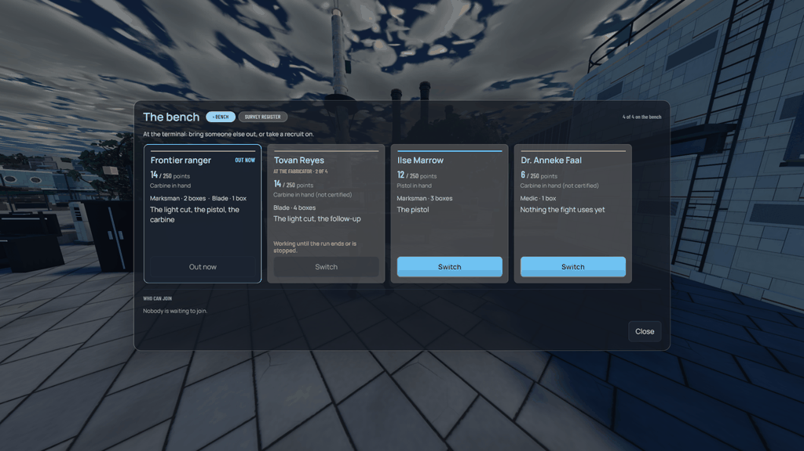
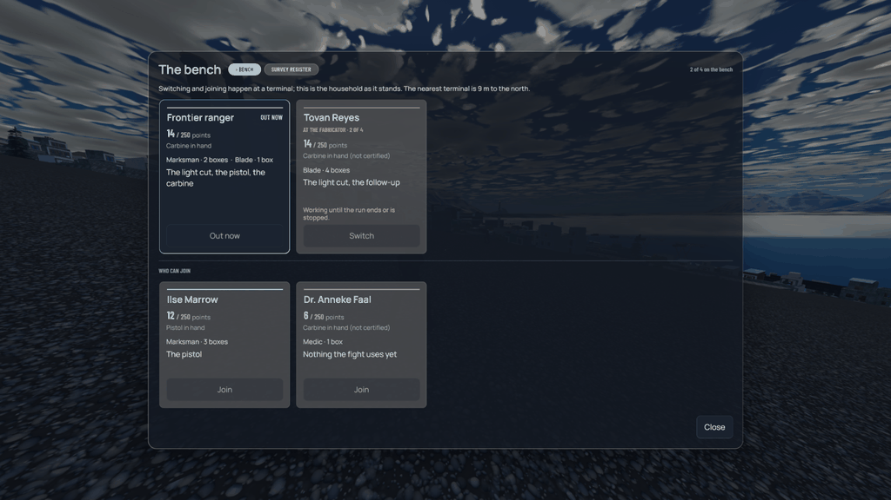
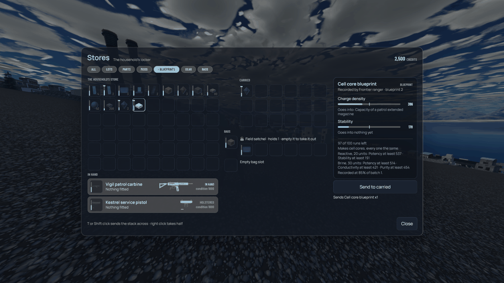
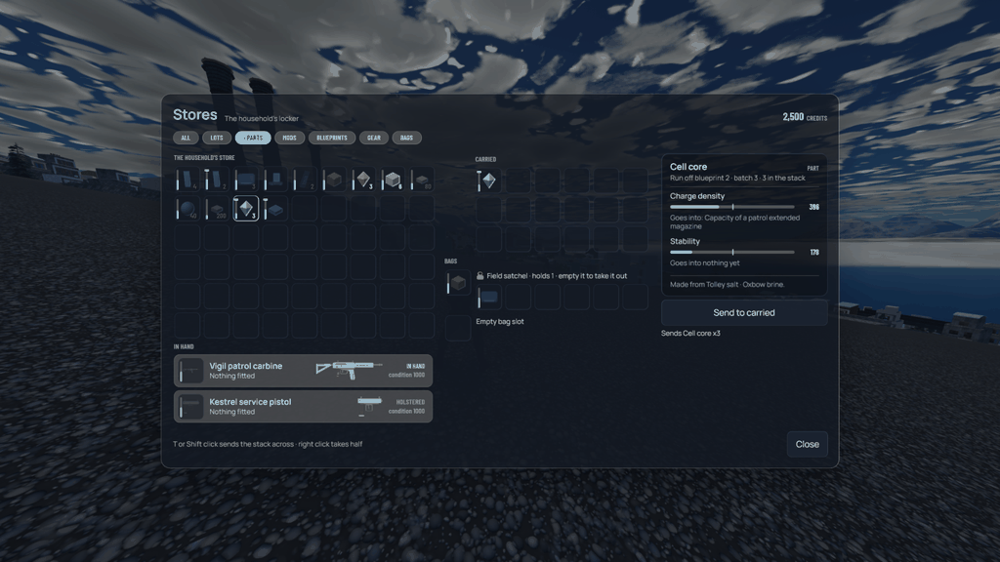
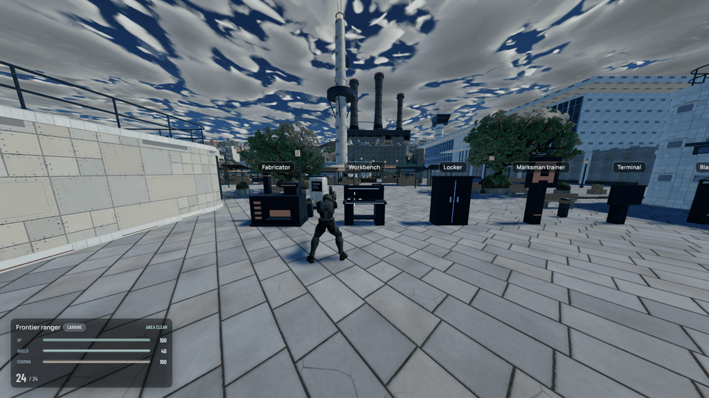
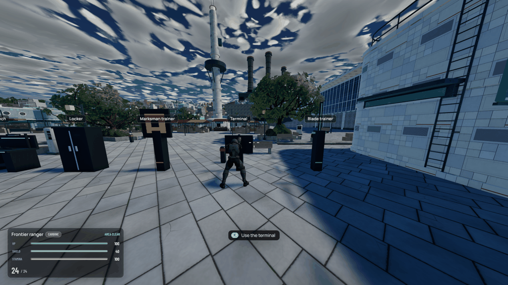
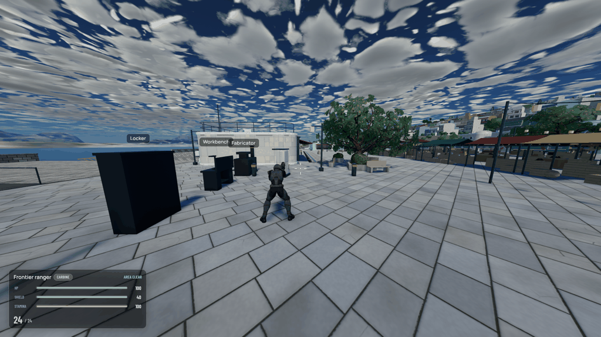
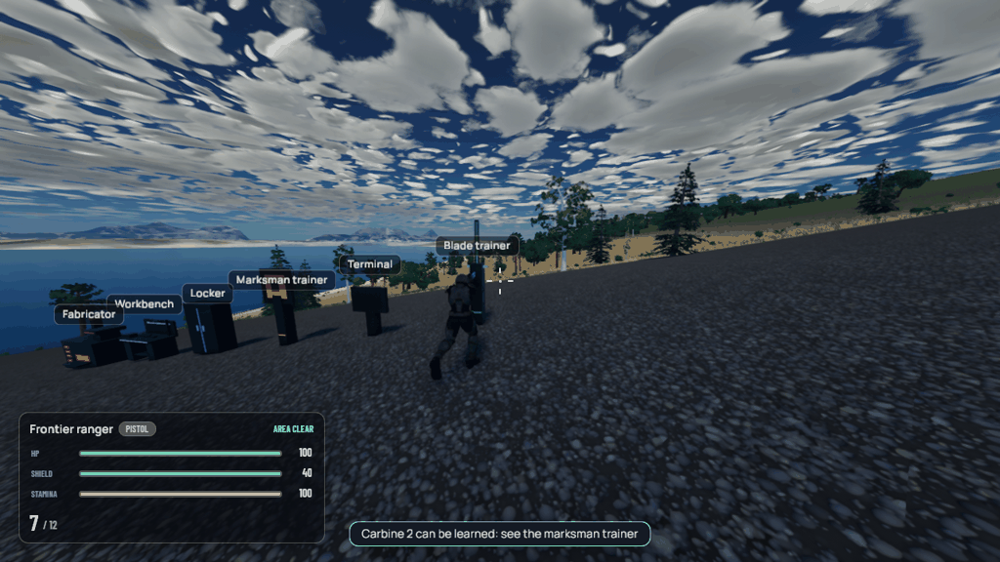

- **The factory's dials are data.** `assets/crafting/factory.ron`
  (`strata_registry::schematic::FactoryRules`, in no version): the
  derating a blueprint may be recorded at (0.70 to 1.00 by 0.05), the runs
  it starts with by complexity (100, 50, 25), twelve played seconds a unit
  a point of complexity with a worker on it, and half that rate with
  nobody. A blueprint is one item, `veyra:blueprint.production` (kind
  `Blueprint`, a stack of one), and the cell core now stacks to a hundred.
- **A blueprint copies exactly and asks for a minimum**
  (`strata_sim::blueprint`, whole per-mille). Its lines are the
  prototype's times the derating; each slot records what the schematic's
  slot takes and, for every stat the schematic weighs there, the figure
  the prototype's input had times the derating as a floor, or where the
  schematic reads the stat as `Light` a ceiling eased the other way.
  `draft` is what the Record box shows and what `record` writes, so the
  two cannot differ, and `check_record` is every reason a recording is
  refused, in the request's order, asked by the screen for its grey
  button and by the request alike. Its body is in the household's ledger (`Blueprints`)
  under its item's batch number, so the patch gained no key and
  `items::{read, write}` are untouched. Recording is a `CraftRequest`
  consumed in the tick with a workbench in reach; it does not consume the
  prototype, and a prototype is recorded once.
- **A run is a standing job** (`strata_sim::factory`): Start, Assign and
  Stop are requests in the tick with a fabricator in reach. Every input
  for the whole batch and the blueprint's item are committed at Start or
  nothing is; a slot may be fed from several stacks that each meet it; a
  unit is made a stretch of played time with no roll, with the
  blueprint's lines exactly, the run's one batch number and the recorder
  as maker, into the household's store. A full store pauses the run and a
  cell freed resumes it; a run standing is a made unit waiting for room,
  so one read back from a save (the pause is saved, the clock is not) has
  its unit still and goes on at the first tick with room. Stop keeps what is made, gives the unspent
  inputs and the blueprint back to the store, and is refused when they
  will not fit. One job a household, saved with it (version 5; a version
  4 file loads with no blueprint and no job and is kept as `.v4.bak`).
- **Played time is played time at any tick rate.** The dials are held to
  the nominal twenty ticks a second, and combat play steps the sim at
  sixty, so the run counts a step down to nominal ticks
  (`factory::nominal_ticks`). Before that a unit took a third of the time
  its screen promised in the game; a sim test and the walk hold it now.
  What the clock has over a unit when one is made goes toward the next,
  so a batch takes the ticks `seconds` and `left` say at any unattended
  share: at 0.7 of the worked rate seven cores are 2,400 ticks, where a
  clock begun again at each unit took 2,401.
- **Record as blueprint** is on the crafting tab's finished card
  (`ui::crafting`): the button opens a box in place with the derating as
  slotted's slider, and as it moves the lines the blueprint would make,
  the minimum each slot would ask and the runs it would start with are
  written where they stand, so a drag is not cut by a rebuild
  (`write_record`). A thing made earlier and still in the stock is listed
  under the schematics (MADE EARLIER) while the ledger knows what went
  into it; its row shows its finished card again and it is recorded the
  same way. What cannot be recorded has the button grey with the sim's
  reason over it.
- **The factory** (`ui::factory`, kind `strata:factory`) is a
  fabricator's F: the blueprints the stock holds at the left with their
  lead line and runs left; at the right the one picked, its batch between
  the buttons that change it with the line that says what holds it, each
  slot saying what it needs with the stock that fits it listed, the kinds
  that meet it first and marked (MEETS, or FEEDS once picked), every kind
  that does not dimmed in place with the figure it fails on and what is
  asked, Cheapest stock, what the run would make and when, who works it,
  and Run with the sim's reason over it when it is grey. With a run on the
  same screen shows how many of the batch are made on a bar, the time
  left (written in place a second at a time), the worker, what is in the
  hopper, PAUSED and why, and Stop. Every figure and reason is asked of
  the sim: `feeds`, `cheapest`, `limit`, `check_start`, `seconds`, `left`,
  `can_stop`, `blueprint::held`.
- **The worker** is a benched member picked on the factory screen, before
  the run or while it is on. The game refuses a switch to them, and the
  bench screen says so on their card (`AT THE FABRICATOR · 2 OF 4`) with
  Switch grey and the reason over it. With nobody the run goes at half
  speed.
- **A finished run is a toast wherever the player is**
  (`factory::toast_notices`): how many of what are in the store and under
  which batch, and that the blueprint is spent when it is. A run that
  stands for want of room is toasted too, and one that goes on again.
- **The card.** A blueprint's card is named for what it makes and says
  who recorded it and under what number, the lines every run has as the
  product's own card draws them, the runs left, and on the long card what
  each slot needs and what it was recorded from. A factory stack's
  provenance line is `Run off blueprint 2 · batch 3 · 3 in the stack`.
  The stores gain a Blueprints chip after Mods, and the line under Send
  names a blueprint as its card does (`Sends Cell core blueprint x1`), by
  `card::stack_name` reading the household's ledger.
- **The fabricator** is a prop one spacing past the workbench at both
  bench places (`InteractionKind::Fabricator`): a machine's body deeper
  than its neighbours with a hopper on its top, a lit mouth over a tray,
  a gauge of four segments and a stack to above head height, in red.
- **The walk.** `--script-crafting` records its second core at 100
  percent, starts a batch of three at the fabricator with nobody on it,
  goes on to the post, the locker and the terminal, and reads the run
  when it has finished. Stills: `--open-factory`; `--crafting-state
  record` with `--record-derate`; and to set a fresh household up for
  them `--record-first [percent]` (with `--craft-first`), `--factory-run
  [n]`, `--factory-worker`, `--factory-finish`, `--factory-full-store`
  (the store filled once the run has started, for the pause),
  `--factory-poor-lot` and `--join-all` (everyone who can joins the
  bench), each refused on the default `--household`. `--at terminal`
  starts within reach of the city's terminal, where `--open-bench` opens
  the bench live as its F does, and `--stores-pin n` pins a later stack
  of `--stores-filter`'s.

Measured on a fresh household at seed 42 (release):

| | Lines | Reactive, 20 units | Brine, 30 units |
| --- | --- | --- | --- |
| The walk's second core (batch 3) at 100% | 513, 209 | Potency 632, Stability 225 | Potency 605, Conductivity 495, Purity 534 |
| The same at 85% | 436, 178 | Potency 537, Stability 191 | Potency 514, Conductivity 421, Purity 454 |
| A first core (466, 209) at 85%, the stills' | 396, 178 | Potency 537, Stability 191 | Potency 514, Conductivity 421, Purity 454 |

Every first-day lot meets its own blueprint at any derating, since the
minimums are read off them. The lot the factory's still refuses is drawn
from another deposit near the spawn (Embry salt, Potency 338 against 537).
After one core the stock feeds a batch of four, held by the brine (130
units at 30 a unit). The walk's batch of three with nobody on it took 72.0
s of play and left one stack of three cores of batch 5 at 513 and 209 and
the blueprint with 97 of 100 runs; a batch of three with a worker took 36
s, timed in the window. A batch of twenty is four minutes with a worker
and eight with nobody; a hundred is twenty and forty.

The step's bar is two sim tests, `a_hundred_identical_cores` (one stack
of a hundred of one batch, the first compared whole with the blueprint's
unit) and `a_lot_under_the_minimum_is_refused_with_its_number`. Beside
them: `a_paused_run_read_back_from_a_save_goes_on_when_there_is_room`,
`a_share_that_does_not_divide_a_unit_loses_nothing` and, for the
recording, `the_check_and_the_request_give_one_answer`.

Presses, from the fabricator's F with no mouse: three to a run started (F,
Accept on the blueprint, Accept on Run), counted by a UI test
(`a_run_is_started_and_stopped_by_keys_alone`). Recording by the keys is
Tab to Record as blueprint, Accept, Left a step of the derating, Tab to
Record, Accept (`a_blueprint_is_recorded_by_keys_alone`).

What the user would have been asked, decided for them and easy to change:

- **A blueprint's body is in a household ledger**, keyed by its item's
  batch number, and one counter numbers batches and blueprints.
- **A prototype is recorded once**, so a blueprint stays finite, and a
  fabricator's copy is never a prototype.
- **Cheapest is what clears the minimums by least**, so the best stock is
  kept for hand work. The factory opens with it in the slots, and the
  slots follow the batch as it changes until a row is picked by hand;
  Cheapest stock puts the sim's choice back.
- **The batch opens at twenty or the most there is**, and steps by one
  and ten with a Most button. A press that would change nothing is grey.
- **The run holds the blueprint** and hands it back to the store, never
  to the pack it came from; a spent one is gone, and its body stays in
  the ledger so its copies can still name it.
- **A run's batch number is taken at Start**, so one stopped before its
  first unit leaves a number with nothing behind it.
- **Progress inside a unit is not saved**: a restart begins the unit
  under way again (up to 24 s). A run that was standing for want of room
  is the exception, since its unit was made: it is not made twice over.
- **A worker who is out or off the bench at load is taken off the run**,
  which goes on unattended, with the file as it was kept as `.mended.bak`.
- **MADE EARLIER stands under the schematics**, not under the buttons as
  the build design had it: the acting buttons stay at the foot of the
  right column in every state, which a step 4 test holds.
- **The factory's Run leads the keyboard back to the blueprint's row**,
  not to Stop, which stands where Run did: a second Accept does not undo
  the first.
- **The city's bench place moved two spacings along its row**, toward the
  blade trainer's end: every prop of steps 1 to 4 on the Exchange moved
  with it, the terminal, both trainers, the locker and the workbench.
  With six props its far end stood inside the wall that closes the
  Exchange square on that side; `--at bench` now stands before the
  workbench and the fabricator. The stills show both ends: the blade
  trainer on the open paving a couple of metres short of the round
  building, the fabricator clear of the curved wall.
- **The slider's unlit track is a light wash** (`slider` and
  `slider.focus` in the theme, `#FFFFFF1F` where the controls' dark well
  was): on the Record box the well could not be told from the ground and
  85 percent read as a full slider. It is every slider's track, the
  settings' too, and it is an edit to the copy of slotted's glass theme,
  which a fresh copy from that workspace would undo.
- **Record and Make another are both the lit button**, as the mockup has
  them (its `btn sm pri` in the box, its `btn pri` under it).
- **The first-day line names the fabricator**: "A terminal, two trainers,
  a locker, a workbench and a fabricator stand behind you; the hostiles
  are ahead."
- **Three toasts, not one**: a finish, a pause for want of room, and the
  run going on again.
- **Away from a fabricator the screen is a reading** of what the
  character carries, as the workbench's tabs are: a carried blueprint is
  listed, the store's lots are not, and Run says to step up to one.
- The words: "Recorded already as blueprint 4", "Run off blueprint 4: a
  copy is no prototype", "Nobody remembers what went into it", "Up to 4 ·
  the Brine in stock feeds 4", "The Reactive in stock does not feed one",
  "No room in the store for what the run holds", "Working until the run
  ends or is stopped."

Left rough, for a later step:

- Anyone records and anyone runs until the Weaponsmith and Fabricator
  trees of step 9. No power, no selling a blueprint, no queue, no second
  fabricator, nothing going wrong on a job, no catching up on time the
  game was closed.
- The staging bench place lies along a ten degree slope, three metres
  from the blade trainer down to the fabricator, each prop on its own
  ground (seen in the walk's still). It reads as a row; a level pad
  would read as a place.
- On the Exchange one of the city's own bollards stands at the
  fabricator's back corner, by the gap to the workbench, and a kiosk two
  metres behind it. Neither is in the way of its front.
- The slider's track stops short of the box's right edge, where slotted
  keeps room for a readout the box does not use.
- The game still words two bench refusals itself ("not while fighting",
  "not at a terminal"), as before this step; the working member's is in
  `ui/strings.rs` (`strata.bench.refused.working`) and filled in by the
  game.
- Room for the blueprint's item is the one refusal of a recording the
  screen does not know before Record is pressed: `check_record` reads
  the stock and does not put anything away.
- The factory's still with a run on has four in its batch: a first day's
  stock feeds no more.
- A blueprint's lines are figures, not the game's units, on the Record
  box and the factory's rows; its card says where a part's line goes.
- The factory lists every kind in a slot's list at once and scrolls when
  there are many; it has no filter.
- A plural is the English rule in `strings::counted` (an `s`, or `es`
  after a sibilant).

What slotted lacked this time, each worked round in the game:

| Gap | Done in the game instead |
| --- | --- |
| A slider on a screen that is replaced when its view changes loses its drag with the node | The box's words are written in place on `ValueChanged`, and a view that differs only in them is no cause for a rebuild |
| A slider's row keeps its readout's width with an empty format | Nothing; the line over the slider says the figure in words |
| A value that changes every second (a time left) has no binding of its own on a screen built from a definition | The one text is written in place, and a view that differs only in it is not rebuilt |
| A disabled `Card` is a stop for focus but raises nothing that says why | The reason is the row's own second line |

### Step 6: wear, kits, repair (2026-10-11)

Stills, 1280x720: `docs/design/crafting/step6-fitting.png` (`--open-fitting
--condition 180`: the bar, "180 of 1000", WORN, Repair with its price, the
warm line), `step6-hud.png` (`--condition 180 --no-hostiles`: the bar and
the CARBINE WORN chip under the magazine), `step6-kit.png` (`--open-stores
--stores-filter kits --stores-pin 0`: the kit's card).

What was built:

- `assets/crafting/wear.ron` is `WearRules` (`ItemCatalogue::wear()`): the
  slide threshold, the costs of a shot, a cut and a fall, the durability
  scale, the step, the `worst` factors and the field repair. A `worst` entry
  on a property the fight has no number for is refused.
- `ItemKind::Kit`, `veyra:kit.field_repair` (a `restore` line), two in the
  first day's store, and a schematic for it. A module may carry a condition
  and so may `Fitted`; both are optional and skipped when absent, so no save
  version moved and a version 5 file loads byte for byte.
- `strata_sim::wear`: `slide`, `band`, `cost`, `field_amount`, `can_repair`,
  `repair`, `WearCarry`, `WearNotice`, `WearRequest::Repair`. The effect joins
  the loadout in `fitting::factors` and nowhere else.
- The client: the fitting header's bar and word, Repair and its reason, the
  HUD bar and chip, the kit's card, a Kits chip, `--condition <n>`.
  `tools/balance` takes `--condition` and `--b-condition`.

Measured: the carbine's repeat interval and reload are the table's exactly at
condition 1000 and 250, and 1.25 times it exactly at 0 (0.30 s and 1.6875 s).
A store-grade carbine takes 375 shots from 1000 to 250, and the first step
of 25 lands on the 13th shot. A store-grade kit mends 700 in the field and
everything at a workbench. In the harness a carbine at 0 fires fewer rounds
in the same bout than a bare one; at 250 it fires the same.

What the user would have been asked, decided for them and easy to change:

- The wear is wholly the dials in `wear.ron`; none was playtested.
- A swing costs once per attack sequence, not per contact tick.
- A fall knocks every carried weapon and module, a module never worn
  reading full, and the stack on the cursor too.
- The HUD names the weapon TIRED from `show_below` and WORN under
  `slide_below`, so the bar is never bare.
- The tick runs in `SimSet::Observe` to see falls physics resolved.

Left rough, for a later step:

- No block or parry wear, tools, armour, Repair skill boxes or timed repair.
- `WearCarry` is per hand and unsaved: under one step is lost on exit, and
  swapping a weapon in leaves the previous one's remainder on the new.
- An upgraded v1 to v3 household gets no kits; a version 5 file gets none
  either, so that player crafts the first.
- The fitting table shows slid figures in NOW and BARE alike; it does not
  say what a repair buys.
- The Worn sentence sits under the buttons, not beside the condition.
- Repair has no skill box: everyone repairs until step 9.

### Step 7: Pelagic's board, the first income (2026-10-11)

Stills, 1280x720: `docs/design/crafting/step7-board.png` (`--open-board
--board-stock`: 40 of 100 cores offered at 5,875 cr, the light alloy rows
not met at 298), `step7-sold.png` (`--board-sell` too: the row filled, the
purse 8,375, SOLD HERE with its entry), `step7-prop.png` (`--at board
--no-hostiles`: the board on the Exchange with its label).

What was built:

- `assets/procurement/pelagic_works.buyer.ron` and
  `strata_registry::procurement` (`BuyerSet`, checked at load), in no
  version.
- `strata_sim::procurement`: the pure rules, `ProcurementRequest::Sell`,
  `SaleAnswer`, `ProcurementState` (saved, serde default, no version change),
  the upkeep refill on played time, `InteractionKind::Board` and `Reach.board`.
- The client's `ui::board`, the prop at +2 spacings, four stills flags.
- `--script-crafting` walks to the board and sells its three run cores.

Measured: the run's cores carry charge density 513 (min stays 500) and
paid 364 cr for 3; 40 cores at 724 pay 5,875 cr (146.88 a unit). Tests:
registry 91, sim 171, client 148 + 96, game 63, balance 17 + 1 + 3 + 2.

What the user would have been asked, decided for them and easy to change:

- Pelagic's prices, minimums, premium and refill dials are guesses.
- A worn thing is not graded at its made figure, so it is not wanted.
- A repeat sale of a kind merges into its ledger entry and moves it last.
- The city row shift is now 1 spacing so the board and the fabricator are
  both on open paving.

Left rough, for a later step:

- The sale pays a rounded-down whole at the count, and the button sells the
  best offer only; there is no choice of amount.
- The filled row still quotes "pays" for what is held.
- `a_sale_survives_a_save_and_a_reload` writes its state by hand; the script
  test covers the real path.
- The first day's lot (Strength 298) meets no metal line, so no still shows
  a lot row that can sell (a test does).
- The reason sits under the grey button, not beside it.

### Step 8, first half: the real weapon in the hand (2026-10-11)

Stills: `docs/design/crafting/step8-hand.png` (bare carbine, close boom),
`step8-scope.png` (`--fitted veyra:module.vigil_reflex`, a dark box on the
rear rail), `step8-wide.png` (default camera). The shoulder camera only sees
the gun from behind and in shade, so the Vigil shell reads blue; the pistol
and the flash were seen under `--combat-script` (`scratch/crafting/s8-pistol.png`,
`s8-fire.png`: the slide in the fist, the flash at its front, no old cube).

Built: `veyra_weapons::model::muzzle_tip`; `content::weapon_models` (113 props
for 12 chassis, 115,712 triangles, 8,494 kB, 764 ms in the release bake; the
patrol carbine's 18 props are 1.77 MB, chassis 261 kB); the index
`strata_registry::models`; a plain weapon material library per maker;
`strata_client::weapon_model` and `combat_art::{dress_weapons, settle_models,
hide_old_art}`; `--orbit-distance`. A rebuild happens only when the wanted
piece set differs, so wear does not rebuild. A model that is still loading
stands beside the old one and takes over when every piece has spawned; a
failed piece throws it away and keeps the old art. The model wears no body
tint. Muzzle tip of the carbine: recipe (0, 0.071, 0.49), the compensator
0.509; the bore sits about 4 cm nearer the top than the old rifle's.

Tests: registry models 3, veyra-weapons muzzle 1, content weapons +3, client
weapon_model 5. combat_art has no app-level test; the stills carry that.

What the user would have been asked, decided for them and easy to change:

- The palm offset `PALM = (0, 0.02, 0.03)` and the true-size scale (the old
  art was drawn 0.9 and chunkier).
- The weapon colours and roughness in the `tools/content` table.
- The baked weapon wears no household tint.

Left rough, for a later step:

- The turning model inside the fitting screen is the second half of step 8.
- The grip fit was tuned by eye from side views taken with a camera hack since
  removed; the shoulder stills cannot show the hand.
- No muzzle module has an item file, so the fitted-muzzle tip is only tested
  with a synthetic piece.
- Weapons on opponents and remote players, and finishes other than Issued.
- `write_materials` also leaves an empty `graphs.ron` beside the library.

### Step 9, first half: the smith, a made carbine, a weapon taken in hand (2026-10-11)

Stills: `docs/design/crafting/step9-crafting.png` (`--as "Tovan Reyes"
--crafting-state hand`: the carbine in the bench hand, 9 points, its three
lines with the shots and the mounts they are worth), `step9-gate.png` (the arrival, pick state: the lines and the grey
Assemble with "Needs Weaponsmith: Frames 1."), `step9-fitting.png`
(`--crafted-carbine 650 --open-fitting muzzle`: 5 of 6 mounts open, the vented
muzzle offered).

Built: the Weaponsmith elite (98 points, `CraftPoints` on tuning 1 to 4);
the profession gate and `crafting::points`; a weapon as a product, made whole;
`strata_sim::equip` and the client's Take in hand; `--script-crafting` as
Tovan with two new acts; `--as`, `--crafted-carbine`; the compensator item.
Review fix: a recorded carbine was a dead blueprint (no condition, so `Stale`
for ever); `Blueprint::unit` now takes the catalogue and shares
`made_condition`, with a test. Also the bench hand reads a weapon's lines.

Measured, and the recipe changed for it. As first built the moddability
line read the frame's Hardness (0.6) and Workability (0.4), and of the 48
structural metal deposits within 8 km of Port Serein only two could reach the
600 that opens the muzzle. Light alloy is workable and soft, ferrous ore hard
and stiff, so that pair of figures is rarely high together. The line now reads
Hardness (0.6) and Strength (0.4), the design's "rigidity": 13 of the 48 reach
600, the nearest (Lackey ferrous ore, ceiling 683) 2 km from the city, and
none reaches the fore end's 800, which stays the far find.
`platform_metal_is_within_a_walk_of_the_city` in `strata-worldgen`'s deposit
tests holds the shipped world to that, from the schematic's own weights.

The first day's Rake light alloy (Hardness 231, Strength 298) gives a ceiling
of 258: 3 of 6 mounts open against a bought one's 4, and 284 to 314 shots
against 375. So the first carbine a household makes is a rough build, and the
done-when (more open mounts than a bought one) is met in play only with
surveyed ferrous ore; the sim test with a ferrous lot (Hardness 800, Strength
700, ceiling 760) gets 5 or 6 open against 4. The script's carbine is batch 6
from the first day's alloy.
Tovan ends with 16 boxes, 60 of 250 points; his prerequisites also certify
him for the pistol and carbine (he now shoots both, reload times 0.85).

What the user would have been asked, decided for them and easy to change:

- The prerequisites (four boxes) and the dropped Blade either-or.
- Tovan as the smith, with Fabrication 900 XP.
- The carbine's line weights and 80 units of frame.
- Take in hand is shown for modules too, grey.

Left rough, for a later step:

- The bench hand's Action line carries no "not in the fight yet" mark.
- Pick stage shows no points line; the smith's extra point shows after Assemble.
- An untaught row says "Stock is short" until selected; the harness card's
  "Goes into" now names the carbine's Action (not in the fight yet).
- Take in hand grows the right column and moves the cells; after a Take the
  stores screen is rebuilt and the focus is lost.
- The UI tests' first day omits the vented muzzle.
- A saved session's point cap is the dials plus every `CraftPoints` box.
- Rework, crafting XP and a trainer for the Weaponsmith are the second half.

### Step 10: spread (2026-10-11)

Stills: `docs/design/crafting/step10-fitting.png` (the reflex sight fitted:
Aimed spread 0.33° against 0.35° bare in the main table, "not in the
fight yet" lists Recoil alone) and `step10-reticle.png` (the hip's cone as
the reticle's gap: bars 18 px out at 720p and the default 45° field of
view; made with an empty config dir, as the user's saved fov of 100 puts
the carbine's cone, 6.3 px, under the old 10 px gap).

Bands, before (spread numbers at 0, bit-identical to the old fight) and
after: fair-duel-length 1.75 and 1.75; pistol-rate-share 0.95 and 0.95;
blade-closes-on-carbine 0.00 and 0.00; dodge-earns-its-stamina 0.00 and
0.00; chain-lands 1.00 and 1.00; cuts-3-lands-the-heavy 1.00 and 1.00;
blade-master-beats-novice 1.00 and 1.00. No band edited; hip numbers
needed no tuning (carbine 1.2, pistol 1.6; aimed 0.35 and 0.6).

Built: `spread` and `aim_spread` on `WeaponSpec` (weapons.ron version 2, so
the handshake's table version moved); `combat::deviate`, `shot_draw`
(`strata_core::splitmix64`), `Combatant::cone`/`cone_when`, `shot_salt`;
`resolve_attacks` turns every unblocked bolt; `Property::AimSpread` live,
`Unit::Degrees`; `combat_hud::cone_gap`; the two presets and the band.

Measured: the new band reads 1.02 (sighted over unsighted dealt per
second, 20 bouts, seed 1; low 1.005, high 1.15). Over 200 bouts 5.36 s to
kill against 5.23 s. A dead sight reads exactly 1.00 and fails. Across
aim_spread 0.30 to 0.50 the ratio stays above 1.00 (1.002 to 1.05).

What the user would have been asked, decided for them and easy to change:
- The pair stands at 120 m, not the brief's 40 m: at 40 m, 60 to 95 m the
  cone sits inside the dummy or the effect is a step of one bolt. Names
  say 120m. Bolts reach about 120 to 150 m; 160 m never lands.
- A sighted gain of 2 percent in time to kill is small: the sight is 6
  percent on a cone, the dummy is a strip, and the sight costs 0.01 s draw.
- Each balance bout salts the shot count from its seed (`shot_salt`), so
  twenty bouts sample the cone; in play the salt is 0.
- The row reads "Aimed spread"; the hip's 1.2° is on no screen.

Left rough, for a later step:
- The hip cone is exercised by no policy or AI (every harness shooter
  aims); only the physics test (50 shots, aimed against hip) holds it, and
  no band measures the hip numbers.
- At a field of view of 100 the old floor hides the carbine's cone at
  every window size; lower the floor if the user wants it shown.
- The aiming reticle was not shot. Recoil, heat and bracing stay out.

### Step 9, second half: rework, crafting XP, the bench that teaches (2026-10-11)

Stills: `docs/design/crafting/step9b-rework.png` (Tovan at the stock mount of a
carbine at moddability 380: Rework and Buy blank live, "Most often to 470,
between 410 and 500"), `step9b-reworked.png` (after one rework: 410, the stock
mount open, "The stock mount is open." in the toast) and `step9b-sheet.png`
(the Weaponsmith tree at the workbench: Edges 1 and Tuning 2 read Learn here).

Built:

- `assets/crafting/rework.ron` (the blank, its line, the weapon's line, the
  box `weaponsmith.frames.2`, the share of the gap per outcome) and the blank
  (`veyra:component.mount_blank`, 150, store grade 500) with its schematic.
- `strata_sim::rework`: `check_rework` (bench, box, weapon, blank, gain),
  `best_blank`, `ReworkRequest::Rework`, `ReworkAnswer`. One roll on the steady
  base row; one blank goes whatever comes; a refusal changes nothing.
- Crafting XP: `craft_xp` on a finished bench session, to the maker only, plus
  `rates.craft.rework`; `CraftState.bests` keys "<schematic>#<line>".
- `TreeDef::bench`: the bench teaches `fabricator` and `weaponsmith`
  (`Reach::teaches`); `TreeDef::in_game` lets the sheet offer a bench tree.
- The fitting screen's Rework and Buy blank with one caption in a box of fixed
  height; the crafting gate's "It can be learned at this bench: close this
  screen and press C."

Measured: a scripted carbine at 258 reworked by a Good to 439 with one blank
(stock mount open, 4 of 6), purse 150 lower, counter 19 to 20; credits 190,
230, 90, 310 and 60 for the core, magazine, second core, carbine and rework;
Tovan's saved Fabrication XP is 900 + 880 = 1780. The saved sheet is the live
one (`track_sheet` copies it on every change), so a switch loses nothing.

What the user would have been asked, decided for them and easy to change:

- The rework shares (1000, 750, 500, 250, 0), the rates (40, 80, 160; first
  150; best 50; rework 60) and the blank's price are data.
- Only the maker earns XP for a batch; another's Finish earns nothing.
- Fabricator is offered on the sheet because a bench teaches it, though its
  boxes have no effects yet and the tree is still marked a placeholder.

Left rough, for a later step:

- The character sheet opens only over the world, so the gate's hint sends the
  player out of the workbench screen to press C; opening it from there is later.
- The sim's `NotTaught` words are composed in the sim, not by the client.
- No dedicated test that a factory unit earns nothing; the script's credit
  list covers it. The still tool opens the sheet on the character's own tree,
  so the arrival at the bench is not shown.
- The caption box scrolls inside itself when a reason runs to a fourth line.

### Step 11: the base made rough (2026-10-11)

The user: "I'm ok making the base weapons quite a bit worse, will reward
crafting/optimization". Stills: `docs/design/crafting/step11-fitting.png`
(reflex sight fitted: Shot every 0.264 s in NOW and BARE, Aimed spread 0.63°
against 0.90°) and `step11-crafting.png` (the carbine's Action line reads
"0.279 to 0.258 s a shot", the "not in the fight yet" mark gone).

Changed: the cones, the reflex's factor, fitting.ron's bands, and a weapon's
own `signature` line (the patrol carbine's `interval`, 1.30 at 0 to 0.90 at
1000 of the table's). `fitting::factors` adds it; `WeaponMeans::Row` words it;
`balance --line`/`--b-line`; five presets; four new chosen: false bands.

Measured (release harness, 20 bouts, seed 1):

| Band | Before | After | Band after |
| --- | --- | --- | --- |
| fair-duel-length (s) | 1.75 | 1.75 | 1.40 to 2.10 |
| pistol-rate-share | 0.95 | 0.95 | 0.76 to 1.14 |
| blade-closes-on-carbine | 0.00 | 0.00 | 0.00 to 0.10 |
| a-sight-tightens-aimed-fire | 1.02 (120 m) | 1.29 (55 m) | 1.05 to 1.60 |
| a-bought-carbine-is-slower | none | 0.94 | 0.75 to 0.98 |
| a-made-carbine-is-faster | none | 1.12 | 1.02 to 1.40 |
| a-fine-sight-beats-a-store-sight | none | 1.08 | 1.01 to 1.30 |

The four chosen: true bands are unedited and hold (0.00, 1.00, 1.00, 1.00).
Against the dummy at 12 m: table 1.81 s to kill, bought 1.92 s (0.94 a
second), made at 900 1.73 s. At 55 m: no sight 4.55 s, store sight 3.44 s,
sight at 900 3.18 s; landed shares with damage 1 (nothing left in flight)
0.54, 0.82, 0.96. Carbine against carbine does not move (record-less sides).

What the user would have been asked, decided for them and easy to change:
- Cones 2.4/0.9 and 2.8/1.3: `assets/combat/weapons.ron` (version 3).
- Reflex AimSpread 0.70: `assets/items/vigil_reflex.item.ron` and
  `veyra_weapons::MODULES`; the 802-assembly bound moved 0.65 to 0.60.
- Bands 0.4 + 1.2q and 1.5 - 1.0q: `assets/crafting/fitting.ron`.
- Signature 1.30 to 0.90: `assets/items/patrol_carbine.item.ron`; the
  pistol has none until it can be made.
- Trio stand of 55 m: `tools/balance/src/lib.rs`.

Left rough, for a later step:
- No schematic makes a sight, so a fine sight shows a banded part's
  quality only in the harness.
- The hip cone doubled (0.50 m radius at 12 m) and no band reads it.
- The crafting hand-stage Action words have no test of their own; a
  signature on a property other than the interval would read "a shot".

Follow-up the same day. Measured at the committed tables, the reflex sight
did nothing at the encounter's ranges (an aimed cone of 0.9 degrees landed
every bolt) and no carbine could be made past about 700, because a harness
could only be bought at 500. Now: `weapons.ron` version 4, carbine 4.0 hip and
2.0 aimed, pistol 4.4 and 2.4 (the reflex sight's 0.70 gives 1.40 against
2.00, `step11-fitting.png`); `assets/schematics/harness.schematic.ron`
(15 units of a conductor, conductance from Conductivity 0.8 and Purity 0.2, so
Conductivity 900 and Purity 800 make 880 and with a frame of Stability 800
the Action's ceiling is 840; `step11b-harness.png`); the made-carbine preset
uses 800, which a smith can make, and the sight trio moved from 55 m to 27 m
(`-27m`), the sentry's range, where the unsighted bolts land 0.49 (0.76 with
the store sight, 0.90 with the 900 one, damage 1). The four chosen: true
bands are unedited and hold. The bands:

| Band | Before | After | Band after |
| --- | --- | --- | --- |
| fair-duel-length (s) | 1.75 | 1.76 | 1.40 to 2.10 |
| pistol-rate-share | 0.95 | 0.88 | 0.70 to 1.06 |
| a-bought-carbine-is-slower | 0.94 | 0.94 | 0.75 to 0.98 |
| a-made-carbine-is-faster | 1.12 (900) | 1.09 (800) | 1.02 to 1.31 |
| a-sight-tightens-aimed-fire | 1.29 (55 m) | 1.44 (27 m) | 1.15 to 1.73 |
| a-fine-sight-beats-a-store-sight | 1.08 (55 m) | 1.10 (27 m) | 1.01 to 1.32 |
| blade-closes-on-carbine | 0.00 | 0.00 | 0.00 to 0.10 |
| dodge-earns-its-stamina | 0.00 | 0.00 | 0.00 to 0.70 |
| chain-lands-on-a-standing-target | 1.00 | 1.00 | 0.90 to 1.00 |
| cuts-3-lands-the-heavy | 1.00 | 1.00 | 0.90 to 1.00 |
| blade-master-beats-novice | 1.00 | 1.00 | 0.80 to 1.00 |

Time to kill against the sentry: table carbine 2.49 s, bought 2.63 s, bought
with the store sight 2.13 s; at 27 m on the dummy 4.16 s, 2.80 s and 2.55 s
(none, store, 900).

### Step 8, second half: the turning model in the fitting screen (2026-10-11)

Stills (1280x720, `docs/design/crafting/`): `step8b-model.png` (reflex sight
fitted, side on, muzzle right), `step8b-preview.png` (nothing fitted, the
candidate sight on the rail before Fit), `step8b-diagram.png` (the flat diagram
under `--fitting-view diagram`). The no-screen world still was compared by eye
with `step8-side.png` (sky and ground only; a different spot).

Built: `ui/weapon_stage.rs`. `WeaponStage` holds a 1024x512 image; while a
fitting screen in Model is on top, one `Camera3d` (order -1, image target), a
key and a fill light without shadows and a turntable stand on `STAGE_LAYER`,
and all go when it leaves. The model is `weapon_model::stand`, swapped in by
`Pieces::standing`, the rule the hand shares. It turns once in 20 s, starts
side on, a drag turns it and the turn resumes after 3 s. `strata:weapon_model`
is a 2:1 `ImageNode` with the mount tag; the Diagram/Model button is in the
well's corner. The stage shows `fitting::staged_record`, which only calls
`strata_sim::fitting::preview`; a row that is gone shows the weapon as it is.

Camera sites: atmosphere is cut off by `NoSky` (every sky, exposure, look, fog,
rays and grade query keys on `SkyCamera` or a fog component). Marked
`strata_terrain::OffWorld` and filtered: water prepass (water.rs), probes
`bound_clusters`, `follow_camera`, `log_probes`, `read_lights` (also skips
lights off the default layer), foliage streaming, client `stats`, game
`settlement::ShadowCameras` and `household::props::label_props`. Combat, HUD,
orbit and fly queries are on markers the stage lacks. The UI picks the primary
window's camera, so no pin was needed. `leave_before_exit` despawns the stage
on `AppExit`: without it the game hung at exit (2 of 2), cause not found.

What the user would have been asked, decided for them and easy to change:
Model first; a scale a chassis clamped 1 to 2.4 (`scale_for`: kept while the
chassis is the same, so a part looked at does not resize the weapon, and brought
in only when a longer one would leave the frame); lighting and the turn rate are
named constants; the stage stands at y = 2000 m; the 2 MB image exists even
for a diagram-only session. The well is as wide as its column in both views and
the picture keeps its two to one inside it, so the switch is in the well's
corner either way.

Left rough, for a later step: F3 GPU spans mix the stage's passes with the
world's while a model is on show; the `read_lights` filter was never seen
live (the drag was, with a pointer under Xvfb: 120 px brought an end-on weapon
back side on); the four atmosphere span systems run for the stage camera; no
pistol was shot at the new scale and no muzzle part was looked at on a made
carbine; a failed piece load logs a warning and keeps the old model.

### What slotted lacks (step 1's list)

Each was worked round in the game, with no edit to slotted:

| Gap | Done in the game instead |
| --- | --- |
| A refused click emits no event and no reason | An observer asks the sim's `apply` on a copy of the mirror and words the answer at the slot |
| `UiAction::Secondary` does nothing on a slot; no quick-move without Shift | An observer makes Secondary a right click; a send button |
| The carried icon follows the mouse only; focus raises no tooltip | A "Carrying" line in the footer; the pinned card follows focus |
| No inventory or grid that grows; a disabled slot still draws | Bag grids declared at their maximum, unopened cells hidden and taken out of the Tab order |
| `OpenMenu.def` is fixed at open, though a slot's rule depends on state | The layout is derived again after every change |
| Popping a screen closes its menu, so a screen over inventories cannot be rebuilt | Built once; every changing word is written to its node |
| A closed menu's carried stack goes to `Dropped`, which nothing drains | The sim stows the cursor; the client clears its entries |
| No per-slot overlay hook | Pip and condition children added on `Changed<ItemView>` |
| No way to dim a slot's content | Alpha held each frame after slotted's render set |
| `TooltipCtx` cannot reach a game's own definitions; built-in parts cannot be removed singly | `CardPart` holds the registries and replaces `TooltipParts` whole |
| A tooltip has no placement option | Nothing; see step 2 |
| The tooltip's ground is 95 percent opaque | The raised card brings an opaque ground |
| A slot grid hands its `test_id` to every cell | Each grid sits in a panel that carries the id |
| `nav.*` links on a container apply to every child | None used; automatic navigation crosses by geometry |
| No stat bar with a tick | The `strata:quality_bar` widget |
| `Authority::submit` has no world access | Two queues under a mutex, drained on either side of slotted's sets |
| Each grid numbers its Tab stops from nought | Nothing yet |
| No amount-carrying click; no count formatter | Deferred; stacks cap at 20 |

## What slotted will probably need

To be confirmed in step 1, and built there under that repository's own
`just ci`:

- A stat bar with a range under it and one or two ticks on it. A custom
  widget in the game first; upstream if it holds.
- A tooltip part that can see a second stack, for the change against what
  is fitted.
- Taking an amount from a large stack by number. Right-click halves and
  drag-painting are the wrong idiom for 200 units of alloy.
- Counts past three digits in a slot's corner.
- The `viewport` feature under this game's renderer (render layers beside
  the atmosphere and fog passes). Only step 8 needs it.
- The `browser` feature, for "what is this good for" and "what makes
  this". Wanted, not scheduled.

## Before anything

Codex's package (`crates/veyra-weapons/`, `tools/weapon-workbench/`,
`docs/design/equipment/`, and its edits to `Cargo.toml`, `justfile` and
`README.md`) and the two crafting documents are uncommitted. Step 1 builds
on them, so they should be committed first.

## Open, for the user

1. **Fitting away from a workbench.** Proposed: readable anywhere, changed
   only at a workbench, as the bench is. The other choice is free
   refitting in the field.
2. **What a character carries.** Settled 2026-10-10 by the user: "a
   minecraft-ish approach, with the option to add storage bags to extend
   inventory". Each character carries a pack that is a grid of slots:
   click carries a stack, right-click halves it, shift-click sends it
   across, and like stacks merge. A bag is an item that, put in a bag
   slot, adds its own slots. Key I opens the pack anywhere. The household
   store stays large. This comes in with step 1.
3. **The flat diagram first.** Settled 2026-10-10: the drawing is baked
   from the weapon's own geometry by [ticket 0008](0008-weapon-pictures.md),
   so it is the real shape from step 2 on.
